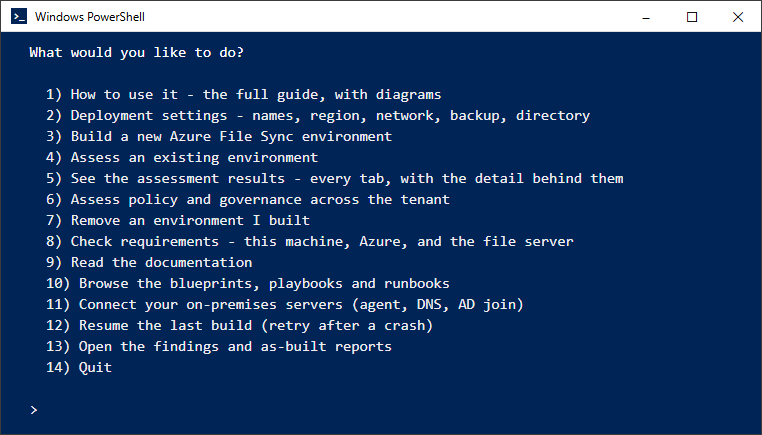
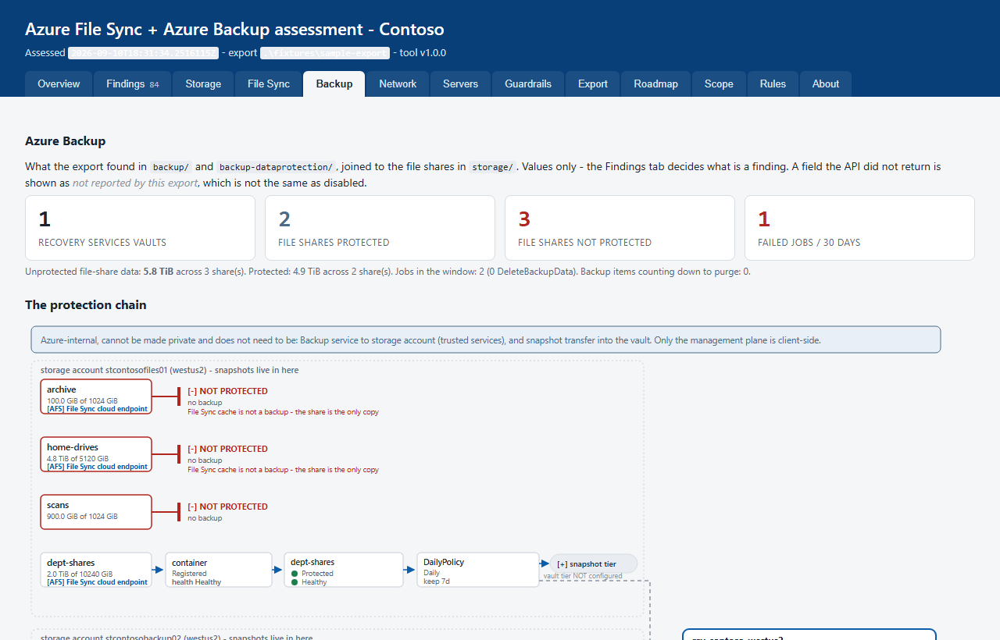
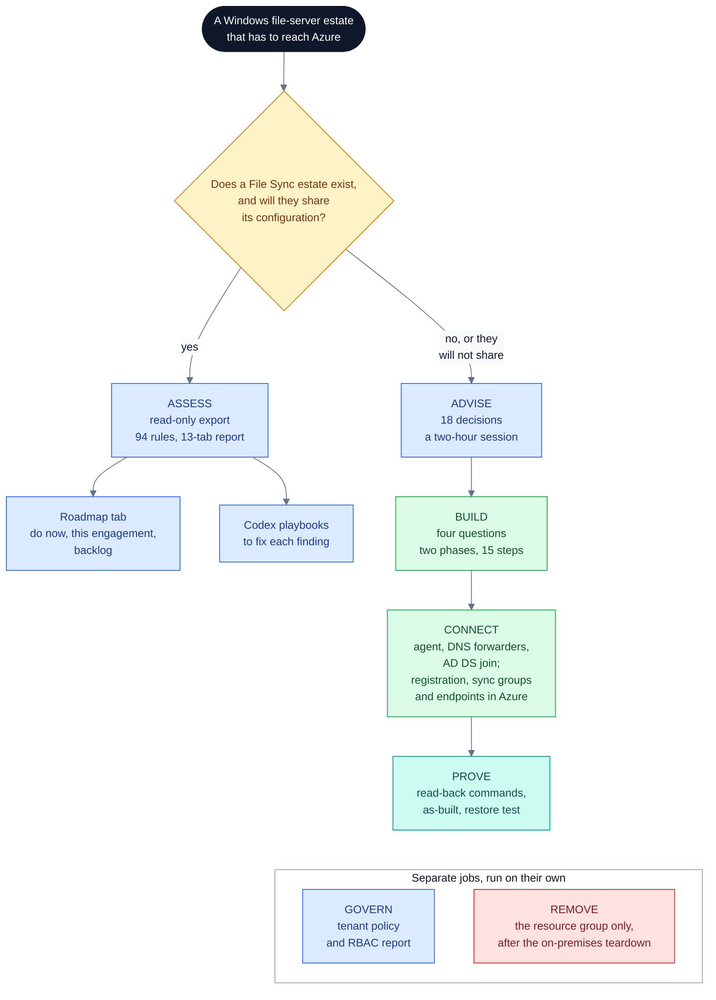
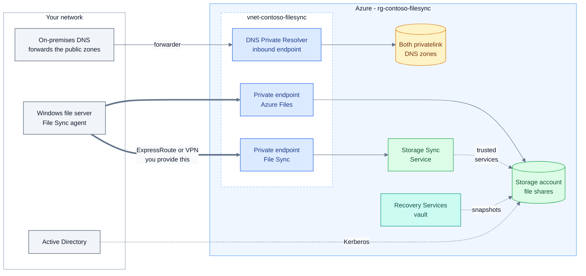

# Azure File Sync + Backup Kit

**Assess, design, build, connect and prove an Azure File Sync estate: Windows file servers syncing
to Azure file shares through private endpoints, with Azure Backup protecting the shares - from one
PowerShell menu.**

The kit is a guided wizard (`start.ps1`), eleven scripts you can also run on their own, and a
reference library. It reviews an estate that already exists, helps you design one with a customer
who will not share their configuration, builds one from four questions, connects your own servers to
it, and shows you - with a command and the answer to expect - that each piece works. **To use it,
read [the user guide](docs/USER-GUIDE.md)**: every option and script, what it asks, what it runs,
what you see when it worked, and what to do when it did not.

<p align="center">
  &nbsp;
  
</p>

**At a glance** (`V 2026.09.10.002`): 94 assessment rules, a 13-tab HTML report, a 15-step build, a 14-option menu, 25 blueprints, playbooks and runbooks, 97 diagrams and 195 tests that need no Azure account.

**On this page:** [Why teams use it](#why-teams-use-it) | [What you get](#what-you-get) | [How it fits together](#how-it-fits-together) | [What it builds](#what-it-builds) | [See what you get](#see-what-you-get) | [Proven against live Azure](#proven-against-live-azure) | [Try it in five minutes](#try-it-in-five-minutes---no-azure-account-needed) | [The menu](#the-menu) | [What is in the box](#what-is-in-the-box) | [Known limitations](#known-limitations-and-contributing)

## Why teams use it

- **It knows the order that works.** Private-path File Sync fails in predictable ways: DNS
  forwarded for the wrong zone, the public path closed too early, a vault redundancy that can no
  longer change, a backup nobody has restored. The kit builds in the order that avoids each one.
- **It works with or without the customer's data.** Assess needs only Reader and an export.
  Advise needs no export at all: 18 design decisions, a two-hour session and a gated build plan.
- **Every claim comes with evidence.** Each object it builds gets a read-back command, the
  as-built is read from Azure after the build rather than written from the plan, and the restore
  test ends with the deleted file back on the file server.
- **It is safe to hand over.** Every build phase, the teardown and each on-premises step asks
  before its real run, and from the wizard phase 2, the teardown and the on-premises steps show a
  dry run first. Phase 1 (the identity) runs for real once you say yes, and each re-run issues a
  new one-year secret. Two things happen unasked: the agent step's dry run creates any missing sync
  folder on the file server
  ([#3](https://github.com/gusitde/azure-filesync-backup-assessment/issues/3)), and the wizard
  switches your Azure CLI default subscription, for every window on the machine, and saves your
  on-premises answers to `deploy\inputs.json`. A failed build re-runs from where it stopped, and the
  wizard, build, teardown, as-built, governance and on-premises scripts each write a log, with
  passwords and client secrets on `az` lines masked.

## What you get

| Capability | What you get | Changes |
| --- | --- | --- |
| **Assess** an existing estate | A read-only export of File Sync, storage accounts, Azure Backup, private endpoints, private DNS, hybrid network topology and alert rules. 94 rules applied offline. A self-contained 13-tab HTML report with the evidence and a Microsoft reference for every finding, plus Markdown and JSON | Nothing in Azure |
| **Diagnose** file servers | One bundle per server: agent, services, filter drivers, volumes, sync sessions, event logs, network tests, and an optional tiered-file census | Nothing in Azure; writes the bundle folder and its zip where you run it. `-CollectAfsDiag` also runs the agent's AFSDiag collection at Verbose trace level |
| **Advise** when there is nothing to assess | 18 decisions, each with a default, a reason and a reversal cost; a session guide; the export asked as interview questions; a gated day-1-to-day-90 plan | Nothing |
| **Build** a new environment | Storage account and shares, virtual network, private endpoints for Azure Files and File Sync, both private DNS zones, a DNS Private Resolver, the Storage Sync Service, a geo-redundant Recovery Services vault and a daily 60-day backup policy on every share | One resource group; one Entra app and service principal with a one-year client secret and Contributor on that group; up to five resource providers registered on the subscription; the Azure CLI's default subscription |
| **Connect** your servers | Install the File Sync agent and sync folders; forward on-premises DNS to the resolver; domain-join the storage account for identity-based access | Your file server, DNS servers and Active Directory; in Azure, the File Sync server registration, the sync groups, the cloud and server endpoints, and the storage account's AD DS settings |
| **Prove** it works | A requirements check before you start, a read-back command for every object, an as-built generated from live reads, and a restore test | Nothing, except: the restore test backs up a test file, deletes it and restores it to the share; the requirements check offers to add a CLI extension to this machine |
| **Govern** the tenant | Policy, RBAC, the management-group tree, locks and Defender coverage, through the Azure Governance Visualizer | Nothing in Azure |
| **Remove** it | A teardown of the resource group only. It inventories the group first and refuses when it holds a resource whose name contains none of the configured names (a name match, not a record of what the build created; `-Force` skips it). Do it last: first remove the server endpoints, the conditional forwarders and the storage account's AD object, then run it, then delete the Entra app ([the order](docs/USER-GUIDE.md#option-7-remove-an-environment-i-built)). Run first, it deletes the resolver that on-premises DNS still forwards `file.core.windows.net` and `afs.azure.net` to, for every storage account | The resource group only. While vault soft delete holds backup data, everything in the group except the vault |
| **Look it up** | The [codex library](codex/README.md): 7 blueprints, 13 playbooks, 5 runbooks, 97 diagrams and 73 Microsoft references | Nothing |

## How it fits together



Colours in this diagram: blue only reads; green creates or changes something in Azure (CONNECT also
changes your file server, DNS and Active Directory); teal verifies; red deletes and cannot be
undone; amber is a decision. Assess and Advise both draw on the [codex](codex/README.md) of
blueprints (the target state), playbooks (how to build it) and runbooks (what to do when it breaks).

## What it builds



Key, and here the colours mark components rather than actions: grey is your machines, blue is networking in Azure, amber is the private DNS zones, green is storage and File Sync, teal is backup.

**You bring the network path, and you close the public paths.** By default the build creates a new
virtual network with no VPN gateway, no ExpressRoute connection and no peering: the path from
on-premises into it is yours to provide (ExpressRoute or VPN, and peering to your hub if you use
one). The build also leaves both public paths open, the storage account's and the Storage Sync
Service's; close them by hand once the private endpoints resolve from on-premises
([after a build](docs/USER-GUIDE.md#next-2),
[#1](https://github.com/gusitde/azure-filesync-backup-assessment/issues/1)). Microsoft reference:
[the Storage Sync Service endpoint](https://learn.microsoft.com/azure/storage/file-sync/file-sync-networking-endpoints#disable-access-to-the-storage-sync-service-public-endpoint)
and [the storage account endpoint](https://learn.microsoft.com/azure/storage/file-sync/file-sync-networking-endpoints#grant-access-to-trusted-azure-services-and-disable-access-to-the-storage-account-public-endpoint).

Names derive from the prefix `contoso` in `eastus`. The network is `10.60.0.0/16`, private endpoints
`10.60.1.0/26`, the resolver `10.60.2.0/28`; the zones are `privatelink.file.core.windows.net` and
`privatelink.afs.azure.net`, and the File Sync endpoint publishes four names. On-premises DNS forwards
the **public** zones, `file.core.windows.net` and `afs.azure.net` ([why](docs/USER-GUIDE.md#why-on-premises-dns-forwards-the-public-zone)); the File Sync server is a cache and is never backed up, the share is.

## See what you get

The assessment report is one HTML file with no external assets: it opens from a laptop, a file share or an air-gapped jump box,
and every finding carries its evidence and a Microsoft reference. The screenshots show the synthetic estate in `fixtures/`, assessed with `-PrivateTrafficRequired`.


## Proven against live Azure

The build and the on-premises steps ran for real on 2026-09-03 and 2026-09-04, in a lab
subscription with a Windows Server 2022 file server and Active Directory on premises:

- **Build:** both phases end to end; a second run skipped everything that already existed.
- **Servers:** agent installed over PowerShell remoting, server registered, files synced up; the
  storage account joined to AD DS and `Debug-AzStorageAccountAuth` passed
  ([codex](codex/playbook-enable-identity-based-auth-ad-ds.md)).
- **Restore:** an item-level folder restore to an alternate location completed in 78 seconds, and the restored files then synced back down to the file server.
- **Teardown:** with vault soft delete held always-on, it removed everything else and printed the retry date.
- **Library:** 898 claims fact-checked (62 corrected) and 89 of 89 `az` commands resolved, both
  across the 20 codex entries that existed on 2026-09-03; 33 of 36 read-only checks passed live.

**Not proven live:** the DNS forwarder write (only its refusal), the lock-down step, ExpressRoute
routing, and the Azure Migrate and migrated-VM backup procedures. Record:
[PROOF-OF-WORK.md](docs/PROOF-OF-WORK.md), [VALIDATION.md](docs/VALIDATION.md).

## Try it in five minutes - no Azure account needed

You need Windows PowerShell 5.1 (`powershell.exe`), Git and Python 3; the Azure CLI only for step 3.
Windows PowerShell 5.1 because the AD DS join needs it, and the requirements check treats
PowerShell 7 as a blocker. Do not use Git Bash: it rewrites Azure resource IDs into Windows paths.

```powershell
git clone https://github.com/gusitde/azure-filesync-backup-assessment.git
cd azure-filesync-backup-assessment
Set-ExecutionPolicy -Scope Process -ExecutionPolicy Bypass        # this window only

# 1. Rebuild the synthetic server bundle, then prove this copy of the kit is intact
python fixtures\make-fixture.py
.\tests\run-tests.ps1                                              # ends: ALL GREEN (195 checks)

# 2. Assess the synthetic estate offline and open the report
.\Assess-AzFileSyncExport.ps1 -ExportPath .\fixtures\sample-export -CustomerName Contoso -OutputPath $env:TEMP\afs-sample
Invoke-Item $env:TEMP\afs-sample\assessment.html

# 3. Start the wizard, then choose 8 to see what your machine and account still need
.\start.ps1
```

Step 1 comes first because the synthetic server bundle is not committed
([#3](https://github.com/gusitde/azure-filesync-backup-assessment/issues/3)): without it nine
checks fail and the step 2 report carries no server findings. Step 2 prints
`Findings: High=13 Medium=27 Low=22 Info=15` and the report path; add `-PrivateTrafficRequired` for
the 18 High and 29 Medium in the screenshots above. Full walk-through:
[Your first hour](docs/USER-GUIDE.md#1-your-first-hour).

## The menu

Every job is reachable from `start.ps1`: the thirteen below, plus option 14, Quit. Every run writes
`logs\<run>.log`, a `.jsonl` twin and a console transcript, and each option links to its guide section.

| Job | Option | What it does | Changes |
| --- | --- | --- | --- |
| Learn | [1 How to use it](docs/USER-GUIDE.md#option-1-how-to-use-it) | Opens the offline guide at the section you pick | Nothing |
| | [9 Read the documentation](docs/USER-GUIDE.md#option-9-read-the-documentation) | Every guide, with what each one is for | Nothing |
| | [10 Browse the blueprints, playbooks and runbooks](docs/USER-GUIDE.md#option-10-browse-the-blueprints-playbooks-and-runbooks) | The codex library | Nothing |
| Prepare | [8 Check requirements](docs/USER-GUIDE.md#option-8-check-requirements) | This machine, Azure, DNS servers, AD DS and the file server: ok, missing or could not check, with the fix for each gap | Nothing, except an offer to add a CLI extension |
| | [2 Deployment settings](docs/USER-GUIDE.md#option-2-deployment-settings) | Every build setting with the value in force, derived or set; edits `deploy\inputs.json` | A local file |
| Assess | [4 Assess an existing environment](docs/USER-GUIDE.md#option-4-assess-an-existing-environment) | Export the configuration (Reader), or assess an export you already have | Nothing in Azure |
| | [5 See the assessment results](docs/USER-GUIDE.md#option-5-see-the-assessment-results) | Opens any tab of a report, prints the headline numbers, or rebuilds an old report | Nothing in Azure; a rebuild rewrites the report files |
| | [6 Assess policy and governance](docs/USER-GUIDE.md#option-6-assess-policy-and-governance-across-the-tenant) | Runs the Azure Governance Visualizer across the tenant | Nothing in Azure |
| | [13 Open the findings and as-built reports](docs/USER-GUIDE.md#option-13-open-the-findings-and-as-built-reports) | Lists assessment, as-built and governance reports; generates the as-built | Nothing in Azure |
| Build | [3 Build a new Azure File Sync environment](docs/USER-GUIDE.md#option-3-build-a-new-azure-file-sync-environment) | Four questions, phase 1 (the identity), then phase 2 as a dry run and for real | A resource group; an Entra app with a one-year secret and Contributor on that group; up to five resource providers on the subscription; your Azure CLI default subscription |
| | [12 Resume the last build](docs/USER-GUIDE.md#option-12-resume-the-last-build) | Phase 2 again from the saved context; it skips what exists | The resource group, any missing resource providers, your Azure CLI default subscription |
| | [11 Connect your on-premises servers](docs/USER-GUIDE.md#option-11-connect-your-on-premises-servers) | Agent and endpoints, DNS forwarders, AD DS join; dry run, then asks | Your servers, DNS and Active Directory; in Azure, the Storage Sync Service and the storage account's AD DS settings |
| Remove | [7 Remove an environment I built](docs/USER-GUIDE.md#option-7-remove-an-environment-i-built) | Dry run, type `DELETE`, then the teardown. Run it last, after the on-premises teardown | The resource group only. While vault soft delete holds backup data, it deletes everything except the vault and prints the two commands to finish after the date it gives |

## What is in the box

Which document is which: this page is the overview; [docs/USER-GUIDE.md](docs/USER-GUIDE.md) is the wizard, the tutorial, troubleshooting and how it
works; [docs/SCRIPT-REFERENCE.md](docs/SCRIPT-REFERENCE.md) is every script's parameters, examples and output, plus the settings file - the two were
split because one file was too large to render comfortably. [docs/HOW-TO-USE.html](docs/HOW-TO-USE.html) is a single offline page for handing the kit
over (menu option 1 opens it), and [docs/GETTING-STARTED.md](docs/GETTING-STARTED.md) covers dependencies and sign-in in more depth.

| Path | What it is | Start with |
| --- | --- | --- |
| `start.ps1` | The guided front door | [User guide](docs/USER-GUIDE.md) |
| `Export-AzFileSyncEnvironment.ps1`, `Get-AfsServerDiagnostics.ps1`, `Assess-AzFileSyncExport.ps1`, `Render-AfsAssessmentHtml.ps1`, `render/` | Export, per-server bundle, assessor, HTML report | [Assessment playbook](docs/PLAYBOOK-azure-file-sync-assessment.md), [rules](docs/RULES.md) |
| `Invoke-AfsGovernanceAssessment.ps1` | The governance wrapper | [Option 6](docs/USER-GUIDE.md#option-6-assess-policy-and-governance-across-the-tenant) |
| `deploy/` | Settings file, both build phases, teardown, as-built, requirements check, logging | [The settings file](docs/SCRIPT-REFERENCE.md#4-the-settings-file) |
| `onprem/` | Agent and server endpoint, DNS forwarders, AD DS join | [Option 11](docs/USER-GUIDE.md#option-11-connect-your-on-premises-servers) |
| `advise/` | Designing with a customer who will not share their data | [SESSION-GUIDE.md](advise/SESSION-GUIDE.md), then [REFERENCE-DESIGN.md](advise/REFERENCE-DESIGN.md) |
| `codex/` | Blueprints, playbooks, runbooks and diagrams | [codex/README.md](codex/README.md) |
| `docs/` | User guide, [script reference](docs/SCRIPT-REFERENCE.md), offline guide, playbooks, rules, references, proof of work, change log | [HOW-TO-USE.html](docs/HOW-TO-USE.html) for an offline handover |
| `fixtures/`, `tests/` | The synthetic estate and the offline test suite | [Maintaining the kit](docs/USER-GUIDE.md#9-maintaining-the-kit) |

Ignored by git: export folders (`afs-export-*`), every zip, server bundles (`*-afs-server-*`),
`logs/`, `assessment-latest/`, `as-built/`, `governance/`, `deploy/inputs.json`,
`deploy/deployment-context.json` and `deploy/deployment-identity.json` - the last holds the
deployment identity's secret. Reports are not ignored everywhere: assessing a zip writes
`assessment.md`, `findings.json` and `assessment.html` beside the zip, which for an export the
wizard made is the kit folder itself. Option 4 does not ask where to put them, so run
`Assess-AzFileSyncExport.ps1` yourself with `-OutputPath` outside the kit, and read `git status`
before you commit.

## Known limitations and contributing

The build leaves both public paths open, and you close them by hand once the private path resolves ([#1](https://github.com/gusitde/azure-filesync-backup-assessment/issues/1)).
Some codex diagrams still draw a forwarder on a `privatelink` zone ([#2](https://github.com/gusitde/azure-filesync-backup-assessment/issues/2)).
Everything else that behaves differently from what you might expect is in
[Known behaviour and limitations](docs/USER-GUIDE.md#7-known-behaviour-and-limitations) ([#3](https://github.com/gusitde/azure-filesync-backup-assessment/issues/3)).
To report a correction or a gap, open an issue - no write access needed; see [CONTRIBUTING.md](CONTRIBUTING.md).
