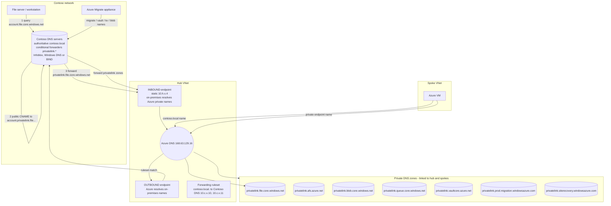

## When to use

A private endpoint exists but `nslookup` from Contoso returns the public IP (or NXDOMAIN),
an Azure VM cannot resolve `contoso.local` names, the Azure Migrate appliance fails registration
with "private link FQDNs not resolving", or the File Sync agent cannot reach
`*.afs.azure.net` privately. Also pull this before the first private endpoint: the DNS layer is
the piece every Microsoft troubleshooting guide for Private Link points at first. Contoso
DNS estate stays authoritative for contoso.local; Azure DNS answers only for the privatelink
zones and Azure-native names.

## The bridge, in one sentence

**On-premises custom DNS reaches Azure Private DNS through the Private Resolver INBOUND
endpoint.** Contoso resolvers keep answering everything they answer today; they gain
conditional forwarders for the `privatelink.*` zones only, pointed at one static IP in the hub
VNet. Nothing is deployed inside Azure to serve DNS to Contoso except the managed resolver
itself - **no DNS appliance runs in Azure** (Contoso decision, 2026-09-02: no Infoblox vNIOS or
equivalent in the Azure environment). The two endpoints are not interchangeable, and each
serves exactly one direction:

| Endpoint | Direction | Who queries it | What it answers | Configured by |
| --- | --- | --- | --- | --- |
| **Inbound endpoint** (static IP in a delegated /28) | **on-premises -> Azure** | Contoso DNS servers, through conditional forwarders | the linked private DNS zones - `privatelink.file.core.windows.net` and the rest - so a share, a Storage Sync Service or a Migrate name returns its private IP | one conditional forwarder per privatelink zone on Contoso DNS, target = the inbound IP |
| **Outbound endpoint + forwarding ruleset** | **Azure -> on-premises** | Azure DNS (168.63.129.16), on behalf of the VNets linked to the ruleset | `contoso.local` and Contoso reverse zones, resolved by Contoso DNS servers themselves | a ruleset rule `contoso.local.` whose targets are Contoso DNS server IPs |

If only on-premises clients must resolve Azure private names, the inbound endpoint alone is
enough. The outbound endpoint is needed the moment an Azure VM has to find a domain controller,
join `contoso.local`, or resolve any other on-premises name.

## Reuse before reinvent (GR11)

```yaml
- primitive: Azure DNS Private Resolver (avm/res/network/dns-resolver 0.5.8 + avm/res/network/dns-forwarding-ruleset 0.5.4)
  path: codex/playbook-deploy-dns-private-resolver-and-forwarders.md
  why: a managed, zone-redundant resolver replaces DNS forwarder VMs that must be patched and
       paired; the Microsoft Azure Files DNS guide names it as the no-VM option, and it is the
       only DNS service this design places in Azure
- primitive: conditional forwarders on the existing on-premises DNS (Infoblox grid, Windows Server DNS or BIND)
  path: codex/blueprint-azure-dns-for-private-endpoints.md
  why: Contoso already runs an authoritative resolver estate for contoso.local (Infoblox
       today, per the landing-zone notes); adding forward zones to it keeps one source of
       truth instead of standing up a second resolver on either side of the circuit
- primitive: Azure Private Endpoint private DNS zone values table
  path: codex/blueprint-azure-dns-for-private-endpoints.md
  why: zone names are prescribed per service; a misspelled or shared zone breaks automatic zone
       groups and is explicitly warned against by Microsoft
```

## Build sequence



1. **Zone set.** Create these private DNS zones once, in the connectivity subscription
   (`rg-dns-privatezones`), and link each to the hub VNet and every spoke that hosts private
   endpoints or servers: `privatelink.file.core.windows.net` (Azure Files `file`),
   `privatelink.afs.azure.net` (Azure File Sync `afs`), `privatelink.blob.core.windows.net` and
   `privatelink.queue.core.windows.net` (Migrate cache storage, Backup vault sub-resources),
   `privatelink.vaultcore.azure.net` (Key Vault created by Azure Migrate),
   `privatelink.prod.migration.windowsazure.com` (Azure Migrate project),
   `privatelink.siterecovery.windowsazure.com` (Recovery Services vault used for replication).
   Azure Backup for Azure Files needs no vault private endpoint; `privatelink.{regionCode}.backup.windowsazure.com`
   is used only if the vault later protects SQL Server or SAP HANA inside Azure VMs, MARS-agent
   backups (including on-premises servers), or DPM/MABS (DPM 2022 / MABS v4 and later); Azure VM
   backup and restore of disks does not require it, though file recovery from a
   private-endpoint-enabled vault is restricted to virtual networks that contain a vault private
   endpoint. Never put two services in one zone and never override a zone that public resolution
   still needs.
2. **Resolver.** Azure DNS Private Resolver in the hub VNet: two delegated subnets (/28 each,
   delegation `Microsoft.Network/dnsResolvers`), one **inbound endpoint** with a **static** IP
   (this IP is the bridge Contoso asked for - it goes into the conditional forwarders and
   into IPAM), one **outbound endpoint** with a **forwarding ruleset** carrying a rule
   `contoso.local.` (and any other on-premises zones, e.g. reverse zones) to Contoso DNS
   servers, ruleset linked to hub and spokes. Inbound serves on-premises-to-Azure; outbound plus
   ruleset serves Azure-to-on-premises; build both only when both directions are needed. Do not
   add a wildcard `.` rule unless the target can resolve public names. Limits: 5 inbound +
   5 outbound endpoints per resolver, 1000 rules per ruleset, 10,000 QPS per endpoint; the
   resolver does not support ExpressRoute FastPath and must live in the same region as its VNet.
   Contoso DNS servers must reach the inbound IP on UDP and TCP 53 across ExpressRoute -
   check the NSG on the inbound subnet and the on-premises firewall before blaming DNS.
3. **On-premises conditional forwarders (product-neutral).** On Contoso authoritative
   resolvers, create one **forward-only** conditional forwarder per privatelink zone above,
   target = the inbound endpoint IP (add the second inbound endpoint IP when a second resolver
   exists). Public names keep resolving through the normal recursion of the estate, which
   returns the `privatelink` CNAME that the forwarder then answers. The design is identical on
   any product; only the syntax differs:

   - **Infoblox** (what Contoso runs today): Data Management > DNS > Zones > Add > Forward
     Zone, one per privatelink zone, forwarder = the inbound IP, with **Use Forwarders Only**
     ticked so the grid never falls back to recursion for that zone. The same object over WAPI
     is `zone_forward`, with `fqdn` and `forward_to`.
   - **Windows Server DNS** (DnsServer PowerShell module; run per zone on a DNS server, or once
     with `-ReplicationScope Forest` so it replicates to every DC in the forest):

     ```powershell
     Add-DnsServerConditionalForwarderZone -Name "privatelink.file.core.windows.net" `
       -MasterServers 10.100.20.4 -ReplicationScope "Forest" -PassThru
     Set-DnsServerConditionalForwarderZone -Name "privatelink.file.core.windows.net" `
       -UseRecursion $false
     ```

     `-UseRecursion $false` is the forward-only setting (Set-, not Add-). The legacy `dnscmd`
     equivalent, still valid but deprecated in favour of the module, is
     `dnscmd . /zoneadd privatelink.file.core.windows.net /dsforwarder 10.100.20.4 /slave /dp /forest`
     - use `/forwarder` instead of `/dsforwarder` for a file-backed zone on a single server, and
     note that `/slave` is what makes it forward-only. Verify with
     `Get-DnsServerZone -Name "privatelink.file.core.windows.net"`: `ZoneType` is `Forwarder`
     and `MasterServers` is the inbound IP.
   - **BIND** (`named.conf`), one stanza per zone:

     ```text
     zone "privatelink.file.core.windows.net" IN {
         type forward;
         forward only;
         forwarders { 10.100.20.4; };
     };
     ```

   If the estate cannot forward a sub-zone, forward `core.windows.net`, `afs.azure.net`,
   `vaultcore.azure.net`, `prod.migration.windowsazure.com`, `siterecovery.windowsazure.com`
   wholesale - accept that every storage account in every tenant then resolves through Azure
   (the documented Microsoft caveat) and that cross-tenant private endpoints may return
   NXDOMAIN.
4. **Azure-side settings.** Spoke VNets keep the **default Azure-provided DNS**
   (168.63.129.16), which is what makes the linked private DNS zones and the forwarding ruleset
   apply; Azure VMs that must resolve `contoso.local` get it from the ruleset. **Do not set
   custom DNS servers on the VNet** pointing at the on-premises resolvers: a VNet with custom
   DNS bypasses Azure-provided DNS, so the linked privatelink zones stop resolving for every VM
   in it and private endpoints fall back to public IPs. The alternative pattern - a DNS
   appliance inside Azure (Infoblox vNIOS or similar) as the VNet DNS, forwarding the
   privatelink zones to 168.63.129.16 - is **declined for this engagement** (Contoso decision,
   2026-09-02: "we will not expect Infoblox in Azure environment at this time"). It is recorded
   here only so that nobody re-opens it by accident: it was never a prerequisite for anything in
   this design, and the resolver pattern above is complete without it.
5. **Private endpoint DNS zone groups.** Every private endpoint gets a DNS zone group referencing
   the matching zone so A records are created and updated automatically. Azure Migrate creates
   its own zones and records in the project's resource group; either link those zones to the hub
   (simplest) or move the records into the central zones and delete the duplicates - never keep
   two zones with the same name linked to the same VNet.
6. **IPAM.** Register every private endpoint IP and both resolver endpoint IPs in Contoso
   IPAM. On Infoblox that is network view `Azure` with extensible attribute `azure-resource-id`,
   plus Infoblox Azure discovery (Reader on the subscriptions) so VNets, subnets and NICs stay
   inventoried - the landing-zone note. Discovery runs from the on-premises
   grid against the Azure control plane and needs nothing deployed in Azure. If the address
   register is not Infoblox, record the same two facts wherever it is kept: the IP, and the
   Azure resource it belongs to.
7. **Verify (the oracle).** From a Contoso server: `Resolve-DnsName <account>.file.core.windows.net`
   -> private IP; `Resolve-DnsName <sss>management.<region>.afs.azure.net`,
   `<sss>syncp.<region>.afs.azure.net`, `<sss>syncs.<region>.afs.azure.net`,
   `<sss>monitoring.<region>.afs.azure.net` (the four Storage Sync Service names, e.g.
   mysssmanagement.westus2.afs.azure.net) -> private IPs;
   `Resolve-DnsName <migrate-project-fqdn>` from the appliance -> private
   IP; from an Azure VM: `Resolve-DnsName dc01.contoso.local` -> the DC's IP, and
   `Resolve-DnsName <account>.file.core.windows.net` -> private IP. On a non-Windows client use
   `dig +short <name>` or `nslookup <name>`. The assessor with
   `-PrivateTrafficRequired` shows no NET-02, NET-10, NET-11.

### Resolution walk-throughs

| Client | Name | Path | Answer |
| --- | --- | --- | --- |
| Contoso file server | `<account>.file.core.windows.net` | Contoso DNS recursion -> public CNAME `<account>.privatelink.file.core.windows.net` -> conditional forwarder -> inbound endpoint -> zone | private endpoint IP |
| Contoso file server | `<sss>management\|syncp\|syncs\|monitoring.<region>.afs.azure.net` (management, sync primary, sync secondary, monitoring) | Contoso DNS -> public CNAME `*.privatelink.afs.azure.net` -> forwarder -> inbound endpoint -> zone | four private IPs of the Storage Sync Service endpoint |
| Azure Migrate appliance | `<id>-agent.<geo>.disc.privatelink.prod.migration.windowsazure.com`, `<kv>.vault.azure.net`, `<cache>.blob.core.windows.net` | Contoso DNS -> forwarders -> inbound endpoint -> zones | private IPs listed in the project's "Download DNS settings" |
| Azure VM (spoke) | `<account>.file.core.windows.net` | Azure DNS -> linked zone | private endpoint IP |
| Azure VM (spoke) | `dc01.contoso.local` | Azure DNS -> ruleset rule `contoso.local.` -> outbound endpoint -> Contoso DNS | on-premises answer |
| Any client, no forwarder | `<account>.file.core.windows.net` | public DNS | **public IP - the failure mode** |

The first three rows are the inbound direction (Contoso resolving Azure private names); the
fifth is the outbound direction (Azure resolving Contoso names). A failure in one direction says
nothing about the other - establish which endpoint the failing query should have used before
changing anything.

## Declared artifact registry

| Artifact | Source of truth | Rebuild | Verify |
| --- | --- | --- | --- |
| Private DNS zones (7) + VNet links | Bicep `avm/res/network/private-dns-zone` 0.8.1 | `az deployment group create` | `az network private-dns zone list` shows the seven names once each |
| DNS Private Resolver + inbound (static IP) + outbound endpoints | Bicep `avm/res/network/dns-resolver` 0.5.8 | same | `Get-AzDnsResolverInboundEndpoint` shows the static IP |
| Forwarding ruleset + rules + VNet links | Bicep `avm/res/network/dns-forwarding-ruleset` 0.5.4 | same | `Get-AzDnsForwardingRulesetForwardingRule` lists `contoso.local.` |
| Conditional forwarders, one per privatelink zone | The on-premises DNS estate (Infoblox grid today; Windows Server DNS or BIND read the same) - DNS change ticket | Infoblox forward zone via UI or WAPI `zone_forward`, `Add-DnsServerConditionalForwarderZone`, or a `named.conf` forward zone | `Resolve-DnsName` from on-premises returns private IPs |
| IPAM reservations + Azure discovery | Contoso IPAM (Infoblox where used) | Infoblox UI, or the equivalent address register | endpoint IPs present with `azure-resource-id` |
| Migrate-created zones reconciled | Azure Migrate project RG | link or merge per step 5 | no duplicate zone name linked to the hub |
| DNS appliance in Azure | not built - Contoso decision 2026-09-02 | n/a | spoke VNets carry no custom `dnsServers` value |

## How a persona runs this (-> ticket)

- **Persona:** `eng-netops`
- **Devstation flavor:** `netops-v`
- **Gate pull:** `kind: azure-dns-for-private-endpoints`
- **CR file:** `change-management/CR-<date>-azure-dns-for-private-endpoints.md`
- **Closure:** all rows of the resolution walk-through table return the expected answer from the named client

## Gate rules

```json
[
  {"rule": "each privatelink zone exists exactly once", "severity": "error", "check": "az network private-dns zone list --query \"[?starts_with(name, 'privatelink.')].name\" -o tsv | sort | uniq -d prints nothing"},
  {"rule": "the inbound endpoint IP is static", "severity": "error", "check": "az dns-resolver inbound-endpoint show -g <rg> --dns-resolver-name <resolver> -n <inbound> --query \"ipConfigurations[0].privateIpAllocationMethod\" -o tsv prints Static"},
  {"rule": "the ruleset forwards contoso.local to the on-premises DNS servers", "severity": "error", "check": "az dns-resolver forwarding-rule list -g <rg> --ruleset-name <ruleset> --query \"[?domainName=='contoso.local.'].targetDnsServers[].ipAddress\" -o tsv lists Contoso DNS server IPs"},
  {"rule": "inbound direction: on-premises resolves a privatelink name privately", "severity": "error", "check": "powershell -Command \"(Resolve-DnsName <account>.file.core.windows.net -Type A).IP4Address\" run on a Contoso server prints a 10.x address"},
  {"rule": "outbound direction: an Azure VM resolves an on-premises name", "severity": "warn", "check": "powershell -Command \"(Resolve-DnsName dc01.contoso.local -Type A).IP4Address\" run on an Azure VM prints the DC address"},
  {"rule": "no DNS appliance in Azure - VNets keep Azure-provided DNS", "severity": "error", "check": "az network vnet list -g <rg> --query \"[].dhcpOptions.dnsServers[]\" -o tsv | grep -c . prints 0"}
]
```

## Reference

```yaml
- path: codex/playbook-deploy-dns-private-resolver-and-forwarders.md
  anchor: "br/public:avm/res/network/dns-resolver"
  why: the executable procedure for the resolver half of this design
- path: codex/playbook-deploy-dns-private-resolver-and-forwarders.md
  anchor: "On-premises conditional forwarders"
  why: the executable procedure for the forwarder half, in all three DNS products
- path: codex/blueprint-azure-migrate-private-link-landing.md
  anchor: "Download DNS settings"
  why: where the Migrate private link names and IPs come from
- path: Assess-AzFileSyncExport.ps1
  anchor: "NET-11"
  why: the check that fires when no DNS Private Resolver exists in the topology
```

Microsoft Learn (read 2026-09-03): Azure DNS Private Resolver overview (limits, subnet rules,
FastPath restriction); Create an Azure DNS Private Resolver using PowerShell; Configure DNS
forwarding for Azure Files; Azure Private Endpoint private DNS zone values; Azure Migrate -
troubleshoot network connectivity (private DNS zone list); Configure Azure File Sync network
endpoints (four Storage Sync Service FQDNs); Add-DnsServerConditionalForwarderZone and
Set-DnsServerConditionalForwarderZone (DnsServer PowerShell module, -MasterServers,
-ReplicationScope, -UseRecursion); dnscmd /zoneadd reference (/forwarder, /dsforwarder, /slave,
/dp); Name resolution for resources in Azure virtual networks (what a custom VNet DNS server
setting turns off). BIND: ISC BIND 9 ARM, forward zones.
