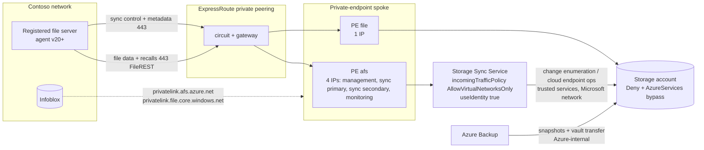

## When to use

Contoso stated that File Sync and backup traffic must use their ExpressRoute. Today the
registered servers reach the Storage Sync Service and the storage account over the public
endpoints (HTTPS 443, Microsoft routing). This entry is the end state in which both legs the
agent initiates are private, the one leg Microsoft initiates (Storage Sync Service to storage
account) stays on the trusted-services path, and Azure Backup is understood to be
Azure-internal. Pull it when the assessor reports NET-05, NET-06, NET-07 or NET-08 with
`-PrivateTrafficRequired`.

## Reuse before reinvent (GR11)

```yaml
- primitive: storage account file private endpoint + hybrid DNS
  path: codex/blueprint-azure-files-private-endpoint.md
  why: the storage leg of File Sync is the same private endpoint any SMB client uses; a second
       endpoint just for sync would double the DNS records and the IPAM entries
- primitive: Azure DNS Private Resolver + Infoblox forwarders
  path: codex/blueprint-azure-dns-for-private-endpoints.md
  why: the four Storage Sync Service names resolve through the same inbound endpoint as every
       other privatelink zone; a hosts file on each file server is what the troubleshooting
       guide calls a testing-only workaround
- primitive: Azure Policy "Configure Azure File Sync with private endpoints" (b35dddd9-daf7-423b-8375-5a5b86806d5a) and "Modify - Configure Azure File Sync to disable public network access" (0e07b2e9-6cd9-4c40-9ccb-52817b95133b)
  path: codex/blueprint-azure-file-sync-private-path.md
  why: Microsoft ships deploy-if-not-exists and modify policies for exactly this end state, so a
       new Storage Sync Service in Contoso landing zone is remediated automatically
```

## Build sequence



1. **Confirm the traffic map with Contoso.** Two legs are private (server to Storage Sync
   Service, server to storage account). One leg cannot be moved to ExpressRoute because
   Microsoft initiates it (Storage Sync Service to storage account for change enumeration and
   cloud endpoint operations) and it never leaves Azure. Azure Backup for Azure Files is also
   Azure-internal; a private endpoint on the Recovery Services vault does not apply to Azure
   Files. Management (portal, PowerShell) and Microsoft Update for the agent remain public.
2. **Prerequisites.** Agent 20.0.0.0 or later on every registered server (managed identity
   requires it; auto-update `InstallLatest` with a maintenance window), Windows Server 2016+
   (2019+ preferred), the hybrid DNS design deployed, the storage account private endpoint in
   place and verified.
3. **Storage Sync Service private endpoint.** One private endpoint per Storage Sync Service,
   sub-resource `afs` (group id `Afs` in PowerShell), in the private-endpoint spoke; the
   endpoint exposes **four** private IPs and four FQDNs
   (`<sss>management.<region>.afs.azure.net`, `<sss>syncp.<region>.afs.azure.net`,
   `<sss>syncs.<region>.afs.azure.net`, `<sss>monitoring.<region>.afs.azure.net` - management,
   sync primary, sync secondary, monitoring) that land in `privatelink.afs.azure.net` through
   the DNS zone group. Register the four IPs in IPAM. Approve the connection if it lands in
   Pending.
4. **DNS.** Infoblox conditional forwarder for the public zone `afs.azure.net` -> Private
   Resolver inbound endpoint (the `file.core.windows.net` forwarder already exists from the
   storage blueprint). Not the `privatelink` zone: a forwarder on it is never consulted,
   because the whole CNAME chain comes back in one answer. Verify from each server with the PowerShell in step 8 before any lock.
5. **Managed identity (recommended, not a prerequisite for the private path).** Arc-enable the
   on-premises file servers (system-assigned identity), then `Set-AzStorageSyncServiceIdentity`
   grants Storage Account Contributor + Storage File Data Privileged Contributor to the service
   identity and Storage File Data Privileged Contributor to each server identity;
   `useIdentity` flips to true and servers move to `ActiveAuthType: ManagedIdentity` within 15
   minutes. Re-run the cmdlet for every server registered later. This removes the account-key
   dependency for File Sync; Azure Backup still needs key access on the account.
6. **Storage account firewall.** `defaultAction: Deny`, `bypass: AzureServices` (the Storage
   Sync Service and Azure Backup use this trusted-services path; Azure File Sync is on the
   trusted-services list and is NOT one of the resource types supported by storage resource
   instance rules, so no resource instance rule applies); IP rules only for admin egress.
   Never `publicNetworkAccess: Disabled` on a File Sync account. Test: a sync session
   completes (Telemetry event 9102, HResult 0) and a cloud change enumeration completes.
7. **Disable the Storage Sync Service public endpoint.** Only after step 8 passes on every
   server: `Set-AzStorageSyncService -IncomingTrafficPolicy AllowVirtualNetworksOnly` (portal:
   Network > Private endpoints only). File Sync has no service-endpoint option; the only states
   are enabled and disabled, and disabling with no working private endpoint stops sync.
8. **Verify (the oracle).** On each server: `Debug-StorageSyncServer -TestNetworkConnectivity`
   succeeds; `Resolve-DnsName` for the four afs names and for `<account>.file.core.windows.net`
   returns 10.x addresses; the next 9102 event has HResult 0 and 9301 heartbeats continue;
   portal server endpoint health Healthy for 24 h; the Storage Sync Service metric
   `StorageSyncServerHeartbeat` keeps counting. The assessor with `-PrivateTrafficRequired`
   shows no NET-05..NET-08 and no AFS-11/AFS-14.
9. **Rollback.** `Set-AzStorageSyncService -IncomingTrafficPolicy AllowAllTraffic` and
   `az storage account update --default-action Allow` restore the public path in minutes;
   private endpoints and DNS stay in place.

### Contoso firewall allow-list when the public path is still used (interim)

Outbound 443 from the file servers to: `https://management.azure.com`, `login.microsoftonline.com`,
`login.windows.net`, `aadcdn.msftauth.net`, `https://secure.aadcdn.microsoftonline-p.com`
(Entra registration UI), `graph.microsoft.com`, `*.core.windows.net`, `*.afs.azure.net` and
`*.one.microsoft.com` (regional alternative, from the Microsoft endpoint table for the Storage
Sync Service's region: primary `https://<region>01.afs.azure.net` + its
`https://kailani*.one.microsoft.com` twin, the paired region's primary pair, and the discovery
pair `https://tm-<region>01.afs.azure.net` + `https://tm-kailani*.one.microsoft.com` for GRS -
e.g. West US: westus01 / kailani, eastus01 / kailani1, tm-westus01 / tm-kailani1), Microsoft
PKI / OCSP URLs, Microsoft Update.
Service tags `StorageSyncService`, `Storage`, `AzureResourceManager` and `AzureActiveDirectory`
for IP-based firewalls. After cut-over, the `*.afs.azure.net` and `*.core.windows.net` flows
move to the private endpoint prefixes over ExpressRoute; the identity, ARM, PKI and Update
flows remain public.

## Declared artifact registry

| Artifact | Source of truth | Rebuild | Verify |
| --- | --- | --- | --- |
| Private endpoint `afs` (4 IPs) + DNS zone group | Bicep `avm/res/network/private-endpoint` 0.12.1 (groupIds `['afs']`) | `az deployment group create` | `Get-AzPrivateEndpoint` NIC shows four FQDN/IP pairs |
| `privatelink.afs.azure.net` zone + links + 4 A records | zone blueprint + DNS zone group | same | `az network private-dns record-set a list -z privatelink.afs.azure.net` |
| Infoblox forwarder for the public zone `afs.azure.net` | Infoblox grid | Infoblox UI | `Resolve-DnsName` from a server returns 10.x for all four names |
| Storage Sync Service `incomingTrafficPolicy` | `playbook-enable-file-sync-private-endpoint-and-cutover` | `Set-AzStorageSyncService` | `Get-AzStorageSyncService` shows AllowVirtualNetworksOnly |
| Managed identity configuration | same playbook | `Set-AzStorageSyncServiceIdentity` | `Get-AzStorageSyncService` UseIdentity True; `Get-AzStorageSyncServer` ActiveAuthType ManagedIdentity |
| Storage firewall (Deny + trusted services) | `playbook-harden-existing-storage-account` | `az storage account update -g <rg> -n <account> --default-action Deny --bypass AzureServices` | `az storage account show -n <account> -g <rg> --query networkRuleSet.bypass -o tsv` contains AzureServices |
| Policy remediation | landing-zone policy set (b35dddd9 / 0e07b2e9 / 21a8cd35) | `az policy assignment create` | compliance Compliant |

## How a persona runs this (-> ticket)

- **Persona:** `eng-sysops`
- **Devstation flavor:** `netops-v`
- **Gate pull:** `kind: azure-file-sync-private-path`
- **CR file:** `change-management/CR-<date>-azure-file-sync-private-path.md`
- **Closure:** incomingTrafficPolicy is AllowVirtualNetworksOnly, every server endpoint stayed Healthy for 24 hours after the change, and the assessor reports no NET-05..NET-08

## Gate rules

```json
[
  {"rule": "the Storage Sync Service has an approved private endpoint", "severity": "error", "check": "az resource show --ids <sss-id> --query \"properties.privateEndpointConnections[?properties.privateLinkServiceConnectionState.status=='Approved'] | length(@)\" prints >= 1"},
  {"rule": "the four afs names resolve privately from a server", "severity": "error", "check": "powershell -Command \"Get-AzPrivateEndpoint -Name pe-<sss>-afs -ResourceGroupName <rg> | Select -Expand NetworkInterfaces | % { Get-AzNetworkInterface -ResourceId $_.Id } | Select -Expand IpConfigurations | Select -Expand PrivateLinkConnectionProperties | Select -Expand Fqdns | % { (Resolve-DnsName $_ -Type A).IP4Address }\" prints four 10.x addresses on a Contoso server"},
  {"rule": "public endpoint disabled only after the private path works", "severity": "error", "check": "az resource show --ids <sss-id> --query properties.incomingTrafficPolicy -o tsv prints AllowVirtualNetworksOnly and the server endpoint syncStatus.combinedHealth is Healthy"},
  {"rule": "the storage account keeps trusted services", "severity": "error", "check": "az storage account show -n <account> -g <rg> --query networkRuleSet.bypass -o tsv contains AzureServices"},
  {"rule": "sync sessions complete after cut-over", "severity": "error", "check": "powershell -Command \"(Get-WinEvent -FilterHashtable @{LogName='Microsoft-FileSync-Agent/Telemetry'; Id=9102; StartTime=(Get-Date).AddHours(-2)} | Select -First 1).Message\" on the server contains HResult: 0"}
]
```

## Reference

```yaml
- path: codex/playbook-enable-file-sync-private-endpoint-and-cutover.md
  anchor: "IncomingTrafficPolicy AllowVirtualNetworksOnly"
  why: the executable cut-over with per-step verification
- path: docs/PLAYBOOK-azure-file-sync-assessment.md
  anchor: "Target design when File Sync traffic must use ExpressRoute"
  why: the customer-facing table this blueprint formalises
- path: Assess-AzFileSyncExport.ps1
  anchor: "NET-05"
  why: the check for a Storage Sync Service without a private endpoint under private-routing
```

Microsoft Learn (read 2026-09-03): Configure Azure File Sync network endpoints (Storage Sync
Service private endpoint, incomingTrafficPolicy, policies); Azure File Sync on-premises
firewall and proxy settings (endpoints, regional URLs, StorageSyncService tag); How to use
managed identities with Azure File Sync; Trusted Azure services for Azure Storage network
security; Azure Files backup support matrix (vault private endpoint not applicable).
