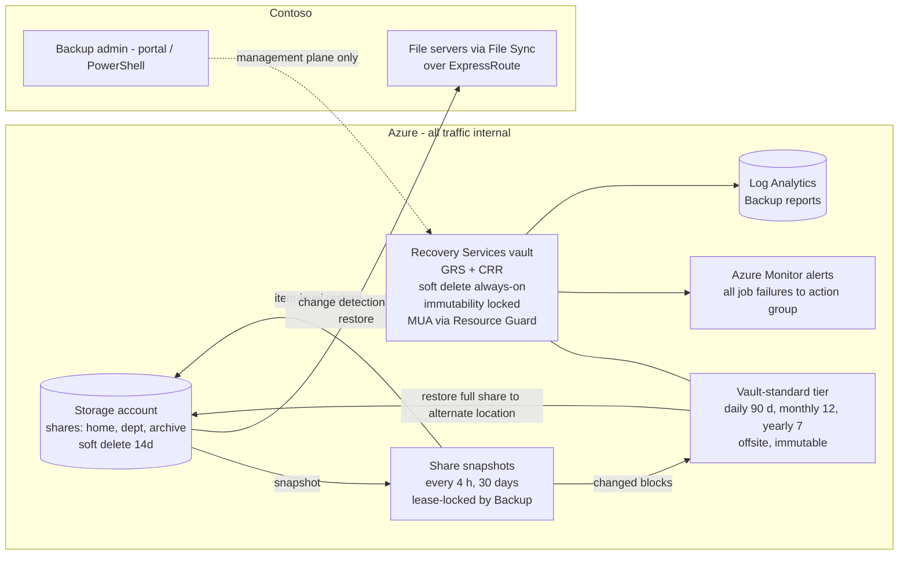

## When to use

Contoso asked to "set up Azure Backup and recovery for all data stored in Azure" and the
data is the Azure file shares behind File Sync. Pull this when the assessor reports BKP-01
(unprotected shares), BKP-04 (snapshot-only), BKP-06..BKP-11 (vault hardening) or when a
restore has to be designed. The trigger question "does backup traffic go over our
ExpressRoute?" is answered here: it does not need to, and cannot - the data path is
Azure-internal.

## Reuse before reinvent (GR11)

```yaml
- primitive: Azure Backup for Azure Files (snapshot + vault-standard tiers, GA)
  path: docs/PLAYBOOK-azure-backup-for-azure-files.md
  why: zero-infrastructure backup with lease-protected snapshots, soft delete and File Sync
       change detection on restore; a server-side backup of a cloud-tiered server endpoint is
       not the supported pattern - depending on the backup product, tiered files are either
       skipped and not backed up (they carry FILE_ATTRIBUTE_RECALL_ON_DATA_ACCESS) or recalled
       to disk with high egress cost - Microsoft directs you to back up the Azure file share in
       the cloud instead
- primitive: share soft delete on the storage account
  path: codex/blueprint-azure-files-secure-storage-account.md
  why: Azure Backup enables it at 14 days; the blueprint keeps it because it is the only
       protection against deleting the share together with its snapshots
- primitive: assessor rules BKP-01..BKP-19
  path: Assess-AzFileSyncExport.ps1
  why: coverage, policy tier, retention, vault security, alerts and jobs are already encoded
       as checks with Microsoft references, so the oracle is a rerun of the assessor
```

## Build sequence



1. **Vault.** One Recovery Services vault per region holding file shares (the vault must be in
   the storage account's region), named `rsv-<org>-<region>`. Decide redundancy **before** the
   first item is protected: `GeoRedundant` with **Cross Region Restore** enabled (LRS/ZRS only if
   data must not leave the region). Security: soft delete **always-on** with 14-180 days
   retention, **immutability** enabled (Unlocked until the first restore test, then Locked),
   **multi-user authorization** through a Resource Guard owned by a second administrator
   (ideally another subscription), public network access can stay enabled (a vault private
   endpoint does not apply to Azure Files), `CanNotDelete` lock, tags.
2. **Prerequisites on the storage account.** `Allow storage account key access` enabled, share
   soft delete 14+ days, storage firewall `Deny` with **Allow Azure services on the trusted
   services list**, GPv2 or FileStorage account, SMB shares only (NFS unsupported).
3. **Policy for synced, actively edited shares** (`AFS-Active-4h-30d-Vault-90d`): backup tier
   **snapshot + vault-standard**, schedule hourly every 4 h in an 8-hour business window,
   snapshot retention 30 days, vault retention daily 90 days, monthly 12 months, yearly 7 years
   (replace with Contoso records-retention schedule), time zone Pacific. Only the last
   scheduled snapshot of the day transfers to the vault. Limits: 200 snapshots per share, vault
   tier 10 TB and 10 million files per share, 6 scheduled backups per day.
4. **Policy for archive / cold shares** (`AFS-Archive-1d-30d-Vault-1y`): daily snapshot, 30
   days; vault daily 30 days, monthly 12, yearly per schedule.
5. **Protect every share** in the coverage table, File Sync cloud endpoints first; run an
   on-demand backup per item and confirm `Backup/Completed` jobs before leaving.
6. **Alerts and reports.** Azure Monitor alerts for all job failures -> action group
   (storage team mailbox + Teams/ITSM); one diagnostic setting in **Resource specific** mode
   carrying the six Backup events (`CoreAzureBackup`, `AddonAzureBackupJobs`,
   `AddonAzureBackupPolicy`, `AddonAzureBackupProtectedInstance`, `AddonAzureBackupStorage`,
   `AzureBackupOperations`) to Contoso Log Analytics workspace - the legacy
   `AzureBackupReport` event flows only in Azure diagnostics mode, so if legacy queries still
   need it, put it in a second, separate diagnostic setting; Backup reports reviewed monthly;
   the File Sync recommended alerts complement them.
7. **Restore paths (test one during the engagement).** Item-level from a snapshot recovery
   point (up to 99 items, original or alternate location, skip/overwrite conflicts); full-share
   restore from snapshot (original or alternate); full-share restore from the vault tier
   (alternate location only, target needs 20 % free space for the `MABRestoreScratchFolder`
   staging); cross-region restore from the vaulted copy in the paired region. After any
   restore, Azure Backup tells the Storage Sync Service which paths changed and the servers
   receive the restored versions without waiting for the 24-hour enumeration.
8. **Verify (the oracle).** Re-export and re-assess: coverage 100 % protected, no BKP-01/02/03,
   no BKP-04 (vault tier on the active policy), no BKP-06..BKP-11, jobs `Completed` only; a
   forced failure injected on a dedicated test storage account that hosts no File Sync cloud
   endpoints and no production shares (remove the trusted-services exception there) raises an
   alert e-mail - never toggle the trusted-services exception on a storage account carrying
   File Sync cloud endpoints, since it is an account-level setting; alternatively validate the
   alert path with the action group's built-in test notification; a documented item-level
   restore completed within the RTO.

### Why ExpressRoute is not involved

| Flow | Path | Private endpoint applicable |
| --- | --- | --- |
| Snapshot creation | Azure Backup -> storage account (trusted-services path inside Microsoft's network) | no |
| Vault transfer of changed blocks | storage account -> Recovery Services vault (Azure-internal) | no (vault private endpoints exclude Azure Files backup) |
| Restore | vault or snapshot -> storage account (Azure-internal), then File Sync change detection to servers over the servers' private path | the File Sync path, already private |
| Management | Contoso admin -> portal / PowerShell | public Azure management plane |

## Declared artifact registry

| Artifact | Source of truth | Rebuild | Verify |
| --- | --- | --- | --- |
| Recovery Services vault + security settings + redundancy | `playbook-enable-azure-backup-for-file-shares` (PowerShell + portal for MUA/immutability) | `New-AzRecoveryServicesVault` + settings | `Get-AzRecoveryServicesVault` properties; assessor no BKP-06..BKP-10 |
| Resource Guard + MUA mapping | second admin's subscription | portal | vault Properties shows MUA enabled |
| Backup policies (2) | same playbook | `New-AzRecoveryServicesBackupProtectionPolicy` / portal for vaulted tier | `Get-AzRecoveryServicesBackupProtectionPolicy -WorkloadType AzureFiles` shows vaultRetentionPolicy |
| Protected items | same playbook | `Enable-AzRecoveryServicesBackupProtection` | coverage table 100 % |
| Alerts + diagnostics | same playbook | portal / `az monitor diagnostic-settings create` | assessor no BKP-11/BKP-12 |
| Restore test record | change ticket | rerun the restore | job id + timing in the engagement record |

## How a persona runs this (-> ticket)

- **Persona:** `eng-sysops`
- **Devstation flavor:** `netops-v`
- **Gate pull:** `kind: azure-files-backup-protection`
- **CR file:** `change-management/CR-<date>-azure-files-backup-protection.md`
- **Closure:** coverage table 100 % protected with vaulted policies, vault hardened, alert test received, one documented restore completed

## Gate rules

```json
[
  {"rule": "every file share in scope is protected", "severity": "error", "check": "powershell -File Assess-AzFileSyncExport.ps1 -ExportPath <export.zip> then grep -c BKP-01 <export>/findings.json prints 0"},
  {"rule": "the active-share policy has a vault tier", "severity": "error", "check": "az backup policy show -v <vault> -g <rg> -n AFS-Active-4h-30d-Vault-90d --query properties.vaultRetentionPolicy -o json prints a non-null object"},
  {"rule": "vault redundancy is GRS with cross-region restore", "severity": "error", "check": "az backup vault backup-properties show -n <vault> -g <rg> --query \"[0].properties.[storageModelType, crossRegionRestoreFlag]\" -o tsv prints GeoRedundant and true"},
  {"rule": "soft delete is always-on and immutability enabled", "severity": "error", "check": "az rest --method get --url https://management.azure.com<vault-id>?api-version=2024-04-01 --query \"[properties.securitySettings.softDeleteSettings.softDeleteState, properties.securitySettings.immutabilitySettings.state]\" -o tsv prints AlwaysON and Unlocked or Locked"},
  {"rule": "job-failure alerts are on", "severity": "error", "check": "az rest --method get --url https://management.azure.com<vault-id>?api-version=2024-04-01 --query properties.monitoringSettings.azureMonitorAlertSettings.alertsForAllJobFailures -o tsv prints Enabled"},
  {"rule": "a restore was tested", "severity": "warn", "check": "az backup job list -v <vault> -g <rg> --operation Restore --status Completed --query \"length(@)\" prints >= 1"}
]
```

## Reference

```yaml
- path: docs/PLAYBOOK-azure-backup-for-azure-files.md
  anchor: "The three facts that shape the design"
  why: the customer-facing rationale this blueprint formalises
- path: codex/playbook-enable-azure-backup-for-file-shares.md
  anchor: "Enable-AzRecoveryServicesBackupProtection"
  why: the executable procedure
- path: Assess-AzFileSyncExport.ps1
  anchor: "BKP-04"
  why: the check for snapshot-only policies and the vaulted-region list
```

Microsoft Learn (read 2026-09-03): About Azure Files backup (snapshot and vault-standard
tiers, lease, File Sync interaction); Support matrix for Azure Files backup (limits, key
access requirement, vault private endpoint note); Restore Azure Files (full share, item level,
alternate location, scratch folder, cross-region); Azure Backup security features (soft delete,
immutability, MUA).
