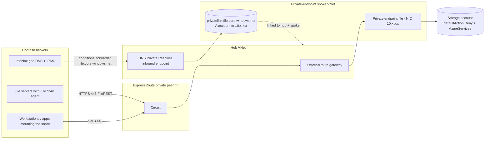

## When to use

Contoso requires that file traffic to Azure stays on the ExpressRoute circuit: the Azure File
Sync servers must upload, download and recall over the private path, and any workstation or
application that mounts the share directly must reach it over SMB 445 across the private
peering, never the internet. Symptom that you need this: `Resolve-DnsName <account>.file.core.windows.net`
from Contoso returns a public IP, or the storage firewall cannot be set to Deny because the
servers would lose access.

## Reuse before reinvent (GR11)

```yaml
- primitive: Azure Verified Module avm/res/network/private-endpoint 0.12.1 (or the privateEndpoints block of avm/res/storage/storage-account 0.33.0)
  path: codex/playbook-add-file-private-endpoint-and-dns.md
  why: the module creates the endpoint, the NIC and the DNS zone group in one idempotent unit;
       creating the A record by hand is the drift that breaks the moment the endpoint IP changes
- primitive: hub DNS design (Private Resolver + Infoblox conditional forwarders)
  path: codex/blueprint-azure-dns-for-private-endpoints.md
  why: every private endpoint Contoso adds (Files, File Sync, Migrate, Key Vault) resolves
       through the same inbound endpoint; a per-service forwarder or hosts file is the recurring
       outage in the Microsoft troubleshooting guides
- primitive: Assess-AzFileSyncExport.ps1 NET-01..NET-08 with -PrivateTrafficRequired
  path: Assess-AzFileSyncExport.ps1
  why: the assessor already checks endpoint presence, approval, DNS zone, links and A records,
       so the oracle is a rerun rather than a manual audit
```

## Build sequence



1. **Prerequisites.** ExpressRoute circuit with private peering provisioned, ExpressRoute
   gateway in the hub VNet, spoke VNet peered to the hub with **Use remote gateway** (spoke) and
   **Allow gateway transit** (hub), a dedicated private-endpoint subnet in the spoke with
   `privateEndpointNetworkPolicies` set to `Disabled` (or NSG-enabled deliberately). If the
   circuit uses ExpressRoute FastPath, note that Private Link / private endpoint traffic over
   FastPath is supported only on ExpressRoute Direct circuits (100 and 10 Gbps), is in limited GA
   requiring enrollment via aka.ms/FPlimitedga (deployment 4-6 weeks after approval), and only in
   the regions Microsoft lists; a gateway SKU of Ultra Performance, ErGw3AZ or ErGwScale (>=10
   scale units) is a FastPath prerequisite but is not sufficient. On an ExpressRoute provider
   circuit, private endpoint traffic always traverses the ExpressRoute gateway, which is fine at
   Contoso bandwidths.
2. **Private endpoint.** One private endpoint per storage account for sub-resource `file`
   (group id `file`), in the spoke subnet, with a **private DNS zone group** that references the
   `privatelink.file.core.windows.net` zone. The endpoint gets a private IP from the subnet;
   register it in Infoblox IPAM under a reservation named for the storage account.
3. **Private DNS zone.** One `privatelink.file.core.windows.net` zone for the whole Contoso
   estate (never one per service instance; never two zones for the same service), linked to the
   hub VNet and to the spoke VNets that resolve through Azure DNS. The zone group writes the A
   record `<account> -> <private IP>` and keeps it current.
4. **On-premises DNS.** The Infoblox grid forwards `file.core.windows.net` to the
   DNS Private Resolver inbound endpoint IP in the hub (see
   `blueprint-azure-dns-for-private-endpoints`). Azure DNS then follows the CNAME from
   `<account>.file.core.windows.net` to the privatelink name and answers with the private IP from
   the linked zone. Microsoft's documented method is to forward the public storage suffix to the
   inbound endpoint: the Azure Files DNS guide requires forwarding the storage endpoint suffix
   `core.windows.net`, and the Cloud Adoption Framework has on-premises DNS servers conditionally
   forward each private endpoint public DNS zone - `file.core.windows.net` for the `file`
   sub-resource - to the private resolver. Microsoft warns that forwarding all of
   `core.windows.net` sends every query for that public domain to Azure DNS, which breaks access
   to a private-endpoint-enabled storage account in a different tenant (workaround: a cross-tenant
   private endpoint); forwarding only `file.core.windows.net` keeps the blast radius to the Files
   service and is still the documented pattern. Forwarding only the
   `privatelink.file.core.windows.net` sub-zone is not a documented pattern: it depends on the
   grid resolving `<account>.file.core.windows.net` publicly and re-applying the forwarder to the
   CNAME target - validate it on Contoso grid before adopting it.
5. **Lock the public endpoint.** Only after step 4 verifies from every server: storage firewall
   `defaultAction: Deny`, `bypass: AzureServices` (Azure File Sync and Azure Backup), IP rules
   for admin egress only. Keep `publicNetworkAccess: Enabled` - the Storage Sync Service and
   Azure Backup use the trusted-services path on the public endpoint.
6. **Firewall and routing checks.** Contoso edge firewall permits TCP 445 and 443 from the
   servers to the private endpoint subnet over the ExpressRoute path; no NAT on the private
   peering; NSG on the private-endpoint subnet (if network policies are enabled) allows 445/443
   from Contoso prefixes; no UDR sends the private-endpoint prefix to an Azure Firewall
   unless the firewall is in the path on purpose.
7. **Verify (the oracle).** From a Contoso file server:
   `Resolve-DnsName <account>.file.core.windows.net` shows the CNAME to
   `<account>.privatelink.file.core.windows.net` and an A record with the private IP;
   `Test-NetConnection <account>.file.core.windows.net -CommonTCPPort SMB` is `TcpTestSucceeded
   True`; a mount `net use Z: \\<account>.file.core.windows.net\<share>` with an AD identity
   succeeds; the File Sync server endpoint stays Healthy through the next sync session (event
   9102, HResult 0). The assessor with `-PrivateTrafficRequired` reports no NET-02/NET-06/NET-08.

### Sizing and naming (Contoso profile)

| Item | Value |
| --- | --- |
| Private-endpoint subnet | `snet-pe-<region>-01`, /26 (room for File, File Sync, Migrate, Key Vault, Backup endpoints) |
| Endpoint name | `pe-<account>-file` |
| NIC name | `nic-pe-<account>-file` |
| Zone | `privatelink.file.core.windows.net` in the connectivity subscription resource group `rg-dns-privatezones` |
| Zone links | hub VNet, private-endpoint spoke, any spoke with servers that resolve via Azure DNS |
| IPAM | Infoblox reservation `<account>.file.core.windows.net` -> endpoint IP, tagged `azure-private-endpoint` |

## Declared artifact registry

| Artifact | Source of truth | Rebuild | Verify |
| --- | --- | --- | --- |
| Private endpoint + NIC | Bicep (`avm/res/network/private-endpoint` or the storage module block) | `az deployment group create` | `az network private-endpoint show` connection state Approved |
| Private DNS zone `privatelink.file.core.windows.net` | Bicep (`avm/res/network/private-dns-zone` 0.8.1) | same | `az network private-dns zone show` |
| VNet links | same Bicep | same | `az network private-dns link vnet list` lists hub + spokes |
| DNS zone group + A record | private endpoint resource | same | `az network private-dns record-set a list` shows `<account>` |
| Infoblox conditional forwarder | Infoblox grid config (change ticket) | Infoblox UI / WAPI | `Resolve-DnsName` from on-premises returns the private IP |
| Storage firewall state | `playbook-harden-existing-storage-account` | `az storage account update --default-action Deny --bypass AzureServices` | assessor SEC-03 absent |

## How a persona runs this (-> ticket)

- **Persona:** `eng-netops`
- **Devstation flavor:** `netops-v`
- **Gate pull:** `kind: azure-files-private-endpoint`
- **CR file:** `change-management/CR-<date>-azure-files-private-endpoint.md`
- **Closure:** every Contoso file server resolves the account to the private IP and the storage firewall default action is Deny with sync healthy for 24 hours

## Gate rules

```json
[
  {"rule": "the private endpoint connection is approved", "severity": "error", "check": "az network private-endpoint show -n pe-<account>-file -g <rg> --query \"privateLinkServiceConnections[0].privateLinkServiceConnectionState.status\" -o tsv prints Approved"},
  {"rule": "the endpoint carries a DNS zone group for privatelink.file.core.windows.net", "severity": "error", "check": "az network private-endpoint dns-zone-group list --endpoint-name pe-<account>-file -g <rg> --query \"[].privateDnsZoneConfigs[].privateDnsZoneId\" -o tsv contains privatelink.file.core.windows.net"},
  {"rule": "the zone is linked to the hub VNet", "severity": "error", "check": "az network private-dns link vnet list -g rg-dns-privatezones -z privatelink.file.core.windows.net --query \"[].virtualNetwork.id\" -o tsv contains the hub VNet id"},
  {"rule": "on-premises resolves the account to the private IP", "severity": "error", "check": "powershell -Command \"(Resolve-DnsName <account>.file.core.windows.net -Type A).IP4Address\" run on a Contoso server prints the endpoint IP"},
  {"rule": "SMB reaches the endpoint over the private path", "severity": "error", "check": "powershell -Command \"(Test-NetConnection <account>.file.core.windows.net -CommonTCPPort SMB).TcpTestSucceeded\" prints True"}
]
```

## Reference

```yaml
- path: codex/blueprint-azure-dns-for-private-endpoints.md
  anchor: "inbound endpoint"
  why: the resolver the Infoblox forwarder points at
- path: codex/playbook-add-file-private-endpoint-and-dns.md
  anchor: "az network private-endpoint create"
  why: the executable procedure for this anatomy
- path: Assess-AzFileSyncExport.ps1
  anchor: "NET-02"
  why: the check for a private endpoint without working private DNS
```

Microsoft Learn (read 2026-09-03): Configure Azure Files network endpoints; Configure DNS
forwarding for Azure Files; Networking considerations for Azure Files; Azure Private Endpoint
private DNS zone values; Azure Storage firewall rules and network access; Trusted Azure services
for Azure Storage network security.
