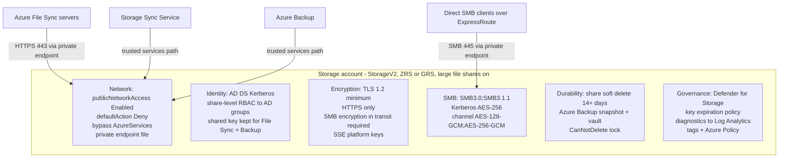

## When to use

A new storage account is about to hold Contoso file shares (home drives, department shares,
archive) that Azure File Sync caches on the Windows Servers and that Azure Backup protects, or
an existing account came back from `Assess-AzFileSyncExport.ps1` with SEC-/DATA- findings and
someone asks what "secure" concretely means. This entry is the target state; the two playbooks
`playbook-deploy-secure-storage-account-and-share` (new) and
`playbook-harden-existing-storage-account` (retrofit) implement it.

Reference instance: Contoso, one general-purpose v2 account per data class in the
Contoso's Azure region, shares consumed through Azure File Sync servers on Contoso network,
private routing over ExpressRoute, AD DS identities, records-retention-driven backup.

## Reuse before reinvent (GR11)

```yaml
- primitive: Azure Verified Module avm/res/storage/storage-account 0.33.0
  path: codex/playbook-deploy-secure-storage-account-and-share.md
  why: the module exposes almost every control in this blueprint (networkAcls, privateEndpoints
       with DNS zone group, fileServices shares + soft delete + SMB protocolSettings,
       identity-based auth, lock, diagnostics); a hand-written ARM template drifts from it on the
       first Bicep release. 0.33.0 has no parameter for the key expiration policy
       (`keyPolicy.keyExpirationPeriodInDays`), so apply that one separately, e.g.
       `az storage account update -n <account> -g <rg> --key-exp-days 180`
- primitive: Assess-AzFileSyncExport.ps1 rule catalog (SEC-01..15, DATA-01..07)
  path: Assess-AzFileSyncExport.ps1
  why: the assessor already encodes each control as a checkable rule with the Microsoft reference,
       so the blueprint's oracle is "re-run the assessor and expect zero SEC/DATA findings"
- primitive: Azure Policy built-ins for Storage
  path: codex/blueprint-azure-files-secure-storage-account.md
  why: the guardrail set in section "Governance" uses Microsoft's built-in definitions by GUID;
       custom policies for the same intent would be re-audited on every Azure Policy release
```

## Build sequence



1. **Account shape.** Kind `StorageV2`, SKU `Standard_ZRS` (zone loss) or `Standard_GRS`
   (region loss; never RA-GRS for Files - the secondary cannot be read), `largeFileSharesState`
   `Enabled`, region = Contoso's landing-zone region (same region as the Recovery Services
   vault that will protect it). Premium `FileStorage` only for latency-sensitive shares.
2. **Network.** `publicNetworkAccess: Enabled` with `networkAcls.defaultAction: Deny` and
   `bypass: AzureServices` - this is the Microsoft pattern for Azure File Sync and Azure Backup,
   both of which reach the account through the trusted-services path; do not set
   `publicNetworkAccess: Disabled` on a File Sync account. Add a private endpoint for the `file`
   sub-resource in the private-endpoint spoke (see
   `blueprint-azure-files-private-endpoint`) so servers and clients reach the share over
   ExpressRoute. IP rules only for admin egress addresses; no VNet rules unless Azure VMs mount
   the share via service endpoint.
3. **Identity.** Join the account to Contoso AD DS (`AzFilesHybrid` v0.3.2+, AES-256
   Kerberos, computer account in a dedicated OU with password expiry disabled), assign
   share-level RBAC (`Storage File Data SMB Share Contributor`) to AD-synced groups at share
   scope, keep NTFS ACLs as the fine-grained layer. Keep `allowSharedKeyAccess: true` while File
   Sync runs without managed identity and while Azure Backup protects the shares (both require
   key access); revisit after the File Sync managed-identity migration.
4. **Encryption.** `minimumTlsVersion: TLS1_2`, `supportsHttpsTrafficOnly: true`, and the file
   service setting **Require Encryption in Transit for SMB** enabled (portal default for new
   accounts, `Not selected` when created by CLI/PowerShell - set it explicitly). Platform-managed
   keys meet the baseline; customer-managed keys only if Contoso policy mandates.
5. **SMB hardening.** `versions: SMB3.0;SMB3.1.1` (drop SMB 2.1), `kerberosTicketEncryption:
   AES-256`, `channelEncryption: AES-128-GCM;AES-256-GCM` (both are SMB 3.1.1-only ciphers:
   AES-128-GCM needs Windows Server 2016 / Windows 10 or later, AES-256-GCM needs Windows
   Server 2022 / Windows 11. SMB 3.0 clients - Windows Server 2012/2012 R2, Windows 8.1 -
   negotiate only AES-128-CCM, so with Require Encryption in Transit for SMB on (step 4) they
   fail session setup with `STATUS_ACCESS_DENIED` even though `SMB3.0` is still listed in
   `versions`; add `AES-128-CCM` to the list only if such a client must keep mounting),
   `authenticationMethods: Kerberos` once every direct SMB client is domain-joined (NTLMv2 is
   only needed for account-key mounts; File Sync agents never use SMB).
6. **Durability.** Share soft delete enabled, 14 days or more (Azure Backup enforces 14),
   Azure Backup snapshot tier plus vault tier per `blueprint-azure-files-backup-protection`,
   `CanNotDelete` lock on the account.
7. **Governance.** Microsoft Defender for Storage on the subscription (or the account), key
   expiration policy (`keyExpirationPeriodInDays: 180`), diagnostic settings for
   `fileServices/default` (StorageRead/Write/Delete) to Contoso Log Analytics workspace,
   tags `owner`, `environment`, `dataClassification`, `costCenter`, and the Azure Policy
   guardrails below assigned at the landing-zone management group.
8. **Verify (the oracle).** Re-run the kit exporter and assessor; the expected state is zero
   `SEC-*` and `DATA-*` findings except `SEC-04` (shared key kept, documented) and `SEC-14`
   (platform-managed keys, informational). `Resolve-DnsName <account>.file.core.windows.net`
   from a Contoso server returns the private endpoint IP; `Test-NetConnection -CommonTCPPort SMB`
   succeeds over ExpressRoute.

### Governance - Azure Policy guardrails (built-in definitions)

| Intent | Built-in definition | Definition id |
| --- | --- | --- |
| Public endpoint locked down | Storage accounts should restrict network access | `34c877ad-507e-4c82-993e-3452a6e0ad3c` |
| Private link present | Storage accounts should use private link | `6edd7eda-6dd8-40f7-810d-67160c639cd9` |
| Trusted services allowed (File Sync / Backup keep working) | Storage accounts should allow access from trusted Microsoft services | `c9d007d0-c057-4772-b18c-01e546713bcd` |
| HTTPS only | Secure transfer to storage accounts should be enabled | `404c3081-a854-4457-ae30-26a93ef643f9` |
| TLS 1.2 | Storage accounts should have the specified minimum TLS version | `fe83a0eb-a853-422d-aac2-1bffd182c5d0` |
| SMB encryption in transit | Encryption in transit should be required for Azure Files SMB and NFS protocols | `e5612cea-18dc-40b0-9390-8bf77072d5df` |
| Key rotation | Storage account keys should not be expired | `044985bb-afe1-42cd-8a36-9d5d42424537` |
| No cross-tenant replication | Storage accounts should prevent cross tenant object replication | `92a89a79-6c52-4a7e-a03f-61306fc49312` |
| Geo redundancy (audit) | Geo-redundant storage should be enabled for Storage Accounts | `bf045164-79ba-4215-8f95-f8048dc1780b` |
| Shared key (audit only - exempt File Sync / Backup accounts) | Storage accounts should prevent shared key access | `8c6a50c6-9ffd-4ae7-986f-5fa6111f9a54` |
| Public network access (audit only - NOT deny for File Sync accounts) | Storage accounts should disable public network access | `b2982f36-99f2-4db5-8eff-283140c09693` |

Assign the first eight as `Deny` or `Audit` at Contoso landing-zone scope - except `Storage
accounts should use private link` (`6edd7eda-6dd8-40f7-810d-67160c639cd9`), whose only supported
effects are `AuditIfNotExists` and `Disabled`; assign it as `AuditIfNotExists`. Keep the last two
as `Audit` with an exemption for File Sync and Backup accounts, because both services need the
trusted-services path on the public endpoint and key access. (For reference, `Geo-redundant
storage should be enabled for Storage Accounts` supports only `Audit`/`Disabled`; the other nine
support Audit, Deny, Disabled.)

## Declared artifact registry

| Artifact | Source of truth | Rebuild | Verify |
| --- | --- | --- | --- |
| Storage account (`Microsoft.Storage/storageAccounts`) | Bicep in `playbook-deploy-secure-storage-account-and-share` | `az deployment group create` | `az storage account show` properties match the table in section Build sequence |
| File service settings (soft delete, SMB, encryption in transit) | same Bicep (`fileServices`) | same | `Get-AzStorageFileServiceProperty` shows the hardened values |
| File shares | same Bicep (`fileServices.shares`) | same | `az storage share-rm list` returns the declared shares with quota and access tier |
| Private endpoint `file` + DNS zone group | `blueprint-azure-files-private-endpoint` | same | `Resolve-DnsName` from on-premises returns the private IP |
| AD DS join (computer account + `azureFilesIdentityBasedAuthentication`) | `playbook-enable-identity-based-auth-ad-ds` | `Join-AzStorageAccount` | `Debug-AzStorageAccountAuth` passes |
| Share-level RBAC | same playbook | `New-AzRoleAssignment` at share scope | `az role assignment list --scope <share>` |
| Backup protection | `blueprint-azure-files-backup-protection` | `Enable-AzRecoveryServicesBackupProtection` | coverage table in the export shows protected |
| Lock, diagnostics, tags, Defender | Bicep / CLI in the playbooks | idempotent re-apply | assessor: no SEC-09, SEC-10, MON-03, OPS-01 |
| Policy assignments | landing-zone policy set | `az policy assignment create` | compliance state Compliant for the account |

## How a persona runs this (-> ticket)

- **Persona:** `eng-sysops`
- **Devstation flavor:** `netops-v`
- **Gate pull:** `kind: azure-files-secure-storage-account`
- **CR file:** `change-management/CR-<date>-azure-files-secure-storage-account.md`
- **Closure:** the assessor reports zero SEC/DATA findings other than SEC-04 and SEC-14 for the account, and the private-endpoint DNS check returns the private IP from a Contoso server

## Gate rules

```json
[
  {"rule": "public endpoint is Deny by default with trusted services allowed", "severity": "error", "check": "az storage account show -n <account> -g <rg> --query \"[networkRuleSet.defaultAction, networkRuleSet.bypass]\" -o tsv prints Deny and AzureServices"},
  {"rule": "TLS 1.2 and HTTPS only", "severity": "error", "check": "az storage account show -n <account> -g <rg> --query \"[minimumTlsVersion, enableHttpsTrafficOnly]\" -o tsv prints TLS1_2 and true"},
  {"rule": "share soft delete at least 14 days", "severity": "error", "check": "az storage account file-service-properties show -n <account> -g <rg> --query shareDeleteRetentionPolicy.days -o tsv prints a number >= 14"},
  {"rule": "SMB 2.1 disabled and Kerberos AES-256 required", "severity": "warn", "check": "az storage account file-service-properties show -n <account> -g <rg> --query \"protocolSettings.smb.[versions, kerberosTicketEncryption]\" -o tsv prints SMB3.0;SMB3.1.1 and AES-256"},
  {"rule": "a file private endpoint exists and is approved", "severity": "error", "check": "az storage account show -n <account> -g <rg> --query \"privateEndpointConnections[?privateLinkServiceConnectionState.status=='Approved'] | length(@)\" prints >= 1"},
  {"rule": "the account is not public-network-disabled while File Sync uses it", "severity": "error", "check": "az storage account show -n <account> -g <rg> --query publicNetworkAccess -o tsv prints Enabled"},
  {"rule": "delete lock present", "severity": "warn", "check": "az lock list --resource <account> --resource-group <rg> --resource-type Microsoft.Storage/storageAccounts --query \"[?level=='CanNotDelete'] | length(@)\" prints >= 1"}
]
```

## Reference

```yaml
- path: Assess-AzFileSyncExport.ps1
  anchor: "SEC-03"
  why: the rule that fails when the public endpoint is open, and its Microsoft reference
- path: Assess-AzFileSyncExport.ps1
  anchor: "SEC-04"
  why: why shared key stays on for File Sync without managed identity and for Azure Backup
- path: docs/PLAYBOOK-azure-backup-for-azure-files.md
  anchor: "Allow storage account key access"
  why: the backup prerequisite this baseline must not break
- path: codex/blueprint-azure-files-private-endpoint.md
  anchor: "privatelink.file.core.windows.net"
  why: the private access path this account exposes
```

Microsoft Learn (read 2026-09-03): Azure Storage firewall rules and network access; Trusted
Azure services for Azure Storage network security; SMB file shares in Azure Files (SMB security
settings); Enable AD DS authentication for Azure Files; Assign share-level permissions; Manage
account access keys; Azure security baseline for Storage; Built-in policy definitions for Azure
Storage; Prevent accidental deletion of Azure file shares; Azure Files backup support matrix.
