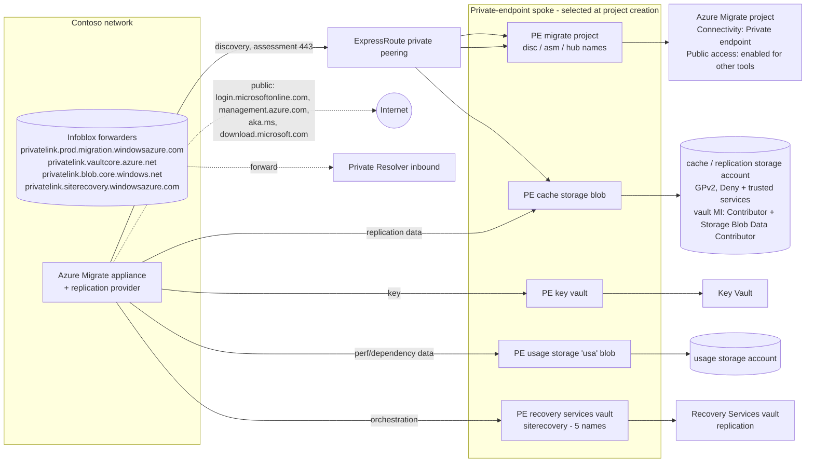

## When to use

The migration plan states that VMs migrate with Azure Migrate over
Private Link, that discovery and assessment may use the public route, and that replication
must use the private path; Contoso adds that the cache storage account must be as secure
as the file share accounts. Pull this when creating the Migrate project (the connectivity
method cannot be changed afterwards), when choosing the cache storage account, or when the
appliance reports `AgentNotConnected`, `ForbiddenToAccessKeyVault` or a 504 while saving its
configuration.

## Reuse before reinvent (GR11)

```yaml
- primitive: hybrid DNS design (Private Resolver + Infoblox forwarders)
  path: codex/blueprint-azure-dns-for-private-endpoints.md
  why: Azure Migrate adds four privatelink zones; resolving them through the existing inbound
       endpoint avoids the hosts-file workaround Microsoft recommends only for testing
- primitive: secure storage account baseline
  path: codex/blueprint-azure-files-secure-storage-account.md
  why: the replication and cache storage accounts take the same firewall, TLS, key and
       diagnostics controls; only the private endpoint sub-resources (blob) differ
- primitive: Azure Migrate private endpoint troubleshooting (Download DNS settings)
  path: codex/runbook-private-endpoint-name-resolution-and-reachability.md
  why: the project exports the exact FQDN/IP pairs the appliance must resolve, which is the
       oracle for the DNS step
```

## Build sequence



1. **Create the project with private endpoint connectivity** (portal or REST; PowerShell is
   not supported for the private link option): Advanced > Connectivity method **Private
   endpoint**, keep **Disable public endpoint access = No** so partner tools can still upload
   usage data, select the private-endpoint spoke VNet/subnet reachable over the ExpressRoute
   gateway. The subnet needs up to 15 addresses for the project's endpoints; more appliances
   need more. The connectivity method cannot be changed on an existing project.
2. **Generate the appliance key.** Azure creates the Key Vault, the usage storage account
   (`...usa`), the Recovery Services vault (agentless VMware) and internal resources, attaches
   a private endpoint to each, creates the privatelink zones in the project resource group and
   links them to the selected VNet, and enables managed identities for the project and vault.
   Download the appliance installer (no OVA/VHD for private projects; an existing appliance can
   be re-registered with the installer script's private endpoint option).
3. **DNS for the appliance.** From both properties pages (Discovery and assessment; Migration
   and modernization) use **Download DNS settings** to get every private link FQDN/IP. For
   production, resolve them through Infoblox conditional forwarders for the zones in the
   diagram to the Private Resolver inbound endpoint (link the Migrate-created zones to the hub
   or merge their records into the central zones - never two zones of the same name on one
   VNet). The hosts file on the appliance is for testing only. If the appliance uses a proxy,
   add bypass rules for the private link FQDNs or make the proxy resolve them privately.
4. **Public URLs that remain.** `*.portal.azure.com`, Entra ID endpoints (`*.microsoftonline.com`
   and related), `management.azure.com`, `aka.ms/*` and `download.microsoft.com/download`
   (updates), optional `*.services.visualstudio.com`. Discovery and assessment traffic itself
   goes to the project private endpoint; agentless dependency visualisation works over Private
   Link, agent-based needs Azure Monitor Private Link Scope.
5. **Cache / replication storage account.** Create it in advance: general-purpose v2 (private
   endpoints are only supported on GPv2), same region as the target, Standard for the cache
   (if the replication account is Premium, a second Standard cache account is required and both
   need private endpoints), private endpoint sub-resource `blob` - the only target
   sub-resource Azure Migrate documents for the cache/replication storage account (agentless
   VMware, agent-based and Hyper-V alike), integrated with `privatelink.blob.core.windows.net`.
   Apply the secure storage baseline: TLS 1.2, HTTPS only, firewall `Deny` with **Allow
   trusted Microsoft services** (required by Migrate), key expiration policy, diagnostics,
   lock; grant the vault's managed identity **Contributor + Storage Blob Data Contributor**
   (Standard) or **Contributor + Storage Blob Data Owner** (Premium) on the account. Add a
   resource instance rule for the Migrate-created Recovery Services vault
   (`Microsoft.RecoveryServices/vaults`) if Contoso later disables the trusted-services
   bypass - the vault's managed identity is the principal holding Contributor + Storage Blob
   Data Contributor on this account. (`Microsoft.Migrate/migrateprojects` remains the right
   instance type only for the project's own `...usa` usage storage account.)
6. **Replication over the private path.** Select the cache account in Replicate > Target
   settings (it appears only after the private endpoint exists and is approved); before the
   first replication, resolve `<cache>.blob.core.windows.net` from the appliance and confirm a
   private IP and `Test-NetConnection -Port 443` success; the Recovery Services vault private
   endpoint exposes five `{vault-id}-asr-pod01-{type}.{geo}.privatelink.siterecovery.windowsazure.com`
   names that the replication provider must also resolve privately.
7. **Verify (the oracle).** Appliance registration completes; discovery starts without
   `AgentNotConnected`; `nslookup` of every FQDN in the DNS settings file returns a private IP
   matching the file; private endpoint **Data Bytes In/Out** metrics show traffic during
   replication; the export/assessment CSV download works from a client on the private network
   (or the usage account's firewall allows the admin IP - a documented Migrate limitation).
   The kit assessor lists the cache account with SEC/DATA findings only for documented
   exceptions.

### Zone and endpoint map

| Resource | Private endpoint sub-resource | Private DNS zone | Created by |
| --- | --- | --- | --- |
| Migrate project (discovery, assessment, hub) | Default | `privatelink.prod.migration.windowsazure.com` | Azure Migrate at project creation |
| Key Vault (appliance key) | vault | `privatelink.vaultcore.azure.net` | Azure Migrate at key generation |
| Usage storage account (`...usa`) | blob | `privatelink.blob.core.windows.net` | Azure Migrate at key generation |
| Recovery Services vault (replication) | AzureSiteRecovery | `privatelink.siterecovery.windowsazure.com` | Azure Migrate (Create resources) |
| Cache / replication storage account | blob | `privatelink.blob.core.windows.net` | **Contoso** (not created by Migrate) |

## Declared artifact registry

| Artifact | Source of truth | Rebuild | Verify |
| --- | --- | --- | --- |
| Migrate project (private endpoint connectivity) | portal / REST (no PowerShell) | recreate (connectivity is immutable) | project Properties shows Private endpoint |
| Key Vault, usage storage, RSV + their private endpoints and zones | Azure Migrate automation | Generate key again | Properties pages list Approved endpoints |
| Cache storage account + blob private endpoint + zone group | Bicep `avm/res/storage/storage-account` 0.33.0 with `privateEndpoints: [{service: 'blob'}]` | `az deployment group create` | `nslookup <cache>.blob.core.windows.net` from the appliance returns 10.x |
| Vault MI role assignments on the cache account | CLI `az role assignment create` | idempotent | `az role assignment list --scope <cache>` |
| Infoblox forwarders for the four zones | Infoblox grid | Infoblox UI | every FQDN in "Download DNS settings" resolves to its listed IP |
| Appliance registration | appliance configuration manager | re-register with the project key | discovery running |

## How a persona runs this (-> ticket)

- **Persona:** `eng-netops`
- **Devstation flavor:** `netops-v`
- **Gate pull:** `kind: azure-migrate-private-link-landing`
- **CR file:** `change-management/CR-<date>-azure-migrate-private-link-landing.md`
- **Closure:** every FQDN in the project's DNS settings file resolves to its private IP from the appliance, discovery is running, and a test replication writes bytes through the cache account private endpoint

## Gate rules

```json
[
  {"rule": "the project uses private endpoint connectivity", "severity": "error", "check": "az rest --method get --url https://management.azure.com<migrate-project-id>?api-version=2020-05-01 --query properties.publicNetworkAccess -o tsv prints Enabled and the project properties page lists private endpoints"},
  {"rule": "every Migrate private endpoint is approved", "severity": "error", "check": "az network private-endpoint list -g <migrate-rg> --query \"[].privateLinkServiceConnections[0].privateLinkServiceConnectionState.status\" -o tsv prints only Approved"},
  {"rule": "the appliance resolves the migrate discovery name privately", "severity": "error", "check": "nslookup <id>-agent.<geo>.disc.privatelink.prod.migration.windowsazure.com on the appliance prints a 10.x address"},
  {"rule": "the cache storage account has blob private endpoint and trusted services", "severity": "error", "check": "az storage account show -n <cache> -g <rg> --query \"[networkRuleSet.defaultAction, networkRuleSet.bypass, length(privateEndpointConnections)]\" -o tsv prints Deny, AzureServices and >= 1"},
  {"rule": "the vault identity can write to the cache account", "severity": "error", "check": "az role assignment list --scope <cache-id> --assignee <vault-principal-id> --query \"[].roleDefinitionName\" -o tsv contains Storage Blob Data Contributor"}
]
```

## Reference

```yaml
- path: codex/blueprint-azure-dns-for-private-endpoints.md
  anchor: "privatelink.prod.migration.windowsazure.com"
  why: the zone set this landing relies on
- path: codex/playbook-azure-migrate-private-link-cache-storage.md
  anchor: "Download DNS settings"
  why: the executable steps for the cache account and the DNS verification
- path: codex/runbook-private-endpoint-name-resolution-and-reachability.md
  anchor: "AgentNotConnected"
  why: the incident classes when the appliance cannot reach the private endpoints
```

Microsoft Learn (read 2026-09-03): Use private endpoints - Azure Migrate; Discover and assess
using Azure Private Link; Migrate servers to Azure by using Private Link (cache storage
account, vault permissions, blob private endpoint); Troubleshoot network connectivity issues -
Azure Migrate (DNS settings download, zone list, public URLs); Azure Private Endpoint private
DNS zone values; Trusted Azure services (Microsoft.RecoveryServices/vaults,
Microsoft.Migrate/migrateprojects).
