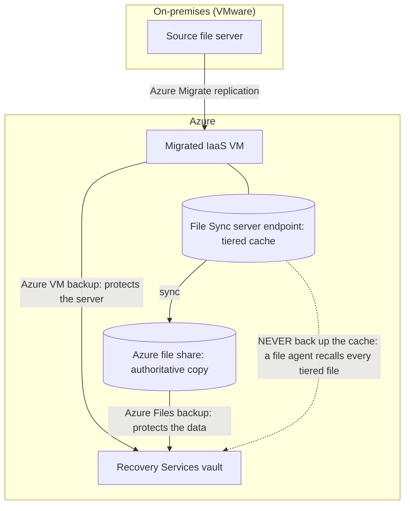
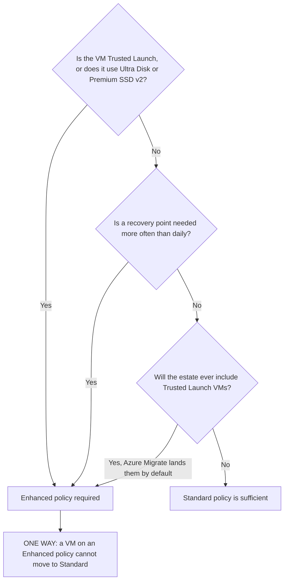
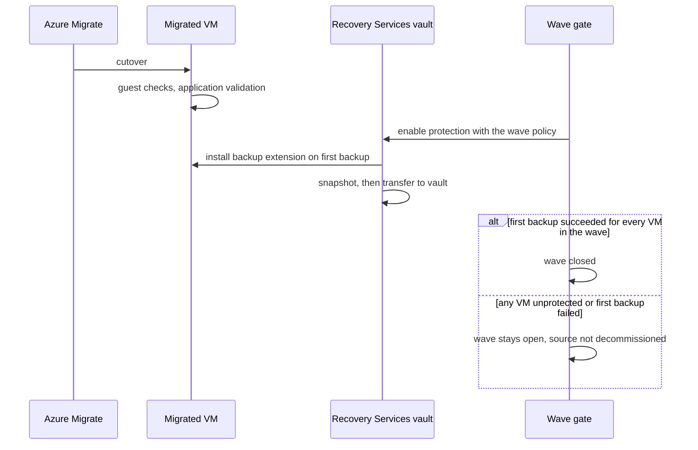

## When to use

Workloads are moving from on-premises VMware into Azure through Azure Migrate, and something
must protect them once they land. This blueprint states the target: which vault, which policy
subtype, which schedule and retention, and which restore paths are available. It also draws
the boundary that Contoso's existing backup habits will otherwise cross - a migrated file
server is protected differently depending on whether Azure File Sync is attached to it.

Pair it with [[blueprint-azure-files-backup-protection]] for the share side and
[[playbook-protect-a-migration-wave-with-azure-backup]] to execute it per wave.

## Reuse before reinvent (GR11)

```yaml
- primitive: the regional Recovery Services vault from blueprint-azure-files-backup-protection
  path: codex/blueprint-azure-files-backup-protection.md
  why: one vault per region protects both Azure file shares and Azure VMs; a second vault for
       VMs splits the security posture, the alerting and the cross-region restore decision
       across two objects that must then be kept identical by hand
- primitive: Az.RecoveryServices cmdlets already used for the file share estate
  path: codex/playbook-enable-azure-backup-for-file-shares.md
  why: the same vault, policy and job cmdlets protect IaaS VMs, so operators learn one model
       and the wave gate can query both workload types with the same command shape
- primitive: the wave plan and disposition table from the migration design
  path: advise/REFERENCE-DESIGN.md
  why: what to protect and when comes from the disposition table (A, B or C per server), not
       from a separate inventory that will drift from it
```

## Build sequence

### The three protection surfaces

The single most common design error in this engagement is treating "backup for the migrated
servers" as one thing. It is three, with different products, different traffic paths and one
hard prohibition.



| Surface | Product | What it is for | Traffic |
|---|---|---|---|
| Migrated IaaS VM | Azure Backup for Azure VMs | Rebuilding the server | Azure-internal |
| Azure file share | Azure Backup for Azure Files | Recovering the data | Azure-internal |
| File Sync server endpoint | none, deliberately | nothing - it is a cache | n/a |

**The prohibition.** A server endpoint's tiered files are reparse points. Any file-level
backup agent that walks the volume reads them, and reading a tiered file recalls it. Pointing
a traditional backup product at a File Sync volume therefore recalls the entire tiered
dataset: the cache volume fills, cloud tiering fights the agent, egress is billed, and the
server enters low disk space mode. For a server with File Sync attached, protect the **share**
and treat the server as rebuildable from
[[playbook-enable-file-sync-private-endpoint-and-cutover]].

### 1. Vault placement and posture

One Recovery Services vault per region, shared with the file share estate. Two properties are
effectively **one-way and must be set before the first item is protected**:

- `BackupStorageRedundancy` - GeoRedundant where Contoso's DR plan requires a second region.
- Cross-region restore - enabled at the same time.

Then soft delete (always-on), immutability, multi-user authorization with a Resource Guard in
a separate subscription, diagnostic settings to the workspace, and alerts for all job
failures. This is the same posture as [[blueprint-azure-files-backup-protection]]; do not
build a second, weaker one for VMs.

### 2. Policy subtype - the decision that cannot be reversed



Azure Migrate lands Trusted Launch VMs by default where the guest supports it, so the
practical answer for a migration estate is **Enhanced**. Verified behaviour:

| Property | Value |
|---|---|
| Frequency options (Enhanced) | Hourly, Daily, Weekly |
| Hourly interval | 4, 6, 8, 12 or 24 hours |
| Hourly RPO | minimum 4 hours, maximum 24 hours |
| Instant restore (snapshot) retention | 1 to 30 days, default 7 |
| Max snapshot retention at 4-hour frequency | 17 days |
| Max snapshot retention at 6-hour frequency | 22 days |
| Portal default retention | daily 180 days, weekly 12 weeks, monthly 60 months, yearly 10 years |
| Snapshot resiliency (Enhanced) | zone-redundant |
| Enhanced to Standard | not supported once protection is enabled |
| Standard to Enhanced | supported as a separate migration operation |

Retention values come from Contoso's records-retention schedule, not from the portal
defaults. The defaults above are a starting point and are frequently wrong for a government
records obligation in both directions.

### 3. Consistency and what the snapshot contains

- **Windows**: Azure Backup coordinates with VSS for an application-consistent snapshot; the
  VMSnapshot extension is installed on first backup. For SQL Server, a VSS Full (Copy-Only)
  backup is taken by default so the SQL backup chain used by other tools is not truncated.
- **Linux**: file-system consistent by default; application consistency requires pre/post
  scripts that you write and own.
- **Crash-consistent** is the opt-in agentless multi-disk mode, and is also what you get when
  the VM is stopped or deallocated at backup time.
- VM-level backup is not a database point-in-time recovery mechanism. If Contoso needs log
  based recovery for SQL Server in a VM, that is the separate SQL-in-VM workload backup.

**Selective disk backup** excludes non-critical data disks to reduce cost. An excluded disk is
an unprotected disk and nothing in the restore experience will remind you, so exclusions
belong in the decision log.

### 4. Restore paths

| Path | Use | Note |
|---|---|---|
| Create a new VM | Whole-server recovery to a new object | Simplest; needs a target that is not throttled |
| Replace disks | In-place recovery of an existing VM | Keeps VM identity, NIC and extensions |
| Restore disks | Recover disks and build the VM yourself | The controllable option for a changed target |
| File recovery | Individual files from a VM recovery point | Mounts the recovery point over iSCSI |

**File recovery and private endpoints.** Azure VM backup and restore of disks require no
private endpoint - the traffic is Azure-internal. But file recovery from a vault that has
private endpoints is restricted to virtual networks that contain a vault private endpoint. If
item-level recovery from VM backups must work over Contoso ExpressRoute, that is the
reason to add a vault private endpoint; otherwise none is needed. See
[[blueprint-azure-dns-for-private-endpoints]] for the zone if you do.

### 5. Where protection sits in the migration

Protection is a **wave exit gate**, not a follow-up task. A migrated VM with no backup runs
perfectly and is invisible until it is needed.



Billing begins only after the first successful backup, so an unprotected VM is also invisible
on the invoice.

### 6. Sizing and timing expectations

- Backup is incremental after the first pass and disks are backed up in parallel.
- Snapshot to vault transfer can take up to eight hours at peak; total backup time for a daily
  policy is under 24 hours. The first backup is the exception and depends on data size.
- Disks with more than 200 GB of daily churn can push a backup beyond eight hours.
- Stagger schedules across VMs rather than backing everything up at the same time.

## How a persona runs this (-> ticket)

- **Persona:** `eng-sysops`
- **Devstation flavor:** `netops-v`
- **Gate pull:** `kind: azure-vm-backup-for-migrated-servers`
- **CR file:** `change-management/CR-<date>-azure-vm-backup-for-migrated-servers.md`
- **Closure:** vault redundancy and cross-region restore set before first protection, Enhanced
  policy created with retention from the records schedule, every VM in every closed wave
  protected with a successful first backup, one documented restore of each type, and an
  explicit confirmation that no file-level backup agent targets a File Sync volume

## Gate rules

```json
[
  {"rule": "vault redundancy and cross-region restore were set before the first protected item", "severity": "error", "check": "az backup vault backup-properties show -n <vault> -g <rg> --query \"[0].properties.storageModelType\" -o tsv prints GeoRedundant and the change ticket records that az backup item list -v <vault> -g <rg> --query length(@) was 0 at the time it was set"},
  {"rule": "every VM in a closed wave is protected", "severity": "error", "check": "az backup item list -v <vault> -g <rg> --backup-management-type AzureIaasVM --query \"[].properties.friendlyName\" -o tsv lists every VM name in the wave plan"},
  {"rule": "the VM policy is the Enhanced subtype", "severity": "error", "check": "powershell -Command \"Get-AzRecoveryServicesBackupProtectionPolicy -PolicySubType Enhanced -VaultId (Get-AzRecoveryServicesVault -Name <vault> -ResourceGroupName <rg>).ID | Select-Object -ExpandProperty Name\" lists the VM policy"},
  {"rule": "every protected VM has a successful recovery point", "severity": "error", "check": "az backup job list -v <vault> -g <rg> --backup-management-type AzureIaasVM --operation Backup --status Completed --query length(@) prints a value equal to or greater than the protected VM count"},
  {"rule": "no file-level backup agent targets a File Sync server endpoint", "severity": "error", "check": "on each registered server, powershell -Command \"Get-Service -Name '*backup*','*veeam*','*commvault*','*netbackup*' -ErrorAction SilentlyContinue | Where-Object Status -eq 'Running'\" returns nothing, or the change ticket records the exclusion configured for the server endpoint path"}
]
```

## Reference

```yaml
- path: codex/blueprint-azure-files-backup-protection.md
  anchor: "vault"
  why: the same regional vault and security posture protects the share estate, and the
       redundancy decision is shared between both workloads
- path: codex/playbook-protect-a-migration-wave-with-azure-backup.md
  anchor: "wave gate"
  why: the executable form of section 5, run once per migration wave
- path: advise/REFERENCE-DESIGN.md
  anchor: "D-13"
  why: the decision record for policy subtype, retention and the one-way constraint
- path: advise/REFERENCE-DESIGN.md
  anchor: "D-14"
  why: the prohibition on backing up a File Sync cache, stated as a customer-facing decision
```

Microsoft Learn (read 2026-09-03): About Azure VM backup (backup process, snapshot
consistency, performance, costs); Back up Azure VMs with the Enhanced policy (subtype limits,
frequency, instant restore retention, Trusted Launch and disk support, one-way constraint);
Private endpoints overview for Azure Backup (which workloads use them, file recovery
restriction); Selective disk backup and restore for Azure VMs.
