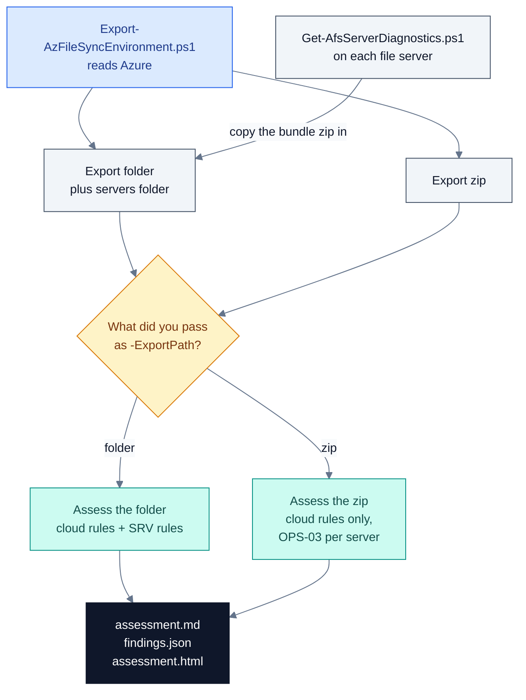
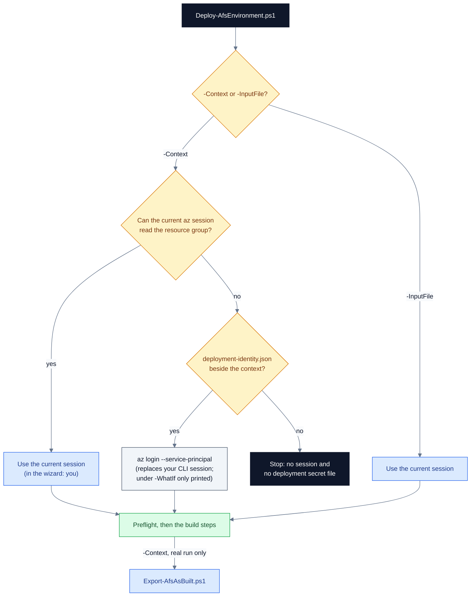
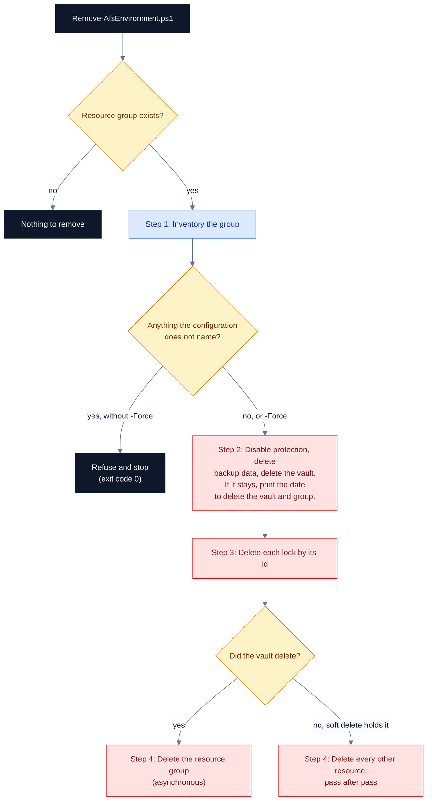
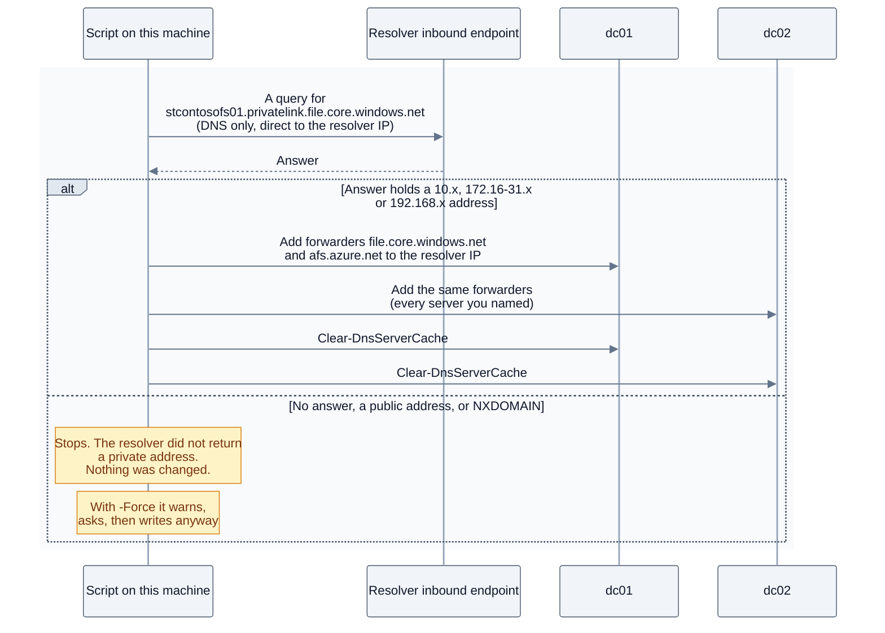
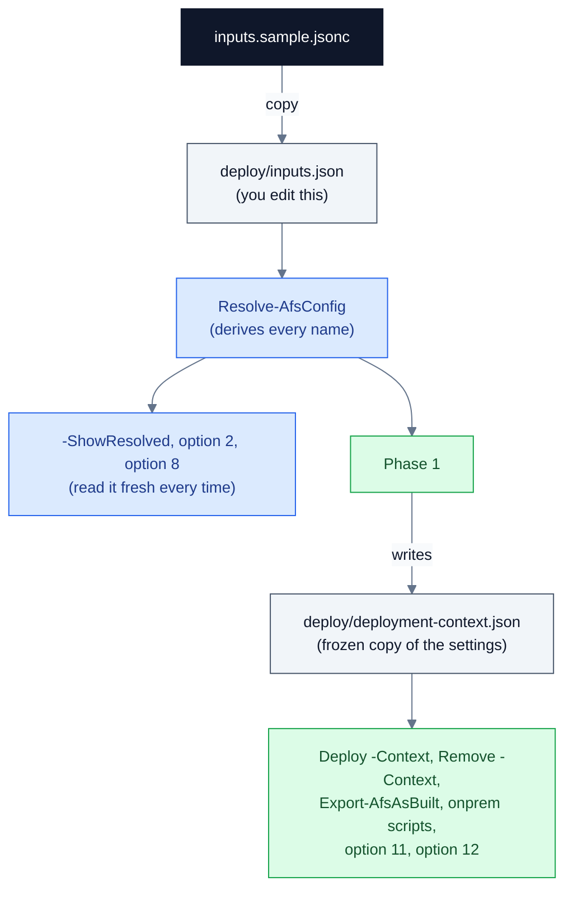

# Script reference - Azure File Sync + Backup Kit

Every script in the kit, and the settings file the build reads. This is part of the
[user guide](USER-GUIDE.md); start there for the wizard, the tutorial, troubleshooting and how it works.
Every statement was checked against the code at `V 2026.09.10.002`.

## 3. Script reference

Every script in the table below also runs on its own from a PowerShell prompt in the kit folder. The wizard asks the questions for you and passes a fixed set of arguments, so run a script directly when you need something the wizard does not expose, such as a longer backup-job window for the export or a separate output folder for the assessor. The table below shows which wizard option runs each script. Every script in the table declares `[CmdletBinding()]` and so accepts the common parameters, including `-Verbose`. The one exception in the table is `Render-AfsAssessmentHtml.ps1`: it is a function library that you dot-source, and its `ConvertTo-AfsAssessmentHtml` function accepts the common parameters instead. The other `.ps1` files under `deploy\`, `onprem\` and `render\` that are not in the table (for example `deploy\AfsConfig.ps1`, `deploy\AfsLog.ps1`, `onprem\AfsOnPrem.ps1` and `render\AfsTab-*.ps1`) are helper files that the scripts dot-source; they declare no `[CmdletBinding()]` and are not meant to be run on their own. `-WhatIf` and `-Confirm` exist only on the scripts that change something: the governance wrapper, `Phase1-New-DeploymentIdentity.ps1`, `Deploy-AfsEnvironment.ps1`, `Remove-AfsEnvironment.ps1` and the three `onprem\` scripts. Each script also carries comment-based help (`Get-Help .\<script>.ps1 -Full`). Where that help and the code disagree, this guide follows the code.

| Script | Wizard option that runs it |
| --- | --- |
| [Export-AzFileSyncEnvironment.ps1](#export-azfilesyncenvironmentps1) | [Option 4](USER-GUIDE.md#option-4-assess-an-existing-environment), step `Export the configuration from Azure (needs Reader)` |
| [Get-AfsServerDiagnostics.ps1](#get-afsserverdiagnosticsps1) | None - run it on each file server |
| [Assess-AzFileSyncExport.ps1](#assess-azfilesyncexportps1) | [Option 4](USER-GUIDE.md#option-4-assess-an-existing-environment), step `Assess an export I already have (no Azure access needed)`; [option 5](USER-GUIDE.md#option-5-see-the-assessment-results), `Re-generate this report from its export` |
| [Render-AfsAssessmentHtml.ps1](#render-afsassessmenthtmlps1) | None directly - the assessor loads it on every run |
| [Invoke-AfsGovernanceAssessment.ps1](#invoke-afsgovernanceassessmentps1) | [Option 6](USER-GUIDE.md#option-6-assess-policy-and-governance-across-the-tenant) |
| [deploy/Phase1-New-DeploymentIdentity.ps1](#deployphase1-new-deploymentidentityps1) | [Option 3](USER-GUIDE.md#option-3-build-a-new-azure-file-sync-environment) |
| [deploy/Deploy-AfsEnvironment.ps1](#deploydeploy-afsenvironmentps1) | [Option 3](USER-GUIDE.md#option-3-build-a-new-azure-file-sync-environment) and [option 12](USER-GUIDE.md#option-12-resume-the-last-build) |
| [deploy/Remove-AfsEnvironment.ps1](#deployremove-afsenvironmentps1) | [Option 7](USER-GUIDE.md#option-7-remove-an-environment-i-built) |
| [deploy/Export-AfsAsBuilt.ps1](#deployexport-afsasbuiltps1) | [Option 13](USER-GUIDE.md#option-13-open-the-findings-and-as-built-reports), `Generate the as-built for the last build now`; also the last step of `Deploy-AfsEnvironment.ps1` |
| [onprem/Install-AfsServerEndpoint.ps1](#onpreminstall-afsserverendpointps1), [onprem/Set-AfsDnsForwarders.ps1](#onpremset-afsdnsforwardersps1), [onprem/Join-AfsStorageAccountToAdDs.ps1](#onpremjoin-afsstorageaccounttoaddsps1) | [Option 11](USER-GUIDE.md#option-11-connect-your-on-premises-servers) |

### Export-AzFileSyncEnvironment.ps1

Exports the configuration and recent health of the Azure File Sync, storage, Azure Backup and private networking resources in the subscriptions you choose, as raw ARM JSON plus a readable `summary.md`, and zips it for the assessor.

| Run it | |
| --- | --- |
| Where | Any workstation that can reach Azure Resource Manager over HTTPS. Not the file server. |
| As whom | Reader on the subscriptions. No Entra ID (Microsoft Graph), AD or server rights. No elevation. |
| PowerShell | Windows PowerShell 5.1 or PowerShell 7, with the `Az.Accounts` module and a working Az PowerShell sign-in (`Connect-AzAccount`). An `az login` does not count. The Azure CLI is not used. |
| Changes | Nothing in Azure. Every call is a read: ARM GET, plus one Azure Resource Graph query that is sent as a POST. Locally it writes the export folder and a zip beside it. |
| Menu | [Option 4](USER-GUIDE.md#option-4-assess-an-existing-environment), step `Export the configuration from Azure (needs Reader)`. The wizard passes only `-SubscriptionId` and runs from the kit folder, so the export lands there. |

**What it reads.** Every call goes through the Az PowerShell session to the Resource Manager endpoint of your Az context, so the script works in whichever cloud that context is in.

| Area | What it reads | api-version | Saved as |
| --- | --- | --- | --- |
| Scope | The subscription list, or each subscription you name | 2022-12-01 | `manifest.json`, `summary.md` |
| Azure File Sync | Storage Sync Services; their private endpoint connections, registered servers, sync groups, cloud endpoints and server endpoints (with sync and cloud tiering status) | 2022-09-01 | `storagesync\<Sub>__<service>\` |
| Storage | Every storage account in the subscription, not only the File Sync ones; file service properties (share soft delete, SMB settings); shares with their snapshots and soft-deleted shares; the usage of each live share | 2024-01-01 | `storage\<Sub>__<account>\` |
| Defender for Storage | The subscription plan for storage accounts; the per-account setting | 2024-01-01, 2022-12-01-preview | `defender\`, `defender.json` |
| Recovery Services vaults | Vault, vault config, storage config, every backup policy, `AzureStorage` protection containers, every protected item (all workloads, not only file shares), backup jobs in the lookback window, Resource Guard proxies | 2024-04-01 | `backup\<Sub>__<vault>\` |
| Backup vaults (Data Protection) | Vault, policies, backup instances | 2024-04-01 | `backup-dataprotection\<Sub>__<vault>\` |
| Private DNS | Zones named `privatelink.file.*`, `privatelink.afs.*` or `*.privatelink.afs.*`, with their VNet links and A records | 2020-06-01 | `network\privatednszones.json` |
| Private endpoints | Endpoints that target a storage account or a Storage Sync Service, with their DNS zone groups | 2023-11-01 | `network\privateendpoints.json` |
| Hybrid topology | One Resource Graph query for ExpressRoute circuits, virtual network gateways, ExpressRoute gateways, connections, virtual networks, DNS Private Resolvers, DNS forwarding rulesets, virtual hubs and Azure Firewalls | 2021-03-01 | `network\topology.json` |
| Alert rules | Metric alert rules whose scope is exactly an exported sync service, storage account or vault | 2018-03-01 | `monitor\metricalerts.json` |
| Per resource | On each sync service, storage account (and its file service) and vault: diagnostic settings, role assignments that apply at that scope (the `atScope()` list, which also includes assignments inherited from the resource group, subscription and management groups), with the role name resolved, and locks. Also the subscription's whole lock list | 2021-05-01-preview, 2022-04-01, 2020-05-01 | `diagnostics*.json`, `roleassignments.json`, `locks.json`, `locks\<Sub>.json` |
| Metrics | Sync service: session results, heartbeat, per-item errors, recall size, low disk mode, agent expiry days, bytes synced. File service: capacity, snapshot size and count, file count, transactions, availability. Skipped with `-SkipMetrics` | 2018-01-01 | `metrics.json` |

#### Parameters

| Parameter | Type | Default | What it does |
| --- | --- | --- | --- |
| `-SubscriptionId` | string[] | Every subscription whose state is `Enabled` in the tenant of your Az context | The subscriptions to export. Each id you name is read directly and is exported even if it is not `Enabled`. |
| `-OutputPath` | string | `afs-export-<yyyyMMdd-HHmmss>` in the current folder | The folder to create, or to reuse if it exists. The zip is written as `<OutputPath>.zip`. |
| `-JobLookbackDays` | int, 1-365 | `30` | Days of Recovery Services backup jobs to export. |
| `-MetricsLookbackDays` | int, 1-30 | `7` | Days of sync service metrics and of storage transactions and availability. Storage capacity metrics always cover the last 1 day. |
| `-SkipMetrics` | switch | off | Skips every Azure Monitor metrics call. No `metrics.json` is written, and the manifest records `metricsSkipped=true`. |
| `-NoZip` | switch | off | Leaves the folder only; no zip is made. |

The script has no prompts and no `-WhatIf`.

#### Examples

```powershell
# Once per machine: the only module the exporter needs
Install-Module Az.Accounts -Scope CurrentUser

# Sign Az PowerShell in. An az login does not sign it in.
Connect-AzAccount -Tenant 00000000-0000-0000-0000-000000000000

# Every Enabled subscription in that tenant; folder and zip in the current folder
.\Export-AzFileSyncEnvironment.ps1

# Two named subscriptions, 60 days of backup jobs, 14 days of metrics
.\Export-AzFileSyncEnvironment.ps1 `
  -SubscriptionId 00000000-0000-0000-0000-000000000000, 00000000-0000-0000-0000-000000000001 `
  -JobLookbackDays 60 -MetricsLookbackDays 14

# Quick re-run into a named folder: no metrics, no zip
.\Export-AzFileSyncEnvironment.ps1 -SkipMetrics -NoZip -OutputPath C:\temp\contoso-afs
```

With `-OutputPath C:\temp\contoso-afs` and no `-NoZip`, the zip is `C:\temp\contoso-afs.zip`.

#### Output

The folder is kept after zipping. The zip sits beside it and holds the folder's contents at its root. `<Sub>` is the subscription display name, with every character other than letters, digits, `_`, `.` and `-` replaced by `_`.

```text
afs-export-<yyyyMMdd-HHmmss>\
  summary.md                      readable inventory, section 5 = export health
  manifest.json                   tool, version, schema, who, tenant, cloud, api versions,
                                  windows, counts, errorCount, sha256 of every file written
  inventory.json                  ids and names of everything found
  errors.json                     every failed call: {where, detail, at}
  storagesync\<Sub>__<service>\   service, privateendpointconnections, registeredservers,
                                  syncgroups, cloudendpoints, serverendpoints, diagnostics,
                                  roleassignments, locks, metrics (.json)
  locks\<Sub>.json                every lock the subscription lists (subscription,
                                  resource-group and resource scope)
  defender\<Sub>-pricing-StorageAccounts.json
  storage\<Sub>__<account>\       account, fileservice, shares {shares, snapshots, softDeleted},
                                  diagnostics-account, diagnostics-fileservice, roleassignments,
                                  locks, defender, metrics (.json; metrics only if the account
                                  has at least one live share)
  backup\<Sub>__<vault>\          vault, vaultconfig, storageconfig, policies, containers,
                                  protecteditems, jobs, resourceguardproxies, diagnostics,
                                  roleassignments, locks (.json)
  backup\share-coverage.json      every live share: protected or not, vault, policy, state
  backup-dataprotection\<Sub>__<vault>\   vault, policies, instances (.json)
  network\                        topology.json, privatednszones.json, privateendpoints.json
  monitor\metricalerts.json
afs-export-<yyyyMMdd-HHmmss>.zip  beside the folder
```

`summary.md` has these sections: `## 1. Azure File Sync` (per service: traffic policy, registered servers, sync groups, server endpoint health and tiering), `## 2. Storage accounts and Azure file shares` (a settings table and a share table per account), `## 3. Azure Backup` (vault settings, file share policies, protected items, job counts, then a `### File share backup coverage` table where an unprotected share reads **NOT PROTECTED**), `## 4. Private networking for Azure Files / Azure File Sync`, `## 4b. Alert rules` and `## 5. Export health`.

The console shows these lines, in this order (the names here are placeholders):

```text
[10:41:02] Export-AzFileSyncEnvironment v1.0.0 -> C:\afs-kit\afs-export-20260910-104102
[10:41:02] Signed in as admin@contoso.com , tenant 00000000-0000-0000-0000-000000000000 , cloud AzureCloud
[10:41:03] Scope: 1 subscription(s): Contoso-Prod (00000000-0000-0000-0000-000000000000)
[10:41:03] [Contoso-Prod] Storage Sync Services
[10:41:04]   Storage Sync Service sss-contoso-filesync
[10:41:09] [Contoso-Prod] Storage accounts
[10:41:10]   Storage account stcontosofs01 (Azure File Sync cloud endpoint)
[10:41:25] [Contoso-Prod] Recovery Services vaults
[10:41:26]   Recovery Services vault rsv-contoso-eastus
[10:41:40] [Contoso-Prod] Private DNS zones + private endpoints
[10:41:42] Hybrid connectivity topology (Resource Graph)
[10:41:43] [Contoso-Prod] Metric alert rules
[10:41:44] Done. 58 files, 0 failed call(s). Counts: storageSyncServices=1 syncGroups=1 ...
[10:41:46] Zipped -> C:\afs-kit\afs-export-20260910-104102.zip  (send this file for assessment)
```

After that it prints the first 12 lines of `summary.md` and `... (full summary in summary.md)`. Each failed call also prints a `WARNING: <label>: <detail>` line as it happens.

**What the export never contains.**

- File contents, storage account keys, SAS tokens or certificates. The script makes no `listKeys` or SAS calls.
- Anything from Entra ID (Microsoft Graph). Role assignments carry only the principal id and principal type, with no display names or UPNs.
- Anything from the file servers. For that, run [Get-AfsServerDiagnostics.ps1](#get-afsserverdiagnosticsps1) on each server.
- Azure Policy, the management-group tree, cost, quota or Advisor data. For tenant governance, use [option 6](USER-GUIDE.md#option-6-assess-policy-and-governance-across-the-tenant). (Locks are captured: `locks\<Sub>.json` is the subscription's whole lock list, which the report's Guardrails tab reads as subscription, resource-group and resource locks.)
- Activity Log entries, Log Analytics contents (only the diagnostic settings that send to it), recovery point lists, backup jobs older than `-JobLookbackDays`, metrics older than `-MetricsLookbackDays`, and storage capacity metrics older than 1 day.
- Alerts other than metric alert rules scoped exactly to a sync service, storage account or vault. Activity-log alerts, log search alerts, action groups, alert processing rules, and rules scoped to `fileServices/default`, a resource group or a subscription are not read.
- Private DNS zones whose names match none of `privatelink.file.*`, `privatelink.afs.*` and `*.privatelink.afs.*`, records other than A records, private endpoints for other targets (Recovery Services vault endpoints included), NSGs, route tables and effective routes.
- Resources in subscriptions outside the scope, such as a separate connectivity subscription that holds the hub network or DNS. Add that subscription to `-SubscriptionId`.
- Blob, queue and table service settings. For Backup vaults, only the vault, its policies and its instances.

**Redaction.**

- Before each JSON file is written, fields with these exact names (any case) are replaced with `[REDACTED]`: `serverCertificate`, `primaryKey`, `secondaryKey`, `connectionString`, `sasToken`, `accessToken`, `password`, `clientSecret`, `sharedKey`, `primaryMasterKey`, `keys`. Registered servers carry `serverCertificate`, and it is blanked.
- The pass walks the ARM objects and lists it is handed. It does not look inside the wrappers the script builds itself: `shares.json`, `metrics.json`, `roleassignments.json`, `backup\share-coverage.json`, `network\privatednszones.json`, `network\privateendpoints.json`, `inventory.json` and `errors.json`. ARM does not return secrets in those payloads and the script requests none, but the redaction pass does not cover them (tracked in [#3](https://github.com/gusitde/azure-filesync-backup-assessment/issues/3)).
- `summary.md` and `manifest.json` are written directly and never pass through redaction. Both record the signed-in account and the tenant id.
- The export does identify the estate: subscription names and ids, resource ids, registered server names, server endpoint local paths, private IP addresses from the A records, and principal ids. Handle it as customer data. The kit's `.gitignore` excludes `afs-export-*` folders and `*.zip`.

#### When it worked

- The console shows `Done. <N> files, 0 failed call(s).` and, unless you used `-NoZip`, `Zipped -> <folder>.zip  (send this file for assessment)`. `<N>` counts every file written plus the manifest.
- `summary.md` section 5 reads `- Calls that failed (see errors.json): 0`.
- A non-zero failed count still gives a usable export. The run ends normally; the gaps are in `errors.json`, and the assessor reports them as finding OPS-02.
- Next, assess it with [Assess-AzFileSyncExport.ps1](#assess-azfilesyncexportps1) or option 4. If you will add server bundles, keep the folder and assess the folder, not the zip.

#### If it goes wrong

| You see | It means | Do this |
| --- | --- | --- |
| `No Az PowerShell session.` followed by help text | Az PowerShell is not signed in. Only `az login` was done, or nothing. | `Connect-AzAccount -Tenant <tenant-id>`, then run the script again. |
| `The Az PowerShell session for <account> exists but cannot call Azure (HTTP <code>). It has expired or was never usable.` | The context is expired, or was created from a raw token. `<code>` reads `no response` when the call itself failed. | `Connect-AzAccount -Tenant <tenant-id>`. |
| `Subscription <id> is not visible to <account>. Check the id, and that this account has Reader on it.` | A typo, no Reader on it, or the subscription is in a different tenant from your Az context. | Fix the id, get Reader, or sign in to the subscription's tenant. |
| `Could not list subscriptions for <account>.` ending `Or scope the run explicitly:  -SubscriptionId <id>[,<id>]` | The subscription list call failed. | Sign in again, or pass `-SubscriptionId`. |
| `No subscriptions in scope.` | No `Enabled` subscription in the tenant of your Az context. | Sign in to the right tenant, or pass `-SubscriptionId`. |
| `WARNING: <label>: HTTP 403 AuthorizationFailed: ...` | Reader is missing at that scope. The run carries on without that data. | Get Reader there and re-export, or accept the gap. The assessor lists it under OPS-02. |
| `WARNING: <label>: aborted paging after 500 pages` | A list was longer than 500 pages. The script stops paging there. | The data for that list is incomplete. Note the gap in the assessment. |
| `WARNING: metrics:<label>: HTTP 400 ...` | Azure Monitor rejected a metric dimension filter. | Nothing. The script retries once without the filter. |
| `WARNING: resourceGraph:topology: ...` | The Resource Graph query failed. | `network\topology.json` is written empty and `summary.md` says `none found / not captured`. Check the hybrid path by hand. |

#### Good to know

- The default scope is limited to the tenant of your Az context. Subscriptions the same account can see in other tenants are skipped without a message.
- A run that ends with `Done.` exits normally even when calls failed. Scripts that call the exporter must read the failed count, not the exit code.
- If `-OutputPath` points at an existing folder, files left there by an earlier run stay and go into the zip, but `manifest.json` lists only the files this run wrote. Use a new folder for each export.
- The storage capacity metrics (`FileCapacity`, `FileShareSnapshotSize`, `FileShareSnapshotCount`, `FileCount`) always cover the last 1 day at hourly grain. The script's own help says 7 days (tracked in [#3](https://github.com/gusitde/azure-filesync-backup-assessment/issues/3)).
- When a metric filter is rejected and the retry without it succeeds, the first failure still stays in `errors.json`. The failed-call count, and so the assessor's OPS-02 finding, can include calls that were recovered (not yet tracked in an issue).
- The Resource Graph query keeps only the first page of results; there is no paging (not yet tracked in an issue).
- Earlier documentation, and the script's own help, said every call is an ARM GET. The Resource Graph query is a POST. It only reads.
- `Az.Accounts` must be installed or the script stops before it starts. No minimum version is enforced, although the help says 2.x or later.
- The wizard cannot set `-JobLookbackDays`, `-MetricsLookbackDays`, `-SkipMetrics`, `-NoZip` or `-OutputPath`. Run the script directly for those.
- The wizard's own Az PowerShell check calls `https://management.azure.com` whatever cloud you use, while the script itself uses your context's endpoint. For a cloud other than the Azure public cloud, run the script directly.
- `manifest.json` does not list itself, and the zip is not hashed.

Microsoft reference: the Reader role, [Azure built-in roles](https://learn.microsoft.com/azure/role-based-access-control/built-in-roles#reader); locks, [Lock your Azure resources](https://learn.microsoft.com/azure/azure-resource-manager/management/lock-resources).

*Code: `Export-AzFileSyncEnvironment.ps1` (Invoke-ArmGet, Remove-Secrets, Save-Json, Get-Metrics), `start.ps1` (Invoke-AssessFlow, Ensure-AzPowerShellSession)*

### Get-AfsServerDiagnostics.ps1

Collects a read-only diagnostic bundle from one Azure File Sync registered server, so the assessor can run its server checks (SRV-01 to SRV-11).

| Run it | |
| --- | --- |
| Where | On the registered file server itself. Run it once on each server. |
| As whom | Local Administrator, in an elevated PowerShell. It runs without elevation, but warns and collects less. No Azure sign-in. |
| PowerShell | Windows PowerShell 5.1 or later. The Azure File Sync agent must be installed at `C:\Program Files\Azure\StorageSyncAgent\`. |
| Changes | Nothing in the server's configuration. It writes a bundle folder and a zip under `-OutputPath`. `-CollectAfsDiag` also starts the agent's own verbose trace collection. |
| Menu | None - run it directly. Option 4 does not offer it, although the wizard's text mentions per-server detail. |

#### Parameters

| Parameter | Type | Default | What it does |
| --- | --- | --- | --- |
| `-OutputPath` | string | The current folder | Parent folder for the bundle folder and its zip. |
| `-EventLookbackDays` | int, 1-90 | `7` | Days of File Sync Telemetry and Operational events to collect. |
| `-SampleTieredFiles` | switch | off | Walks each server endpoint path found in the registry and counts tiered files. |
| `-MaxFiles` | int | `200000` | With `-SampleTieredFiles`, the most files inspected per server endpoint path. |
| `-CollectAfsDiag` | switch | off | Also runs `Debug-StorageSyncServer -AFSDiag` with verbose kernel-mode and user-mode tracing, into `afsdiag\`. Large, and takes minutes. |

The script has no prompts and no `-WhatIf`.

#### Examples

```powershell
# Elevated PowerShell on the file server. The usual run:
.\Get-AfsServerDiagnostics.ps1 -OutputPath C:\temp

# Also count tiered files under each server endpoint (reads attributes only)
.\Get-AfsServerDiagnostics.ps1 -OutputPath C:\temp -SampleTieredFiles

# A month of events and a bigger census limit
.\Get-AfsServerDiagnostics.ps1 -OutputPath D:\diag -EventLookbackDays 30 -SampleTieredFiles -MaxFiles 500000

# Include the agent's own log and trace collection (large, takes minutes)
.\Get-AfsServerDiagnostics.ps1 -OutputPath C:\temp -CollectAfsDiag
```

#### Output

A folder `<OutputPath>\<COMPUTERNAME>-afs-server-<yyyyMMdd-HHmmss>\` and a zip of the same name beside it. Every file the script writes is UTF-8 without a byte order mark; the files in `afsdiag\` are written by the agent's own cmdlet.

| File | What it holds |
| --- | --- |
| `system.json` | Host name, domain, OS, hardware, agent product and `FileSyncSvc.exe` version, agent registry and auto-update settings, .NET release, cluster, and whether the run was elevated |
| `services.json`, `fltmc.txt` | The FileSyncSvc, WSearch, W32Time, Dedup, DFSR, Dfs, srmsvc, MpsSvc, WinDefend and obengine services; the AzureStorageSyncMonitor and FileSyncSvc processes; whether the `StorageSync` and `StorageSyncGuard` filter drivers are loaded |
| `volumes.json` | Fixed volumes (size, free space, free %, NTFS cluster size), dedup volumes, seven related Windows features, Windows Search scopes |
| `programs.json` | Installed programs, the backup and antivirus products among them, Defender status and exclusions |
| `w32tm.txt`, `winhttp-proxy.txt`, `network.json` | Time sync status, WinHTTP proxy, IP, DNS and gateway per interface, and DNS lookups of `management.azure.com` and `login.microsoftonline.com` |
| `smbshares.json`, `registry-storagesync.json` | SMB shares (admin shares excluded) and the server endpoint registry keys |
| `debug-diagnose.txt`, `debug-network.txt`, `debug-filesyncerrors.txt` | `Debug-StorageSyncServer -Diagnose`, `-TestNetworkConnectivity` and `-FileSyncErrorsReport`. Only when the agent's cmdlets load. |
| `selfservicerestore.json` | Previous Versions state per volume. Only when `Get-StorageSyncSelfServiceRestore` exists. |
| `events-telemetry.json` | Telemetry log events 9102, 9121, 9302, 9301, 9003, 9016, 9029, 9005, 9006, 9009, 9059 and 9071, newest 5000 |
| `events-operational.json` | Operational log critical, error and warning events, newest 2000 |
| `sync-session-digest.json` | For each 9102 event: HResult, per-item error count, sync group and direction |
| `tiered-census.json` | Only with `-SampleTieredFiles`: per path, files inspected, `truncated`, tiered files, local GiB and tiered GiB |
| `afsdiag-run.txt`, `afsdiag\` | Only with `-CollectAfsDiag` |
| `errors.json` | Every collector that threw, and a missing agent DLL. A native tool that fails without throwing, a missing `Get-StorageSyncSelfServiceRestore` and a missing endpoint path are not listed. |

The console prints one line per section: `Get-AfsServerDiagnostics v1.0.0 on <HOST> -> <folder>`, `System`, `Services, drivers`, `Volumes, dedup, features`, `Installed programs (backup / AV)`, `Time / proxy / network`, `SMB shares`, `Azure File Sync server cmdlets`, `Event logs (last <N> days)`, then `Tiered file census (bounded)` with `-SampleTieredFiles`, and finally the `Done.` line.

#### When it worked

```text
[10:15:42] Done. 0 warning(s). Bundle: C:\temp\FS01-afs-server-20260910-101500.zip
Copy the zip into the cloud export folder under servers\<hostname>\ and run Assess-AzFileSyncExport.ps1.
```

A non-zero warning count is not a failure; read `errors.json` in the bundle to see what is missing. Then hand the bundle to the assessor:

1. Copy the zip to the machine that holds the export.
2. Put it in a `servers\<hostname>\` folder inside the export folder. Create the folders.
3. Run the assessor against the export **folder**, not the zip.

```text
afs-export-20260910-104102\
  manifest.json
  ...
  servers\
    FS01\
      FS01-afs-server-20260910-101500.zip     the assessor expands this in place
```

The assessor matches a bundle to a registered server by the host name recorded in `system.json` (the server's computer name), compared with the first label of the registered server's name, both lower-cased. The folder name counts only when `system.json` has no host name.

#### If it goes wrong

| You see | It means | Do this |
| --- | --- | --- |
| `WARNING: Not elevated: event logs, fltmc and server cmdlets may be incomplete. Re-run from an elevated PowerShell.` | The session is not elevated. The run continues. | Run it again from an elevated PowerShell. |
| In `errors.json`: `agent DLL not found at C:\Program Files\Azure\StorageSyncAgent\StorageSync.Management.ServerCmdlets.dll - is the Azure File Sync agent installed on this server?` | The agent is not installed, or not at the default path. The `debug-*.txt` files are not written. | Install the agent. There is no parameter for a different install path. |
| `WARNING: telemetry-log : <message>` or `WARNING: operational-log : <message>` | No event matched in the window (a quiet server gives "No events were found that match the specified selection criteria."), the log is missing, or the session is not elevated. | Widen `-EventLookbackDays`, or run elevated. |
| `WARNING: dns:management.azure.com : <message>` | The server cannot resolve that name. | Fix the server's DNS. Sync needs it too. |
| `A parameter cannot be found that matches parameter name 'SkipAfsDiag'.` | The script's help lists `-SkipAfsDiag`, but the script does not have it. | Leave it out. AFSDiag is off unless you pass `-CollectAfsDiag`. |
| The assessor reports OPS-03 `no servers/<hostname>/ bundle in the export` for this server | The assessor did not find the bundle: it is not under `servers\<hostname>\`, you assessed the zip, or the host name does not match. | Put the bundle in place and assess the folder. |

#### Good to know

- No wizard option runs this script. Server diagnostics are always a manual step.
- `Get-Help` shows a `-SkipAfsDiag` parameter that does not exist (tracked in [#3](https://github.com/gusitde/azure-filesync-backup-assessment/issues/3)).
- The agent paths are fixed at `C:\Program Files\Azure\StorageSyncAgent\`.
- One failed collector never stops the run. Most failures print a `WARNING:` line and are recorded in `errors.json`. The captured text outputs (`fltmc`, `w32tm`, the WinHTTP proxy, and the `Debug-StorageSyncServer` and AFSDiag runs) stay silent on the console: when one throws, it writes `ERROR: <message>` into its text file and a row into `errors.json`; when a native tool simply fails, for example `fltmc` without elevation, only its own error text lands in the file.
- The tiered-file census reads file attributes only. It does not open files, so it does not recall them. It counts files with the recall-on-data-access attribute (`0x400000`) as tiered, stops a path at `-MaxFiles` and marks it `truncated`, and skips a path that does not exist without a message.
- `-CollectAfsDiag` starts the agent's verbose trace collection. The script itself changes no setting.
- Every run writes a new time-stamped folder.
- The bundle holds server names, paths, installed programs, IP addresses and event messages. Handle it as customer data. The kit's `.gitignore` excludes `*-afs-server-*` folders and `*.zip`.

Microsoft reference: `Debug-StorageSyncServer`, [Use the Azure File Sync debug cmdlet](https://learn.microsoft.com/troubleshoot/azure/azure-storage/files/file-sync/file-sync-use-debug-cmdlet); `Get-StorageSyncSelfServiceRestore`, [self-service restore through Previous Versions and VSS](https://learn.microsoft.com/azure/storage/file-sync/file-sync-deployment-guide#optional-use-self-service-restore-through-previous-versions-and-vss). The kit's own notes on `fltmc` are in [codex/runbook-file-sync-agent-install-and-registration-failures.md](../codex/runbook-file-sync-agent-install-and-registration-failures.md), and on `w32tm` and the WinHTTP proxy in [codex/runbook-file-sync-broken-after-network-lockdown.md](../codex/runbook-file-sync-broken-after-network-lockdown.md).

*Code: `Get-AfsServerDiagnostics.ps1` (Try-Run, Capture, Save), `Assess-AzFileSyncExport.ps1` (the server bundle loader)*

### Assess-AzFileSyncExport.ps1

Reads an export (and any server bundles in it) offline, applies 94 rules, and writes a scorecard, the findings and a roadmap as `assessment.md`, `findings.json` and `assessment.html`.

| Run it | |
| --- | --- |
| Where | Any Windows machine that holds the export. It makes no Azure or network calls. |
| As whom | Any user. No Azure rights, no elevation. |
| PowerShell | Windows PowerShell 5.1 or later. Keep `Render-AfsAssessmentHtml.ps1` next to it, or the HTML is not produced. Keep the `render\` folder next to that too, or the HTML has only 6 tabs and none of the subject tabs. |
| Changes | Nothing in Azure or on any server. It writes the reports to `-OutputPath`, expands a zip input to `%TEMP%`, and expands server bundle zips inside the export folder. |
| Menu | [Option 4](USER-GUIDE.md#option-4-assess-an-existing-environment), step `Assess an export I already have (no Azure access needed)`, and [option 5](USER-GUIDE.md#option-5-see-the-assessment-results), `Re-generate this report from its export`. Option 4 passes `-ExportPath`, `-CustomerName` and, when you answer yes, `-PrivateTrafficRequired`. Option 5 passes `-ExportPath`, `-OutputPath` and `-CustomerName`, never `-PrivateTrafficRequired`, and `findings.json` does not record that it was used. So re-generating a private-path assessment in option 5 drops NET-05 to NET-11 and puts NET-01 back to Info. For those, run the script directly with `-PrivateTrafficRequired` (tracked in [#3](https://github.com/gusitde/azure-filesync-backup-assessment/issues/3)). |

**Folder or zip.** The input decides where the reports go and whether the server checks run.

- **Folder:** assessed in place. The reports go into the same folder. Server bundles under `servers\<hostname>\` are read, and the SRV rules run for each one.
- **Zip:** expanded to `%TEMP%\afs-assess-<yyyyMMdd-HHmmss>`, assessed from there, and the temporary folder is deleted at the end. The reports go into the folder that holds the zip. A `servers\` folder you created next to the zip, or in the export folder after zipping, is not in the zip, so it is never read: every registered server gets OPS-03 and no SRV rule runs (tracked in [#1](https://github.com/gusitde/azure-filesync-backup-assessment/issues/1)).



**The rules.** The catalog has 94 rules, grouped by ID prefix. The full catalog, with every check, recommendation and Microsoft Learn reference, is in [RULES.md](RULES.md), or print it with `-ListRules`.

| Prefix | What it covers | Rules | Needs |
| --- | --- | --- | --- |
| AFS | Azure File Sync: sync health, registered servers, topology, identity, scope | 19 | Export |
| TIER | Cloud tiering | 6 | Export |
| SEC | Storage account security | 15 | Export |
| DATA | Data durability: redundancy, share soft delete, quota, snapshots | 7 | Export |
| BKP | Azure Backup: coverage, health, policy design, vault security | 19 | Export |
| NET | Private networking. NET-05 to NET-11 run only with `-PrivateTrafficRequired` | 11 | Export |
| MON | Monitoring: alert rules and file service logs | 3 | Export |
| OPS | Tags, failed export calls (OPS-02), missing server bundles (OPS-03) | 3 | Export |
| SRV | The file servers | 11 | A server bundle |
| **Total** | | **94** | |

In the catalog 20 rules are High, 32 Medium, 26 Low and 16 Info. The report defines them this way: High, data is exposed or recovery is blocked today; Medium, a control that should be in place before the engagement closes; Low, hygiene; Info, worth knowing, no action required. The `Area` column in the findings uses 18 finer areas (for example Sync health, Vault security, Networking); the report's area filter and area table use those.

#### Parameters

| Parameter | Type | Default | What it does |
| --- | --- | --- | --- |
| `-ExportPath` | string | none | The export folder or its zip. Required unless you pass `-ListRules`. |
| `-OutputPath` | string | Folder input: the export folder. Zip input: the folder that holds the zip. | Where `assessment.md`, `findings.json`, `assessment.html` (and `rules.md`) are written. Created if missing. |
| `-CustomerName` | string | `Customer` | Printed in the title of both reports. Also fills the `{customer}` placeholder in rule text; with the default it reads `your`. |
| `-LatestAgentMajor` | int | `20` | The agent major version AFS-06 compares with. Check the Azure File Sync release notes and pass the current major. |
| `-ListRules` | switch | off | Prints the rule catalog as markdown and stops. Reads no export. |
| `-IncludeCatalog` | switch | off | Appends the catalog to `assessment.md`, writes `rules.md`, and shows it on the HTML Rules tab. |
| `-PrivateTrafficRequired` | switch | off | Use when sync and backup traffic must stay private. Turns on NET-05 to NET-11 and raises NET-01 from Info to High. |
| `-PassThru` | switch | off | Also returns the sorted findings as objects. |

#### Examples

```powershell
# Try it with no Azure access: the sample export that ships with the kit.
# Send the output elsewhere so the fixture stays clean.
.\Assess-AzFileSyncExport.ps1 -ExportPath .\fixtures\sample-export -OutputPath $env:TEMP\afs-sample -CustomerName "Contoso"

# Cloud side only, from the zip; reports land beside the zip
.\Assess-AzFileSyncExport.ps1 -ExportPath .\afs-export-20260910-104102.zip -CustomerName "Contoso"

# With server bundles: assess the folder
.\Assess-AzFileSyncExport.ps1 -ExportPath .\afs-export-20260910-104102 -CustomerName "Contoso"

# Private path required, catalog embedded, current agent major, separate output folder
.\Assess-AzFileSyncExport.ps1 -ExportPath .\afs-export-20260910-104102 -CustomerName "Contoso" `
  -PrivateTrafficRequired -IncludeCatalog -LatestAgentMajor 21 -OutputPath .\assessment-contoso

# The rule catalog as a file
.\Assess-AzFileSyncExport.ps1 -ListRules > rules.md

# Work with the findings in PowerShell
$f = .\Assess-AzFileSyncExport.ps1 -ExportPath .\afs-export-20260910-104102 -PassThru
$f | Where-Object severity -eq 'High' | Format-Table id, resource, title
```

#### Output

- `assessment.md`: the title `# Azure File Sync + Azure Backup assessment - <CustomerName>`; the export time and account; the subscriptions; a scope line with resource counts and the number of server bundles; `## Scorecard` (a severity table and an area-by-severity table); `## High findings (n)` and the Medium, Low and Info tables (ID, Resource, Finding, Evidence, Recommendation with a reference link); `## Recommendation roadmap` (`### Do now (High)`, `### This engagement window (Medium)`, `### Backlog (Low)`, one line per rule with its resource count); `## Assessment gaps` (the failed export calls, or `- Export completed with no failed calls.`, plus a line for servers with no bundle); and `## Appendix - rule catalog` with `-IncludeCatalog`.
- `findings.json`: `tool`, `toolVersion`, `customer`, `export` (the path you passed, resolved; the zip path for a zip), `assessedAtUtc`, `counts` (High, Medium, Low, Info) and `findings[]`. Each finding has `id`, `area`, `severity`, `title`, `resource`, `evidence`, `recommendation` and `reference`, sorted by severity, then id, then resource. Option 5 reads this file.
- `assessment.html`: the tabbed report. See [Render-AfsAssessmentHtml.ps1](#render-afsassessmenthtmlps1).
- `rules.md`: only with `-IncludeCatalog`.
- Re-running overwrites all of them.

#### When it worked

```text
Assessing export at C:\afs-kit\afs-export-20260910-104102 (exported 2026-09-10 10:41:02Z)
Findings: High=3 Medium=11 Low=9 Info=6 -> C:\afs-kit\afs-export-20260910-104102\assessment.md
Report: C:\afs-kit\afs-export-20260910-104102\assessment.html
```

There is no `assessment.html was not produced` warning. Open `assessment.html`, or use [option 5](USER-GUIDE.md#option-5-see-the-assessment-results) to open it at a tab or print the headline numbers. Check the High findings against `summary.md` and the raw JSON before you report them.

#### If it goes wrong

| You see | It means | Do this |
| --- | --- | --- |
| `ExportPath is required (folder or zip from Export-AzFileSyncEnvironment.ps1), or use -ListRules.` | You left out `-ExportPath`. | Pass the export folder or zip. |
| `Not an export folder (manifest.json missing): <path>` | The path is the wrong level, such as the parent folder or `servers\`. | Point at the `afs-export-<stamp>` folder or its zip. |
| `Cannot find path '<path>' because it does not exist.` | The path is wrong. | Check it. Relative paths start from your current folder. |
| `WARNING: assessment.html was not produced: <message>` | The HTML renderer failed. `assessment.md` and `findings.json` are complete. | Check that `Render-AfsAssessmentHtml.ps1` sits next to the assessor, then run it again. |
| `WARNING: subject tab not loaded: AfsTab-<name>.ps1 - <message>` | One tab file under `render\` failed to load. That tab is left out. | Restore the file from the kit. |
| Finding OPS-03, evidence `no servers/<hostname>/ bundle in the export` | No bundle was found for that server, so its SRV checks were skipped. | Run [Get-AfsServerDiagnostics.ps1](#get-afsserverdiagnosticsps1), place the zip, and assess the folder. |
| Finding OPS-02 | The export had failed calls; the evidence lists the first 8. | Read `errors.json`. Re-export with Reader where it was missing, or note the gap. |
| With `-PrivateTrafficRequired`: NET-10 evidence `topology: not captured (Resource Graph unavailable) - verify manually`, or NET-11 evidence `topology: DNS Private Resolvers=0 (topology not captured - verify manually)` | `network\topology.json` is empty. | Check the ExpressRoute or VPN path and the DNS Private Resolver by hand. |

#### Good to know

- **Severity depends on context.** The catalog and [RULES.md](RULES.md) show only the default. The assessor changes it in these cases:

  | Rule | Default | What you get |
  |---|---|---|
  | AFS-05 | High | Medium when the agent is only expiring within 90 days. Expired or Blocked stays High. |
  | AFS-07 | High | Low for Windows Server 2016, with the note "Plan the upgrade before support ends." |
  | AFS-14 | High | Medium when the storage account has a private endpoint. |
  | SEC-03, DATA-01 | Medium | Low when the account holds neither File Sync shares nor backed-up shares. |
  | SEC-04 | Info | Medium when the account holds neither File Sync shares nor backed-up shares. |
  | SEC-07 | Low | Medium when some shares on the account are outside File Sync. |
  | DATA-02 | High | Medium when share soft delete is on but shorter than 14 days. |
  | DATA-03 | Medium | High above 95 % of quota, Medium above 90 %, Low above 80 %. |
  | BKP-06 | High | Medium when vault soft delete is on but not always-on. |
  | BKP-09 | Medium | Low when the vault protects nothing yet. |
  | NET-01 | Info | High with `-PrivateTrafficRequired`, with the recommendation prefixed "Private routing is REQUIRED by the customer: today every byte of sync traffic uses the public endpoints." |

- `-PrivateTrafficRequired` escalates exactly one finding, NET-01, and adds NET-05 to NET-11. Other severities do not change. Earlier documentation said it escalates public-endpoint findings in general.
- Ages are measured from the export time in `manifest.json`, not from now: heartbeat older than 1 hour (AFS-04), no successful sync for 24 hours (AFS-03), change enumeration older than 48 hours (AFS-08). A findings row is only as current as the export.
- Other thresholds: agent expiry within 90 days, recall over 500 GiB in a day, free-space policy under 10 %, cache hit ratio under 0.8, account keys older than 365 days, more than 150 snapshots on a share, clock offset over 300 seconds.
- Storage accounts with no file shares are skipped as out of scope.
- `assessment.md` leaves Info findings out of its roadmap. The HTML roadmap puts Low and Info together in Backlog.
- For a zip, the reports use fixed names in the folder that holds the zip. Assessing a second zip from the same folder overwrites the first report. Pass `-OutputPath` to keep them apart.
- The wizard writes exports into the kit folder, so assessing one of its zips writes `assessment.md`, `findings.json` and `assessment.html` into the kit folder itself. The kit's `.gitignore` does not exclude them there; keep them out of any commit (tracked in [#3](https://github.com/gusitde/azure-filesync-backup-assessment/issues/3)).
- Server bundle zips under `servers\<hostname>\` are expanded next to the zip, inside the export folder, unless that folder already exists. Only the first `system.json` found under each host folder is used, so keep one bundle per server.
- If the run stops with an error after expanding a zip, the folder `%TEMP%\afs-assess-<stamp>` is left behind; clean-up runs only on success (not yet tracked in an issue).
- The script's own help says about 60 rules, says it writes only `assessment.md` and `findings.json`, and says the output always defaults to the export folder. The code has 94 rules, also writes `assessment.html`, and for a zip writes beside the zip (the rule count and the extra output are tracked in [#3](https://github.com/gusitde/azure-filesync-backup-assessment/issues/3); the zip output default is not yet tracked).
- The committed [RULES.md](RULES.md) was generated with a customer name in the `{customer}` placeholder. `-ListRules` without `-CustomerName` prints `your`.
- The wizard never passes `-IncludeCatalog` or `-LatestAgentMajor`. Run the script directly for those.

*Code: `Assess-AzFileSyncExport.ps1` (the `$Rules` catalog, Add-Finding, the LOAD, EVALUATE and REPORT blocks), `start.ps1` (Invoke-AssessFlow, Invoke-AssessmentResultsFlow)*

### Render-AfsAssessmentHtml.ps1

A function library that turns `findings.json` and the export folder into one self-contained, tabbed `assessment.html`.

| Run it | |
| --- | --- |
| Where | Any machine. No network access is used. |
| As whom | Any user. No elevation. |
| PowerShell | Windows PowerShell 5.1 or later. Dot-source it; it has no parameters of its own. Keep `render\AfsTab-*.ps1` beside it. |
| Changes | Writes one HTML file. |
| Menu | None directly. The assessor loads it on every run, so options 4 and 5 use it. |

**How to use it.** Dot-sourcing defines `ConvertTo-AfsAssessmentHtml` and loads the seven subject-tab renderers from `render\`. Then call the function. Use it to rebuild the HTML without re-assessing, or to write the report somewhere else.

#### Parameters

These are the parameters of `ConvertTo-AfsAssessmentHtml`.

| Parameter | Type | Default | What it does |
| --- | --- | --- | --- |
| `-FindingsPath` | string | none (required) | The `findings.json` written by the assessor. |
| `-OutputPath` | string | `assessment.html` next to `findings.json` | The HTML file to write. |
| `-SummaryPath` | string | none | The export's `summary.md`, rendered on the Scope tab. |
| `-RulesPath` | string | none | A rule catalog in markdown (for example `rules.md`), rendered on the Rules tab. |
| `-ExportRoot` | string | none | The export folder (not the zip). Without it, or if the path no longer exists, the seven subject tabs are left out. |

#### Examples

```powershell
# Load the library and the subject-tab renderers
. .\Render-AfsAssessmentHtml.ps1

# Rebuild the full report from an assessment and its export folder
ConvertTo-AfsAssessmentHtml `
  -FindingsPath .\afs-export-20260910-104102\findings.json `
  -ExportRoot   .\afs-export-20260910-104102 `
  -SummaryPath  .\afs-export-20260910-104102\summary.md

# Findings-only report (6 tabs) written to another file
ConvertTo-AfsAssessmentHtml -FindingsPath .\afs-export-20260910-104102\findings.json -OutputPath C:\temp\contoso-findings.html
```

To re-render an assessment that was made from a zip, expand the zip first and pass the folder as `-ExportRoot`.

#### Output

One HTML file, UTF-8 without a byte order mark, with no external assets. It opens from a file share, an email attachment or a USB stick. The function returns its path. The header reads `Azure File Sync + Azure Backup assessment - <customer>`, then `Assessed <UTC time> - export <path> - tool v<version>`. Through the assessor, which always passes `-ExportRoot`, the report has 13 tabs. Without `-ExportRoot` it has 6 (those marked "no").

| # | Tab | Link id | What it shows | Needs `-ExportRoot` |
| --- | --- | --- | --- | --- |
| 1 | Overview | `overview` | Four severity tiles (click one to see those findings), the By area table, a card for every High finding | no |
| 2 | Findings | `findings` | Every finding, filterable by severity and area, with a `<n> of <m> findings` counter | no |
| 3 | Storage | `storage` | Posture at a glance, then a panel per storage account and its shares | yes |
| 4 | File Sync | `filesync` | Per Storage Sync Service: sync groups, server endpoints, sync health with HResults decoded, cloud tiering, cloud endpoints, registered servers, metrics | yes |
| 5 | Backup | `backup` | The protection chain, a coverage matrix of every share, each vault's guards, policies and jobs, and who can delete the backups | yes |
| 6 | Network | `network` | Resolution chain, private endpoints, private DNS zones, VNet coverage, the hybrid path, public path evidence | yes |
| 7 | Servers | `servers` | Registered servers, then the measurements from each server bundle | yes |
| 8 | Guardrails | `adjacent` | Defender for Storage, resource locks, metric alert rules, Backup vaults, capture confidence | yes |
| 9 | Export | `provenance` | Chain of custody: a confidence statement, run identity, collection windows, failed calls, file hashes, what the export cannot tell you | yes |
| 10 | Roadmap | `roadmap` | Do now (High), This engagement (Medium), Backlog (Low and Info) | no |
| 11 | Scope | `scope` | Customer, assessed time, export path, the severity counts, and `summary.md` when `-SummaryPath` is given | no |
| 12 | Rules | `rules` | The catalog when `-RulesPath` is given; otherwise a pointer to `docs/RULES.md` | no |
| 13 | About | `about` | What the report is and is not, the severity definitions, the three protection surfaces, which traffic cannot be made private | no |

Add `#<link id>` to the file address to open a tab directly, for example `assessment.html#backup`. Printing prints every tab on its own page.

#### When it worked

The function returns the path of the HTML file. Open it; a full report shows 13 tabs, starting with Overview and Findings. Through the assessor, look for `Report: <path>\assessment.html`.

#### If it goes wrong

| You see | It means | Do this |
| --- | --- | --- |
| `findings file not found: <path>` | `-FindingsPath` is wrong. | Point at the assessor's `findings.json`. |
| `The term 'ConvertTo-AfsAssessmentHtml' is not recognized as the name of a cmdlet, function, script file, or operable program.` | You ran the script instead of dot-sourcing it. | Load it with `. .\Render-AfsAssessmentHtml.ps1` (dot, space, path). |
| `WARNING: subject tab not loaded: AfsTab-<name>.ps1 - <message>` | That tab file failed to load. The tab is left out. | Restore the file from the kit. |
| A tab shows `This section could not be rendered from the export: <message>` | That tab's renderer failed. The rest of the report is unaffected. | Read the message. The raw data is still in the export. |
| Only 6 tabs | `-ExportRoot` was not given, the path no longer exists, or the `render\AfsTab-*.ps1` files are not beside the library. | Pass the export folder, and restore `render\` from the kit. |
| The Storage tab says `This is not an Azure File Sync export.` | `-ExportRoot` has no readable `manifest.json` at its root. | Pass the folder that holds `manifest.json`. |

#### Good to know

- The file has no parameter block on purpose. A dot-sourced script binds its parameters in the caller's scope, and an earlier version blanked the assessor's `$OutputPath` that way.
- The script's header lists 6 tabs and leaves out `-ExportRoot`. The function has `-ExportRoot` and writes up to 13 tabs (not yet tracked in an issue).
- Every value taken from the findings is HTML-encoded before it is written.
- The counts on the Scope tab are severity counts from `findings.json`, not resource counts. Resource counts appear only through `summary.md`.
- The Rules tab is always there. Without `-RulesPath` it only points to `docs/RULES.md` and `-IncludeCatalog`.
- The File Sync tab measures ages against the export time, not today.
- Option 5 spots a report written before the subject tabs existed and offers `Re-generate this report from its export (adds the subject tabs)` when the export is still at the path recorded in `findings.json`.
- Writing to an existing `-OutputPath` overwrites it.

*Code: `Render-AfsAssessmentHtml.ps1` (ConvertTo-AfsAssessmentHtml, ConvertTo-AfsHtmlFromMarkdown), `render\AfsTab-*.ps1`, `Assess-AzFileSyncExport.ps1` (the HTML step)*

### Invoke-AfsGovernanceAssessment.ps1

Runs the Azure Governance Visualizer (AzGovViz) read-only against your tenant's management-group tree (policy, RBAC, locks, Defender coverage) and writes its report to `governance\`.

| Run it | |
| --- | --- |
| Where | The operator workstation or jump box, with the Azure CLI, `git`, and internet access to GitHub and the PowerShell Gallery. |
| As whom | An Azure CLI sign-in (`az login`) with Reader at the management group you assess, by default the tenant root group. No local administrator. |
| PowerShell | Starts in Windows PowerShell 5.1 and runs AzGovViz in PowerShell 7.0.3 or later. |
| Changes | Nothing in Azure. On this machine: clones AzGovViz into `.azgovviz\`, installs modules for your user in PowerShell 7 and marks the PowerShell Gallery as trusted there, and writes `governance\` and a log. |
| Menu | [Option 6](USER-GUIDE.md#option-6-assess-policy-and-governance-across-the-tenant). The wizard passes only `-Context` (when `deploy\deployment-context.json` exists), then `-WhatIf` for the dry run or `-Confirm:$false` for the real run. |

**What a run does.** Before the steps it prints `log: <path>`, the title `Policy and governance assessment (AzGovViz)`, and the `subscription :`, `tenant       :` and `output       :` lines. Then it runs six steps, each headed `[n/6] <name>`:

1. `[1/6] Preflight`: checks the Azure CLI sign-in, picks the management group (the tenant id unless you pass one), finds PowerShell 7 and checks its version, and tests that the management group is readable.
2. `[2/6] AzGovViz source`: uses the checkout at `-SourcePath`, or clones it with `git clone --depth 1`. Prints the AzGovViz version it finds.
3. `[3/6] Modules inside PowerShell 7`: reads the AzAPICall version AzGovViz asks for (1.4.1 if it cannot tell), then makes sure that version of AzAPICall and any version of Az.Accounts are installed in PowerShell 7. Without this, AzGovViz stops to ask for AzAPICall and, with no console to answer, never starts.
4. `[4/6] Run the assessment`: prints the command line with `pwsh` in place of the PowerShell 7 it found, `pwsh -NoProfile -File <entry> -ManagementGroupId <mg> -OutputPath <path> -SubscriptionId4AzContext <sub> -TenantId4AzContext <tenant>`, runs it with the `pwsh.exe` found in step 1, and prints `OK    finished in <n> seconds`.
5. `[5/6] Collect the output`: lists the files this run wrote. See Output.
6. `[6/6] Where it fits`: prints a timing summary, `Governance assessment complete.` (or `WHAT-IF complete. Nothing was run.`), the "Two reports, two questions" note and `Output: <path>`.

**Where it finds PowerShell 7,** in this order:

1. `-PwshPath`, if that file exists. A path that does not exist is skipped without a message.
2. The portable copy `<kit>\.pwsh7\pwsh.exe`. It prints `..    using the portable PowerShell 7 in .pwsh7`.
3. `pwsh` on the PATH.

If none is found, it prints `WARN  PowerShell 7 is not installed, and AzGovViz needs 7.0.3 or later` and then stops with `The variable '$r' cannot be retrieved because it has not been set.` The fix text it means to print holds `$r` and `$a` inside an expandable string, and under `Set-StrictMode -Version 2.0` an unset variable is an error. So the fix text is never shown and `-InstallPowerShell7` is never reached (not yet tracked in an issue). Install PowerShell 7 yourself before the run: `winget install --exact --id Microsoft.PowerShell`, or pass `-PwshPath`, or, with no winget or no local administrator, unzip the portable build into `.pwsh7` from the kit folder with these commands:

```powershell
$r = Invoke-RestMethod https://api.github.com/repos/PowerShell/PowerShell/releases/latest
$a = $r.assets | Where-Object name -like 'PowerShell-*-win-x64.zip' | Select-Object -First 1
Invoke-WebRequest $a.browser_download_url -OutFile $env:TEMP\ps7.zip -UseBasicParsing
Expand-Archive $env:TEMP\ps7.zip -DestinationPath .\.pwsh7
```

#### Parameters

| Parameter | Type | Default | What it does |
| --- | --- | --- | --- |
| `-Context` | string | none | Path to `deployment-context.json` from phase 1. Supplies the subscription and the tenant. |
| `-SubscriptionId` | string | From `-Context`, else the signed-in `az` account | The subscription AzGovViz uses for its context. A value you pass wins over `-Context`. |
| `-TenantId` | string | From `-Context`, else the signed-in `az` account's tenant | The tenant AzGovViz uses. A value you pass wins over `-Context`. |
| `-ManagementGroupId` | string | The tenant id (the tenant root group) | Where AzGovViz starts its walk. |
| `-SourcePath` | string | `<kit>\.azgovviz` | Where AzGovViz is, or is cloned to. |
| `-SourceRepo` | string | `https://github.com/gusitde/azuregovassessment` | The repository cloned when `-SourcePath` has no checkout. |
| `-OutputPath` | string | `<kit>\governance` | The report folder, passed to AzGovViz. |
| `-PwshPath` | string | none | A specific `pwsh.exe`. Checked first. |
| `-InstallPowerShell7` | switch | off | Meant to install PowerShell 7 with `winget install --exact --id Microsoft.PowerShell --accept-source-agreements --accept-package-agreements` when it is missing. Today it has no effect: when PowerShell 7 is missing, the script stops with a variable error before it reaches the install. |
| `-SkipClone` | switch | off | Never clone. Stop if the checkout is missing. |
| `-WhatIf`, `-Confirm` | common | | `-WhatIf` skips the clone, the module install and the AzGovViz run. The read-only checks still run. `ConfirmImpact` is Low, so there is no prompt by default. |

#### Examples

```powershell
# Dry run with the subscription and tenant from the build
.\Invoke-AfsGovernanceAssessment.ps1 -Context .\deploy\deployment-context.json -WhatIf

# The real run
.\Invoke-AfsGovernanceAssessment.ps1 -Context .\deploy\deployment-context.json

# A tenant this kit did not build, from one management group
.\Invoke-AfsGovernanceAssessment.ps1 -SubscriptionId 00000000-0000-0000-0000-000000000000 `
  -TenantId 00000000-0000-0000-0000-000000000001 -ManagementGroupId mg-contoso

# PowerShell 7 in a folder of your choice
.\Invoke-AfsGovernanceAssessment.ps1 -Context .\deploy\deployment-context.json -PwshPath D:\tools\pwsh7\pwsh.exe

# An AzGovViz checkout you already have; never clone
.\Invoke-AfsGovernanceAssessment.ps1 -Context .\deploy\deployment-context.json -SourcePath D:\src\azgovviz -SkipClone
```

#### Output

- **The report:** AzGovViz writes its HTML, markdown and CSV files into `-OutputPath` (default `governance\`). The file names come from AzGovViz. The wizard's [option 13](USER-GUIDE.md#option-13-open-the-findings-and-as-built-reports) lists the top-level `governance\AzGovViz*.html` with the kind `governance`.
- **Step 5** compares file times with the moment the run started:
  - Files written by this run are listed as `OK    <name>  (<n> KB)`, up to eight, then `..    and <n> more`. Older files in the folder are not mentioned.
  - A dry run that wrote nothing prints `..    nothing was written - this was a what-if.` and, if older files exist, `..    the folder already holds <n> file(s) from a previous run, newest <yyyy-MM-dd HH:mm> - they are NOT from this run`.
  - A real run that wrote nothing prints `WARN  this run produced no output files - check the log before trusting anything in that folder.` and, if older files exist, `WARN  what is there is older: <n> file(s), newest <date>. Do not read it as current.`
- **The log:** run directly, it starts `logs\governance-<yyyyMMdd-HHmmss>.log` (UTC time) with a `.jsonl` and a `.transcript.txt` beside it. Under the wizard it writes to the wizard's log. See [Logs, levels and environment variables](USER-GUIDE.md#5-logs-levels-and-environment-variables).

#### When it worked

```text
      OK    PowerShell 7.x.y at <path>\pwsh.exe
      OK    management group <mg> is readable
      OK    AzGovViz <version>
      OK    finished in <n> seconds
      OK    AzGovViz_<...>.html  (<n> KB)
Governance assessment complete.
Output: <kit>\governance
```

Open the report from [option 13](USER-GUIDE.md#option-13-open-the-findings-and-as-built-reports) or directly from `governance\`, and read it next to `assessment.html`: the assessment asks whether the File Sync and Backup estate is built well; AzGovViz asks whether the tenant around it is governed well. The runbook-style walkthrough is in [codex/playbook-run-the-tenant-governance-assessment.md](../codex/playbook-run-the-tenant-governance-assessment.md).

#### If it goes wrong

| You see | It means | Do this |
| --- | --- | --- |
| `Not signed in. Run: az login` | No Azure CLI session. | `az login`, then run again. The wizard signs you in first. |
| `Deployment context not found: <path>` | `-Context` points at a missing file. | Fix the path, or pass `-SubscriptionId` and `-TenantId` instead. |
| `WARN  PowerShell 7 is not installed, and AzGovViz needs 7.0.3 or later`, then `The variable '$r' cannot be retrieved because it has not been set.` | PowerShell 7 is in none of the three places, and the script fails while building its fix text. | `winget install --exact --id Microsoft.PowerShell`, or unzip the portable build into `.pwsh7`, or pass `-PwshPath`. `-InstallPowerShell7` does not help. |
| `AzGovViz needs PowerShell 7.0.3 or later; this machine has <version>.` | The PowerShell 7 found is too old. | Update it, or point `-PwshPath` at a newer one. |
| `WARN  cannot read management group <mg>` | No Reader there. The run continues, and the report comes back nearly empty. | Run the printed `az role assignment create --assignee <you> --role Reader --scope /providers/Microsoft.Management/managementGroups/<mg>`. For the tenant root, elevate your account once first (Entra ID > Properties > Access management for Azure resources). |
| `git is needed to fetch AzGovViz, or pass -SourcePath to an existing checkout.` | No checkout and no `git`. This stops a dry run too. | Install git, or pass `-SourcePath`. |
| `git clone failed (exit <n>): <git output>` | No network to GitHub, or a wrong `-SourceRepo`. | Fix the network or `-SourceRepo`, or pass `-SourcePath`. |
| `Cloned, but <path>\pwsh\AzGovVizParallel.ps1 is not there. Check -SourceRepo.` | The repository is not an AzGovViz source. | Correct `-SourceRepo`. |
| `AzGovViz was not found at <path> and -SkipClone was given.` | `-SkipClone` with no checkout. | Pass the right `-SourcePath`, or drop `-SkipClone`. |
| `Cannot find path '<kit>\.azgovviz\pwsh\AzGovVizParallel.ps1' because it does not exist.` in a dry run | First dry run on a machine that has never cloned AzGovViz. The dry run skips the clone, then step 3 reads the missing file. | Run for real (it clones), or clone once first. |
| `AzGovViz exited with code <n>. The log is <path>.` | AzGovViz itself failed. | Read the log. |
| (wizard) `The dry run did not complete.` or `The governance assessment did not complete.` followed by the error | The script stopped with one of the errors above. | Find the error text in this table. |

#### Good to know

- A first dry run on a machine without `.azgovviz` fails at step 3, because `-WhatIf` skips the clone and step 3 then reads the AzGovViz entry script without checking that it exists (tracked in [#3](https://github.com/gusitde/azure-filesync-backup-assessment/issues/3)). The real run clones normally.
- Missing Reader is a warning, not a stop. A run without it finishes with a nearly empty report.
- The wizard cannot pass `-PwshPath`, `-InstallPowerShell7`, `-ManagementGroupId` or `-SkipClone`. In the wizard, PowerShell 7 must be on the PATH or in `.pwsh7`, and the scope is always the tenant root. The wizard says "The script sorts that out"; it does not. When PowerShell 7 is missing, the script stops with `The variable '$r' cannot be retrieved because it has not been set.`, and the wizard shows that under `The dry run did not complete.` or `The governance assessment did not complete.`
- "IT DOES NOT MODIFY ANYTHING" in the script's help is true for Azure. On this machine it clones a repository, installs whatever is missing of the NuGet provider, AzAPICall and Az.Accounts for your user in PowerShell 7, and sets the PowerShell Gallery to Trusted there.
- The clone is not pinned to a version: `--depth 1` of the default branch of `-SourceRepo`. The version is printed, not enforced. The script's help calls AzGovViz "Microsoft's Azure Governance Visualizer"; the default source is the repository in the `-SourceRepo` default.
- The wrapper checks only the Azure CLI sign-in. It does not run `Connect-AzAccount` in PowerShell 7; AzGovViz receives only the tenant and subscription ids.
- Every run adds new files to `governance\`; nothing clears the folder. Older files are named as leftovers only when the run produced nothing.
- `governance\`, `.azgovviz\` and `.pwsh7\` are excluded by the kit's `.gitignore`.

Microsoft reference: the Reader role that `az role assignment create` grants, [Azure built-in roles](https://learn.microsoft.com/azure/role-based-access-control/built-in-roles#reader). The kit's own walkthrough of `az login`, the PowerShell 7 install (winget or the portable zip) and the management-group Reader check is [codex/playbook-run-the-tenant-governance-assessment.md](../codex/playbook-run-the-tenant-governance-assessment.md).

*Code: `Invoke-AfsGovernanceAssessment.ps1`, `start.ps1` (Invoke-GovernanceFlow, Get-AfsReports), `deploy/AfsLog.ps1` (Start-AfsLog)*

### deploy/Phase1-New-DeploymentIdentity.ps1

Creates the resource group and a deployment identity with Contributor on that group only, then writes the context file phase 2 builds from.

| Run it | |
| --- | --- |
| Where | Your workstation, in PowerShell (not Git Bash), from the `deploy` folder. The two output files land in the current folder. |
| As whom | An Entra **Application Administrator** or **Global Administrator**, who is also **Owner** on the subscription. Interactive, with MFA if your tenant asks. |
| PowerShell | Written for Windows PowerShell 5.1. There is no `#Requires` line and no elevation is needed. |
| Changes | Creates the resource group, an Entra app and service principal, a one-year client secret (or a GitHub federated credential), and a role assignment on the group. Writes `deployment-context.json` and `deployment-identity.json`. Sets the Azure CLI default subscription. |
| Menu | [Option 3](USER-GUIDE.md#option-3-build-a-new-azure-file-sync-environment), with `-SkipLogin` and without `-WhatIf` |

#### Parameters

| Parameter | Type | Default | What it does |
| --- | --- | --- | --- |
| `-InputFile` | string, required | none | Path to `inputs.json` |
| `-IdentityName` | string | `sp-<prefix>-afs-deploy` | Display name of the Entra app and service principal |
| `-Role` | string | `Contributor` | Role granted on the resource group |
| `-Federate` | switch | off | Adds a GitHub Actions federated credential instead of issuing a secret |
| `-GitHubRepo` | string | none | `owner/repo`. Required with `-Federate` |
| `-GitHubBranch` | string | `main` | Branch in the federated subject `repo:<repo>:ref:refs/heads/<branch>` |
| `-ContextFile` | string | `.\deployment-context.json` | Where to write the context, relative to the **current** folder |
| `-SecretFile` | string | `.\deployment-identity.json` | Where to write the secret, relative to the current folder |
| `-SkipLogin` | switch | off | Uses your existing `az` session instead of opening a browser |
| `-WhatIf` / `-Confirm` | common | off | `-WhatIf` signs nothing in, creates nothing in Azure and writes neither `deployment-context.json` nor `deployment-identity.json`, but still sets the CLI default subscription and writes its log; `-Confirm` asks before each write |

The steps print as `-> [n/9] <title>`:

| # | Title printed | Runs when |
| --- | --- | --- |
| 1 | `Reading and expanding the inputs` | Always; prints the `Resolved configuration` block |
| 2 | `Signing in as <admin UPN>` | Not with `-SkipLogin`. A browser opens. |
| 3 | `Establishing write access, and the resource group` | Always |
| 4 | `Entra deployment identity sp-contoso-afs-deploy` | Always |
| 5 | `Federated credential - no secret is issued` | With `-Federate` |
| 5 | `Issuing a client secret, valid one year` | Without `-Federate`, when an app exists and this is not a `-WhatIf` run |
| 6 | `Granting Contributor on the resource group, not the subscription` | Always |
| 7 | `Writing the deployment context` | Always; no file is written under `-WhatIf` |
| 8 | `Proving the new identity works, before phase 2 depends on it` | Always; the test itself runs only when a secret was issued |

The counter is a running count, so the numbers shift when a step is skipped.

#### Examples

```powershell
cd deploy

# Dry run. You must already be signed in (az login); nothing is created.
.\Phase1-New-DeploymentIdentity.ps1 -InputFile .\inputs.json -WhatIf

# The real run. A browser opens for sign-in and MFA.
.\Phase1-New-DeploymentIdentity.ps1 -InputFile .\inputs.json

# Reuse the session you already have (what the wizard does).
.\Phase1-New-DeploymentIdentity.ps1 -InputFile .\inputs.json -SkipLogin

# For a pipeline: no secret, a GitHub OIDC federated credential instead.
.\Phase1-New-DeploymentIdentity.ps1 -InputFile .\inputs.json -Federate -GitHubRepo contoso/afs-infra -GitHubBranch main
```

#### Output

- `deployment-context.json` (schema `afs-deployment-context/1`) holds:
  - `createdUtc` and `createdBy`;
  - `identity`: `displayName`, `appId`, `tenantId`, `authMode` (`clientSecret` or `federated`), `scope`, `role` and `secretFile`;
  - `config`: the whole resolved configuration.
- `deployment-identity.json`: `appId`, `tenantId` and `password`. Written only when a secret was issued. `.gitignore` excludes it at `deploy/deployment-identity.json`.
- Run on its own, the script logs to `logs\phase1-<yyyyMMdd-HHmmss>.log`, `.jsonl` and `.transcript.txt`; the first line is `  log: <path>`. Started from the wizard, it writes into the wizard's log. See [section 5](USER-GUIDE.md#5-logs-levels-and-environment-variables).
- At the end it prints the phase 2 commands and `az role assignment list --assignee <appId> --scope <scope> -o table`.

#### When it worked

```powershell
   OK   Contributor granted at /subscriptions/00000000-0000-0000-0000-000000000000/resourceGroups/rg-contoso-filesync
   OK   wrote .\deployment-context.json
   OK   wrote .\deployment-identity.json
   OK   the identity can sign in and read rg-contoso-filesync (ready after 2 attempt(s)) - phase 2 will run unattended
   OK   your own session is untouched: still signed in as admin@contoso.onmicrosoft.com
Phase 1 complete.
```

On a re-run, `   OK   already granted` replaces the first line.

#### If it goes wrong

| You see | It means | Do this |
| --- | --- | --- |
| `Not signed in. Run az login, or re-run without -SkipLogin.` | No `az` session. `-WhatIf` never signs you in. | `az login`, then run it again |
| `Stopped before creating anything. Fix the above and run this again.` | The resource group could not be created. The `What went wrong:` lines above name the cause: `RequestDisallowedByAzure` means no MFA, `AuthorizationFailed` means not Owner. | For MFA: `az logout`, then `az login`. For rights: get Owner on the subscription. |
| `Stopped. The resource group exists; nothing else was created.` | You have no Entra directory role that can create apps | Get Application Administrator. Check your roles with `az rest --method get --url 'https://graph.microsoft.com/v1.0/me/memberOf?$select=displayName'` |
| `   WARN principal not replicated yet (attempt 3/6) - waiting 10 s` | Entra has not replicated the new service principal yet | Nothing; it retries 6 times |
| `Stopped. Grant the role, then run this again - it will reuse the identity.` | The role assignment failed, usually for lack of Owner | Get Owner, then run it again |
| `   WARN no secret issued - use -Federate, or create one in the portal` | The secret reset failed | Phase 2 can still run under your own session; or run again |
| `   WARN the identity is not usable yet: <detail>` | Replication delay, usually | Wait a minute. Phase 2 tests the identity only on a real run (not `-WhatIf`) in which no `az` session can read the group; a session that can read it, such as the wizard's, is used instead and the identity is not tested |
| `   WARN signed in as <x> but the inputs file names <y>` | You are signed in as someone else | Continue if intended; otherwise `az logout`, then `az login` |
| `-Federate needs -GitHubRepo in owner/repo form.` | `-Federate` without `-GitHubRepo` | Add `-GitHubRepo contoso/afs-infra` |

#### Good to know

- **Every re-run replaces the secret.** Without `-Federate`, each run calls `az ad sp credential reset --years 1` without `--append`. The Azure CLI then clears every existing password on the identity and issues a new one, and `deployment-identity.json` is overwritten. Anything still using the old secret stops working. A comment in the code says a re-run issues no new secret; it does. (tracked in [#3](https://github.com/gusitde/azure-filesync-backup-assessment/issues/3))
- **It does not sign in as the new identity.** Earlier documentation said it does. It requests a token with the secret and reads the resource group over REST, retrying 12 times, 10 seconds apart. Your own session is left alone. The test is skipped for `-Federate`, for `-WhatIf` and when no secret was issued, and it prints `sign-in test skipped (federated identity, or a what-if run)`.
- **The counter says `/9`, but at most 8 steps print** (7 with `-SkipLogin`). The closing strip still shows `9/9`.
- **Owner, not User Access Administrator.** The wizard's text says "Owner or User Access Administrator". The script needs Owner, because it creates the resource group.
- **Run it from `deploy`.** `-ContextFile` and `-SecretFile` are relative to the current folder. The wizard changes into `deploy` for you. Run from elsewhere, the files land elsewhere, and the gitignore rule does not cover them.
- **Under `-Federate`, `   OK   federated <subject>` prints even if creating the credential failed**, for example because it already exists.
- **A failed `az ad sp create` still prints `   OK   created <appId>`.** The next run looks for a service principal by display name, finds none, and creates a second app registration with the same name. (tracked in [#3](https://github.com/gusitde/azure-filesync-backup-assessment/issues/3))
- **It has no remove switch.** Delete the identity with `az ad app delete --id <appId>`; the as-built's Teardown tab prints the exact command.
- **It changes your CLI default subscription** with `az account set`. That default is shared by every window on the machine.

Microsoft reference: [Azure RBAC best practices](https://learn.microsoft.com/azure/role-based-access-control/best-practices) (grant a role at the narrowest scope, here the resource group).

*Code: `deploy/Phase1-New-DeploymentIdentity.ps1`, `deploy/AfsLog.ps1` (Test-AfsServicePrincipal), `deploy/AfsConfig.ps1`*

### deploy/Deploy-AfsEnvironment.ps1

Builds the whole Azure side - storage, shares, network, private endpoints, DNS resolver, File Sync service and backup - and creates only what is missing.

| Run it | |
| --- | --- |
| Where | Your workstation, in PowerShell (not Git Bash; if you must, set `MSYS_NO_PATHCONV=1`), from the `deploy` folder |
| As whom | Contributor on the resource group covers the build. Registering a missing resource provider needs subscription-level rights. See "Which identity runs it" below. |
| PowerShell | Written for Windows PowerShell 5.1. No elevation. |
| Changes | Everything in "What gets built". It may register resource providers and install the `dns-resolver` CLI extension. It sets the CLI default subscription. |
| Menu | [Option 3](USER-GUIDE.md#option-3-build-a-new-azure-file-sync-environment) (`-InputFile ... -ShowResolved`, then `-Context ... -WhatIf`, then `-Context` up to 5 times) and [option 12](USER-GUIDE.md#option-12-resume-the-last-build) |

#### Parameters

| Parameter | Type | Default | What it does |
| --- | --- | --- | --- |
| `-Context` | string | none | `deployment-context.json` from phase 1. The default mode. The file's schema must be `afs-deployment-context/1`. |
| `-InputFile` | string | none | Builds straight from `inputs.json` as your current session. Use instead of `-Context`. |
| `-ShowResolved` | switch | off | Prints the resolved configuration, then stops. Makes no Azure call. |
| `-SkipPreflight` | switch | off | Skips step 1 (CLI, sign-in, extension, providers, storage name) |
| `-WhatIf` | common | off | Runs every read-only check and prints `WHATIF would <action> -> <target>` instead of each change |
| `-Confirm` | common | off | Asks before each change |

#### Which identity runs it



In `-Context` mode the block `[0] Which identity runs this` decides:

- If a session exists and can read the group, you see `      OK    using the current session: <upn>`. In the wizard that is you, not the deployment identity.
- Otherwise it reads the secret file named in the context, from the context's folder. It tests the identity (6 tries), signs in with `az login --service-principal`, and prints `      OK    signed in unattended`. This replaces the session in your shared CLI profile. Under `-WhatIf` it only prints `what-if: would sign in as the deployment identity`, so with no session a dry run then stops in preflight with `Not signed in. Run: az login`.
- With neither, it stops with `No signed-in session and no deployment secret file. Run az login, or re-run phase 1.`

#### Steps

The header is `[n/17] <title>`. The number is a running count, so it shifts when a step is skipped. A default run prints 15 steps.

| Step (default run) | Title printed | Runs when |
| --- | --- | --- |
| 1 | `Preflight` | Not `-SkipPreflight` |
| 2 | `Resource group rg-contoso-filesync` | Always. Creates the group if it is missing. |
| 3 | `Storage account stcontosofs01` | Always |
| 4 | `Share soft delete (14 days)` | Always. Re-applied on every run. |
| 5 | `File shares` | Always |
| 6 | `Virtual network vnet-contoso-filesync` | The kit creates the network |
| 6 | `Using existing virtual network <name>` | `existingVNet` is set. It only checks the network exists. |
| 7 | `Private DNS zones` | Always |
| 8 | `Private endpoint for the storage account (sub-resource: file)` | Always |
| 9 | `Storage Sync Service sss-contoso-filesync` | Always |
| 10 | `Private endpoint for the Storage Sync Service (sub-resource: Afs)` | Always |
| 11 | `DNS Private Resolver dnspr-contoso-eastus` | `deployDnsResolver` is true |
| 12 | `Recovery Services vault rsv-contoso-eastus` | `deployBackup` is true |
| 13 | `Vault redundancy and cross-region restore (must precede any protected item)` | `deployBackup`. Skipped with a warning once the vault protects anything. |
| 14 | `Backup policy afs-daily-60d (daily snapshot, 60 days)` | `deployBackup` |
| 15 | `Protect the file shares` | `deployBackup` |
| never | `Lock down the storage account public path` | Unreachable: switched off in the code and not settable from the inputs file (tracked in [#1](https://github.com/gusitde/azure-filesync-backup-assessment/issues/1)) |

Preflight prints `      OK    Azure CLI <version>`, `      OK    signed in as <upn>` and `      OK    subscription set`. When the resolver is on, it installs the `dns-resolver` extension if missing. It then checks five resource providers: `Microsoft.Storage`, `Microsoft.Network`, `Microsoft.StorageSync`, `Microsoft.RecoveryServices` and `Microsoft.Insights`. A provider that is not registered prints `      ..    provider <ns> is <state> - needed for <why>`; the kit tries to register it and waits up to 10 minutes. Last, it checks the storage account name is free.

Without `-SkipPreflight`, a default run prints 15 steps. It prints 14 with `-SkipPreflight`, 14 with the resolver off, and 11 with backup off.

#### What gets built

For prefix `contoso`, region `eastus`, suffix `01` and no overrides. Every object is looked up first and created only when missing.

| # | Resource | Name | Key settings | Made by |
| --- | --- | --- | --- | --- |
| 1 | Resource group | `rg-contoso-filesync` | Tags `purpose=azure-file-sync`, `prefix=contoso` | Phase 1 (step 2 re-checks) |
| 2 | Entra app and service principal | `sp-contoso-afs-deploy` | Contributor on the group only; one-year secret, or a federated credential | Phase 1 |
| 3 | Storage account | `stcontosofs01` | StorageV2, `Standard_ZRS`, TLS 1.2 minimum, HTTPS only, blob public access off, shared key access **on** (Azure Backup needs it), large file shares on, tags. Public network access and firewall not set, so they stay open. | Step 3 |
| 4 | File share | `dept-shares` | 1024 GiB quota | Step 5 |
| 5 | File share | `home-drives` | 2048 GiB quota | Step 5 |
| 6 | Share soft delete | on the account | 14 days | Step 4 |
| 7 | Virtual network | `vnet-contoso-filesync` | `10.60.0.0/16` | Step 6 |
| 8 | Subnet | `snet-privateendpoints` | `10.60.1.0/26`, for the private endpoints | Step 6 |
| 9 | Subnet | `snet-dnsresolver-inbound` | `10.60.2.0/28`, delegated to `Microsoft.Network/dnsResolvers` | Step 11 |
| 10 | Private DNS zone | `privatelink.file.core.windows.net` | Linked to the network as `link-vnet-contoso-filesync`, auto-registration off | Step 7 |
| 11 | Private DNS zone | `privatelink.afs.azure.net` | Same link | Step 7 |
| 12 | Private endpoint | `pe-stcontosofs01-file` | Sub-resource `file`, connection `conn-file`, zone group `default` on zone 10. Azure adds a network interface. | Step 8 |
| 13 | Storage Sync Service | `sss-contoso-filesync` | Incoming traffic policy `AllowAllTraffic` | Step 9 |
| 14 | Private endpoint | `pe-sss-contoso-filesync-afs` | Sub-resource `Afs`, connection `conn-Afs`, zone group `default` on zone 11 | Step 10 |
| 15 | DNS Private Resolver | `dnspr-contoso-eastus` | On the network; no outbound endpoint | Step 11 |
| 16 | Resolver inbound endpoint | `inbound-01` | Dynamic IP from `10.60.2.0/28`. On-premises DNS forwards to this address. | Step 11 |
| 17 | Recovery Services vault | `rsv-contoso-eastus` | `GeoRedundant`, cross-region restore on, both set before any item is protected; tags | Steps 12-13 |
| 18 | Backup policy | `afs-daily-60d` | Azure Files, one snapshot daily at 02:00 UTC, kept 60 days | Step 14 |
| 19 | Protected items | `dept-shares`, `home-drives` | Protected under `afs-daily-60d`. The first one registers the storage account with the vault. | Step 15 |

Azure Backup also places a lock named `AzureBackupProtectionLock` on the storage account. The teardown removes it.

Not built by this script:

- the sync groups, registered servers and endpoints ([option 11](USER-GUIDE.md#option-11-connect-your-on-premises-servers));
- the storage account's domain join (option 11);
- the on-premises DNS forwarders (option 11);
- closing the public paths. Do this by hand once the private endpoints resolve; see [Why on-premises DNS forwards the public zone](USER-GUIDE.md#why-on-premises-dns-forwards-the-public-zone).

#### Examples

```powershell
cd deploy

# What the inputs expand into. No Azure call.
.\Deploy-AfsEnvironment.ps1 -InputFile .\inputs.json -ShowResolved

# Dry run from the context phase 1 wrote. Always run this first.
.\Deploy-AfsEnvironment.ps1 -Context .\deployment-context.json -WhatIf

# The build. Safe to run again after a failure; it continues where it stopped.
.\Deploy-AfsEnvironment.ps1 -Context .\deployment-context.json

# Build straight from the inputs as yourself, without phase 1. No as-built is written.
.\Deploy-AfsEnvironment.ps1 -InputFile .\inputs.json
```

#### Output

- A header with `  subscription :`, `  location     :`, `  group        :`, `  storage      : stcontosofs01 (Standard_ZRS)` and `  shares       : dept-shares, home-drives`. A dry run adds `  MODE         : WHAT-IF (nothing will be changed)`.
- Per step: `      OK    created`, `      OK    already exists`, `      ..    WHATIF would <action> -> <target>` or `      WARN  <text>`, then the step's elapsed time.
- `  Took <time> in total.` and, under `  Where it went:`, up to three steps that took a second or more; then the `Deployment complete` line and a table of the objects created in this run.
- In `-Context` mode, a real run then prints `Generating the as-built from the live estate` and runs [Export-AfsAsBuilt.ps1](#deployexport-afsasbuiltps1). In `-InputFile` mode it prints `Tip: run phase 2 with -Context to have the as-built generated automatically.`
- `Verify with:` and one `az` read-back command per object. The resolver's inbound IP comes from `az dns-resolver inbound-endpoint show ... -n inbound-01 --query 'ipConfigurations[0].privateIpAddress' -o tsv`.
- The three on-premises steps with their commands, then `Remove everything with: .\Remove-AfsEnvironment.ps1 -Context <path>`.
- Run on its own, it logs to `logs\deploy-<yyyyMMdd-HHmmss>.*`.

#### When it worked

```powershell
Deployment complete. 14 object(s) created this run.
  as-built: C:\kits\afs\as-built\AS-BUILT-contoso-20260910-1200.md
  as-built: C:\kits\afs\as-built\AS-BUILT-contoso-20260910-1200.html
```

A dry run ends with `WHAT-IF complete. Nothing was changed.` A re-run on a finished estate says `Deployment complete. 0 object(s) created this run.`, with `already exists`, `already attached` or `already protected` for each object; step 4 still prints `enabled`, because it re-applies soft delete on every run, and step 13 prints `WARN  vault already protects <n> item(s) - redundancy can no longer be changed`. `-ShowResolved` ends with `Nothing was changed and nothing was called. Remove -ShowResolved to continue.`

#### If it goes wrong

A failed `az` call that the build cannot tolerate prints `Failed: az ...`, then either a plain-English `What went wrong:` / `Do this:` block or, for an error the kit does not recognise, `The error Azure returned:` and its first 6 lines, then stops. See [section 6](USER-GUIDE.md#6-when-it-goes-wrong) for the full list.

| You see | It means | Do this |
| --- | --- | --- |
| `Unexpected context schema '<x>'. Regenerate it with Phase1-New-DeploymentIdentity.ps1.` | The context is old or not a context file | Run phase 1 again (option 3) |
| `No signed-in session and no deployment secret file. Run az login, or re-run phase 1.` | No usable session, and no `deployment-identity.json` beside the context | `az login`, or run phase 1 again |
| `The deployment identity cannot sign in yet: <detail>. Wait a minute and try again, or re-run phase 1.` | Replication delay; or the secret expired (one year) or was replaced by a later phase 1 run | Wait and retry; otherwise run phase 1 again |
| `Azure CLI (az) is not available on PATH.` | The CLI is missing | `winget install --exact --id Microsoft.AzureCLI` |
| `Not signed in. Run: az login` | No session (preflight) | `az login` |
| `These resource providers did not finish registering in 10 minutes: <list>. Check 'az provider show -n <namespace>' and run again.` | The session cannot register providers; a group-scoped identity never can | A subscription Owner runs `az provider register -n <namespace>`, then retry (tracked in [#1](https://github.com/gusitde/azure-filesync-backup-assessment/issues/1)) |
| `storageAccountName '<sa>' is already taken by another account: <message>` | The global name is in use | Change `azure.uniqueSuffix`, run phase 1 again, then build |
| `Derived storage account name '<x>' is invalid: 3-24 lowercase letters and digits. Shorten azure.namePrefix.` | The storage name has an illegal character or length | Fix the inputs, run phase 1 again |
| `Existing virtual network '<vnet>' not found in group '<rg>'.` | `existingVNet` is wrong | Fix it, run phase 1 again |
| `      WARN  storage account id not resolvable yet (what-if run?), private endpoint skipped` | Normal in a dry run on a new estate: the account does not exist yet | Nothing; the real run creates it |
| `      WARN  vault already protects 2 item(s) - redundancy can no longer be changed` | Normal on a re-run | Nothing. If you wanted another redundancy, it is too late for this vault. |
| `      WARN  as-built not generated: <message>` | The build finished; only the document failed | Run `.\Export-AfsAsBuilt.ps1 -Context .\deployment-context.json` later |

#### Good to know

- **The counter says `/17` for 15 steps.** It always ends at `17/17`. (tracked in [#1](https://github.com/gusitde/azure-filesync-backup-assessment/issues/1))
- **The public paths stay open.** The lock-down step cannot be reached from the inputs file, so you close the storage account's public network access by hand after the private endpoints resolve. (tracked in [#1](https://github.com/gusitde/azure-filesync-backup-assessment/issues/1))
- **A denied provider registration shows up only after 10 minutes.** The register attempt tolerates failure, and the kit then waits for a registration that never comes.
- **A dry run does not register providers or install the extension.** It prints `WHATIF would register resource provider -> <ns>` and carries on, so a clean dry run can still be followed by a real run that waits on providers.
- **Phase 2 runs as you in the wizard.** Earlier documentation said it signs in as the deployment identity. It does so only when no session can read the group.
- **`-Context` builds what phase 1 froze.** Edits to `inputs.json` after phase 1 are ignored until phase 1 runs again. See [When an edit takes effect](#when-an-edit-takes-effect).
- **`-InputFile` needs no phase 1.** It creates the resource group itself and builds as your session. It writes no as-built, and Remove and Export then need `-InputFile` too; Export has no such mode.
- **An existing zone is not re-linked.** If a zone exists, step 7 does not check its network link. A run that stopped between creating a zone and linking it leaves the zone unlinked on every retry, and private names then resolve publicly. Check with `az network private-dns link vnet list -g rg-contoso-filesync -z privatelink.file.core.windows.net -o table`. (tracked in [#3](https://github.com/gusitde/azure-filesync-backup-assessment/issues/3))
- **An existing network in another resource group fails.** The zone links and the private endpoints name the network together with the deployment resource group, while the Azure CLI needs a full ID for a network in another group. A first run stops at step 7 when it links the first new zone. The next run skips that zone and stops linking the second one. Only a third run reaches step 8, where the storage private endpoint fails, and both zones are left unlinked. See the `existingVNet` caveats under [Gotchas](#gotchas). No issue tracks this yet.
- **Redundancy is fixed once a share is protected.** Step 13 runs only while the vault protects nothing, which is why it comes before step 15.
- **The unattended fallback replaces your CLI session.** When phase 2 signs in as the identity, your `az` session becomes the identity's until you sign in again.
- **The share list is read from the context.** Adding a share later means editing `shares`, running phase 1 again, then phase 2; existing shares are skipped.

Microsoft reference: [private endpoints for Azure File Sync](https://learn.microsoft.com/azure/storage/file-sync/file-sync-networking-endpoints#create-the-private-endpoints), [private endpoint DNS](https://learn.microsoft.com/azure/private-link/private-endpoint-dns-integration), [DNS Private Resolver for hybrid DNS](https://learn.microsoft.com/azure/dns/private-resolver-hybrid-dns), [vault storage redundancy](https://learn.microsoft.com/azure/backup/backup-create-recovery-services-vault#set-storage-redundancy), [back up Azure file shares](https://learn.microsoft.com/azure/backup/backup-azure-files), [share soft delete](https://learn.microsoft.com/azure/storage/files/storage-files-prevent-file-share-deletion). Codex: [private endpoint and DNS](../codex/playbook-add-file-private-endpoint-and-dns.md), [backup for file shares](../codex/playbook-enable-azure-backup-for-file-shares.md).

*Code: `deploy/Deploy-AfsEnvironment.ps1`, `deploy/AfsConfig.ps1` (Resolve-AfsConfig, Show-AzureFailure), `deploy/AfsLog.ps1` (Invoke-AfsAz, Test-AfsServicePrincipal)*

### deploy/Remove-AfsEnvironment.ps1

Deletes what the build made by deleting the resource group, after refusing if the group holds resources the configuration does not name.

| Run it | |
| --- | --- |
| Where | Your workstation, in PowerShell, from the `deploy` folder |
| As whom | Your own signed-in `az` session; the script never signs in. You need delete rights on the group. Removing the backup lock needs `Microsoft.Authorization/locks/delete`, which Owner and User Access Administrator have and Contributor does not. |
| PowerShell | Written for Windows PowerShell 5.1. No elevation. |
| Changes | **Deletes** backup protection and its backup data, the vault, resource locks, and the resource group with everything in it. It cannot be undone. |
| Menu | [Option 7](USER-GUIDE.md#option-7-remove-an-environment-i-built): runs `-WhatIf`, then asks you to type `DELETE`, then runs `-Confirm:$false`. It never passes `-Force`. |

#### Parameters

| Parameter | Type | Default | What it does |
| --- | --- | --- | --- |
| `-Context` | string | none | The same `deployment-context.json` phase 2 used. The default mode. |
| `-InputFile` | string | none | Resolves `inputs.json` instead. Use for a build made with `-InputFile`. |
| `-Force` | switch | off | Deletes even when the group holds resources the configuration does not name. Skips only that check, not the confirmations. |
| `-WhatIf` | common | off | Lists what would be deleted and deletes nothing |
| `-Confirm` | common | on | High impact: PowerShell asks before every deletion unless you pass `-Confirm:$false` |

#### Steps and prompts

The steps print as `-> [n/4] <title>`: `Inventory`, `Recovery Services vault`, `Resource locks` and `Resource group rg-contoso-filesync`.



Run directly without `-Confirm:$false`, PowerShell asks before each of these operations:

| Operation in the prompt | Target |
| --- | --- |
| `disable protection and delete backup data` | each protected share |
| `delete recovery services vault` | `rsv-contoso-eastus` |
| `delete lock` | each lock, for example `AzureBackupProtectionLock` |
| `DELETE the resource group and everything in it` | `rg-contoso-filesync` |
| `delete <resource type>` | each resource, only on the soft-delete path |

The prompt reads `Performing the operation "DELETE the resource group and everything in it" on target "rg-contoso-filesync".` Under `-WhatIf`, the same text follows `What if:`.

#### Examples

```powershell
cd deploy

# See what it would delete. Nothing is removed.
.\Remove-AfsEnvironment.ps1 -Context .\deployment-context.json -WhatIf

# Delete, answering each PowerShell confirmation.
.\Remove-AfsEnvironment.ps1 -Context .\deployment-context.json

# Delete a group that also holds resources the configuration does not name, with no prompts.
.\Remove-AfsEnvironment.ps1 -Context .\deployment-context.json -Force -Confirm:$false

# Later: confirm the group is gone (returns false).
az group exists -n rg-contoso-filesync
```

#### Output

- The inventory: `   N resource(s) in the group`, then `     - <name>  (<type>)` for each.
- For each protected share: `   OK   protection removed: <share>`. Then `   OK   vault deleted`, `   OK   lock removed: <name>` and `   OK   delete issued (asynchronous)`, followed by `Confirm it is gone with:` and `  az group exists -n rg-contoso-filesync`.
- There is no final "complete" line.
- Run on its own, it logs to `logs\remove-<yyyyMMdd-HHmmss>.*`.

#### When it worked

```powershell
   OK   delete issued (asynchronous)

Confirm it is gone with:
  az group exists -n rg-contoso-filesync
```

A few minutes later `az group exists -n rg-contoso-filesync` returns `false`. If soft delete holds the vault, look for `   OK   everything except the vault is gone` and the date printed with the two commands to run then.

#### If it goes wrong

| You see | It means | Do this |
| --- | --- | --- |
| `   WARN the group holds N resource(s) the parameter file does not name:` then `     ! <name>  (<type>)` and `   WARN refusing to delete the group. Re-run with -Force if this is expected.` | Something else lives in the group. Nothing was deleted. | Move or check the listed resources. Use `-Force` only when you are sure they may go. |
| `   WARN vault NOT deleted: soft delete keeps the removed backup data for 14 days, and a vault holding soft-deleted items cannot be deleted` | Soft delete, possibly enforced by policy, keeps the deleted backup data | Wait. After the printed date, run `az backup vault delete -n rsv-contoso-eastus -g rg-contoso-filesync --yes`, then `az group delete -n rg-contoso-filesync --yes`. |
| `   WARN lock NOT removed: <name> (<id>)` | Your session cannot delete locks | An Owner runs `az lock delete --ids <id>`; then run the script again |
| `   WARN a full pass removed nothing - N resource(s) are held by something this script cannot see` | A lock, or something outside the group, still holds them | Read `still present:` for the names, remove the blocker, run again |
| `   OK   resource group does not exist - nothing to remove` | Already gone, or the context names another group | Nothing, or check the context file |
| `az group exists` still returns `true` | The delete is asynchronous | Wait a few minutes and ask again |

#### Good to know

- **A refusal is not an error.** The script returns normally, so `powershell -File` exits 0, and the wizard reports nothing wrong. Read the `WARN` lines.
- **"Named" means a substring match.** A resource counts as the kit's when its name contains the storage account, sync service, vault, network or resolver name, or either zone name. That is how the endpoint network interfaces and zone links are recognised. It also means any resource whose name merely contains `stcontosofs01` is treated as the kit's.
- **An existing network in the same group is deleted.** With `existingVNet` pointing into the deployment group, the network's name is on the known list, and the group delete takes it.
- **The dry run always shows the plain group delete.** It cannot foresee that soft delete will hold the vault, because under `-WhatIf` the vault is never actually deleted.
- **`protection removed:` prints even if disabling failed.** The disable call tolerates failure. If the vault then refuses to delete, look at the protected items in the portal.
- **Soft delete keeps the group.** Earlier documentation said it always deletes the group. When the vault cannot go, the group stays, and every other resource is deleted one by one, children before parents, until a pass removes nothing.
- **Things outside the group stay behind.** Remove them first, in this order (the as-built's Teardown tab prints the exact commands for every step except the forwarders):
  1. the sync topology and registered server: `onprem\Install-AfsServerEndpoint.ps1 -Remove`;
  2. the storage account's AD object: `onprem\Join-AfsStorageAccountToAdDs.ps1 -Remove`, and the conditional forwarders: `onprem\Set-AfsDnsForwarders.ps1 -Remove`. The forwarder removal reads the resolver address from Azure, so run it while the group still exists, or pass `-ResolverIpAddress`;
  3. then this script;
  4. then the deployment identity: `az ad app delete --id <appId>`.

  This script does not remove the on-premises DNS forwarders, and the as-built's Teardown order does not list them. Remove them before you delete the group; otherwise every `file.core.windows.net` and `afs.azure.net` lookup keeps going to a resolver that no longer exists. With `existingVNet` in another group, the `snet-dnsresolver-inbound` subnet also stays in that network.
- **It changes your CLI default subscription** with `az account set`.

Microsoft reference: [resource locks](https://learn.microsoft.com/azure/azure-resource-manager/management/lock-resources), [soft delete for Azure Backup](https://learn.microsoft.com/azure/backup/backup-azure-security-feature-cloud). Codex: [point on-premises DNS at the private resolver](../codex/playbook-point-on-premises-dns-at-the-private-resolver.md).

*Code: `deploy/Remove-AfsEnvironment.ps1`, `start.ps1` (Invoke-RemoveFlow)*

### deploy/Export-AfsAsBuilt.ps1

Reads the live estate with `az` and writes the as-built document as Markdown, as a self-contained tabbed HTML page, and as a JSON manifest.

| Run it | |
| --- | --- |
| Where | Your workstation, in PowerShell, from the `deploy` folder (or anywhere, with a full `-Context` path) |
| As whom | Your signed-in `az` session with Reader on the resource group; the script never signs in |
| PowerShell | Written for Windows PowerShell 5.1. No elevation. |
| Changes | Nothing in Azure - read-only. Writes three files locally and sets the CLI default subscription. |
| Menu | Runs automatically at the end of a real `-Context` build (options 3 and 12). [Option 13](USER-GUIDE.md#option-13-open-the-findings-and-as-built-reports): **`Generate the as-built for the last build now`**. |

#### Parameters

| Parameter | Type | Default | What it does |
| --- | --- | --- | --- |
| `-Context` | string, required | none | `deployment-context.json` from phase 1 |
| `-OutputDirectory` | string | `<kit folder>\as-built` | Where to write. Created if missing. |

#### Examples

```powershell
cd deploy

# Write the as-built from what exists now.
.\Export-AfsAsBuilt.ps1 -Context .\deployment-context.json

# Write it somewhere else.
.\Export-AfsAsBuilt.ps1 -Context .\deployment-context.json -OutputDirectory C:\Reports\contoso
```

#### Output

Three files, stamped in UTC to the minute:

- `as-built\AS-BUILT-contoso-<yyyyMMdd-HHmm>.md`, with Mermaid for the topology;
- `as-built\AS-BUILT-contoso-<yyyyMMdd-HHmm>.html`, with inline SVG, no network needed;
- `as-built\AS-BUILT-contoso-<yyyyMMdd-HHmm>.json` (schema `afs-as-built/1`): inventory, identity, sync topology, teardown order and known delays.

`.gitignore` excludes `as-built/`, because the files hold real resource names.

Each `## ` section in the Markdown becomes one tab in the HTML:

| Tab | What it shows |
| --- | --- |
| Summary | Subscription, resource group, region, prefix, who ran phase 1 and when, and the deployment identity with its role |
| Resources | Every resource in the group, with its type and region, and the count |
| Storage | SKU, kind and tier, minimum TLS, HTTPS only, public blob access, public network access, firewall default and bypass, shared key access, large file shares, identity-based auth; share soft delete; each share with quota, tier and protocols |
| Network | Address space and subnets with delegations; private endpoints with sub-resource, IPs, FQDNs and state; private DNS zones with record counts, links and each A record; the resolver's `inbound-01` IP and the public zones to forward |
| File Sync | The sync service, its traffic policy and state; registered servers with agent version and last heartbeat; sync groups with cloud and server endpoints, tiering and health |
| Backup | Vault redundancy, cross-region restore, soft delete, immutability; policies; protected items |
| Identity | Display name, application id, auth mode, role on the group, and the AD DS join as configured in the settings (not read from Azure) |
| Topology | A drawing of what exists now, built from the values read on the other tabs |
| Teardown | What lives outside the group (Entra app, AD object, registered servers), the eight-step removal order with commands, the two surprises (14-day vault soft delete; File Sync share snapshots are never removed), and every resource id |
| Verify | One read-back `az` command per object, to prove each row |
| Still manual | The three on-premises steps with Status set to `pending` and blank Done by and Date columns |

The console shows `As-built for rg-contoso-filesync in <subscription>`, then the two paths. Run directly, the script also prints an object with `Markdown`, `Html` and `Resources` (the resource count). Run on its own, it logs to `logs\asbuilt-<yyyyMMdd-HHmmss>.*`; it does not print a `log:` line.

#### When it worked

```powershell
  as-built: C:\kits\afs\as-built\AS-BUILT-contoso-20260910-1200.md
  as-built: C:\kits\afs\as-built\AS-BUILT-contoso-20260910-1200.html
```

Open the HTML, and check the Resources count and the private endpoint IPs against the portal. Run any row's command on the Verify tab to prove it. A template for the evidence to capture by hand is in [AS-BUILT-TEMPLATE.md](AS-BUILT-TEMPLATE.md).

#### If it goes wrong

| You see | It means | Do this |
| --- | --- | --- |
| `File not found: <path>` | Wrong `-Context` path | Pass `.\deployment-context.json` from `deploy` |
| Every tab says `_Storage account <x> not found._`, `_Virtual network <x> not found._` and similar | Not signed in, signed in to another tenant, or signed in as an account that cannot read the subscription. Every read tolerates failure, so the script does not stop. | `az login` to the right tenant, then run it again |
| `_No DNS Private Resolver in this deployment._`, although you built one | The `dns-resolver` CLI extension is missing, so the read fails quietly | `az extension add --name dns-resolver`, then run it again |
| `Role at the resource group` shows `not readable from this session` | The role list came back empty. Either the identity holds no role on the group (the grant failed or was removed), or your session cannot list role assignments | Run the Verify tab's `az role assignment list` command. An empty table means the identity has no role there; an error means your session cannot read role assignments |
| From the build: `      WARN  as-built not generated: <message>` | The build worked; only the document failed | Fix the cause, then run this script, or use option 13 |
| An error that names `Render-AfsAssessmentHtml.ps1` | The kit copy is incomplete; the HTML renderer lives at the kit root | Restore the full kit |

#### Good to know

- **Eleven tabs, three files.** The script's own help lists nine sections and two files. The code writes eleven tabs, adding Topology and Teardown, plus the `.json` manifest.
- **"Phase 2 as" names whoever ran the export.** The Summary's "Built via ... phase 2 as <account>" is the account that generated the document, not necessarily the one that ran phase 2. From option 13, days later, it names you. (tracked in [#3](https://github.com/gusitde/azure-filesync-backup-assessment/issues/3))
- **Still manual always says `pending`.** The script does not check whether the on-premises steps were done. Fill in the columns yourself.
- **Run it again after option 11.** The sync topology and registered servers are read live, and so are the Storage tab's `Identity-based auth` and the Teardown tab's AD identity row, so a fresh export records them. The Identity tab's `AD DS join` row comes from the settings phase 1 froze: it says `configured for <domain>` whether or not the join has run.
- **Two exports in the same minute overwrite each other.** The stamp has no seconds.
- **The Teardown commands assume the default path.** They always use `deploy/deployment-context.json`, whatever `-Context` you passed.
- **The sync topology is read through ARM REST** (API `2022-09-01`), so it needs no File Sync CLI extension.
- **It changes your CLI default subscription** with `az account set`.

Microsoft reference: [the Reader role](https://learn.microsoft.com/azure/role-based-access-control/built-in-roles#reader).

*Code: `deploy/Export-AfsAsBuilt.ps1`, `Render-AfsAssessmentHtml.ps1` (ConvertTo-AfsHtmlFromMarkdown), `start.ps1` (Invoke-ReportsFlow)*

### onprem/Install-AfsServerEndpoint.ps1

Installs the Azure File Sync agent on one file server over PowerShell remoting, registers the server with the Storage Sync Service, and creates one sync group, one cloud endpoint and one server endpoint for each share you map to a local folder.

| Run it | |
| --- | --- |
| Where | An admin machine with the Azure CLI, the `Az.Accounts`, `Az.Storage` and `Az.StorageSync` modules, and WinRM (port 5985) to the file server. Run it from PowerShell, not Git Bash. |
| As whom | A local administrator on the file server (the credential it asks for). In Azure, your own `az` and Az PowerShell sign-ins; the cloud endpoint step needs Owner, User Access Administrator, Azure File Sync Administrator or Role Based Access Control Administrator on the storage account. Server registration runs as the phase-1 deployment identity. |
| PowerShell | Not checked. The script checks neither the PowerShell edition nor elevation on the machine you run it from. |
| Changes | The file server: Az modules, the agent, IE Enhanced Security, endpoint folders. Azure: the registered server, sync groups, cloud endpoints, server endpoints. |
| Menu | [Option 11](USER-GUIDE.md#option-11-connect-your-on-premises-servers), choice 1 `Install the File Sync agent and sync a folder to a share` |

#### What it does

The script runs eight steps. Each step checks first and skips anything that already exists, so after a failure you fix the cause and run it again; it continues where it stopped.

| Step | What happens | Done as |
| --- | --- | --- |
| 1 Preflight | Checks the Az modules here, the `az` sign-in, the Az PowerShell session (and points it at the subscription in the context), WinRM, the server's OS build and .NET release, that every folder is on a local NTFS volume, the sync service traffic policy, and that the storage account allows shared-key access. | you, read-only |
| 2 Azure PowerShell on the file server | Installs `Az.Accounts` and `Az.StorageSync` on the server if they are missing: from the PowerShell Gallery, or copied from this machine when the server cannot reach the Gallery. | file-server local admin |
| 3 Azure File Sync agent | Downloads and installs the agent (see below). Skipped when the agent is already installed. | SYSTEM, on the server |
| 4 Register | Turns off IE Enhanced Security, then registers the server with the Storage Sync Service. | the phase-1 deployment identity |
| 5 Sync groups | One per share, named `sg-<namePrefix>-<share>`. | your Az PowerShell session |
| 6 Cloud endpoints | One per share, named after the share. Checks your role first. | your Az PowerShell session |
| 7 Server endpoints | One per local folder, named after the server's computer name. Creates the folder if it is missing. | your Az PowerShell session |
| 8 First sync | Shows the latest sync events (IDs 9301, 9302, 9102) from the `Microsoft-FileSync-Agent/Telemetry` log on the server. | file-server local admin |

**How the agent is installed.** Step 3 runs on the file server:

1. It refuses to start if a previous agent's file system filter is still loaded and waiting for a restart (a leftover rename entry or a `StorageSync` filter in `fltmc filters`), because the install would then fail with MSI error 1603. Any other pending restart only prints a warning.
2. The server downloads the agent itself, over HTTPS with TLS 1.2, from `https://aka.ms/afs/agent/<tag>`. The tag follows the OS build: 26100 is `Server2025`, 20348 is `Server2022`, 17763 is `Server2019`, 14393 is `Server2016`. Any other build is refused in step 1. The download times out after 600 seconds.
3. It saves the file as `C:\Windows\Temp\afs-agent\StorageSyncAgent.msi` and stops unless its Authenticode signature is `Valid`.
4. It runs `msiexec /i "<msi>" /qn /norestart /l*v "C:\Windows\Temp\afs-agent\AFSInstaller.log" ACCEPTEULA=1 ENABLE_MU_ENROLL=1 ENABLE_AGENT_AUTO_UPDATE=0`. That enrols the agent in Microsoft Update and turns agent auto-update off.
5. msiexec runs from a scheduled task named `AfsAgentInstall`, as `SYSTEM` with the highest run level. The installer closes PowerShell sessions while it runs; the task keeps the install alive when your remoting session is closed.
6. It checks every 10 seconds, for up to 20 minutes, for the agent version under `HKLM:\SOFTWARE\Microsoft\Azure\StorageSync\Agent`. It stops early when the task has finished with a result other than 0 or 3010. It then deletes the task.
7. On failure it names the MSI exit code (1603, 1618, 1638, 1601; see the table below) and prints up to eight cause lines from the MSI log.

**Who creates what.** Registration runs inside the remote session on the file server, where your own Azure sign-in does not exist. The script reads the phase-1 service principal's secret from the secret file next to the context (`deployment-identity.json`), passes it to the session in memory, signs in there with `Connect-AzAccount -ServicePrincipal ... -Scope Process`, registers, and signs out. The sync groups, cloud endpoints and server endpoints are created by your own Az PowerShell session on this machine, not by the deployment identity.

**The role check.** When Azure creates a cloud endpoint, it grants the Storage Sync service `Reader and Data Access` on the storage account. That is a role assignment, and Contributor cannot create one. Before step 6 creates anything, the script lists the roles your `az` account holds at the storage account scope (inherited roles included) and goes on only if one of them is Owner, User Access Administrator, Azure File Sync Administrator or Role Based Access Control Administrator. Otherwise it stops and prints the grant command. Steps 1 to 5 are done by then; grant the role, run the script again, and it continues from step 6. The check also runs in a dry run whenever a cloud endpoint is missing.

#### Parameters

| Parameter | Type | Default | What it does |
| --- | --- | --- | --- |
| `-Context` | string | required | Path to `deploy\deployment-context.json` from phase 1. The subscription, resource group, storage account, sync service and share names come from it. |
| `-FileServer` | string | required | The file server, as a name PowerShell remoting can reach. |
| `-SharePath` | object[] | `onPremises.serverPaths` in the context | Which local folder syncs to which share: a hashtable such as `@{ 'dept-shares' = 'D:\Shares\dept-shares' }`, or `share=path` strings. Use strings when you start the script with `powershell -File`. Each share must be one the build created. |
| `-Credential` | PSCredential | `AFS_SERVER_USER` and `AFS_SERVER_PASS` when both are set, otherwise a prompt | Local administrator on the file server. |
| `-CloudTiering` | switch | off | Turns on cloud tiering for the server endpoints it creates. Refused for a folder on the system volume. |
| `-VolumeFreeSpacePercent` | int | 20 | With `-CloudTiering`: the free space to keep on the volume. |
| `-TierFilesOlderThanDays` | int | 0 (not sent) | With `-CloudTiering`: sets the date policy when greater than 0. Not in the script's built-in help. |
| `-Remove` | switch | off | Runs the reverse path instead (see "Reverse it" below). |
| `-UninstallAgent` | switch | off | With `-Remove`: also uninstalls the agent. |
| `-SkipAgentInstall` | switch | off | Stops with an error instead of installing when the agent is missing. Not in the script's built-in help. |
| `-WhatIf`, `-Confirm` | common | - | Dry run, or ask before each change. Without `-Confirm` the script does not ask "Are you sure?" at all. |

#### Examples

```powershell
# Dry run for one share. Note: it creates a missing folder on the server (see Good to know).
.\onprem\Install-AfsServerEndpoint.ps1 -Context .\deploy\deployment-context.json -FileServer fs01.corp.contoso.com -SharePath 'dept-shares=D:\Shares\dept-shares' -WhatIf

# Real run for two shares
.\onprem\Install-AfsServerEndpoint.ps1 -Context .\deploy\deployment-context.json -FileServer fs01.corp.contoso.com -SharePath 'dept-shares=D:\Shares\dept-shares','home-drives=D:\Shares\home-drives'

# Cloud tiering on, keep 30 percent free, credential collected up front
.\onprem\Install-AfsServerEndpoint.ps1 -Context .\deploy\deployment-context.json -FileServer fs01.corp.contoso.com -SharePath @{ 'dept-shares' = 'E:\Shares\dept' } -CloudTiering -VolumeFreeSpacePercent 30 -Credential (Get-Credential)
```

#### Output

- Log files in `<repo>\logs\`: `serverendpoint-<yyyyMMdd-HHmmss>.log`, `.jsonl` and `.transcript.txt` (UTC time stamp). When the wizard starts the script, it writes into the wizard's log files instead. The first line on screen is `  log: <path>`.
- A header with the file server, the sync service, the storage account, one `share        : <share>  <->  <folder>` line per share, and the cloud tiering setting.
- Step headers `[n/8] <step>`, then `OK`, `..` and `WARN` lines.
- At the end: `Took <duration> in total.`, the outcome line, a `Verify with:` block (agent version, `Get-AzStorageSyncServer`, sync groups, cloud endpoints, the `Reader and Data Access` role assignment, server endpoint health), a `What to expect:` block, and `Reverse it with: .\Install-AfsServerEndpoint.ps1 -Context <ctx> -FileServer <server> -Remove`.
- On the file server: `C:\Windows\Temp\afs-agent\StorageSyncAgent.msi` and `AFSInstaller.log`. They are not deleted.

#### When it worked

```text
      OK    agent <version> installed (service Running)
      OK    registered as fs01.corp.contoso.com (server id 00000000-0000-0000-0000-000000000000)
      OK    sg-contoso-dept-shares created
      OK    dept-shares cloud endpoint created
      OK    dept-shares server endpoint created for D:\Shares\dept-shares
Server endpoint setup complete.
```

A second run shows `already installed`, `already registered as ...` and `already exists` instead. A dry run ends with `WHAT-IF complete. Nothing was changed.`

Then run the `Verify with:` commands. Server endpoint health reads `Pending` for the first few minutes. Files already on the server upload first. Files added directly to the Azure share are detected once every 24 hours; to see them sooner, run the printed `Invoke-AzStorageSyncChangeDetection` command.

#### Reverse it (-Remove)

```powershell
# Dry run first, then drop -WhatIf
.\onprem\Install-AfsServerEndpoint.ps1 -Context .\deploy\deployment-context.json -FileServer fs01.corp.contoso.com -SharePath 'dept-shares=D:\Shares\dept-shares' -Remove -WhatIf
```

Read the `-Remove -WhatIf` output with care. The dry run does not remove this server's endpoints, so the later steps still see them. For each mapped share it prints WARN `<sync group> still has <n> server endpoint(s): <this server>`, then `Leaving the cloud endpoint and the sync group in place - another server is using them.`, then WARN `<sync group> still has endpoints - left in place`. The real run removes this server's endpoints first, so it then removes those cloud endpoints and sync groups, unless another server still has an endpoint in them.

`-Remove` runs the same preflight as an install first. So it still needs WinRM to the server, the local administrator credential, both Azure sign-ins, shared-key access allowed on the storage account, and a share mapping (from `-SharePath`, or `onPremises.serverPaths` in the context). It cannot clean up after a file server that no longer answers.

It then undoes, in this order (the only order Azure accepts):

1. **Server endpoints.** Every server endpoint of this server, in every sync group of the Storage Sync Service - not only the shares you mapped. If an endpoint has cloud tiering on, it first recalls the files with `Invoke-StorageSyncFileRecall` and stops if any file is still offline.
2. **Cloud endpoints**, for the mapped shares only. A cloud endpoint whose sync group still has a server endpoint (another server) is left in place, with its sync group.
3. **Sync groups** `sg-<namePrefix>-<share>`, for the mapped shares, only when they are empty.
4. **Server registration.** `Unregister-AzStorageSyncServer -Force`.
5. With `-UninstallAgent`: `msiexec /x <product code> /qn /norestart` on the server. Exit code 3010 means the uninstall worked and the server needs a restart to unload the file system filter. Without the switch you see `the agent is left installed - add -UninstallAgent to remove it as well`.

It ends with `Reverse path complete.` and a `Confirm with:` block.

It does not undo:

- the Azure file shares and their data, or the local files;
- the share snapshot Azure File Sync takes when a cloud endpoint is created (it prints an `az storage share list ... --include-snapshots` command to list them);
- IE Enhanced Security, which stays off;
- the Az modules, the NuGet provider and the trusted PowerShell Gallery setting on the server;
- `C:\Windows\Temp\afs-agent` and the endpoint folders;
- any role assignment, including the `Reader and Data Access` grant for the sync service and any role you granted yourself.

Restart the server after an uninstall that returned 3010 before you install again. Otherwise the install refuses with the "filter loaded" message below.

#### If it goes wrong

| You see | It means | Do this |
| --- | --- | --- |
| `<module> is not installed on this machine. Install it with: Install-Module <module> -Scope CurrentUser` | An Az module is missing on this machine. | Run the printed command. |
| `Not signed in. Run: az login` | The Azure CLI is not signed in. | `az login`, then run again. |
| `No Azure PowerShell session. Run Connect-AzAccount, then run this again.` | Az PowerShell has its own sign-in, separate from `az`. | `Connect-AzAccount -Tenant <tenant id>` (the script prints the tenant). |
| `The Azure PowerShell session (<account>) cannot select subscription <id>: ...` | The Az PowerShell account has no access to the subscription in the context. | Sign in with an account that has it. |
| `PowerShell remoting to <server> failed.` after WARN `cannot reach <server> over PowerShell remoting: ...` | WinRM is off, port 5985 is blocked, or the credential is not a local administrator there. | On the server, `Enable-PSRemoting -Force`. From here, `Test-WSMan -ComputerName fs01.corp.contoso.com`. |
| `No share-to-path mapping. Pass -SharePath ...` | No `-SharePath`, and the context has no `onPremises.serverPaths`. | Pass `-SharePath 'share=path'`. |
| `'<share>' is not a share this deployment created. Known shares: ...` | The share name is not in the context. | Use one of the listed names. |
| `Cannot read '<text>' as a share mapping. Use share=path, ...` | A `-SharePath` string has no `=`. | Write it as `dept-shares=D:\Shares\dept-shares`. |
| `Azure File Sync supports Windows Server 2016, 2019, 2022 and 2025. That server reports build <n>.` | Unsupported OS. | Use a supported Windows Server. |
| `.NET Framework 4.7.2 or later is required on the file server (found release <n>). ...` | .NET is too old for registration. | Install .NET Framework 4.7.2 or later on the server. |
| `A server endpoint path must be on a local NTFS volume. ...` | The folder is a UNC path, a mapped drive or not NTFS. | Give a local NTFS path. |
| `Cloud tiering cannot be enabled on the system volume, ...` | `-CloudTiering` with a folder on the system drive. | Use another volume, or drop `-CloudTiering`. |
| `Azure File Sync needs 'Allow storage account key access' enabled on <account>. ...` | Shared-key access is off. This also blocks `-Remove`. | Run the printed `az storage account update ... --allow-shared-key-access true`. |
| WARN `the Storage Sync Service only accepts traffic from virtual networks` | The sync service is locked to its private endpoint, so the server can register only over a private path. Not fatal on its own. | Give the server a VPN or ExpressRoute path plus the [DNS forwarders](#onpremset-afsdnsforwardersps1), or run the printed `az resource update ... AllowAllTraffic` command. |
| `These modules could not be installed on <server>: ... Install them by hand and run this again.` | Neither the Gallery nor the copy from this machine worked (the copy needs the Gallery on this machine). | Install `Az.Accounts` and `Az.StorageSync` on the server by hand. |
| `This server still has the previous Azure File Sync agent's file system filter loaded, waiting for a restart. ...` | An earlier uninstall is not finished. | Restart the file server and run again. |
| `The downloaded agent is not validly signed: <status>` | The file that arrived is not the signed Microsoft installer. | Check what the server's web proxy returns for the aka.ms link, then run again. |
| `The agent installer failed. MSI 1603 - ...` | Usually a previous agent's filter still loaded. | Restart the server, run again. Read the log lines printed under the message. |
| `The agent installer failed. MSI 1618 - ...` | Another installation is in progress on the server. | Wait for it to finish, run again. |
| `The agent installer failed. MSI 1638 - ...` | Another version of the agent is installed. | Uninstall it, restart, run again. |
| `The agent installer failed. MSI 1601 - ...` | The Windows Installer service could not be reached. | Check the Windows Installer service on the server. |
| `The agent did not install within 20 minutes, and the installer task never reported a result.` | The install is still running or hung. | Read `C:\Windows\Temp\afs-agent\AFSInstaller.log` on the server. Run again when it is done; the agent step is skipped once the agent is present. |
| `Server registration runs inside the session on <server>, ... deploy/deployment-identity.json was not found next to the context ...` | The phase-1 secret file is missing. | Run phase 1 again, or register the server by hand with `ServerRegistration.exe`. |
| `The signed-in account cannot create a cloud endpoint (needs to create a role assignment).` after WARN `the signed-in account cannot create the cloud endpoint: holds ...` | Your `az` account holds none of the four roles on the storage account. The check counts roles assigned to your account at that scope or a parent scope; a role held only through a group is not seen. | Run the printed `az role assignment create --assignee <you> --role 'Azure File Sync Administrator' --scope <storage account id>`, then run again. |
| `The server is not registered, so no server endpoint can be created.` | Step 4 did not register the server. | Read the step 4 output; fix and run again. |
| `The agent is not installed and -SkipAgentInstall was given.` | As it says. | Drop `-SkipAgentInstall`, or install the agent yourself. |
| `<n> file(s) under <folder> are still tiered. Recall them before removing the endpoint.` | During `-Remove`, the recall of tiered files did not finish. | Free space on the volume, let the recall complete, then run `-Remove` again. |

#### Good to know

- **`-WhatIf` is not fully read-only.** Step 7 creates a missing endpoint folder on the file server before its dry-run check, so a dry run - including the wizard's - creates the folder. (tracked in [#3](https://github.com/gusitde/azure-filesync-backup-assessment/issues/3))
- **No "Are you sure?" prompts.** Run directly, the script changes things without asking unless you pass `-Confirm`. Only the wizard forces a dry run first.
- **IE Enhanced Security is turned off and stays off.** Before registering, the script sets `IsInstalled=0` on `HKLM:\SOFTWARE\Microsoft\Active Setup\Installed Components\{A509B1A7-37EF-4b3f-8CFC-4F3A74704073}` (skipped on Server Core) and prints `IE Enhanced Security was <value> before this run`. A comment in the code says the value is recorded for the reverse path, but `-Remove` never restores it. Note the printed value and set it back by hand. (tracked in [#3](https://github.com/gusitde/azure-filesync-backup-assessment/issues/3))
- **The role check sees direct assignments only.** It lists roles with `az role assignment list --assignee <you> --include-inherited`, without `--include-groups`, so a role you hold only through a group is not seen and the script refuses. Assign the role to your account directly.
- **Sign both tools in as the same account.** The role check asks about your `az` account; the cloud endpoint is created by your Az PowerShell session.
- **Agent auto-update is off.** The install sets `ENABLE_AGENT_AUTO_UPDATE=0` and enrols in Microsoft Update. Keep the agent current through Microsoft Update or your patch process.
- **What it installs on the server.** Only `Az.Accounts` and `Az.StorageSync` (the script's own notes also name `Az.Storage`; the code does not install it). The Gallery route installs the NuGet provider, marks `PSGallery` as trusted and installs for all users. The copy route saves the modules on this machine and copies them into the server's Program Files module folder.
- **One sync group per share.** The groups are named `sg-<namePrefix>-<share>`. The `syncGroupName` value the settings show (`sg-<prefix>-shares`) is not used by this script.
- **`-Remove` reaches beyond your mapping.** It removes this server's endpoints in every sync group, then removes cloud endpoints and sync groups only for the shares you mapped.
- **Defaults come from the context, not from `deploy\inputs.json`.** Without `-SharePath`, the script reads `onPremises.serverPaths` from the context file (its error message says "inputs file"). The wizard saves your answers to `deploy\inputs.json`, so they reach the script only once the context is written again.
- **From the wizard you are asked for the file-server credential twice**, once for the dry run and once for the real run. Set `AFS_SERVER_USER` and `AFS_SERVER_PASS` to skip both prompts.

Microsoft reference: [Deploy Azure File Sync](https://learn.microsoft.com/azure/storage/file-sync/file-sync-deployment-guide), [operating system requirements](https://learn.microsoft.com/azure/storage/file-sync/file-sync-planning#operating-system-requirements), [agent installation troubleshooting](https://learn.microsoft.com/troubleshoot/azure/azure-storage/files/file-sync/file-sync-troubleshoot-installation), [Invoke-AzStorageSyncChangeDetection](https://learn.microsoft.com/powershell/module/az.storagesync/invoke-azstoragesyncchangedetection), [prevent Shared Key authorization](https://learn.microsoft.com/en-us/azure/storage/common/shared-key-authorization-prevent). The WinRM, `msiexec` and role-assignment commands are documented in the codex entries [playbook-install-file-sync-agent-and-server-endpoint](../codex/playbook-install-file-sync-agent-and-server-endpoint.md) and [runbook-file-sync-agent-install-and-registration-failures](../codex/runbook-file-sync-agent-install-and-registration-failures.md).

*Code: `onprem/Install-AfsServerEndpoint.ps1`, `onprem/AfsServerEndpointRemove.ps1` (the -Remove path), `onprem/AfsOnPrem.ps1` (Install-AfsRemoteModule, Test-AfsAzureWriteScope, Get-AfsRegisteredServer, Get-AfsSyncGroupName)*

### onprem/Set-AfsDnsForwarders.ps1

Adds conditional forwarders on your Windows DNS servers that send the public Azure Files and Azure File Sync zones to the Azure DNS Private Resolver, and writes nothing until the resolver has answered with a private address.

| Run it | |
| --- | --- |
| Where | Any Windows machine that can reach the resolver's inbound IP address and WinRM (TCP 5985) on each DNS server. The gate queries the resolver from this machine, so it needs a network path into the build's virtual network (VPN or ExpressRoute); the build creates none. The RSAT `DnsServer` module is recommended: with it the script runs each command with `-ComputerName`, which still uses WinRM; without it the script runs the command on the DNS server over PowerShell remoting. |
| As whom | A member of DnsAdmins or Domain Admins on each DNS server. In Azure, read access to the resolver, needed only when you do not pass `-ResolverIpAddress`. |
| PowerShell | Not checked. It needs a console that can show confirmation prompts, or `-Confirm:$false` passed in a way that binds (see below). |
| Changes | Conditional forwarder zones on each DNS server you name, and each server's DNS cache (cleared). Nothing in Azure. |
| Menu | [Option 11](USER-GUIDE.md#option-11-connect-your-on-premises-servers), choice 2 `Point on-premises DNS at the Azure resolver` |

#### What it does

**Which zones, and why not the privatelink ones.** By default the script forwards `file.core.windows.net` and `afs.azure.net`, the public zones. It takes the private DNS zone names from the context (`privatelink.file.core.windows.net` and `privatelink.afs.azure.net`) and strips `privatelink.`. A client asks for `stcontosofs01.file.core.windows.net`; public DNS answers with a CNAME to `stcontosofs01.privatelink.file.core.windows.net` and the address, in one answer. A forwarder on the privatelink zone is never consulted, because the name the client asked for does not end in that suffix. The script refuses any `privatelink.*` zone you pass with `-Zone`. The background is in [Why on-premises DNS forwards the public zone](USER-GUIDE.md#why-on-premises-dns-forwards-the-public-zone).

**Why it is careful.** Once the public zone is forwarded, every query for it goes to the resolver - for every storage account under `file.core.windows.net`, not only yours. If the resolver cannot be reached, the script's own text warns that clients get no answer after about eleven seconds per query. A resolver that answers wrongly is worse: the wrong answer goes straight to the client.

The script runs five steps:

1. **Preflight.** Finds the resolver address (from `-ResolverIpAddress`, or with `az dns-resolver inbound-endpoint show` for the inbound endpoint named `inbound-01` of the resolver in the context), then reads the zones on every DNS server you named.
2. **The gate:** `Does the resolver actually answer with a private address?`
3. **Conditional forwarders**, for each server and zone.
4. **Clear the cached public answers** on each server.
5. **Verify:** prints the commands to check the result.

**The gate.** Before it writes anything, the script sends one query straight to the resolver's inbound IP and looks at the answer:



The gate runs from the machine that runs the script, not from a DNS server. That machine needs a network path into the build's virtual network (a VPN or ExpressRoute connection): the inbound endpoint has no public route, and the build creates no VPN or ExpressRoute connection. Without that path the gate fails and nothing is written.

What a pass proves: from the machine running the script, the resolver's inbound IP answers DNS, and the `privatelink.file.core.windows.net` zone linked to the resolver's virtual network holds a private address for your storage account.

What a pass does not prove:

- that `dc01` and `dc02` themselves can reach the resolver - the query runs from your machine, not from each DNS server. Option 8's per-server `reaches the resolver` row is always `[?]` from the menu; to test it, run `Get-AfsDnsRequirements` with `-ResolverIpAddress` as shown at the end of [option 8](USER-GUIDE.md#option-8-check-requirements)'s "Good to know";
- anything about `afs.azure.net` - no File Sync name is queried, although that zone is forwarded too;
- that SMB (port 445) reaches the private endpoint;
- that an address outside 10.0.0.0/8, 172.16.0.0/12 and 192.168.0.0/16 is private - a virtual network on other address space fails the gate.

The gate is a read, so it also runs, and also refuses, in a dry run.

**How each forwarder is written.** For each server and zone:

| Zone on that server | What the script does |
| --- | --- |
| Missing | `Add-DnsServerConditionalForwarderZone` with the resolver IP as the only master, `-ForwarderTimeout 3`, and `-ReplicationScope Forest` (or the scope you pass; with `None`, no scope, so a file-backed forwarder on that server only). |
| A forwarder that already points only at the resolver | Nothing: `already forwards to <ip>`. |
| A forwarder with other masters | WARN and skip, unless you pass `-UpdateExisting`. Then `Set-DnsServerConditionalForwarderZone` changes the masters and the timeout. The replication scope is not changed. |
| Any other zone type (primary, secondary, stub) | Stops. The script will not touch authoritative data. |

**Replication scope.** The default, `Forest`, stores the forwarder in Active Directory, which replicates it to the domain controllers in the forest that run DNS. The script still checks and writes each server you name. A DNS server that is not a domain controller cannot hold an Active Directory-integrated zone, so `Forest` fails there. One scope applies to the whole `-DnsServer` list, so a member server in the list stops the run after the servers before it were already changed. Give member servers their own run with `-ReplicationScope None`. Infoblox, BIND and other non-Windows resolvers are never changed; the script prints the equivalent steps for them.

**Cache clear.** After writing, the script runs `Clear-DnsServerCache -Force` on each server, because each server still holds the public addresses it looked up before the change.

#### Parameters

| Parameter | Type | Default | What it does |
| --- | --- | --- | --- |
| `-Context` | string | required | Path to `deploy\deployment-context.json`. |
| `-DnsServer` | string[] | required | The DNS servers to change. A single comma-separated string is split, which is what `powershell -File` needs. |
| `-ResolverIpAddress` | string | read with `az` from inbound endpoint `inbound-01` | The resolver's inbound IP address. |
| `-Zone` | string[] | `file.core.windows.net`, `afs.azure.net` | Zones to forward. Any `privatelink.*` zone is refused. |
| `-ReplicationScope` | Forest, Domain, Legacy, None | Forest | Active Directory replication scope. `None` makes a forwarder local to that one server. |
| `-ForwarderTimeout` | int, 0 to 15 | 3 | Seconds each DNS server waits for the resolver. Lower than the Windows default of 5. |
| `-Credential` | PSCredential | the signed-in account | Used only on the remoting route (see Good to know). |
| `-UpdateExisting` | switch | off | Repoint an existing forwarder whose masters differ. |
| `-Force` | switch | off | Write even though the gate failed, after a confirmation. |
| `-Remove` | switch | off | Runs the reverse path instead (see "Reverse it" below). |
| `-WhatIf`, `-Confirm` | common | - | PowerShell asks before every change unless you pass `-Confirm:$false`. |

#### Examples

```powershell
# Dry run against two domain controllers (the gate still runs, and can refuse)
.\onprem\Set-AfsDnsForwarders.ps1 -Context .\deploy\deployment-context.json -DnsServer dc01.corp.contoso.com,dc02.corp.contoso.com -WhatIf

# Real run, with a DnsAdmins account for the remoting route
.\onprem\Set-AfsDnsForwarders.ps1 -Context .\deploy\deployment-context.json -DnsServer dc01,dc02 -Credential (Get-Credential CONTOSO\dnsadmin)

# A member-server DNS in its own run: server-local forwarder, resolver address given
.\onprem\Set-AfsDnsForwarders.ps1 -Context .\deploy\deployment-context.json -DnsServer dns01.corp.contoso.com -ReplicationScope None -ResolverIpAddress 10.60.2.4

# Record the current masters first, then repoint an existing forwarder
Get-DnsServerZone -Name file.core.windows.net -ComputerName dc01 | Select-Object ZoneName,ZoneType,MasterServers,ReplicationScope
.\onprem\Set-AfsDnsForwarders.ps1 -Context .\deploy\deployment-context.json -DnsServer dc01,dc02 -UpdateExisting

# Unattended, from a PowerShell prompt. Use -Command, not -File: -File drops -Confirm:$false.
powershell -Command "& '.\onprem\Set-AfsDnsForwarders.ps1' -Context .\deploy\deployment-context.json -DnsServer dc01,dc02 -Confirm:`$false"
```

#### Output

- Log files in `<repo>\logs\`: `dnsforwarders-<yyyyMMdd-HHmmss>.log`, `.jsonl` and `.transcript.txt` (or the wizard's files when the wizard starts it).
- A header: `DNS servers :`, `zones       :`, `replication :`.
- Step headers `[n/5] <step>`, then `OK`, `..` and `WARN` lines.
- At the end: the outcome line; `Verify with:` (one `Get-DnsServerZone` per server and zone, `Clear-DnsClientCache; Resolve-DnsName <account>.file.core.windows.net`, `Test-NetConnection <account>.file.core.windows.net -CommonTCPPort SMB`); advice to test from a client; the Infoblox path `Data Management > DNS > Add > Zone > Add Forward Zone`; and `Reverse it with: .\Set-AfsDnsForwarders.ps1 -Context <ctx> -DnsServer <list> -Remove`.

#### When it worked

```text
      OK    resolver inbound endpoint: 10.60.2.4
      OK    dc01.corp.contoso.com answers - 14 zones
      OK    stcontosofs01.privatelink.file.core.windows.net -> 10.60.1.4 (a private address, through the resolver)
      OK    file.core.windows.net on dc01.corp.contoso.com now forwards to 10.60.2.4
      OK    afs.azure.net on dc01.corp.contoso.com now forwards to 10.60.2.4
      OK    dc01.corp.contoso.com cache cleared
Conditional forwarders in place.
```

Then test from a client that uses these DNS servers - not from the DNS server itself, and not with `-Server`:

```powershell
Clear-DnsClientCache; Resolve-DnsName stcontosofs01.file.core.windows.net      # expect a private address
Test-NetConnection stcontosofs01.file.core.windows.net -CommonTCPPort SMB    # expect TcpTestSucceeded : True
```

A client with no route to the private endpoint now fails at SMB instead of at DNS. Remount any share that was mounted against the public address.

#### Reverse it (-Remove)

```powershell
.\onprem\Set-AfsDnsForwarders.ps1 -Context .\deploy\deployment-context.json -DnsServer dc01,dc02 -Remove
```

The preflight still runs, so `-Remove` needs a resolver address and readable zones on every server. Once the resolver is deleted, the `az` lookup finds nothing; pass `-ResolverIpAddress` with its former address.

It then undoes, in this order:

1. **Forwarders.** For each server and zone, if the zone exists and is a forwarder, `Remove-DnsServerZone -Force`, whatever its masters are. The confirmation shows them: `remove the conditional forwarder (currently -> <masters>)`. A missing zone prints `<zone> is not present on <server>`; a zone of another type is left alone with a WARN.
2. **Cache.** `Clear-DnsServerCache -Force` on each server, so the cached private answers go.

It ends with `Reverse path complete - <n> forwarder(s) removed.` From a client, `Resolve-DnsName stcontosofs01.file.core.windows.net` should again show the privatelink CNAME and then a public address.

It does not undo:

- the masters a forwarder had before an `-UpdateExisting` run. The script never records them, and `-Remove` deletes the forwarder rather than restoring it. Re-create it by hand from the values you noted.
- a forwarder of the same name that existed before the kit ran. It is not spared: `-Remove` deletes it too, even one the forward run skipped as "configured deliberately". Record its masters with `Get-DnsServerZone` before you run `-Remove`.
- forwarders you added by hand on member servers, Infoblox or BIND;
- client caches and mounted shares.

#### If it goes wrong

| You see | It means | Do this |
| --- | --- | --- |
| `No resolver address. Pass -ResolverIpAddress, or deploy the DNS Private Resolver first.` | The `az` lookup returned nothing: no resolver, no `dns-resolver` CLI extension, an inbound endpoint not named `inbound-01`, or `az` not signed in. | Pass `-ResolverIpAddress`. |
| `Cannot read DNS zones on <server>.` then `The RSAT DnsServer PowerShell module is not installed on this machine, ...` | No local module, and the remoting fallback also failed. | Install it once, elevated: `Install-WindowsFeature RSAT-DNS-Server` (Server) or `Add-WindowsCapability -Online -Name Rsat.Dns.Tools~~~~0.0.1.0` (Windows 10/11). |
| `Remoting to <server> was refused: access denied.` | Your account has no rights there; domain controllers usually refuse a local account. | Run again with `-Credential` for a DnsAdmins or Domain Admins account. |
| `The name <server> did not resolve.` | Typo, or a short name that does not resolve here. | Use the fully qualified name. |
| `WinRM could not reach <server> : ...` | WinRM is off or blocked. | Test with `Test-WSMan -ComputerName <server> -Credential (Get-Credential)`. |
| `<server> answered, but does not have the DNS Server role installed ...` | That machine is not a Windows DNS server. | Remove it from `-DnsServer`. |
| WARN `the resolver did not return a private address for <name>`, then `The resolver did not return a private address. Nothing was changed. ...` | No network path from this machine to the resolver (VPN or ExpressRoute only), the private DNS zones are not linked to the resolver's virtual network, or there is no A record for the private endpoint. | Fix the cause and run again. Use `-Force` only when the network path is being built in the same change window. |
| WARN `<zone> is a privatelink zone, and a conditional forwarder on it never fires.` then `Refusing to create a forwarder for <zone> - it would have no effect.` | You passed a privatelink zone. | Pass the public zone, or leave `-Zone` out. |
| `<zone> already exists on <server> as a <type> zone. This script will not touch it - ...` | A primary, secondary or stub zone of that name exists. | Decide with the DNS owner; the script will not change it. |
| WARN `<zone> on <server> forwards to <masters>, not <ip>` and `Somebody configured that deliberately. Re-run with -UpdateExisting to repoint it.` | An existing forwarder points elsewhere. | Record its masters, then run with `-UpdateExisting`. |
| An error from `Add-DnsServerConditionalForwarderZone` on one server, part-way through the list | Usually a member server with `-ReplicationScope Forest`. The servers before it are already changed. | Run again without that server; give it its own run with `-ReplicationScope None`. |
| WARN `this session cannot show a confirmation prompt, ...` then `No console is available to confirm against. See the note above.` | Input or output is redirected, so PowerShell cannot ask. | Run from a console, or use the `powershell -Command "... -Confirm:`$false"` form. |

#### Good to know

- **A forced dry run shows nothing past the gate.** With `-Force -WhatIf` and a failing gate, the script stops at the `forward a zone to a resolver that is not answering` confirmation and never shows the forwarder plan. If you answer No to that prompt at a console, it ends there too, with no outcome line. (tracked in [#3](https://github.com/gusitde/azure-filesync-backup-assessment/issues/3))
- **`cache cleared` prints even when the clear failed.** The cache clear is allowed to fail silently. If in doubt, run `Clear-DnsServerCache -ComputerName dc01 -Force` yourself. (tracked in [#3](https://github.com/gusitde/azure-filesync-backup-assessment/issues/3))
- **`-Credential` is used only on the remoting route.** With the `DnsServer` module installed here, each call first runs as the signed-in account with `-ComputerName`; the credential is used only when that call fails and the script falls back to running the command on the DNS server over WinRM.
- **`-UpdateExisting` changes masters and timeout only.** An existing forwarder keeps its replication scope, and one that already points only at the resolver is not touched even if its timeout differs.
- **Confirmations.** At a console, PowerShell asks before each forwarder and each cache clear. Answer `A` (Yes to All) to accept the rest of the run.
- **The wizard's limits.** The wizard passes only `-DnsServer` and, if you gave one, `-Credential`. For `-ReplicationScope`, `-UpdateExisting`, `-Force`, `-Zone`, `-ResolverIpAddress` or `-Remove`, run the script directly.
- **Check first.** [Option 8](USER-GUIDE.md#option-8-check-requirements) tests each DNS server in advance: rights to read its zones, and whether `Forest` scope is legal there. Its `reaches the resolver` row is always `[?]` from option 8, because option 8 passes no resolver address. To test that path, run `Get-AfsDnsRequirements` with `-ResolverIpAddress` as shown at the end of option 8's "Good to know".

Microsoft reference: [resolve Azure and on-premises domains with the DNS Private Resolver](https://learn.microsoft.com/azure/dns/private-resolver-hybrid-dns), [configure DNS forwarding for Azure Files](https://learn.microsoft.com/en-us/azure/storage/files/storage-files-networking-dns), [troubleshoot hybrid resolution through the resolver](https://learn.microsoft.com/en-us/troubleshoot/azure/dns/troubleshoot-azure-dns-private-resolver-hybrid-resolution-failure), [private endpoint DNS integration](https://learn.microsoft.com/azure/private-link/private-endpoint-dns-integration). The DnsServer cmdlets, `Resolve-DnsName` and `Test-NetConnection` steps are documented in the codex entries [playbook-point-on-premises-dns-at-the-private-resolver](../codex/playbook-point-on-premises-dns-at-the-private-resolver.md) and [runbook-private-endpoint-name-resolution-and-reachability](../codex/runbook-private-endpoint-name-resolution-and-reachability.md).

*Code: `onprem/Set-AfsDnsForwarders.ps1` (Invoke-Dns, Get-AfsDnsFailureAdvice), `onprem/AfsDnsForwardersRemove.ps1` (the -Remove path), `onprem/AfsOnPrem.ps1` (Confirm-AfsCanPrompt)*

### onprem/Join-AfsStorageAccountToAdDs.ps1

Joins the storage account to your on-premises Active Directory with Microsoft's AzFilesHybrid module, so users reach the Azure file shares with their domain credentials; it then verifies the join and can grant share-level access.

| Run it | |
| --- | --- |
| Where | A domain-joined Windows machine (an admin workstation or a domain controller) with the RSAT Active Directory module, `Az.Storage` 8.1.0 or later, and internet access to download AzFilesHybrid from GitHub. |
| As whom | An account with the right to create computer objects in the target OU: the join creates the object as the account running the script. In Azure, an Az PowerShell session that can read and change the storage account (the script does not pre-check these rights), plus an `az` sign-in that can create role assignments if you use `-GrantShareAccess`. |
| PowerShell | Windows PowerShell 5.1 only. PowerShell 7 is refused. Elevation is needed only once, to install RSAT. |
| Changes | Active Directory: a computer (or user) object holding the storage account's Kerberos key, and optionally a new OU. Azure: the storage account's AD DS settings, and optionally share-level role assignments. |
| Menu | [Option 11](USER-GUIDE.md#option-11-connect-your-on-premises-servers), choice 3 `Domain-join the storage account to Active Directory` (the wizard passes only `-OrganizationalUnit`) |

#### What it does

The script runs six steps:

1. **Preflight.** Windows PowerShell 5.1, a domain-joined machine, the RSAT Active Directory module, `Az.Storage` 8.1.0 or later, an Az PowerShell session on the context subscription, the storage account exists, and its identity source is none or `AD`. All of this is checked before AzFilesHybrid loads, because `Join-AzStorageAccount` validates even under `-WhatIf` and then fails with the misleading `This cmdlet requires an elevated PowerShell session` when RSAT is missing.
2. **AzFilesHybrid module.** Unless `%TEMP%\AzFilesHybrid\AzFilesHybrid.psd1` already exists, it downloads `https://github.com/Azure-Samples/azure-files-samples/releases/download/v0.3.2/AzFilesHybrid.zip`, extracts it to `%TEMP%\AzFilesHybrid`, unblocks the files and imports the module from there. Nothing is copied into your profile.
3. **Is it already joined?** If the storage account already reports `AD`, the account name must match (otherwise it stops), and `Test-AzStorageAccountADObjectPasswordIsKerbKey` must confirm that the AD object's password is one of the storage account's Kerberos keys. If it is, the join is skipped. If not, it warns `joined, but the AD object password does not match either Kerberos key - the join will be repaired` and joins again.
4. **Organizational unit.** Described below.
5. **Join.** `Join-AzStorageAccount` with named parameters only: resource group, storage account, `-SamAccountName`, `-DomainAccountType`, `-OrganizationalUnitDistinguishedName`, and `-Domain` when the settings name an AD domain. No `-EncryptionType` is passed; current AzFilesHybrid versions always use AES-256.
6. **Verify and grant access.** Prints the domain, account and account type, and the storage SID. Runs `Debug-AzStorageAccountAuth` with five checks a join alone can pass: `CheckADObject`, `CheckADObjectPasswordIsCorrect`, `CheckStorageAccountDomainJoined`, `CheckDomainLineOfSight`, `CheckKerberosTicketEncryption`. With `-GrantShareAccess`, grants the share role on every share.

**The account name (SamAccountName) is deterministic.** AzFilesHybrid on its own adds five random characters, so each run would create a new account. The script instead uses:

| Storage account name | SamAccountName | Rule |
| --- | --- | --- |
| `stcontosofs01` (13 characters) | `stcontosofs01` | 15 characters or fewer: the name as it is. |
| `stcontosofilesync01` (19 characters) | `stcontosofbc923` | Longer: the first 10 characters plus the first 5 hex characters (lower-case) of the MD5 hash of the name. |

Pass `-SamAccountName` to choose your own; keep it to 15 characters.

**OU handling.** The script needs an OU distinguished name, from `-OrganizationalUnit` or from the settings (`adOuDn`). Without one it stops, because AzFilesHybrid would otherwise put the object wherever this machine's computer account lives.

- OU exists: `OK    <OU> exists`.
- OU missing and `-CreateOrganizationalUnit` given: it creates the OU with `ProtectedFromAccidentalDeletion` on, as `-AdCredential`, or `AFS_AD_USER` and `AFS_AD_PASS` when both are set, or a prompt pre-filled with the AD admin UPN from the settings.
- OU missing without the switch: it stops and prints the `New-ADOrganizationalUnit -Name '<name>' -Path '<parent>'` command.

`-AdCredential` covers only the OU check and the OU creation. The join itself always runs as you, because `Join-AzStorageAccount` has no credential parameter.

#### Parameters

| Parameter | Type | Default | What it does |
| --- | --- | --- | --- |
| `-Context` | string | required | Path to `deploy\deployment-context.json`. |
| `-OrganizationalUnit` | string | `adOuDn` from the context | Distinguished name of the OU for the AD object. In practice required. |
| `-SamAccountName` | string | derived, see above | The AD account name. |
| `-DomainAccountType` | ComputerAccount, ServiceLogonAccount | the settings, else `ComputerAccount` | The kind of AD object: a computer account, or a user account used as a service logon account. |
| `-CreateOrganizationalUnit` | switch | off | Create the OU if it is missing. |
| `-AdCredential` | PSCredential | `AFS_AD_USER` and `AFS_AD_PASS`, else a prompt (only when an OU must be created) | Account for the OU check and the OU creation. |
| `-GrantShareAccess` | string[] | none | UPNs or object IDs to grant `-ShareRole` on every share in the settings. |
| `-ShareRole` | string | `Storage File Data SMB Share Contributor` | Or `Storage File Data SMB Share Reader`, or `Storage File Data SMB Share Elevated Contributor`. |
| `-ModuleUrl` | string | the AzFilesHybrid v0.3.2 zip on GitHub | Where to download AzFilesHybrid. Not in the script's built-in help. |
| `-Remove` | switch | off | Runs the reverse path instead (see "Reverse it" below). |
| `-WhatIf`, `-Confirm` | common | - | PowerShell asks before every change unless you pass `-Confirm:$false`. |

#### Examples

```powershell
# Run these in Windows PowerShell 5.1 (powershell.exe), not pwsh.

# Dry run
.\onprem\Join-AfsStorageAccountToAdDs.ps1 -Context .\deploy\deployment-context.json -OrganizationalUnit 'OU=AzureFiles,DC=corp,DC=contoso,DC=com' -WhatIf

# Join and grant a synced group share-level access in one run
.\onprem\Join-AfsStorageAccountToAdDs.ps1 -Context .\deploy\deployment-context.json -OrganizationalUnit 'OU=AzureFiles,DC=corp,DC=contoso,DC=com' -GrantShareAccess 'file-users@contoso.com'

# Create the OU as a directory administrator, then join as yourself
.\onprem\Join-AfsStorageAccountToAdDs.ps1 -Context .\deploy\deployment-context.json -OrganizationalUnit 'OU=AzureFiles,DC=corp,DC=contoso,DC=com' -CreateOrganizationalUnit -AdCredential (Get-Credential CONTOSO\ouadmin)
```

#### Output

- Log files in `<repo>\logs\`: `addsjoin-<yyyyMMdd-HHmmss>.log`, `.jsonl` and `.transcript.txt` (or the wizard's files when the wizard starts it).
- A header: `storage account :`, `AD domain       :`, `organizational  :` (shows `(NOT SET - see below)` when there is no OU), `account         :`.
- Step headers `[n/6] <step>`, then `OK`, `..` and `WARN` lines, and the output of `Debug-AzStorageAccountAuth`.
- At the end: the outcome line; `Verify with:` (the OU, the identity source, the domain properties, the Kerberos key test, and the share role assignments when you granted any); the next steps block that starts `A join on its own lets nobody in. Two more layers decide access:`; and `Reverse it with: .\Join-AfsStorageAccountToAdDs.ps1 -Context <ctx> -Remove`.

#### When it worked

```text
      OK    Windows PowerShell 5.1.<build>
      OK    domain-joined to corp.contoso.com
      OK    Active Directory PowerShell module present
      OK    Az.Storage <version>
      OK    storage account identity source: none
      OK    AzFilesHybrid <version> imported
      OK    OU=AzureFiles,DC=corp,DC=contoso,DC=com exists
      OK    joined as stcontosofs01
      OK    domain corp.contoso.com, account stcontosofs01 (Computer)
AD DS join complete.
```

A second run shows `already joined, and the AD password matches a Kerberos key` and `nothing to do`.

**Next: a join on its own lets nobody in.** Two more layers decide access.

1. **Share level** - who may reach the share at all. The default is nobody. Grant a group that is synced from AD DS to Entra ID; a cloud-only account cannot be used.

   ```powershell
   .\onprem\Join-AfsStorageAccountToAdDs.ps1 -Context .\deploy\deployment-context.json -OrganizationalUnit 'OU=AzureFiles,DC=corp,DC=contoso,DC=com' -GrantShareAccess 'file-users@contoso.com'
   ```

2. **File level** - the NTFS permissions inside the share. Mount it once with the storage account key and set them. Use `net use`, not `New-PSDrive`, or Explorer and cmd.exe will not see the drive. These are the commands the script prints:

   ```powershell
   net use Z: \\stcontosofs01.file.core.windows.net\<share> /user:localhost\stcontosofs01 <account-key>
   icacls Z: /grant <group-upn>:(f)
   cmdkey /delete:Domain:target=stcontosofs01.file.core.windows.net
   ```

#### Reverse it (-Remove)

```powershell
.\onprem\Join-AfsStorageAccountToAdDs.ps1 -Context .\deploy\deployment-context.json -Remove
```

The preflight still needs Windows PowerShell 5.1, a domain-joined machine, RSAT Active Directory, `Az.Storage` 8.1.0 or later and an Az PowerShell session. If the storage account is already deleted, it warns `<account> no longer exists in <resource group>` and goes on to clean up the AD object.

It undoes, in this order:

1. **Capture the AD object** by its service principal name, with the LDAP filter `(servicePrincipalName=cifs/<account>.file.core.windows.net)`, as you. This comes first because disabling AD DS erases the storage account's record of which object it used.
2. **Disable AD DS** on the storage account with `Set-AzStorageAccount ... -EnableActiveDirectoryDomainServicesForFile $false`, only if its identity source is `AD`. The Windows ACLs on the files are kept; they stop being evaluated until a new join.
3. **Delete the AD object** with `Remove-ADComputer`, or `Remove-ADUser` for a service logon account.

It asks before steps 2 and 3 (`disable AD DS authentication`, `delete the AD object`) and ends with `AD DS join reversed.` and an `az storage account show ... --query azureFilesIdentityBasedAuthentication` command to confirm.

It does not undo:

- the OU (if the script created it, it is protected from accidental deletion);
- share-level role assignments made with `-GrantShareAccess`;
- NTFS permissions on the files;
- the extracted module in `%TEMP%\AzFilesHybrid`.

#### If it goes wrong

| You see | It means | Do this |
| --- | --- | --- |
| `This must run in Windows PowerShell 5.1. PowerShell <version> (Core) cannot load ...` | You started it in PowerShell 7. | Run it from `powershell.exe`. |
| `This machine is not domain-joined. Join-AzStorageAccount refuses to run anywhere else - even with -WhatIf. ...` | As it says. | Run it from a domain-joined machine. |
| WARN `the Active Directory PowerShell module (RSAT) is not installed on this machine`, then `RSAT Active Directory PowerShell is required. See the instructions above.` | RSAT AD is missing. | From an elevated prompt, once: `Install-WindowsFeature RSAT-AD-PowerShell` (Server) or `Add-WindowsCapability -Online -Name Rsat.ActiveDirectory.DS-LDS.Tools~~~~0.0.1.0` (client). |
| `Az.Storage is not installed. ...` or `AzFilesHybrid needs Az.Storage 8.1.0 or later; this machine has <version>.` | `Az.Storage` is missing or too old. | `Install-Module Az.Storage -Scope CurrentUser`. |
| `No Azure PowerShell session. Run Connect-AzAccount, then run this again.` | No Az PowerShell sign-in. | `Connect-AzAccount -Tenant <tenant id>`. |
| `Storage account <account> was not found in <resource group>. ...` | Not built yet, or the wrong context. | Build it first, or pass the right `-Context`. |
| `<account> already uses a different identity source (<source>). ...` | Another identity source is enabled; a storage account supports one at a time. | Disable that source first. |
| `The storage account is joined under a different account name.` | It is already joined with another SamAccountName. | Pass `-SamAccountName <that name>`, or run `-Remove` first. |
| `An organizational unit is required. See above.` | No `-OrganizationalUnit`, and none in the settings. | Pass `-OrganizationalUnit 'OU=AzureFiles,DC=corp,DC=contoso,DC=com'`. |
| `The organizational unit does not exist.` | The OU is missing, or it could not be read (ADWS down, no domain controller reached, a malformed DN, a denied read); the script does not tell these apart. | Run option 8, which does. If the OU is really missing, run the printed `New-ADOrganizationalUnit` command, or add `-CreateOrganizationalUnit`. |
| WARN `could not create <OU>: <message>` | The account used may not create an OU there. | Ask a directory administrator, or pass `-AdCredential` with an account that can. |
| WARN `Active Directory refused to create the account`, then the error again | The account running the script cannot create a computer object in the OU - or the SamAccountName is longer than 15 characters, which the module reports with the same message. | Delegate the right with the corrected `dsacls` line below, or run as an account that has it. Check the length the message prints. |
| WARN `shared key access is disabled on this storage account` | The join reads a Kerberos key; this may fail with shared-key access off. | If the join fails on key retrieval, run the printed `az storage account update ... --allow-shared-key-access true` and join again. The script's text says to turn it off again afterwards. Do not: the file-server step and its `-Remove` refuse to run while shared key access is off, so leave it on while you use File Sync. |
| WARN `the diagnostics did not complete: <message>` | `Debug-AzStorageAccountAuth` could not run; the join itself is done. | Run the `Verify with:` commands. |
| WARN `this session cannot show a confirmation prompt, ...` then `No console is available to confirm against. See the note above.` | Input or output is redirected. | Run from a console, or use `powershell -Command "& '.\onprem\Join-AfsStorageAccountToAdDs.ps1' ... -Confirm:`$false"`. |

#### Good to know

- **The printed `dsacls` line is wrong.** When Active Directory refuses the join, the script prints a delegation command, but it loses the user name and the `:CC` right. It prints, for example, `dsacls "OU=AzureFiles,DC=corp,DC=contoso,DC=com" /I:T /G "CONTOSO\;computer"`. Use this form instead, where `<user>` is the account that runs the join, and run it as someone allowed to change the OU's permissions: (tracked in [#3](https://github.com/gusitde/azure-filesync-backup-assessment/issues/3))

  ```powershell
  dsacls "OU=AzureFiles,DC=corp,DC=contoso,DC=com" /I:T /G "CONTOSO\<user>:CC;computer"
  ```

  `CC;computer` grants the right to create computer objects; `/I:T` applies it to the OU and the objects below it. [Option 8](USER-GUIDE.md#option-8-check-requirements) checks this right in advance and prints the command in the correct form. With `-DomainAccountType ServiceLogonAccount` the object is a user account, so the right to delegate is `CC;user`.
- **Every run goes through the OU step.** "Already joined" skips only the join. A later run with no OU (none passed, none in the settings) stops with `An organizational unit is required. See above.` - including the `-GrantShareAccess` command the script prints as a next step, which omits `-OrganizationalUnit`. Pass `-OrganizationalUnit` every time. (tracked in [#3](https://github.com/gusitde/azure-filesync-backup-assessment/issues/3))
- **A dry run can report a repair that is not needed.** If AzFilesHybrid is not yet extracted on this machine, a dry run does not download it, so the Kerberos key check cannot run; on a storage account that is already joined it then warns `the join will be repaired`. The real run downloads the module first and checks properly. (tracked in [#3](https://github.com/gusitde/azure-filesync-backup-assessment/issues/3))
- **A failed direct run leaves the transcript running.** The script has no cleanup block, so when it stops on an error its transcript keeps recording your console into `logs\addsjoin-<stamp>.transcript.txt` until you run `Stop-Transcript` or close the window. (tracked in [#3](https://github.com/gusitde/azure-filesync-backup-assessment/issues/3))
- **A leftover object blocks a clean join.** The join never passes `-OverwriteExistingADObject`. If an older object still carries `cifs/<account>.file.core.windows.net` (for example from an earlier storage account with the same name), clear it with `-Remove` first. Option 8 reports it as `no leftover object with the SPN`.
- **`-GrantShareAccess` uses the Azure CLI**, grants on every share in the settings, skips grants that already exist (`<who> already has <role> on <share>`), and does not check your rights first.
- **Confirmations.** At a console, PowerShell asks before the module download, the OU creation, the join and each share grant.
- **The wizard's limits.** The wizard passes only `-OrganizationalUnit`. For `-GrantShareAccess`, `-CreateOrganizationalUnit`, `-AdCredential` or `-Remove`, run the script directly.

Microsoft reference: [enable AD DS authentication for Azure file shares](https://learn.microsoft.com/en-us/azure/storage/files/storage-files-identity-ad-ds-enable), [assign share-level permissions](https://learn.microsoft.com/en-us/azure/storage/files/storage-files-identity-assign-share-level-permissions), [identity-based authentication overview](https://learn.microsoft.com/en-us/azure/storage/files/storage-files-active-directory-overview), [prevent Shared Key authorization](https://learn.microsoft.com/en-us/azure/storage/common/shared-key-authorization-prevent). The `dsacls`, `net use`, `icacls` and `cmdkey` steps are documented in the codex entry [playbook-enable-identity-based-auth-ad-ds](../codex/playbook-enable-identity-based-auth-ad-ds.md).

*Code: `onprem/Join-AfsStorageAccountToAdDs.ps1` (the -Remove path is inline), `onprem/AfsOnPrem.ps1` (Get-AfsCredential, Confirm-AfsCanPrompt, Confirm-AfsAzPowerShell), `deploy/AfsRequirements.ps1` (the option 8 AD and DNS checks)*

## 4. The settings file

Every build starts from one file, `deploy\inputs.json`. In it you give the admin who creates the deployment identity, the subscription and a short name prefix, and - only if you want the domain join - the Active Directory details. The kit derives every name, address range and backup setting from those. You can replace anything it derives in the optional `overrides` section. This section lists every key the code reads, its default, and what the code checks and does not check. For a guided editor over the same file, use [option 2](USER-GUIDE.md#option-2-deployment-settings).

### Create inputs.json

You have three ways to get the file. All three write `deploy\inputs.json` in the kit folder, which is the only place the wizard looks.

| Way | What you get | Watch for |
| --- | --- | --- |
| Copy the sample yourself | The full annotated sample, comments included | It resolves as-is with placeholder values; replace them all |
| [Option 2](USER-GUIDE.md#option-2-deployment-settings): **`Create one from the sample now?`** `[Y/n]` | The same copy of the sample | The first save from option 2 removes the comments |
| [Option 3](USER-GUIDE.md#option-3-build-a-new-azure-file-sync-environment): the four questions | A new file holding only the keys the questions set | If a file exists, **`Overwrite it?`** `[y/N]`; yes replaces the whole file, including your `overrides` and `onPremises` |

```powershell
# From the kit folder
Copy-Item .\deploy\inputs.sample.jsonc .\deploy\inputs.json
notepad .\deploy\inputs.json

# See what it expands into. Reads the file only; makes no Azure call.
cd deploy
.\Deploy-AfsEnvironment.ps1 -InputFile .\inputs.json -ShowResolved
```

- The scripts accept any path through `-InputFile`. Only the wizard fixes the path.
- `.gitignore` excludes `deploy/inputs.json`, because it holds account names, the domain and the OU. The sample is tracked.
- Three wizard paths rewrite the file for you. Each one drops the comments and reorders the keys:
  - every save in option 2;
  - [option 11](USER-GUIDE.md#option-11-connect-your-on-premises-servers), which records the file server, share folders and DNS servers you typed into `onPremises`;
  - option 3, when you answer yes to **`Overwrite it?`**.

*Code: `deploy/inputs.sample.jsonc`, `start.ps1` (Invoke-SettingsFlow, New-InputsFile), `deploy/AfsSettings.ps1` (Save-AfsInputs, Save-AfsOnPremisesAnswers)*

### How the file is read

The file is JSON with comments. Before parsing, the kit removes:

- whole-line comments that start with `//`;
- block comments between `/*` and `*/`;
- trailing comments, but only where the `//` has whitespace on both sides.

Windows PowerShell's `ConvertFrom-Json` then parses what is left. That gives you these rules:

- Put a space after `//` in a trailing comment. `"location": "eastus", // region` works. `"location": "eastus", //region` keeps the comment, and the file does not parse.
- Do not put ` // ` (with spaces) inside a string value. The rest of the line is removed from that point, closing quote included, so the file no longer parses.
- URLs are safe, because the `//` in `https://` has no space before it.
- Double every backslash: `"D:\\Shares\\dept-shares"`. A single backslash usually fails with `Unrecognized escape sequence`, but before `b`, `f`, `n`, `r` or `t` it parses without error into a control character: `"D:\temp"` becomes `D:`, a tab, then `emp`.
- Leave no trailing comma after the last item. Windows PowerShell 5.1 rejects `{"a": 1,}`.
- Write booleans as JSON `true` or `false`, without quotes. The kit converts with `[bool]`, and in PowerShell the string `"false"` converts to true.
- An empty string counts as absent. `"location": ""` gives you the default `eastus`. You cannot set a value to empty.

A file that does not parse stops everything that reads it, with `Not valid JSON after comment stripping: <detail>`. To check the file without running anything, run `.\Deploy-AfsEnvironment.ps1 -InputFile .\inputs.json -ShowResolved` from `deploy`. Option 2 reads the file before it shows its menu, so a file that does not parse stops option 2 with the same message; its **`Check that it still parses`** (under **`Edit the JSON file directly (deploy\inputs.json)`**) is reachable only while the file still parses.

```jsonc
{
  "entraGlobalAdmin": { "userPrincipalName": "admin@contoso.onmicrosoft.com", "tenantId": "00000000-0000-0000-0000-000000000000" },
  "azure": { "subscriptionId": "00000000-0000-0000-0000-000000000000", "location": "eastus", "namePrefix": "contoso", "uniqueSuffix": "01" },
  "activeDirectoryAdmin": { "userPrincipalName": "svc-azurefiles@corp.contoso.com" },
  "activeDirectory": {
    "domainFqdn": "corp.contoso.com",
    "netBiosName": "CONTOSO",
    "organizationalUnitDistinguishedName": "OU=AzureFiles,DC=corp,DC=contoso,DC=com"
  },
  "onPremises": {
    "fileServer": "fs01.corp.contoso.com",
    "serverPaths": { "dept-shares": "D:\\Shares\\dept-shares" },   // two backslashes
    "dnsServers": "dc01.corp.contoso.com, dc02.corp.contoso.com"
  },
  "overrides": { "backupDailyRetentionDays": 90, "deployDnsResolver": true }   // no quotes on true
}
```

*Code: `deploy/AfsConfig.ps1` (Read-AfsJsonc, Get-AfsProp)*

### The keys outside overrides

Only two values are strictly required. The domain join additionally needs the four marked "For the AD join".

| Key | Needed? | Default | What the code does with it |
| --- | --- | --- | --- |
| `azure.subscriptionId` | Yes | none | Must be 36 hexadecimal digits and dashes. Every Azure call is pinned to it. |
| `azure.namePrefix` | Yes | none | Lowercased, then must be 2 to 8 letters or digits. Every derived name starts from it. |
| `azure.location` | No | `eastus` | Region for every resource. The kit does not check the value. |
| `azure.uniqueSuffix` | No | `01` | Lowercased and appended to the storage account name. The resolver does not check its characters. Option 2 accepts 1 to 6 letters or digits, and phase 2 rejects a derived storage account name that contains anything else, but only after phase 1 has created the resource group and the identity. |
| `entraGlobalAdmin.userPrincipalName` | No | none | Phase 1 warns when the signed-in account is a different one. |
| `entraGlobalAdmin.tenantId` | No | none | Phase 1 passes it to `az login --tenant` when it signs you in itself. |
| `activeDirectoryAdmin.userPrincipalName` | For the AD join | none | Required, with the three `activeDirectory` values, for the join to be planned. `-ShowResolved` prints it as `join run as`, but the join does not run as it: it runs as the Windows account that runs the script. The join script uses it only as the user name it offers when it needs a credential to create a missing OU (`-CreateOrganizationalUnit`). |
| `activeDirectoryAdmin.passwordSource` | No | `prompt` | Read, then used by nothing. |
| `activeDirectory.domainFqdn` | For the AD join | none | The AD DS domain. |
| `activeDirectory.netBiosName` | For the AD join | none | The short domain name. |
| `activeDirectory.organizationalUnitDistinguishedName` | For the AD join | none | The OU that receives the storage account's AD object. |
| `activeDirectory.identityObjectType` | No | `ComputerAccount` | `ComputerAccount` or `ServiceLogonAccount`; the join script's default. |
| `activeDirectory.domainControllerOrSite` | No | empty | Read, then used by nothing. |
| `onPremises.fileServer` | No | empty | Checked by [option 8](USER-GUIDE.md#option-8-check-requirements); offered by option 11. |
| `onPremises.serverPaths` | No | none | `{ "<share>": "<local path>" }`. `onprem\Install-AfsServerEndpoint.ps1` uses it when you pass no `-SharePath`. |
| `onPremises.dnsServers` | No | empty | Comma-separated list. Checked by option 8; offered by option 11. |

The domain join is planned only when `overrides.enableAdDsJoin` is not false **and** all four of `domainFqdn`, `netBiosName`, `organizationalUnitDistinguishedName` and `activeDirectoryAdmin.userPrincipalName` are set. If one is missing, the kit turns the join off and `-ShowResolved` prints `AD DS join          NOT configured - missing: adDomainFqdn, ...`. The names in that line are the internal ones: `adDomainFqdn`, `adNetBiosName`, `adOuDn` and `adAdminUpn`.

*Code: `deploy/AfsConfig.ps1` (Resolve-AfsConfig, Show-AfsConfig)*

### Every override key

Every key below goes under `overrides`. Defaults are for prefix `contoso`, region `eastus` and suffix `01`. The sample shows 10 of these keys. The 12 marked **not in the sample** work the same way.

| Override key | Default for prefix contoso, region eastus | Notes |
| --- | --- | --- |
| `resourceGroup` | `rg-contoso-filesync` | Option 2: Names. Not checked. |
| `storageAccountName` | `stcontosofs01` | Globally unique; 3 to 24 lowercase letters and digits. Option 2 checks it; the file resolver does not. |
| `storageSku` | `Standard_ZRS` | Full SKU name. Passed to `--sku` unchecked. Option 2 accepts `Standard_LRS`, `_ZRS`, `_GRS`, `_GZRS`, `_RAGRS`, `_RAGZRS`. |
| `storageSyncServiceName` | `sss-contoso-filesync` | **Not in the sample.** Option 2: Names. |
| `syncGroupName` | `sg-contoso-shares` | **Not in the sample.** Printed by `-ShowResolved`, used by nothing (see Gotchas). |
| `vnetName` | `vnet-contoso-filesync` | **Not in the sample.** Replaced by `existingVNet.name` when that is set. |
| `vnetAddressPrefix` | `10.60.0.0/16` | The subnets do not move with it (see Gotchas). |
| `peSubnetName` | `snet-privateendpoints` | **Not in the sample.** Replaced by `existingVNet.subnet` when that is set. |
| `peSubnetPrefix` | `10.60.1.0/26` | **Not in the sample.** Used only when the kit creates the network. |
| `deployDnsResolver` | `true` | `false` skips the resolver step. |
| `dnsResolverName` | `dnspr-contoso-eastus` | **Not in the sample.** |
| `inboundSubnetName` | `snet-dnsresolver-inbound` | **Not in the sample.** Created even inside an existing network. |
| `inboundSubnetPrefix` | `10.60.2.0/28` | **Not in the sample.** Delegated to `Microsoft.Network/dnsResolvers`; must fit inside the network's address space. |
| `deployBackup` | `true` | `false` skips the four backup steps. |
| `vaultName` | `rsv-contoso-eastus` | **Not in the sample.** |
| `backupStorageRedundancy` | `GeoRedundant` | **Not in the sample.** `LocallyRedundant`, `GeoRedundant` or `ZoneRedundant`. Applied only while the vault protects nothing. |
| `enableCrossRegionRestore` | `true` | **Not in the sample.** Applied together with the vault redundancy. |
| `backupDailyRetentionDays` | `60` | Whole days. Also names the default policy. Not range-checked. |
| `backupPolicyName` | `afs-daily-60d` | **Not in the sample.** Default is `afs-daily-<days>d`. |
| `enableAdDsJoin` | `true` | Forced off unless all four AD values are set. |
| `shares` | `dept-shares` (1024 GiB), `home-drives` (2048 GiB) | Array of `{ "name": ..., "quotaGiB": ... }`. Replaces the defaults; does not add to them. |
| `existingVNet` | not set (the kit creates a network) | `{ "resourceGroup": ..., "name": ..., "subnet": ... }`. `name` and `subnet` are required; `resourceGroup` defaults to the deployment group. |

These values are fixed and cannot be overridden: the zone names `privatelink.file.core.windows.net` and `privatelink.afs.azure.net`, the inbound endpoint name `inbound-01`, the 14-day share soft delete, and the 02:00 UTC backup time.

*Code: `deploy/AfsConfig.ps1` (Resolve-AfsConfig), `deploy/AfsSettings.ps1` (Get-AfsSettingCatalog)*

### Names the kit derives

| Object | Pattern | For contoso, eastus, 01 | Change it with |
| --- | --- | --- | --- |
| Resource group | `rg-<prefix>-filesync` | `rg-contoso-filesync` | `resourceGroup` |
| Storage account | `st<prefix>fs<suffix>` | `stcontosofs01` | `storageAccountName`, `azure.uniqueSuffix` |
| Storage Sync Service | `sss-<prefix>-filesync` | `sss-contoso-filesync` | `storageSyncServiceName` |
| Sync groups (made by option 11) | `sg-<prefix>-<share>` | `sg-contoso-dept-shares`, `sg-contoso-home-drives` | the prefix and share names only |
| Virtual network | `vnet-<prefix>-filesync` | `vnet-contoso-filesync` | `vnetName`, `existingVNet` |
| Zone links | `link-<vnet>` | `link-vnet-contoso-filesync` | follows the network name |
| DNS Private Resolver | `dnspr-<prefix>-<region>` | `dnspr-contoso-eastus` | `dnsResolverName` |
| Resolver inbound endpoint | fixed | `inbound-01` | cannot be changed |
| Storage private endpoint | `pe-<storage account>-file` | `pe-stcontosofs01-file` | follows the storage account name |
| Sync private endpoint | `pe-<sync service>-afs` | `pe-sss-contoso-filesync-afs` | follows the sync service name |
| Recovery Services vault | `rsv-<prefix>-<region>` | `rsv-contoso-eastus` | `vaultName` |
| Backup policy | `afs-daily-<days>d` | `afs-daily-60d` | `backupPolicyName`, `backupDailyRetentionDays` |
| Deployment identity | `sp-<prefix>-afs-deploy` | `sp-contoso-afs-deploy` | Phase 1 `-IdentityName` |
| As-built files | `AS-BUILT-<prefix>-<yyyyMMdd-HHmm>` | `AS-BUILT-contoso-20260910-1200` | the prefix |

The resource group, storage account and vault are also tagged `purpose=azure-file-sync` and `prefix=<prefix>`.

*Code: `deploy/AfsConfig.ps1` (Resolve-AfsConfig), `deploy/Deploy-AfsEnvironment.ps1`, `onprem/AfsOnPrem.ps1` (Get-AfsSyncGroupName)*

### Validation messages

The same resolver checks the file wherever it is read: option 2 (before every save and under **`Check that it still parses`**), `-ShowResolved`, phase 1 step 1, and every script started with `-InputFile`. Some problems surface only later, in phase 2.

| You see | It means | Do this |
| --- | --- | --- |
| `File not found: <path>` | The path is wrong | Pass the right `-InputFile`, or create the file (see above) |
| `Not valid JSON after comment stripping: <detail>` | A comma, backslash or comment breaks the JSON | Apply the rules under "How the file is read" |
| `inputs file is missing the "azure" section.` | No `azure` object | Add it with `subscriptionId` and `namePrefix` |
| `inputs file is missing required value: azure.subscriptionId` | Missing or empty | Add the subscription GUID |
| `inputs file is missing required value: azure.namePrefix` | Missing or empty | Add a prefix of 2 to 8 letters or digits |
| `azure.namePrefix '<x>' is invalid: 2-8 lowercase letters or digits. Every resource name derives from it.` | Wrong length, or a dash, space or other symbol | Use letters and digits only |
| `azure.subscriptionId '<x>' does not look like a GUID.` | Not 36 hex digits and dashes | Copy the id from `az account list -o table` |
| `derived storage account name '<x>' is longer than 24 characters. Shorten azure.namePrefix.` | `st` + prefix + `fs` + suffix is over 24 | Shorten the prefix or the suffix |
| `overrides.existingVNet needs both "name" and "subnet".` | `existingVNet` is incomplete | Add both, or remove `existingVNet` |
| In phase 2: `Derived storage account name '<x>' is invalid: 3-24 lowercase letters and digits. Shorten azure.namePrefix.` | The storage account name, often an override, has an uppercase letter or symbol | Fix it, then run phase 1 again (option 3) |
| In phase 2: `Existing virtual network '<vnet>' not found in group '<rg>'.` | `existingVNet` points at the wrong place | Correct `name` and `resourceGroup`, then run phase 1 again |
| In phase 2: `storageAccountName '<sa>' is already taken by another account: <message>` | Storage names are global; someone has yours | Change `azure.uniqueSuffix`, then run phase 1 again |

In option 2 a failed check prints `that value does not resolve: <message>` and `Nothing was saved. Pick it again and enter something else.`

*Code: `deploy/AfsConfig.ps1` (Resolve-AfsConfig), `deploy/Deploy-AfsEnvironment.ps1`, `start.ps1` (Invoke-SettingsFlow)*

### When an edit takes effect

Phase 1 freezes the settings. It copies the whole resolved configuration into `deploy\deployment-context.json`, and from then on most of the kit reads that copy, not `inputs.json`.



- Before phase 1, every script started with `-InputFile` reads the file fresh.
- After phase 1, an edit reaches the build only when phase 1 runs again. Option 3 runs it again; [option 12](USER-GUIDE.md#option-12-resume-the-last-build) deliberately does not. Running phase 1 again also replaces the identity's secret (see [Phase 1](#deployphase1-new-deploymentidentityps1)).
- Option 2 warns about drift only when the resource group name differs: `the saved deployment still points at <old-rg>, not <new-rg>.` It does not flag a change of region, retention, redundancy or network.
- After the first protected item, the vault's redundancy cannot be changed. The storage account keeps the SKU it was created with: step 3 skips an account that exists, so a later `storageSku` edit is ignored. See [Decisions you cannot undo](USER-GUIDE.md#decisions-you-cannot-undo).

*Code: `deploy/Phase1-New-DeploymentIdentity.ps1`, `deploy/Deploy-AfsEnvironment.ps1`, `start.ps1` (Invoke-SettingsFlow, Invoke-ResumeFlow)*

### Gotchas

- **The three address ranges are independent defaults.** If you set only `vnetAddressPrefix` (for example `10.70.0.0/16`), both subnets stay at `10.60.1.0/26` and `10.60.2.0/28`, outside the new space. Nothing checks this. Set `peSubnetPrefix` and `inboundSubnetPrefix` with it.
- **`existingVNet` has four caveats:**
  - `-ShowResolved` still prints the default `pe subnet ... 10.60.1.0/26`, although the kit uses your existing subnet.
  - The kit still creates `snet-dnsresolver-inbound` at `inboundSubnetPrefix` inside your network. The range must be free. Turn `deployDnsResolver` off if you do not want it.
  - A network in a **different** resource group fails. The zone links pass the network by name and the endpoints pass the subnet by name, both resolved in the deployment resource group, while the Azure CLI needs a full ID for a network in another group. A first build stops when it links the first new zone, the next run stops linking the second zone, and only a third run reaches the private endpoint step, which fails. No issue tracks this yet.
  - A network in the **same** resource group counts as the kit's own. The teardown deletes it with the group.
- **`passwordSource` is unused.** The sample offers `"env:VAR_NAME"` and `"registry:<id>"`, but no script reads the value. The join itself asks for no password: it runs as the Windows account that runs it. A credential is requested only to create a missing OU with `-CreateOrganizationalUnit`, taken from `-AdCredential`, then `AFS_AD_USER` and `AFS_AD_PASS`, then a prompt. `domainControllerOrSite` is also read and never used.
- **`syncGroupName` is displayed only.** `-ShowResolved` prints `sync group          sg-contoso-shares`, but no script creates a group by that name. Option 11 creates one sync group per share, named `sg-<prefix>-<share>`. Setting the override changes nothing. No issue tracks this yet.
- **`shares` replaces the defaults.** A list with only `dept-shares` builds only `dept-shares`. An empty list gives you the two defaults back. A share without `quotaGiB` gets 1024 GiB.
- **The copied sample resolves as it is.** Its all-zero subscription GUID passes the check, so the file looks ready before you have changed anything.
- **Several values are checked only later, or not at all:**
  - A bad `storageAccountName` override passes the resolver. Phase 1 then creates the resource group and the identity, and phase 2 stops. (tracked in [#3](https://github.com/gusitde/azure-filesync-backup-assessment/issues/3))
  - The 24-character check runs on the derived name even when you set `storageAccountName`. A long `uniqueSuffix` therefore fails the file even with an override in place.
  - `storageSku`, `backupStorageRedundancy` and `location` go to Azure as written.
  - `backupDailyRetentionDays` has no range check. The wizard's text says 1 to 200, but 0 and 201 and above are accepted.
- **Cross-region restore does not follow the vault redundancy.** If you set `backupStorageRedundancy` to anything but `GeoRedundant`, set `enableCrossRegionRestore` to `false` as well. Otherwise the kit still requests cross-region restore.
- **The option 3 placeholder admin.** If you skip the AD questions, option 3 writes `activeDirectoryAdmin.userPrincipalName` as `not-configured`. Turn the join on later without replacing it, and the kit plans the join with `not-configured` as the account name, which `-ShowResolved` prints as `join run as`.
- **Non-ASCII characters are lost from option 3.** Option 3 writes the file as ASCII, so a UPN or OU containing such characters is saved with `?` in their place.
- **Option 11 saves its answers where it does not read them.** It writes the file server, folders and DNS servers you typed into `inputs.json`, but pre-fills its questions from `deployment-context.json`. Your answers come back only after phase 1 runs again. (tracked in [#3](https://github.com/gusitde/azure-filesync-backup-assessment/issues/3))

*Code: `deploy/AfsConfig.ps1` (Resolve-AfsConfig, Show-AfsConfig), `deploy/Deploy-AfsEnvironment.ps1` (New-Endpoint, New-PrivateZone), `start.ps1` (New-InputsFile, Invoke-OnPremisesFlow)*

### What the sample's comments get wrong

Where the comments in `deploy/inputs.sample.jsonc` and the code disagree, the code is right.

| The sample says | The code does |
| --- | --- |
| A prefix produces `st<prefix>fsdemo` and `rsv-<prefix>-filesync` | It produces `st<prefix>fs<suffix>` and `rsv-<prefix>-<region>`: for contoso, `stcontosofs01` and `rsv-contoso-eastus` |
| The admin needs "Owner or User Access Administrator" | Phase 1 creates the resource group, which needs **Owner**. User Access Administrator alone cannot create it. |
| "Phase 2 never uses this account - it runs as the identity phase 1 creates" | Phase 2 uses any signed-in session that can read the group. In the wizard that is you. |
| `passwordSource` can be `"env:VAR_NAME"` or `"registry:<id>"`; the password is "read from your secret store" | Nothing reads `passwordSource`. The join runs as the Windows account that runs it; a password is asked for only to create a missing OU. |
| `storageSku`: "ZRS \| GRS \| LRS" | The value must be a full SKU name such as `Standard_ZRS`. The kit passes any value to Azure unchecked. |
| Phase 2 is `.\Deploy-AfsEnvironment.ps1 -InputFile .\inputs.json` | That works, but it runs as your session and writes no as-built. Phase 1 prints the `-Context .\deployment-context.json` form, which is the normal one. |
| "Delete this whole section to accept the defaults", placed above `onPremises` | The comment refers to `overrides`. `onPremises` is a separate section. |

*Code: `deploy/inputs.sample.jsonc`, `deploy/AfsConfig.ps1` (Resolve-AfsConfig)*
