# User guide - Azure File Sync + Backup Kit

This guide shows you how to run the kit: your first hour with it, each of the 14 options in
`start.ps1`, the logs every run leaves, what to do when something fails, how it works, and how to
maintain it. For each option it says what to prepare, what you will be asked, what runs, what you
see when it worked, and what to do when it did not. Every script you can also run on its own, and
the settings file `deploy\inputs.json`, are in the sibling document
[SCRIPT-REFERENCE.md](SCRIPT-REFERENCE.md); part 3 below is a pointer to it. Every statement in both
was checked against the code at `V 2026.09.10.002`. Where the kit behaves in a way you might not
expect, the guide says so and links the issue that tracks it.

**New here?** Start with [Your first hour](#1-your-first-hour). **In the middle of a task?** Jump
to the option or script below, or to [When it goes wrong](#6-when-it-goes-wrong).

| Part | What it is for |
| --- | --- |
| [1. Your first hour](#1-your-first-hour) | Install, test, open a sample report, try the wizard, choose your path. Includes [Four jobs, start to finish](#four-jobs-start-to-finish) and [How to tell it works](#how-to-tell-it-works) |
| [2. The wizard, option by option](#2-the-wizard-option-by-option) | All 14 menu options |
| [3. Script reference](SCRIPT-REFERENCE.md#3-script-reference) | Every script: parameters, examples, output, failures. Lives in [SCRIPT-REFERENCE.md](SCRIPT-REFERENCE.md), not below |
| [4. The settings file](SCRIPT-REFERENCE.md#4-the-settings-file) | `deploy\inputs.json`: required values, every override, every derived name. Also in SCRIPT-REFERENCE.md, which is why the parts below run 1, 2, then 5 |
| [5. Logs, levels and environment variables](#5-logs-levels-and-environment-variables) | What each run writes, and how to read a failed one |
| [6. When it goes wrong](#6-when-it-goes-wrong) | The messages you may see, what they mean, what to do |
| [7. Known behaviour and limitations](#7-known-behaviour-and-limitations) | Where the kit differs from what you might expect, with workarounds |
| [8. How it works](#8-how-it-works) | The architecture, DNS, backup, and the decisions you cannot undo |
| [9. Maintaining the kit](#9-maintaining-the-kit) | Tests, the synthetic estate, the codex import, the version stamp |

**Which document is which.** This guide covers the tutorial, the wizard, the logs, troubleshooting,
known behaviour, how the kit works and how to maintain it. Its sibling
[SCRIPT-REFERENCE.md](SCRIPT-REFERENCE.md) covers every script - parameters, examples, output and
failures - and the settings file `deploy\inputs.json`. [HOW-TO-USE.html](HOW-TO-USE.html) is a
one-page guide you can hand over and read offline; menu option 1 opens it in your browser. It
carries the product name the wizard prints, `Luca AZ Consulting Helper`, which `deploy\AfsLog.ps1`
sets in one place along with the version; this guide and the [README](../README.md), the front page
of the kit, use the plain name Azure File Sync + Backup Kit instead.
[GETTING-STARTED.md](GETTING-STARTED.md) covers dependencies and sign-in in more depth.

**Menu options:**
[1 How to use it](#option-1-how-to-use-it) -
[2 Deployment settings](#option-2-deployment-settings) -
[3 Build](#option-3-build-a-new-azure-file-sync-environment) -
[4 Assess](#option-4-assess-an-existing-environment) -
[5 Results](#option-5-see-the-assessment-results) -
[6 Governance](#option-6-assess-policy-and-governance-across-the-tenant) -
[7 Remove](#option-7-remove-an-environment-i-built) -
[8 Requirements](#option-8-check-requirements) -
[9 Documentation](#option-9-read-the-documentation) -
[10 Codex](#option-10-browse-the-blueprints-playbooks-and-runbooks) -
[11 Connect servers](#option-11-connect-your-on-premises-servers) -
[12 Resume](#option-12-resume-the-last-build) -
[13 Reports](#option-13-open-the-findings-and-as-built-reports) -
[14 Quit](#option-14-quit)

**Scripts:**
[Export](SCRIPT-REFERENCE.md#export-azfilesyncenvironmentps1) -
[Server diagnostics](SCRIPT-REFERENCE.md#get-afsserverdiagnosticsps1) -
[Assess](SCRIPT-REFERENCE.md#assess-azfilesyncexportps1) -
[Render](SCRIPT-REFERENCE.md#render-afsassessmenthtmlps1) -
[Governance](SCRIPT-REFERENCE.md#invoke-afsgovernanceassessmentps1) -
[Phase 1](SCRIPT-REFERENCE.md#deployphase1-new-deploymentidentityps1) -
[Phase 2](SCRIPT-REFERENCE.md#deploydeploy-afsenvironmentps1) -
[Remove](SCRIPT-REFERENCE.md#deployremove-afsenvironmentps1) -
[As-built](SCRIPT-REFERENCE.md#deployexport-afsasbuiltps1) -
[Server endpoint](SCRIPT-REFERENCE.md#onpreminstall-afsserverendpointps1) -
[DNS forwarders](SCRIPT-REFERENCE.md#onpremset-afsdnsforwardersps1) -
[AD DS join](SCRIPT-REFERENCE.md#onpremjoin-afsstorageaccounttoaddsps1)

**Conventions.** Run every command from the kit folder in Windows PowerShell 5.1. Names such as
`contoso`, `rg-contoso-filesync`, `stcontosofs01` and `fs01.corp.contoso.com` are placeholders for
your own. `<...>` is a value you supply. Console text is quoted exactly as the kit prints it.

## 1. Your first hour

This hour gets you from an empty machine to a working copy of the kit. By the end you will have a green test run, a sample assessment report open in your browser, and the wizard tried on your machine. You will also know which path fits your real job. Nothing here changes Azure, and only option 8 needs the Azure CLI.

### Step 1: Install what you need

For this hour you need Windows PowerShell 5.1, Git and Python. Install the Azure CLI before you try option 8. Install the rest when option 8 reports it missing.

| Tool | Needed for | Install |
| --- | --- | --- |
| Windows PowerShell 5.1 | Everything. The AD DS join runs only on 5.1 | Built into Windows (`powershell.exe`) |
| Git | Cloning the kit | `winget install --exact --id Git.Git` |
| Python 3 | Generating the test fixture, once per clone | `winget install --exact --id Python.Python.3.12` |
| Azure CLI | Option 8 and every flow that talks to Azure | `winget install --exact --id Microsoft.AzureCLI`, then reopen PowerShell |
| Az.Accounts, Az.Storage, Az.StorageSync | The export (Az.Accounts) and the on-premises steps | `Install-Module Az.Accounts, Az.Storage, Az.StorageSync -Scope CurrentUser` |
| RSAT AD and DNS modules | The on-premises steps (option 11) only | Elevated, once - see below |
| PowerShell 7 | The governance assessment (option 6) only | `winget install --exact --id Microsoft.PowerShell`, or unzip the portable build into `.pwsh7\` in the kit folder |

```powershell
# RSAT, once, from an ELEVATED PowerShell. Afterwards the AD DS join runs without elevation.
Install-WindowsFeature RSAT-AD-PowerShell, RSAT-DNS-Server                         # Windows Server
Add-WindowsCapability -Online -Name Rsat.ActiveDirectory.DS-LDS.Tools~~~~0.0.1.0   # Windows 10 or 11
Add-WindowsCapability -Online -Name Rsat.Dns.Tools~~~~0.0.1.0                      # Windows 10 or 11
```

Microsoft reference: [Azure File Sync deployment guide](https://learn.microsoft.com/azure/storage/file-sync/file-sync-deployment-guide) (the Az PowerShell modules) and [Enable AD DS authentication for Azure Files](https://learn.microsoft.com/en-us/azure/storage/files/storage-files-identity-ad-ds-enable) (the Active Directory module the join needs).

*Code: `start.ps1` (Test-Prerequisites), `deploy/AfsRequirements.ps1` (Get-AfsLocalRequirements)*

### Step 2: Get the kit and open the right shell

Open **Windows PowerShell** from the Start menu. Clone the kit, then allow scripts for this window only:

```powershell
git clone https://github.com/gusitde/azure-filesync-backup-assessment.git C:\kits\afs
cd C:\kits\afs
Set-ExecutionPolicy -Scope Process -ExecutionPolicy Bypass   # this window only; nothing is saved
```

- Use `powershell.exe`, not Git Bash. Git Bash rewrites arguments that begin with `/` into Windows paths, and that corrupts Azure resource IDs. The kit looks for the `MSYSTEM` variable that Git Bash sets. A `powershell.exe` started from inside Git Bash inherits that variable, so options 3, 4, 7, 8 and 12 stop there too, with `[!]    you appear to be running under Git Bash / MSYS.` The other options do not check for it, so do not run any of them from Git Bash.
- Use Windows PowerShell 5.1, not PowerShell 7 (`pwsh.exe`), for everything except governance. Under 7, option 8 reports `Windows PowerShell 5.1` as a blocker, because the AD DS join needs 5.1.
- Run every command in this chapter from the kit folder.

*Code: `start.ps1` (Test-Prerequisites), `deploy/AfsRequirements.ps1` (Get-AfsLocalRequirements)*

### Step 3: Run the test suite

The suite tests the assessor against a synthetic export and checks how the wizard is wired. It needs no Azure access and no sign-in, but it is not fully offline: section `4c. requirements` reaches the network (below). Generate the fixture first, then run the tests:

```powershell
python fixtures\make-fixture.py     # prints: fixture written to C:\kits\afs\fixtures\sample-export
.\tests\run-tests.ps1
```

When it worked, every check prints `  PASS  <what>` and the last line is `ALL GREEN (195 checks)`. The exit code is the number of failed checks, so 0 means green. A run usually takes well under a minute. Section `4c. requirements` is the part that is not offline. It deliberately probes DNS and AD names that end in `.invalid`, so those lookups leave the machine, and the AD area then reaches for the AzFilesHybrid module the AD DS join needs: unless `%TEMP%\AzFilesHybrid\AzFilesHybrid.psd1` is already there, it sends one HEAD request to `github.com` with an 8-second timeout. Nothing is downloaded and nothing is installed. On a network that is slow to fail a lookup, each of the two `.invalid` areas can take up to about 3 minutes, and a check fails only past 3 minutes. The suite writes to `%TEMP%\afs-tests-<yyyyMMdd-HHmmss>` and deletes that folder when it ends.

| You see | It means | Do this |
| --- | --- | --- |
| `9 check(s) FAILED`, with `FAIL  fires` for SRV-02, SRV-03, SRV-04, SRV-06, SRV-07, SRV-08, SRV-09 and SRV-11, and `FAIL  OPS-03 for the two servers without a bundle (FS02, FS03)` | The fixture's server bundle is missing: `make-fixture.py` was not run | Run `python fixtures\make-fixture.py`, then the tests again |
| `fixture missing - run: python fixtures/make-fixture.py` | `fixtures\sample-export\manifest.json` is missing | Run it |
| `The term 'python' is not recognized` | Python is not installed, or not on PATH | Install Python 3, then reopen PowerShell |
| `running scripts is disabled on this system` | The execution policy blocks scripts | `Set-ExecutionPolicy -Scope Process -ExecutionPolicy Bypass` |
| `FAIL  Get-AfsAdRequirements claims no proven remote blocker against an unreachable target -> AzFilesHybrid v0.3.2` | This machine cannot reach `github.com`, and `AzFilesHybrid.psd1` is not staged, so the AD DS check reports the download as a proven blocker | Extract `AzFilesHybrid.zip` into `%TEMP%\AzFilesHybrid`, or run the suite where egress to `github.com` is allowed |

**Good to know**

- A fresh clone does not contain the fixture's server bundle. It lives in a folder named `FS01-afs-server-<stamp>`, and that name matches the `.gitignore` pattern for real server bundles (`*-afs-server-*/`). The suite's guard checks only for `manifest.json`, which is committed. So on a fresh clone the suite runs and fails 9 checks, rather than telling you to run `make-fixture.py` (tracked in [#3](https://github.com/gusitde/azure-filesync-backup-assessment/issues/3)).
- `make-fixture.py` deletes `fixtures\sample-export` and writes it again. It changes no committed file: `git status` stays clean afterwards. It needs only the Python standard library.

*Code: `tests/run-tests.ps1`, `fixtures/make-fixture.py`, `.gitignore`*

### Step 4: Open a sample report

The fixture is a synthetic export of a fictional Contoso estate. It holds one Storage Sync Service, three registered servers, two storage accounts, one Recovery Services vault and one server bundle, with deliberate defects that each map to a rule. Its names are its own and do not match this guide's placeholders: the fixture's subscription is `Contoso-Prod` in `westus2`, its storage accounts are `stcontosofiles01` and `stcontosobackup02`, its vault is `rsv-contoso-westus2` and its servers are `FS01`, `FS02` and `FS03`, while the rest of this guide uses the build's own defaults for prefix `contoso` in `eastus` (`rg-contoso-filesync`, `stcontosofs01`, `sss-contoso-filesync`). Neither set is yours. Assess it the way you would assess a real export, with no Azure access:

```powershell
$out = Join-Path $env:TEMP 'afs-sample'
.\Assess-AzFileSyncExport.ps1 -ExportPath .\fixtures\sample-export -CustomerName Contoso -OutputPath $out
Start-Process (Join-Path $out 'assessment.html')
```

Always pass `-OutputPath` here. Without it, the assessor writes its reports next to the export, which for this command means inside `fixtures\sample-export`. Git ignores them there, but `make-fixture.py` deletes that folder the next time it runs, and your reports go with it. When it worked (your `%TEMP%` path appears in full):

```
Assessing export at C:\kits\afs\fixtures\sample-export (exported 2026-09-03 15:00:00Z)
Findings: High=13 Medium=27 Low=22 Info=15 -> %TEMP%\afs-sample\assessment.md
Report: %TEMP%\afs-sample\assessment.html
```

The command above gives 13 High, 27 Medium, 22 Low and 15 Info: 77 findings. The two screenshots below were taken with `-PrivateTrafficRequired` added to it. That switch turns on the private-network rules NET-05 to NET-11 and raises NET-01 from Info to High, so the screenshots show 18 High, 29 Medium and 84 findings. To see the same numbers, run the command again with the switch.

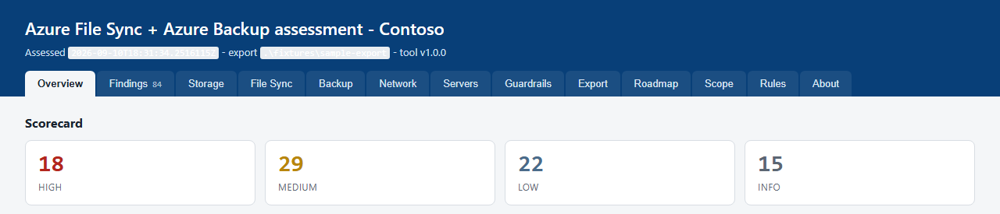

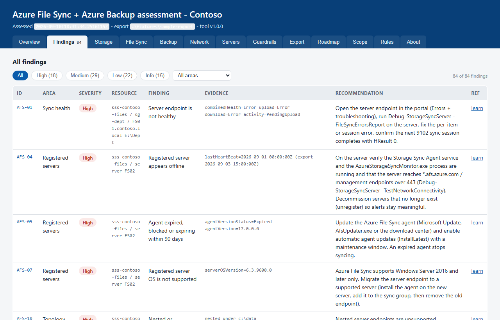

The folder now holds `assessment.md`, `findings.json` and `assessment.html`. The HTML is one self-contained file with 13 tabs, and it needs no network. On the Overview tab, click a severity tile to jump to the Findings tab, filtered to that severity.

*Code: `Assess-AzFileSyncExport.ps1`, `Render-AfsAssessmentHtml.ps1`, `fixtures/make-fixture.py`*

### Step 5: Start the wizard and try options 1 and 8

Run `.\start.ps1`. The wizard prints its banner, then `  Logging to C:\kits\afs\logs\wizard-<yyyyMMdd-HHmmss>.log` and `  Level Verbose - re-run with -LogLevel Debug for full Azure CLI traces`, then the menu. Starting the wizard neither signs you in nor checks anything. Each option checks what it needs when you choose it.


**Reading the console.** Every flow uses the same markers:

| Marker | Colour | Means |
| --- | --- | --- |
| `[ok]` | Green | Done, or present |
| `[!]` | Red | Failed or missing. The grey lines under it say what to do |
| `[i]` | Yellow | A note. Nothing failed, but read it |
| `[?]` | Yellow | Option 8 only: could not be checked from here |

**Answering prompts.**

- A menu takes a number from its list. Pressing Enter alone is not an answer. A wrong entry prints `[!]    choose 1 to 14`, and after five wrong entries in a row the wizard stops instead of looping.
- A question with a default shows it in brackets, for example `  > [Customer] `. Press Enter to take the default.
- A yes/no question shows `  > [Y/n] ` (Enter means yes) or `  > [y/N] ` (Enter means no). Any answer that starts with `y` or `n` counts. If input is redirected, an empty answer counts as no.
- Anything you type while a long step runs is discarded before the next menu or yes/no question. A question that takes typed text is not protected - `Type DELETE to confirm` after the teardown's dry run is one - so do not type ahead.

**Try option 1.** Type `1`. At **`Where would you like to start?`**, pick `Start here`. The offline guide, `docs\HOW-TO-USE.html`, opens in your browser at that section, and the console prints `[ok]   file:///C:/kits/afs/docs/HOW-TO-USE.html#start`. The same prompt comes back. Choose `12` (Back) to return to the main menu.

**Try option 8.** Type `8`. Option 8 checks this machine and Azure without changing them. Once `deploy\inputs.json` exists, it also checks your DNS servers and AD DS.

1. Under `Checking what you have`, it prints `[ok]   PowerShell <version>` and `[ok]   Azure CLI <version>`. If the Azure CLI is missing, you see `That step did not complete.`, then `The term 'az' is not recognized as the name of a cmdlet ...` and `This one is not recognised.` The kit's own `Azure CLI (az) was not found on PATH.` line does not print, because the missing command throws before the check can run. Install the Azure CLI (Step 1), close and reopen PowerShell, then choose 8 again.
2. If the CLI's `dns-resolver` extension is missing, it asks **`Install it now?`** `[Y/n]`. Pressing Enter installs the extension into your Azure CLI. That is the only change option 8 can make. Answer `n` to skip.
3. **`Also check the file server?`** `[Y/n]`. Answer `n` for now. If you answer yes and no file server is in the settings, **`Which file server should I check?`** follows. Pressing Enter with nothing typed skips it.
4. It prints one row per check, grouped by area, with a grey fix line under anything not ok. Then it prints a count: `<N> checks - <ok> ok, <b> blocker(s), <u> could not be checked, <d> degraded`.

On a new machine, expect some red rows. `signed in` stays red until you run `az login`, and so does any Az or RSAT module you have not installed. Option 8 counts all of these as blockers, even though only option 11 uses the RSAT modules. A row marked `(degraded)` or `(advisory)` never blocks. Also expect a yellow line even when nothing is broken. With no settings file, `subscription` is always `[?]`. With one, `role assignment rights` is always `[?]` (its second JSON parse fails, tracked in [#3](https://github.com/gusitde/azure-filesync-backup-assessment/issues/3)), the DNS area always adds a `[?]` row - `DNS readiness` when no DNS servers are named, otherwise `resolver inbound address`, because option 8 never passes the resolver's address - and the AD DS area adds one when no domain or OU is set. So a settings file always gives at least two `[?]` rows. With no settings file, the best result option 8 can print today is:

```
  [i]    nothing is known to be broken, but 1 requirement(s) could not be checked from here.
    ? Azure: subscription - no resolved config was supplied, so nothing subscription-scoped could be checked
```

The green `[ok]   everything the run needs is in place.` cannot appear from option 8 (tracked in [#3](https://github.com/gusitde/azure-filesync-backup-assessment/issues/3)). Read each `?` line: it names what could not be reached, and the matching row above it carries the fix. Choose `14` to quit, and the wizard prints `Bye.`

*Code: `start.ps1` (Read-Choice, Read-YesNo, Read-Answer, Invoke-HowToUseFlow, Invoke-RequirementsFlow, Show-AfsRequirements), `deploy/AfsRequirements.ps1`*

### Step 6: Choose your path

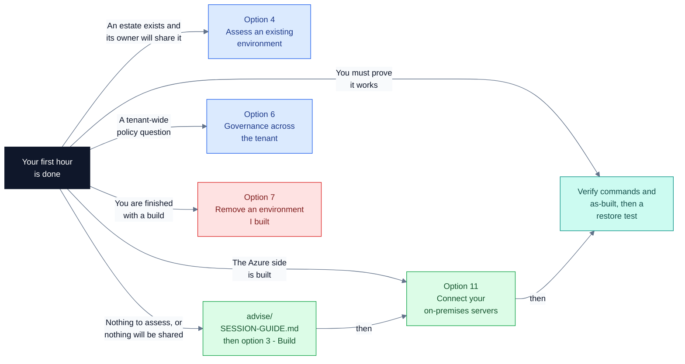

| Goal | Start with | Then |
| --- | --- | --- |
| Review an estate whose owner will share its configuration | [Option 4](#option-4-assess-an-existing-environment): export with Reader, then assess | [Option 5](#option-5-see-the-assessment-results). For the server rules, run [Get-AfsServerDiagnostics.ps1](SCRIPT-REFERENCE.md#get-afsserverdiagnosticsps1) on each file server |
| Design with a customer who has nothing to assess, or will not share | [advise/SESSION-GUIDE.md](../advise/SESSION-GUIDE.md): a two-hour session on 18 design decisions | [Option 3](#option-3-build-a-new-azure-file-sync-environment), which asks its four questions itself |
| Build a new environment | [Option 3](#option-3-build-a-new-azure-file-sync-environment). To set more than the four inputs, use [option 2](#option-2-deployment-settings) first | [Option 11](#option-11-connect-your-on-premises-servers) |
| Connect file servers, DNS and AD after the build | [Option 8](#option-8-check-requirements), with the settings filled in | [Option 11](#option-11-connect-your-on-premises-servers) |
| Prove a build works | [How to tell it works](#how-to-tell-it-works), from the top: the `Verify with:` commands the build prints, and the as-built's Verify tab from [option 13](#option-13-open-the-findings-and-as-built-reports) | The restore test at the end of [How to tell it works](#how-to-tell-it-works), and [the restore runbook](../codex/runbook-restore-file-share-and-share-soft-delete.md) |
| Answer a tenant-wide policy question | Install PowerShell 7, then [option 6](#option-6-assess-policy-and-governance-across-the-tenant) (Reader at the tenant root) | [Option 13](#option-13-open-the-findings-and-as-built-reports) to open the report |
| Tear down a lab build | [Option 7](#option-7-remove-an-environment-i-built) | If the vault's soft delete blocks it, re-run the two commands it prints after the date it prints |

When something fails, the wizard names the log file to read. See [Logs, levels and environment variables](#5-logs-levels-and-environment-variables) and [When it goes wrong](#6-when-it-goes-wrong).

*Code: `start.ps1` (main menu and the flows named above)*

### Four jobs, start to finish

Each list is one whole job, in order. Each step names the option or script, and links the section that covers it.

**Job 1: Assess an estate.**

1. Decide who runs the export. It needs Reader on the subscriptions, the `Az.Accounts` module, and an Az PowerShell sign-in (`Connect-AzAccount`). An `az login` does not count. See [Export-AzFileSyncEnvironment.ps1](SCRIPT-REFERENCE.md#export-azfilesyncenvironmentps1).
2. If you run it: [option 4](#option-4-assess-an-existing-environment), then `1) Export the configuration from Azure (needs Reader)`. The wizard signs in the Azure CLI and Az PowerShell, then writes `afs-export-<yyyyMMdd-HHmmss>` and its zip in the kit folder.
3. If the customer runs it: send them `Export-AzFileSyncEnvironment.ps1`, which runs on its own, or the whole kit. They run:

   ```powershell
   Install-Module Az.Accounts -Scope CurrentUser
   Connect-AzAccount -Tenant 00000000-0000-0000-0000-000000000000
   .\Export-AzFileSyncEnvironment.ps1 -SubscriptionId 00000000-0000-0000-0000-000000000000
   ```

   It ends with `Zipped -> <path>.zip  (send this file for assessment)`. The zip holds subscription and resource ids, server names, private IPs and principal ids. Agree with the customer how it travels.
4. For the server rules, [Get-AfsServerDiagnostics.ps1](SCRIPT-REFERENCE.md#get-afsserverdiagnosticsps1) runs elevated on each registered file server and writes one `<hostname>-afs-server-<stamp>.zip`. When the customer runs the export, they send these zips with it.
5. With server zips: extract the export zip into a folder of its own, copy each server zip into `servers\<hostname>\` inside it, and assess the folder. Without them, assess the zip. The assessor reads server bundles only from a folder.
6. Assess: [option 4](#option-4-assess-an-existing-environment), then `2) Assess an export I already have`, or run [Assess-AzFileSyncExport.ps1](SCRIPT-REFERENCE.md#assess-azfilesyncexportps1). Answer `y` to the private-path question if sync and backup traffic must stay private. No Azure access is needed.
7. Read the report with [option 5](#option-5-see-the-assessment-results). Finding OPS-03 names each registered server that has no bundle.

**Job 2: Build and connect one file server, with its DNS and AD.** Run every step on a domain-joined admin workstation inside your network, in Windows PowerShell 5.1.

1. Fill in the settings with [option 2](#option-2-deployment-settings): subscription, region, prefix, network ranges, `onPremises.fileServer`, `onPremises.serverPaths`, `onPremises.dnsServers`, and the domain and OU under `activeDirectory`. Option 3's four questions can write the file instead, but then option 8 has no DNS or AD names to check.
2. Sign in twice, in this window: `az login` for the Azure CLI, and `Connect-AzAccount -Tenant <tenant id>` for Az PowerShell. Option 8 signs in to neither.
3. Run [option 8](#option-8-check-requirements) and fix every `[!]` row with the fix printed under it. The best result is the yellow line with `0 blocker(s)`.
4. Build with [option 3](#option-3-build-a-new-azure-file-sync-environment). Sign in with an account that is Application Administrator or Global Administrator in Entra ID and Owner on the subscription. Phase 1 runs for real. Phase 2 shows a dry run, then asks **`Build it for real now?`**. Leave `deploy\deployment-identity.json` beside the context until step 6 has registered the server, then move it into your secret store.
5. Give your network a path into the build's virtual network. The kit builds no VPN or ExpressRoute connection. This workstation and your DNS servers need UDP and TCP 53 to the resolver's inbound subnet (`10.60.2.0/28` by default). The file server needs TCP 443 to the private-endpoint subnet (`10.60.1.0/26` by default) to sync over the private endpoints. Without the path, option 11's DNS step refuses to write. See [Why on-premises DNS forwards the public zone](#why-on-premises-dns-forwards-the-public-zone).
6. Run [option 11](#option-11-connect-your-on-premises-servers) in the same window. It signs the Azure CLI in itself, but not Az PowerShell, so it relies on the `Connect-AzAccount` session from step 2. Each step runs a dry run, then asks **`Do it for real?`**:
   - `1) Install the File Sync agent and sync a folder to a share`: local administrator on the file server, WinRM on 5985, and Owner, User Access Administrator, Azure File Sync Administrator or Role Based Access Control Administrator on the storage account.
   - `2) Point on-premises DNS at the Azure resolver`: DnsAdmins or Domain Admins. It writes nothing until the resolver answers this machine with a private address.
   - `3) Domain-join the storage account to Active Directory`: your Windows account needs the create-computer right in the OU.
7. Grant share-level access: run [onprem/Join-AfsStorageAccountToAdDs.ps1](SCRIPT-REFERENCE.md#onpremjoin-afsstorageaccounttoaddsps1) with `-GrantShareAccess`. The wizard does not.
8. Prove it: Job 3.
9. Close the public paths by hand, and only after Job 3 shows private resolution from a client. The build leaves them open. The commands and checks are in [playbook-harden-existing-storage-account](../codex/playbook-harden-existing-storage-account.md) and [playbook-enable-file-sync-private-endpoint-and-cutover](../codex/playbook-enable-file-sync-private-endpoint-and-cutover.md).

Microsoft reference: [Azure File Sync deployment guide](https://learn.microsoft.com/azure/storage/file-sync/file-sync-deployment-guide) (sign-in and modules), [Azure File Sync networking considerations](https://learn.microsoft.com/azure/storage/file-sync/file-sync-networking-overview), [Resolve Azure and on-premises domains](https://learn.microsoft.com/azure/dns/private-resolver-hybrid-dns), and the two public-path pages: [storage account](https://learn.microsoft.com/azure/storage/file-sync/file-sync-networking-endpoints#grant-access-to-trusted-azure-services-and-disable-access-to-the-storage-account-public-endpoint) and [Storage Sync Service](https://learn.microsoft.com/azure/storage/file-sync/file-sync-networking-endpoints#disable-access-to-the-storage-sync-service-public-endpoint).

**Job 3: Prove it works.** Work down [How to tell it works](#how-to-tell-it-works) in order:

1. The `Verify with:` commands, and the as-built's Verify tab from [option 13](#option-13-open-the-findings-and-as-built-reports).
2. The A records in both private DNS zones.
3. Private resolution and a TCP connection from an on-premises client.
4. Sync on the server: event 9102 with `HResult: 0`.
5. Identity-based access: `Debug-AzStorageAccountAuth`, and `directoryServiceOptions` reading `AD`.
6. Backup: every share listed as a protected item.
7. The restore test.
8. After you close the public paths (Job 2, step 9), run check 3 again. For a written record, export and assess again with the private-path answer `y` (Job 1).

**Job 4: Tear it down, in the right order.** Steps 1 and 2 work through Azure, so do them while the resource group exists. [Option 7](#option-7-remove-an-environment-i-built) has the commands.

1. The file server: `onprem\Install-AfsServerEndpoint.ps1 ... -Remove` removes the server endpoints, cloud endpoints and sync groups, then unregisters the server. Add `-UninstallAgent` to remove the agent too.
2. The AD object and the DNS forwarders: `onprem\Join-AfsStorageAccountToAdDs.ps1 ... -Remove`, then `onprem\Set-AfsDnsForwarders.ps1 ... -Remove`. If the group goes first, the forwarders send every `file.core.windows.net` and `afs.azure.net` lookup to a resolver that no longer exists.
3. Azure: [option 7](#option-7-remove-an-environment-i-built). It shows a dry run, then you type `DELETE`. Use an account that can delete management locks (Owner); Contributor cannot. The backup data is deleted and cannot be recovered.
4. If soft delete kept the vault, run the two `az` commands it prints, after the date it prints.
5. Delete the deployment identity (step 4 of the order in option 7), as Application Administrator or Global Administrator.
6. Confirm the group is gone with the `az group exists` line option 7 prints; it returns `false`. Then delete `deploy\deployment-identity.json` and move `deploy\deployment-context.json` out of the kit folder. Option 7 leaves both, and [option 12](#option-12-resume-the-last-build) would build the environment again from the context.

*Code: `start.ps1` (Invoke-AssessFlow, Invoke-BuildFlow, Invoke-RequirementsFlow, Invoke-OnPremisesFlow, Invoke-RemoveFlow), `Export-AzFileSyncEnvironment.ps1`, `Get-AfsServerDiagnostics.ps1`, `onprem/Install-AfsServerEndpoint.ps1`, `onprem/Set-AfsDnsForwarders.ps1`, `onprem/Join-AfsStorageAccountToAdDs.ps1`, `deploy/Remove-AfsEnvironment.ps1`*

### How to tell it works

Each row is a question, what to run, and the answer that means yes. Start at the top. Run each command from the kit folder unless the row says otherwise. Names are the defaults for prefix `contoso` in `eastus`; use the names in your as-built.

| Question | Run | It works when |
| --- | --- | --- |
| Is this copy of the kit intact? | `.\tests\run-tests.ps1`, after `python fixtures\make-fixture.py` ([Step 3](#step-3-run-the-test-suite)) | The last line is `ALL GREEN (195 checks)` and the exit code is 0. It needs no Azure access. |
| Are this machine and account ready? | [Option 8](#option-8-check-requirements) | The summary shows `0 blocker(s)`. The best line option 8 can print is the yellow `nothing is known to be broken, but N requirement(s) could not be checked from here.`; the green line cannot appear from option 8 ([Step 5](#step-5-start-the-wizard-and-try-options-1-and-8)). Read every `?` line. |
| What will be built? | `.\deploy\Deploy-AfsEnvironment.ps1 -InputFile .\deploy\inputs.json -ShowResolved` | Every name, address range and setting prints, then `Nothing was changed and nothing was called. Remove -ShowResolved to continue.` |
| Will the build succeed? | `.\deploy\Deploy-AfsEnvironment.ps1 -Context .\deploy\deployment-context.json -WhatIf` (option 3 runs it for you after phase 1) | It ends `WHAT-IF complete. Nothing was changed.` The preflight is real: CLI, sign-in, subscription, and storage name availability. Its limits: it does not register resource providers or install the `dns-resolver` extension, it does not test the deployment identity's sign-in, and on a first build it skips both private endpoints (`storage account id not resolvable yet (what-if run?)`). A pass does not prove the real run will pass. Option 8 checks the providers. |
| Did the build do what it says? | The `Verify with:` commands phase 2 prints, and the as-built's Verify tab ([option 13](#option-13-open-the-findings-and-as-built-reports)) | Each command returns its object. The as-built is read from Azure after the build, not written from the plan, and its Verify tab gives the read-back command for every row. Regenerate it with `.\deploy\Export-AfsAsBuilt.ps1 -Context .\deploy\deployment-context.json`. |
| Do the private endpoints have DNS records? | `az network private-dns record-set a list -g rg-contoso-filesync -z privatelink.file.core.windows.net -o table`, then the same with `-z privatelink.afs.azure.net` | One A record, for the storage account, in the first zone. Four, for the Storage Sync Service, in the second. An empty zone means no zone group wrote the records, so the name does not resolve to the private endpoint: run phase 2 again ([option 12](#option-12-resume-the-last-build)). |
| Does the name resolve privately from your network? | On an on-premises client that uses your DNS servers: `Clear-DnsClientCache; Resolve-DnsName stcontosofs01.file.core.windows.net`, then `Test-NetConnection stcontosofs01.file.core.windows.net -CommonTCPPort SMB` | A CNAME to `stcontosofs01.privatelink.file.core.windows.net`, a private address (in `10.60.1.0/26` by default), and `TcpTestSucceeded : True`. Test from a client, not from the DNS server and not with `-Server`. Only then close the public paths. |
| Is the server syncing? | On the file server: `(Get-WinEvent -FilterHashtable @{LogName='Microsoft-FileSync-Agent/Telemetry'; Id=9102} -MaxEvents 1).Message`. [Get-AfsServerDiagnostics.ps1](SCRIPT-REFERENCE.md#get-afsserverdiagnosticsps1) collects the same events. | The newest event 9102 (a sync session) contains `HResult: 0`, and the server's files appear in the Azure file share. |
| Does identity-based access work? | In Windows PowerShell 5.1 on a domain-joined machine, with Az PowerShell signed in: `Import-Module "$env:TEMP\AzFilesHybrid\AzFilesHybrid.psd1"; Debug-AzStorageAccountAuth -StorageAccountName stcontosofs01 -ResourceGroupName rg-contoso-filesync -Verbose`. Then `az storage account show -g rg-contoso-filesync -n stcontosofs01 --query azureFilesIdentityBasedAuthentication.directoryServiceOptions -o tsv` | Every check passes, and the second command prints `AD`. The join put AzFilesHybrid in `%TEMP%\AzFilesHybrid`. Running the join again reports `already joined, and the AD password matches a Kerberos key`. |
| Are the shares protected? | `az backup item list -g rg-contoso-filesync -v rsv-contoso-eastus --backup-management-type AzureStorage --workload-type AzureFileShare --query "[].properties.friendlyName" -o tsv` | Every share is listed: `dept-shares` and `home-drives` by default. Until a share's first backup completes, its protection state reads `IRPending`. |
| Can you get a file back? | The restore test below | The file you deleted is back on the file server. |

**The restore test.** A backup is not protection until a restore has worked. Use a test file, not real data:

1. Put a test file in a server endpoint folder, for example `D:\Shares\dept-shares\restore-test\test.txt`.
2. Confirm the file appears in the Azure file share `dept-shares`.
3. Take an on-demand backup of that share, and wait for the job to read `Completed`. In the vault in the portal that is **Backup items** > the share > **Backup now**. In Az PowerShell (`Install-Module Az.RecoveryServices -Scope CurrentUser`, then `Connect-AzAccount`) it is:

   ```powershell
   $v = Get-AzRecoveryServicesVault -Name rsv-contoso-eastus -ResourceGroupName rg-contoso-filesync
   $c = Get-AzRecoveryServicesBackupContainer -ContainerType AzureStorage -FriendlyName stcontosofs01 -VaultId $v.ID
   $i = Get-AzRecoveryServicesBackupItem -Container $c -WorkloadType AzureFiles -FriendlyName dept-shares -VaultId $v.ID
   Backup-AzRecoveryServicesBackupItem -Item $i -VaultId $v.ID
   Get-AzRecoveryServicesBackupJob -VaultId $v.ID -From (Get-Date).AddHours(-2).ToUniversalTime() | Format-Table Operation, Status, WorkloadName
   ```

   The same commands, with the vault and policy setup around them, are in [PLAYBOOK-azure-backup-for-azure-files.md](PLAYBOOK-azure-backup-for-azure-files.md).

4. Delete the file on the server, and let the delete sync to the share.
5. Restore the file. This step is done in the portal: in the vault, open the share under Protected items and choose **File Recovery**, pick the snapshot recovery point from step 3, and restore the file to its original location. The build's policy keeps daily snapshots, and single files come back only from a snapshot recovery point. The PowerShell equivalent (`Restore-AzRecoveryServicesBackupItem`) and the ways a restore fails are in [the restore runbook](../codex/runbook-restore-file-share-and-share-soft-delete.md) and [playbook-enable-azure-backup-for-file-shares](../codex/playbook-enable-azure-backup-for-file-shares.md).
6. Azure Backup tells File Sync which paths it restored. To be sure the server gets the file now, and not at the next 24-hour change detection, force detection. The build names each cloud endpoint after its share, so `-CloudEndpointName` is the share name:

   ```powershell
   Invoke-AzStorageSyncChangeDetection -ResourceGroupName rg-contoso-filesync -StorageSyncServiceName sss-contoso-filesync `
       -SyncGroupName sg-contoso-dept-shares -CloudEndpointName dept-shares -DirectoryPath 'restore-test' -Recursive
   ```

   A scoped run detects at most 10,000 items; leave `-DirectoryPath` out to detect over the whole share.

7. Confirm the file is back on the server, in its folder. That proves the whole loop: server, share, backup, restore, server.

Microsoft reference: [Azure private endpoint DNS integration](https://learn.microsoft.com/azure/private-link/private-endpoint-dns-integration) and [Azure Files networking DNS](https://learn.microsoft.com/en-us/azure/storage/files/storage-files-networking-dns) (the DNS records and resolution checks), [Monitor Azure File Sync](https://learn.microsoft.com/azure/storage/file-sync/file-sync-monitoring) (event 9102), [Enable AD DS authentication for Azure Files](https://learn.microsoft.com/en-us/azure/storage/files/storage-files-identity-ad-ds-enable) (`Debug-AzStorageAccountAuth`), [Back up Azure file shares](https://learn.microsoft.com/azure/backup/backup-azure-files) (protected items and on-demand backup), and [Invoke-AzStorageSyncChangeDetection](https://learn.microsoft.com/powershell/module/az.storagesync/invoke-azstoragesyncchangedetection). The codex has the same checks with their failure modes: [runbook-private-endpoint-name-resolution-and-reachability](../codex/runbook-private-endpoint-name-resolution-and-reachability.md), [playbook-enable-identity-based-auth-ad-ds](../codex/playbook-enable-identity-based-auth-ad-ds.md), [playbook-enable-azure-backup-for-file-shares](../codex/playbook-enable-azure-backup-for-file-shares.md) and [runbook-restore-file-share-and-share-soft-delete](../codex/runbook-restore-file-share-and-share-soft-delete.md).

*Code: `tests/run-tests.ps1`, `start.ps1` (Show-AfsRequirements), `deploy/Deploy-AfsEnvironment.ps1` (Preflight, Add-Verification), `deploy/Export-AfsAsBuilt.ps1`, `onprem/Install-AfsServerEndpoint.ps1`, `onprem/Join-AfsStorageAccountToAdDs.ps1`, `Get-AfsServerDiagnostics.ps1`*

## 2. The wizard, option by option

Run `.\start.ps1` and type the number of an option. Every option except 14 (Quit) returns to the
menu when it finishes. When a step fails, most options print the error themselves - what went wrong
and, when the wizard recognises it, the fix - and return to the menu. Only an error an option does
not handle also prints `Full detail is in <log path>` and
`Nothing further was changed. You can choose again, or quit.` The log is always the
`logs\wizard-<stamp>.log` that the wizard names (`Logging to ...`) when it starts.

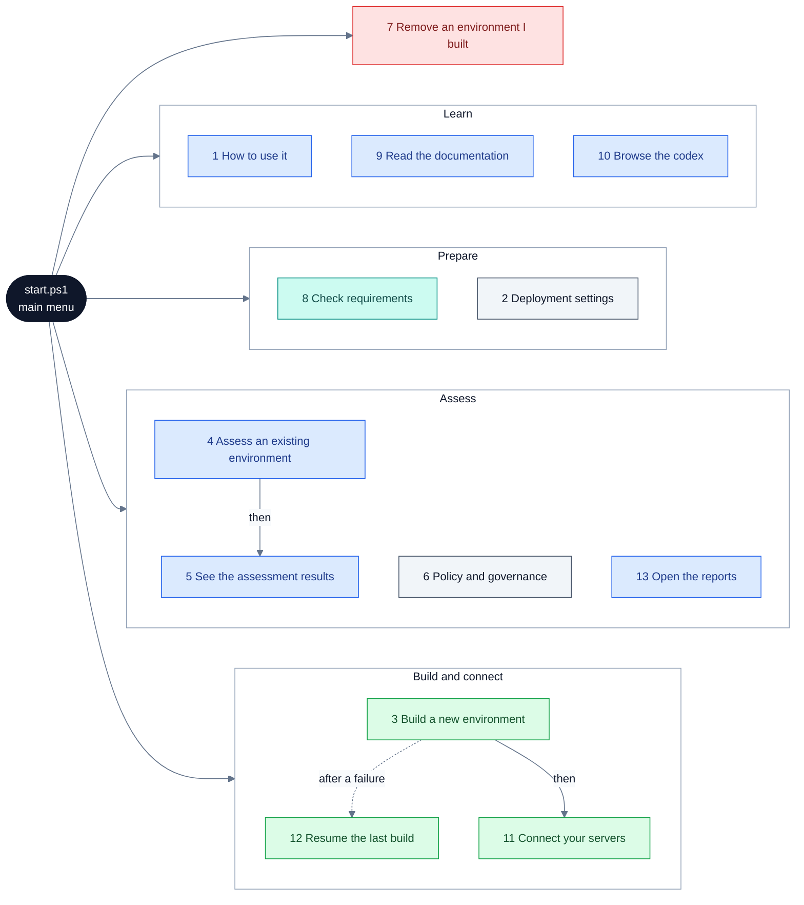

Colours in the flow diagrams in this guide: blue only reads; green creates or changes something
in Azure; grey changes a machine or file of yours (a settings file, a file server, DNS, Active
Directory); teal verifies; red deletes or cannot be undone; amber is a decision or a prompt. An
option that changes both Azure and your machines, such as option 11, is green. A blue option can
still write its own report files; the table below says which. The architecture diagram in
[section 8](#8-how-it-works) colours by component instead and carries its own key.

| Option | Changes | Asks first | Dry run first |
| --- | --- | --- | --- |
| 1, 9, 10, 14 | Nothing | - | - |
| 2 Deployment settings | `deploy\inputs.json` | You choose each edit | - |
| 3 Build | Entra ID and Azure | Before phase 1, before phase 2, before each retry | Phase 2 only |
| 4 Assess | Nothing in Azure; writes the export and reports | Before the export | - |
| 5, 13 Results and reports | Nothing in Azure; 5 can rebuild a report, 13 can write an as-built | - | - |
| 6 Governance | Nothing in Azure; clones a tool and installs modules locally | Before the run | Offered |
| 7 Remove | The resource group, or, while vault soft delete holds backup data, everything in it except the vault. Nothing outside the group: remove the server endpoints, the AD object and the DNS forwarders first, and the Entra app after ([Option 7](#option-7-remove-an-environment-i-built)) | Type `DELETE` | Always |
| 8 Check requirements | Nothing, unless you accept installing a CLI extension | Before the install | - |
| 11 Connect servers | Your file server, DNS servers and Active Directory; in Azure, the server registration, sync groups, endpoints and the storage account's AD DS settings | Before each step, default No | Always - but the agent step's dry run creates any missing folder on the file server |
| 12 Resume | Azure | Before the build and each retry | Offered |

### Option 1: How to use it

Opens the kit's one-page HTML guide in your browser, either at the top or at the section you pick.

#### Before you start

- Run it on any machine that has the kit folder and a web browser. You do not need a network connection, an Azure sign-in or any rights.
- The file `docs\HOW-TO-USE.html` must be in your copy of the kit.
- The wizard does not check prerequisites or sign you in for this option.

#### What you will be asked

1. **`Where would you like to start?`** - type a number from 1 to 12. There is no default, so Enter on its own is not accepted.
   - `1) Open the whole guide` opens the guide at the top.
   - 2 to 11 open the guide at one of its ten sections. Each section's description is shown on a second line under its name:

     | # | Section | What it covers |
     |---|---|---|
     | 2 | Start here | What the kit is, the two doors, and every menu option. |
     | 3 | Deployment settings | The four inputs, what is derived from them, and what cannot be changed later. |
     | 4 | Build | The two phases, the 15 steps, and what the as-built records. |
     | 5 | Connect your servers | Agent and endpoint, DNS forwarders, AD DS join - the three steps that touch your machines. |
     | 6 | Backup and restore | What to protect, which tier restores one file, and how to prove it. |
     | 7 | Assess | Export read-only, assess offline, and what comes out. |
     | 8 | Governance | The tenant-wide question, and what it needs to answer it. |
     | 9 | Teardown | The order, the two things outside the resource group, and the 14-day wait. |
     | 10 | When it goes wrong | Real messages from real runs, and what each one actually means. |
     | 11 | Reference | Layout, dependencies, and the one-way doors in one list. |

   - `12) Back` returns to the main menu.

   After each section opens, the same prompt comes back, so you can open another section. Choose Back when you are done.

#### What it runs

- No scripts. The wizard hands the file to your default browser with `Start-Process`.
- Choice 1 opens the plain path, for example `C:\kits\afs\docs\HOW-TO-USE.html`.
- Choices 2 to 11 open the file as a `file:///` address with the section appended, for example `file:///C:/kits/afs/docs/HOW-TO-USE.html#connect`.
- You cannot pick a different file or browser from the menu. The file is always `docs\HOW-TO-USE.html`, and the browser is whatever Windows opens for that address.

#### When it worked

Your browser shows the guide at the section you chose, and the console prints the address it opened:

```
  [ok]   file:///C:/kits/afs/docs/HOW-TO-USE.html#connect
```

For choice 1 the line shows the plain path instead: `  [ok]   C:\kits\afs\docs\HOW-TO-USE.html`.

#### Next

- Choose [option 8](#option-8-check-requirements) to check this machine, Azure and the file server before you build.
- Choose [option 2](#option-2-deployment-settings) to review the names and settings a build would use.

#### If it goes wrong

| You see | It means | Do this |
| --- | --- | --- |
| `[!]    the guide is missing from this copy of the kit: <path>` then `Pull the latest from the repository, or read docs/GETTING-STARTED.md instead.` | `docs\HOW-TO-USE.html` is not in your copy. The wizard returns to the main menu. | Get a complete copy of the kit, or read [GETTING-STARTED.md](GETTING-STARTED.md). |
| `[i]    opened at the top - the section you wanted is <Section>.` | This machine has no handler for `file:///` addresses, so the wizard opened the plain file instead. | Click the named section in the guide. |
| `[!]    could not open a browser: <message>` then `Open this file by hand: <path>` | Windows could not open the file at all. | Open the path shown in any browser, or copy the file to a machine that has one. |
| `[!]    choose 1 to 12` | You typed something other than a number from 1 to 12, or pressed Enter on its own. | Type the number. After five unusable entries the option stops with `That step did not complete.` and you are back at the main menu. |

#### Good to know

- Option 1 opens `docs/HOW-TO-USE.html`, which is a separate HTML guide, not this user guide. Where the two disagree, this guide follows the code. For example, what the HTML guide says about clearing settings and the drift warning is not how the code behaves (see [option 2](#option-2-deployment-settings)).
- The guide is one self-contained file. It opens from a file share or an offline jump box.
- The list of ten sections is fixed in `start.ps1`. Every section it offers exists in the HTML file in this copy.

*Code: `start.ps1` (Invoke-HowToUseFlow), `docs/HOW-TO-USE.html`*

### Option 2: Deployment settings

Shows every build setting with the value that is actually in force, and lets you change any of them in `deploy\inputs.json`.

#### Before you start

- Run it on your workstation, in the wizard's console. It makes no Azure calls, so you do not need to sign in and you need no Azure, Entra or AD rights.
- If `deploy\inputs.json` does not exist yet, `deploy\inputs.sample.jsonc` must be there, because the wizard copies it.
- `deploy\inputs.json` must parse. Comments are allowed: `/* */` anywhere, and `//` on a line of its own or after a value with a space on both sides of the `//`. A trailing comma, an unescaped backslash or a comment such as `//later` with no space after it stops the screen from opening.
- Nothing needs to exist in Azure. This option only reads and writes local files.

#### What you will be asked

1. Only if there is no `deploy\inputs.json` yet: the wizard prints `[i]    there is no inputs file yet.` and asks **`Create one from the sample now?`** `[Y/n]`.
   - Yes copies `inputs.sample.jsonc` to `inputs.json` and prints `[ok]   created C:\kits\afs\deploy\inputs.json`.
   - No returns you to the main menu.
2. The settings screen opens. It re-reads the file every time it is shown. It prints the path of the settings file, the drift warning when it applies (below), and every setting grouped as Azure, Names, Network, Storage, Backup, Directory and On-premises. A value followed by `(derived)` is one you have not set, shown as the resolver supplies it: a name built from the prefix, region and suffix, or a default such as `10.60.0.0/16`. The domain-join default also depends on the AD values (see the table below). A value you set shows without the tag. An empty value shows as `(not set)`. For a file whose prefix is `contoso`, the screen looks like this:

   ```
     Azure
       Subscription id                  00000000-0000-0000-0000-000000000000
       Region                           eastus
       Name prefix                      contoso
       Storage name suffix              01
     Names
       Resource group                   rg-contoso-filesync (derived)
       Storage account                  stcontosofs01 (derived)
       Storage Sync Service             sss-contoso-filesync (derived)
       Recovery Services vault          rsv-contoso-eastus (derived)
       Virtual network                  vnet-contoso-filesync (derived)
       DNS Private Resolver             dnspr-contoso-eastus (derived)
     Network
       Address space                    10.60.0.0/16 (derived)
       Private endpoint subnet          snet-privateendpoints (derived)
       Private endpoint subnet range    10.60.1.0/26 (derived)
       Resolver inbound subnet          snet-dnsresolver-inbound (derived)
       Resolver inbound range           10.60.2.0/28 (derived)
       Deploy the DNS resolver          True (derived)
     Storage
       Redundancy                       Standard_ZRS (derived)
     Backup
       Deploy backup                    True (derived)
       Daily retention (days)           60 (derived)
       Vault redundancy                 GeoRedundant (derived)
       Cross-region restore             True (derived)
     Directory
       Domain-join the storage account  True (derived)
       AD domain                        corp.contoso.com
       NetBIOS name                     CONTOSO
       Organizational unit              OU=AzureFiles,DC=corp,DC=contoso,DC=com
       Object type                      ComputerAccount
       AD admin account                 svc-azurefiles@corp.contoso.com
     On-premises
       File server                      fs01.corp.contoso.com
       DNS servers                      dc01.corp.contoso.com, dc02.corp.contoso.com
   ```

3. **`What now?`** - type 1 to 10. There is no default.
   - 1 to 7: `Change something under Azure`, `Names`, `Network`, `Storage`, `Backup`, `Directory` or `On-premises`. Go to step 4.
   - 8: `Show what it all resolves to` prints the full `Resolved configuration` block (see "When it worked"). If the file does not resolve yet, it prints `[!]    the settings do not resolve yet - fill in the ones shown as (not set).`
   - 9: `Edit the JSON file directly (deploy\inputs.json)` opens the file screen described below.
   - 10: `Back` returns to the main menu.
4. **`<Group> - which setting?`**, for example **`Azure - which setting?`**. It lists each setting in the group as `<Setting>  =  <value>`, plus `Back`.
5. The wizard prints the setting's name and, for most settings, why it matters. For a derived value it adds `Derived as <value> today. Setting it here stops it following the prefix.` Then it asks one of two things:
   - For a yes/no setting: **`Turn this on?`**, shown as `[Y/n]` when the setting is on now, or `[y/N]` when it is off.
   - For any other setting: **`New value`**, shown as `  > [<current value>] `. Enter keeps the value shown (see "Good to know"). An answer that fails the setting's rule prints `[!]    Expected: <rule>` and asks again.
6. The wizard checks that the whole file still resolves, then saves it and returns to the settings screen.

**The drift warning.** Phase 1 copies your settings into `deploy\deployment-context.json` when it runs, and phase 2 builds from that copy. If the context file exists and names a different resource group from the one your settings now resolve to, the screen shows:

```
  [i]    the saved deployment still points at rg-contoso-filesync, not rg-contoso2-filesync.
  Phase 1 captured those names when it ran. Build re-runs phase 1 and picks
  these up; Resume deliberately does not, because it exists to continue the
  deployment that was already started.
```

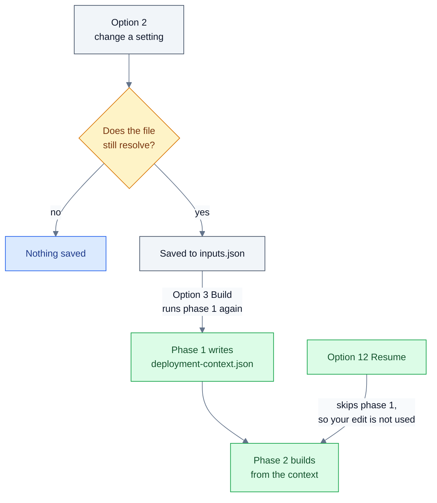

**The settings catalogue.** These are all the settings the screen offers. `<prefix>` is the name prefix, `<suffix>` the storage name suffix and `<region>` the region. "Not checked" means the editor saves whatever you type.

| Group | Setting | Default or derived value | Rule |
| --- | --- | --- | --- |
| Azure | Subscription id (`azure.subscriptionId`) | none - required | A subscription GUID. |
| Azure | Region (`azure.location`) | `eastus` (used when empty, but shown as `(not set)`) | Region short name, letters and digits. The vault and the resolver names include it. |
| Azure | Name prefix (`azure.namePrefix`) | none - required | 2 to 8 lowercase letters or digits. Every derived name starts from it. |
| Azure | Storage name suffix (`azure.uniqueSuffix`) | `01` (used when empty, but shown as `(not set)`) | 1 to 6 lowercase letters or digits. Change it if the storage name is taken. |
| Names | Resource group (`overrides.resourceGroup`) | `rg-<prefix>-filesync` | Not checked. |
| Names | Storage account (`overrides.storageAccountName`) | `st<prefix>fs<suffix>` | 3 to 24 lowercase letters and digits, globally unique. |
| Names | Storage Sync Service (`overrides.storageSyncServiceName`) | `sss-<prefix>-filesync` | Not checked. |
| Names | Recovery Services vault (`overrides.vaultName`) | `rsv-<prefix>-<region>` | Not checked. |
| Names | Virtual network (`overrides.vnetName`) | `vnet-<prefix>-filesync` | Not checked. |
| Names | DNS Private Resolver (`overrides.dnsResolverName`) | `dnspr-<prefix>-<region>` | Not checked. |
| Network | Address space (`overrides.vnetAddressPrefix`) | `10.60.0.0/16` | CIDR form. Must not overlap anything it is peered or routed to. |
| Network | Private endpoint subnet (`overrides.peSubnetName`) | `snet-privateendpoints` | Not checked. |
| Network | Private endpoint subnet range (`overrides.peSubnetPrefix`) | `10.60.1.0/26` | CIDR form, inside the address space. |
| Network | Resolver inbound subnet (`overrides.inboundSubnetName`) | `snet-dnsresolver-inbound` | Not checked. |
| Network | Resolver inbound range (`overrides.inboundSubnetPrefix`) | `10.60.2.0/28` | CIDR form. Delegated to the resolver; /28 is the minimum. |
| Network | Deploy the DNS resolver (`overrides.deployDnsResolver`) | `True` | Yes/no. Turn it off if on-premises name resolution is handled another way. |
| Storage | Redundancy (`overrides.storageSku`) | `Standard_ZRS` | `Standard_LRS`, `Standard_ZRS`, `Standard_GRS`, `Standard_GZRS`, `Standard_RAGRS` or `Standard_RAGZRS`. One way in places. |
| Backup | Deploy backup (`overrides.deployBackup`) | `True` | Yes/no. |
| Backup | Daily retention (days) (`overrides.backupDailyRetentionDays`) | `60` | A whole number of days, 1 to 200 (the range is not checked). It also names the backup policy `afs-daily-<days>d`. |
| Backup | Vault redundancy (`overrides.backupStorageRedundancy`) | `GeoRedundant` | `LocallyRedundant`, `GeoRedundant` or `ZoneRedundant`. One way, and set before the first protected item. |
| Backup | Cross-region restore (`overrides.enableCrossRegionRestore`) | `True` | Yes/no. One way, and geo-redundant only. |
| Directory | Domain-join the storage account (`overrides.enableAdDsJoin`) | `True`, but `False` when AD domain, NetBIOS name, Organizational unit or AD admin account is empty | Yes/no. |
| Directory | AD domain (`activeDirectory.domainFqdn`) | none | Not checked. |
| Directory | NetBIOS name (`activeDirectory.netBiosName`) | none | Not checked. |
| Directory | Organizational unit (`activeDirectory.organizationalUnitDistinguishedName`) | none | Not checked. Use a dedicated OU, not the default Computers container. |
| Directory | Object type (`activeDirectory.identityObjectType`) | `ComputerAccount` (used when empty, but shown as `(not set)`) | `ComputerAccount` or `ServiceLogonAccount`. |
| Directory | AD admin account (`activeDirectoryAdmin.userPrincipalName`) | none | Not checked. Needs only the right to create an object in the OU, not Domain Admin. |
| On-premises | File server (`onPremises.fileServer`) | none | A computer name PowerShell remoting can reach, for example `fs01.corp.contoso.com`. |
| On-premises | DNS servers (`onPremises.dnsServers`) | none | One or more computer names separated by commas. List every resolver your clients use. |

These keys are used by the build but are not on the screen. Change them in the file (menu choice 9, or any editor):

| Key | Default | Notes |
| --- | --- | --- |
| `entraGlobalAdmin.userPrincipalName`, `entraGlobalAdmin.tenantId` | none | The phase 1 administrator. Option 3's first questions write them. |
| `overrides.syncGroupName` | `sg-<prefix>-shares` | |
| `overrides.shares` | `dept-shares` (1024 GiB) and `home-drives` (2048 GiB) | A list of `{ "name": ..., "quotaGiB": ... }`. |
| `overrides.existingVNet` | none (a new network is built) | Needs `name` and `subnet`. `resourceGroup` defaults to the build's resource group. |
| `overrides.backupPolicyName` | `afs-daily-<days>d` | |
| `activeDirectory.domainControllerOrSite` | empty (the join picks a domain controller) | |
| `activeDirectoryAdmin.passwordSource` | `prompt` | |
| `onPremises.serverPaths` | none | Share name to local folder on the file server. [Option 11](#option-11-connect-your-on-premises-servers) saves your answers here. |

**The Edit the JSON file directly screen** (menu choice 9). It shows the path, the file size in KB and when it last changed. If the file does not exist yet, it prints `[i]    it does not exist yet - the sample is the place to start.` It re-reads the file each time, so you can edit in another window and come back. It then asks **`What would you like to do?`** (1 to 5, no default):

1. `Open it in the default editor` - opens `deploy\inputs.json` and prints `[ok]   opened <path>`.
2. `Open the folder it is in` - opens `deploy\` in Explorer.
3. `Open the annotated sample (inputs.sample.jsonc)` - the sample explains the required sections and the on-premises section in comments. Its `overrides` block shows only some keys: it does not show the vault, network, resolver, sync service or sync group names, the subnet names and ranges, `backupStorageRedundancy`, `enableCrossRegionRestore` or `backupPolicyName`. The two tables above list every key.
4. `Check that it still parses` - reads the file and resolves it, without saving anything.
5. `Back` - returns to the settings screen.

#### What it runs

- No scripts and no Azure calls. It writes `deploy\inputs.json` only. It also reads `deploy\deployment-context.json` for the drift warning, and copies `inputs.sample.jsonc` when there is no settings file yet.
- Before every save it resolves the whole file with the same resolver the build uses. A change that does not resolve is not saved.
- A save rewrites the file as plain JSON (UTF-8, no byte-order mark). It does not keep a copy of the previous version.
- It does not update `deploy\deployment-context.json`. Only phase 1 writes that file.
- You cannot change the keys in the second table above from the screen.

#### When it worked

After a change:

```
  [ok]   saved to C:\kits\afs\deploy\inputs.json
```

After a change of name prefix, a second line lists the names that moved with it:

```
  Everything derived moved with it: rg-contoso-filesync, stcontosofs01, sss-contoso-filesync, rsv-contoso-eastus
```

`Show what it all resolves to` prints the configuration a build would use:

```
Resolved configuration
----------------------

  Scope
    subscription        00000000-0000-0000-0000-000000000000
    location            eastus
    resource group      rg-contoso-filesync

  Storage
    account             stcontosofs01  (Standard_ZRS)
    shares              dept-shares (1024 GiB), home-drives (2048 GiB)

  Network
    vnet                vnet-contoso-filesync  10.60.0.0/16
    pe subnet           snet-privateendpoints  10.60.1.0/26
    private dns zones   privatelink.file.core.windows.net, privatelink.afs.azure.net

  File Sync
    sync service        sss-contoso-filesync
    sync group          sg-contoso-shares

  DNS
    resolver            dnspr-contoso-eastus
    inbound subnet      snet-dnsresolver-inbound  10.60.2.0/28

  Backup
    vault               rsv-contoso-eastus
    redundancy          GeoRedundant   cross-region restore: True
    policy              afs-daily-60d  (60 day daily retention)

  Identity
    ad domain           corp.contoso.com  (CONTOSO)
    identity object     ComputerAccount in OU=AzureFiles,DC=corp,DC=contoso,DC=com
    join run as         svc-azurefiles@corp.contoso.com
```

When the domain join is off, the Identity block shows `AD DS join          NOT configured - ` followed by the reason, for example `missing: adOuDn`.

`Check that it still parses` on the file screen prints `[ok]   it parses.` and then `[ok]   and it resolves - resource group rg-contoso-filesync in eastus`.

#### Next

- Choose [option 3](#option-3-build-a-new-azure-file-sync-environment) to build. When it asks **`Answer the questions again?`** `[y/N]`, keep the default (No) to build from the file you just edited. Yes writes a new file from your answers, after **`Overwrite it?`** `[y/N]`. That file holds only the four answers, so every other setting you changed here is lost.
- If the drift warning is showing, build with option 3, not [option 12](#option-12-resume-the-last-build). Resume continues from the settings phase 1 captured before your change.
- [Section 4](SCRIPT-REFERENCE.md#4-the-settings-file) describes the file itself.

#### If it goes wrong

| You see | It means | Do this |
| --- | --- | --- |
| `That step did not complete.` then `Not valid JSON after comment stripping: ...` | `deploy\inputs.json` does not parse. The settings screen cannot open, and neither can its file screen. | Open the file in an editor. Remove any trailing comma. In a Windows path write `\\` (`"D:\\Shares\\dept"`) or use `/`. Then choose option 2 again. |
| `[!]    that value does not resolve: inputs file is missing required value: azure.subscriptionId` (or `azure.namePrefix`) | A required value is missing, so no change can be saved. | Set the missing one first. If both are missing, add them in the file (menu choice 9). |
| `[!]    that value does not resolve: azure.namePrefix '...' is invalid: 2-8 lowercase letters or digits. Every resource name derives from it.` | The prefix in the file is invalid. Every save fails until it is fixed. | Change Name prefix under Azure. |
| `[!]    that value does not resolve: derived storage account name '...' is longer than 24 characters. Shorten azure.namePrefix.` | The prefix and suffix in the file make a storage name that is too long. | Shorten the name prefix or the storage name suffix. |
| `[!]    that value does not resolve: overrides.existingVNet needs both "name" and "subnet".` | `existingVNet` in the file is incomplete. | Add both keys in the file, or remove `existingVNet`. |
| `[!]    the settings do not resolve yet - fill in the ones shown as (not set).` | You chose `Show what it all resolves to` while a required value is missing or invalid. | Set Subscription id and Name prefix. |
| `[!]    Expected: <rule>` | Your answer does not match the setting's rule. | Type a value that matches. After five attempts the wizard stops the option with `No usable answer after several attempts (is input redirected or empty?). Stopping rather than looping.` and returns to the menu. |
| `[i]    the saved deployment still points at <old group>, not <new group>.` | Phase 1 ran with different settings. | Build with option 3 to use the new settings. Resume keeps the old ones. |
| `That step did not complete.` with an error that names `inputs.sample.jsonc` | There was no `inputs.json`, and the sample to copy is missing too. | Restore `deploy\inputs.sample.jsonc` from the repository. |
| `[!]    it does not parse: <message>` (file screen) | Same as the first row. | Fix the file as the hint says: `A trailing comma and an unescaped backslash are the two usual causes.` |
| `[i]    it parses, but does not resolve yet: <message>` (file screen) | The file is valid JSON but a required value is missing or invalid. | Fill in the value the message names. A half-filled file is fine until you build. |
| `[!]    there is no file to open yet.` or `[!]    the sample is missing: <path>` (file screen) | The file you asked to open is not there. | Leave the file screen and let option 2 create the file from the sample, or restore the sample. |

#### Good to know

- **Enter keeps the value shown, and that pins a derived value.** `New value` offers the current value as its default. Pressing Enter on a derived value writes it into the file, so it stops following the prefix and the `(derived)` tag disappears. To make it follow the prefix again, delete the key from `inputs.json` by hand.
- **A value that is shown cannot be cleared from this screen.** The wizard's `cleared - it goes back to being derived.` path only runs when a setting has no value at all. The HTML guide says clearing a value hands it back to the prefix. In the code that only happens when you delete the key from the file. This is not yet listed in [#3](https://github.com/gusitde/azure-filesync-backup-assessment/issues/3).
- **Yes/no settings become explicit once saved.** Even pressing Enter at `Turn this on?` writes the value. Take care with `Domain-join the storage account`. It shows `False (derived)` while any AD value is empty, and Enter then saves `false`. The join then stays off after you fill in the AD values, until you turn it on again. (tracked in [#3](https://github.com/gusitde/azure-filesync-backup-assessment/issues/3))
- **Comments are lost on the first save.** A file copied from the sample keeps its comments until something saves it. After that it is plain JSON without comments. [Option 11](#option-11-connect-your-on-premises-servers) also saves this file when it remembers your server and DNS answers. `inputs.sample.jsonc` stays as the annotated reference.
- **The sample resolves with placeholder values.** A fresh copy has subscription `00000000-0000-0000-0000-000000000000`, a placeholder Entra administrator and Contoso AD and on-premises values. The all-zero GUID passes the check, so the screen and `Check that it still parses` report the file as resolved. Replace every placeholder before you build. `entraGlobalAdmin` is not on the screen: edit it in the file (menu choice 9). Option 3 asks for it only if you answer Yes at `Answer the questions again?`, and that rewrites the whole file, so every other setting you changed here is lost.
- **Set the required values first.** Until Subscription id and Name prefix are valid, every derived setting shows `(not set)` and no other change can be saved. If both are missing, the editor cannot save either one, because each save needs the other. Add them in the file with menu choice 9. (tracked in [#3](https://github.com/gusitde/azure-filesync-backup-assessment/issues/3))
- **The drift warning only compares the resource group name.** A change of region, retention, redundancy or address space after phase 1 shows no warning, but a Resume still ignores it. The HTML guide says "The settings screen warns you when the two have drifted apart"; in the code, that covers the resource group only.
- **The rules are looser than their help text.** The editor compares without regard to case, so it accepts `StContoso01` as a storage account name or `EastUS` as a region. Azure rejects capital letters in a storage account name. Type lowercase. The 1 to 200 range for retention, the /28 minimum for the resolver range and "inside the address space" are not checked. (tracked in [#3](https://github.com/gusitde/azure-filesync-backup-assessment/issues/3))
- **The region is part of two names.** Changing it moves the derived vault and resolver names, for example from `rsv-contoso-eastus` to `rsv-contoso-westeurope`.
- **There is no undo.** A save overwrites `inputs.json` and keeps no copy. Copy the file first if you want to compare before and after.

*Code: `start.ps1` (Invoke-SettingsFlow, Invoke-SettingsFileFlow), `deploy/AfsSettings.ps1` (Get-AfsSettingCatalog, Get-AfsEffectiveValue, Save-AfsInputs), `deploy/AfsConfig.ps1` (Read-AfsJsonc, Resolve-AfsConfig, Show-AfsConfig), `deploy/inputs.sample.jsonc`*

### Option 3: Build a new Azure File Sync environment

Use this option to build the Azure side of a new Azure File Sync and Azure Backup environment, in one resource group, from four questions.

#### Before you start

- Run it on your own Windows workstation, in PowerShell, from the kit folder. The wizard refuses to run under Git Bash. You do not need an elevated window.
- Install the Azure CLI (`az`) first. The wizard stops without it. If the `dns-resolver` extension is missing, the wizard offers to install it.
- Have a browser on this machine. Sign-in opens one, and you complete MFA there.
- Sign in with an account that holds both of these roles:
  - **Application Administrator** or **Global Administrator** in Entra ID. Phase 1 needs one of them to create the app registration and service principal.
  - **Owner** on the target subscription. Phase 1 creates the resource group and grants a role on it, and phase 2 registers any missing resource providers. User Access Administrator alone cannot create the resource group. Global Administrator is a directory role, not an Azure role, and on its own it cannot read the subscription.
- Allow this machine to reach Azure Resource Manager, Microsoft Graph and `login.microsoftonline.com`.
- Nothing has to exist in Azure yet. If the resource group already exists, the build reuses it.
- Plan the network path from on-premises. The build creates an isolated virtual network, `vnet-<prefix>-filesync`, with no VPN gateway, ExpressRoute connection or peering. You must provide that path yourself, for example a site-to-site VPN, ExpressRoute private peering, or peering to a hub network that has one. Until it exists, the DNS step of [option 11](#option-11-connect-your-on-premises-servers) cannot pass its gate: the gate queries the resolver's inbound IP from the machine that runs option 11, and refuses to write forwarders without a private answer. To build into a network that already has a path, set `overrides.existingVNet` in `deploy\inputs.json` (see [The settings file](SCRIPT-REFERENCE.md#4-the-settings-file) and the caveats under [Gotchas](SCRIPT-REFERENCE.md#gotchas)).
  - Microsoft reference: [Azure Files DNS forwarding over VPN or ExpressRoute](https://learn.microsoft.com/en-us/azure/storage/files/storage-files-networking-dns) and [hybrid DNS with Azure DNS Private Resolver](https://learn.microsoft.com/azure/dns/private-resolver-hybrid-dns).
- You do not need a settings file. If `deploy\inputs.json` is missing, the wizard asks four questions and writes the file. To set names, network ranges, shares or redundancy before you build, use [option 2](#option-2-deployment-settings) or see [The settings file](SCRIPT-REFERENCE.md#4-the-settings-file).
- The prerequisite check also lists the Az.Accounts, Az.Storage, Az.StorageSync, ActiveDirectory and DnsServer modules. Those are for [option 11](#option-11-connect-your-on-premises-servers). A missing module does not stop the build.

#### What you will be asked

1. Only if the `dns-resolver` extension is missing: **`Install it now?`** `[Y/n]`. If you answer `n`, the build still installs it during the real phase 2 run.
2. Signing in, under the title `Signing in`:
   - If you are already signed in, you see `[ok]   already signed in as <upn>`, then **`Use this account?`** `[Y/n]`. If you answer `n`, the wizard runs `az logout` and then opens the browser.
   - If you are not signed in, you see `Press Enter to open the browser`. Complete MFA in the browser.
3. Only if `deploy\inputs.json` already exists: **`Answer the questions again?`** `[y/N]`. Press Enter to build from the file as it is, and go on to step 5.
4. The four questions, under the title `Four questions`:
   1. `1 of 4 - the administrator`
      - **`Which Entra account will create the deployment identity?`** `[<your signed-in UPN>]`. The tenant comes from your sign-in, so you are not asked for it.
   2. `2 of 4 - where to build it`
      - **`Which subscription should the work go into?`** The wizard lists the enabled subscriptions your account can see, as `<name>   (<id>)`. There is no default: type the number.
        - The wizard makes that subscription active straight away and prints `[ok]   active subscription: <name>`.
        - Then it checks that you can read the subscription. If you cannot, it prints the commands that fix this and asks **`Carry on anyway and answer the rest?`** `[y/N]`.
        - If your account sees no subscriptions at all, the wizard asks **`Subscription id?`** instead. There is no default, and the answer must be a GUID.
      - **`Which Azure region?`** `[eastus]`. Type a short region name, such as `eastus` or `westeurope`.
      - **`Short name prefix for everything this builds?`** There is no default. Type 2 to 8 lowercase letters or digits. For example, `contoso` gives `rg-contoso-filesync`, `stcontosofs01`, `vnet-contoso-filesync` and `rsv-contoso-eastus`.
   3. `3 of 4 - Active Directory`
      - **`Configure the AD DS domain join?`** `[y/N]`. The wizard advises no for a first run. If you answer `y`, four more questions follow:
        - **`AD domain FQDN?`** `[corp.example.com]`. Type your own domain, for example `corp.contoso.com`.
        - **`NetBIOS (short) domain name?`** The default is the first label of the domain in capitals, for example `[CORP]`.
        - **`Distinguished name of the OU for the storage account identity?`** The default is built from the domain, for example `[OU=AzureFiles,OU=Servers,DC=corp,DC=contoso,DC=com]`. The OU must already exist. A dedicated one such as `OU=AzureFiles,DC=corp,DC=contoso,DC=com` is what the wizard asks for.
        - **`Which AD account will perform the join?`** `[administrator@<domain>]`. The account needs the right to create objects in that OU. It does not need Domain Admin. You type its password later, when [option 11](#option-11-connect-your-on-premises-servers) runs the join.
   4. `4 of 4 - backup retention`
      - **`How many days should daily backups be kept?`** `[60]`.
   - Only if `deploy\inputs.json` already exists: **`Overwrite it?`** `[y/N]`. If you answer `n` or press Enter, the wizard throws away the answers you just gave and prints `[i]    keeping the existing file.`
5. The wizard prints the full design under `What this will create` and asks **`Does that look right?`** `[Y/n]`. If you answer `n`, it stops. Nothing in Azure has changed. If you answered the four questions in this run, the subscription you chose is already the Azure CLI default, and your answers are already saved in `deploy\inputs.json` unless you declined **`Overwrite it?`**.
6. **`Run phase 1 now?`** `[Y/n]`. If you answer `n`, you go back to the menu. If you answer `Y`, phase 1 creates objects in Entra ID and Azure straight away. There is no dry run of phase 1.
7. Phase 1 runs, then the phase 2 dry run runs. Neither asks you anything.
8. **`Build it for real now?`** `[Y/n]`.
9. Only if phase 2 fails: **`Retry phase 2 now?`** `[Y/n]`. The wizard asks this after each of the first four failed attempts.

#### What it runs

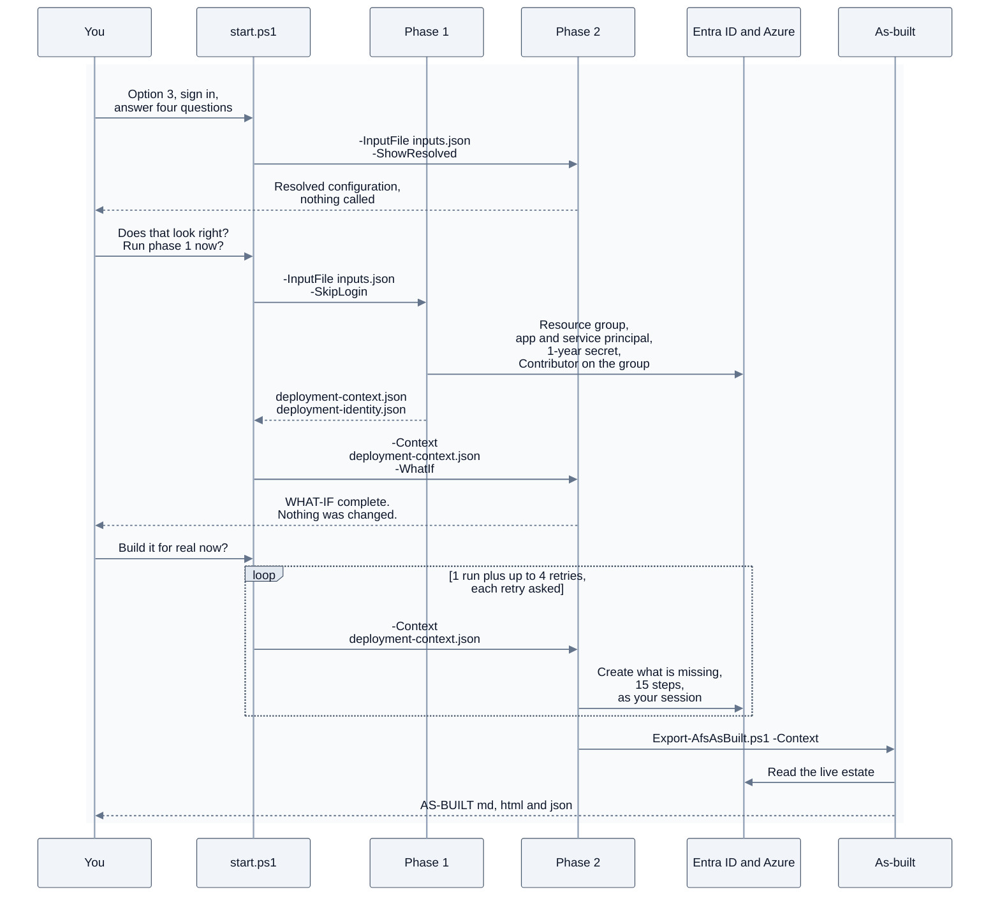

The wizard runs each script from the `deploy\` folder:

| # | What the wizard runs | What it changes |
| --- | --- | --- |
| 1 | `Deploy-AfsEnvironment.ps1 -InputFile <kit>\deploy\inputs.json -ShowResolved` | Nothing. It prints the resolved configuration and makes no Azure call. |
| 2 | `Phase1-New-DeploymentIdentity.ps1 -InputFile <kit>\deploy\inputs.json -SkipLogin` | Real run: the resource group, an Entra app and service principal, a client secret, a role assignment and two local files. |
| 3 | `Deploy-AfsEnvironment.ps1 -Context <kit>\deploy\deployment-context.json -WhatIf` | Nothing. It only reads, and prints a `WHATIF would <action> -> <target>` line for each change. |
| 4 | `Deploy-AfsEnvironment.ps1 -Context <kit>\deploy\deployment-context.json` | Real run, up to five times. It creates whatever is missing. |
| 5 | `Export-AfsAsBuilt.ps1 -Context <kit>\deploy\deployment-context.json`, called by step 4 after a successful run | It only reads Azure, and it writes the as-built files. |

The menu cannot change any of the following:

- **Phase 1 always runs for real.** The identity is always `sp-<prefix>-afs-deploy`, the role is always `Contributor` on the resource group, and the identity always gets a client secret, never a federated credential. If you want `-WhatIf`, `-Federate`, `-IdentityName` or `-Role`, run the script yourself: see [deploy/Phase1-New-DeploymentIdentity.ps1](SCRIPT-REFERENCE.md#deployphase1-new-deploymentidentityps1).
- **Phase 2 always runs a dry run first.** The wizard never passes `-SkipPreflight`, and it stops after five attempts.
- **The questions write two values you are not asked for.** They always save the storage name suffix as `01` and the AD object type as `ComputerAccount`. To use other values, change them in [option 2](#option-2-deployment-settings) and build from the file: press Enter at **`Answer the questions again?`**. Answering the questions again and overwriting the file resets both. Shares, network ranges, redundancy and every other name come from the defaults or from `deploy\inputs.json`. Change those in [option 2](#option-2-deployment-settings).

**Progress: the seven stages.** Above each script's own output, the wizard shows a bar that ends with `<n>/7 stages`:

| Stage | Label | Reached when |
| --- | --- | --- |
| 1 | `prerequisites checked` | The prerequisite check passed. |
| 2 | `signed in` | You are signed in. |
| 3 | `answers ready` | `deploy\inputs.json` exists. |
| 4 | `design reviewed` | You answered `Y` to **`Does that look right?`** |
| 5 | `phase 1 done - identity ready` | Phase 1 wrote the deployment context. |
| 6 | `dry run reviewed - building` | You answered `Y` to **`Build it for real now?`** |
| 7 | `built` | Phase 2 succeeded. |

**Phase 1: the deployment identity.** Phase 1 prints `PHASE 1 - deployment identity`, followed by these steps:

1. `-> [1/9] Reading and expanding the inputs`. It prints the resolved configuration again. It checks that you are signed in and warns `signed in as <x> but the inputs file names <y>` when the account differs from your first answer. It then makes the subscription in the file the active one.
2. `-> [2/9] Establishing write access, and the resource group`. It reuses `rg-<prefix>-filesync`, or creates it with the tags `purpose=azure-file-sync` and `prefix=<prefix>`.
3. `-> [3/9] Entra deployment identity sp-<prefix>-afs-deploy`. It reuses a service principal that has this display name, or creates the app registration and the service principal.
4. `-> [4/9] Issuing a client secret, valid one year`.
5. `-> [5/9] Granting Contributor on the resource group, not the subscription`. It skips the grant if the identity already holds the role. While the new principal replicates, it retries up to 6 times, 10 s apart.
6. `-> [6/9] Writing the deployment context`. It writes `deployment-context.json` and `deployment-identity.json`.
7. `-> [7/9] Proving the new identity works, before phase 2 depends on it`. It asks Entra for a token as the new identity and reads the resource group with that token. It tries up to 12 times, 10 s apart. It does not touch your own sign-in.

**Phase 2: the build.** Phase 2 starts with `[0] Which identity runs this`. If your session can read the resource group, it prints `OK    using the current session: <upn>` and builds as you. In the wizard this is the normal case, because phase 1 has just created the group with your account. Phase 2 signs in as the deployment identity only when no session can read the group. Then it runs 15 steps. Each step checks first and creates only what is missing:

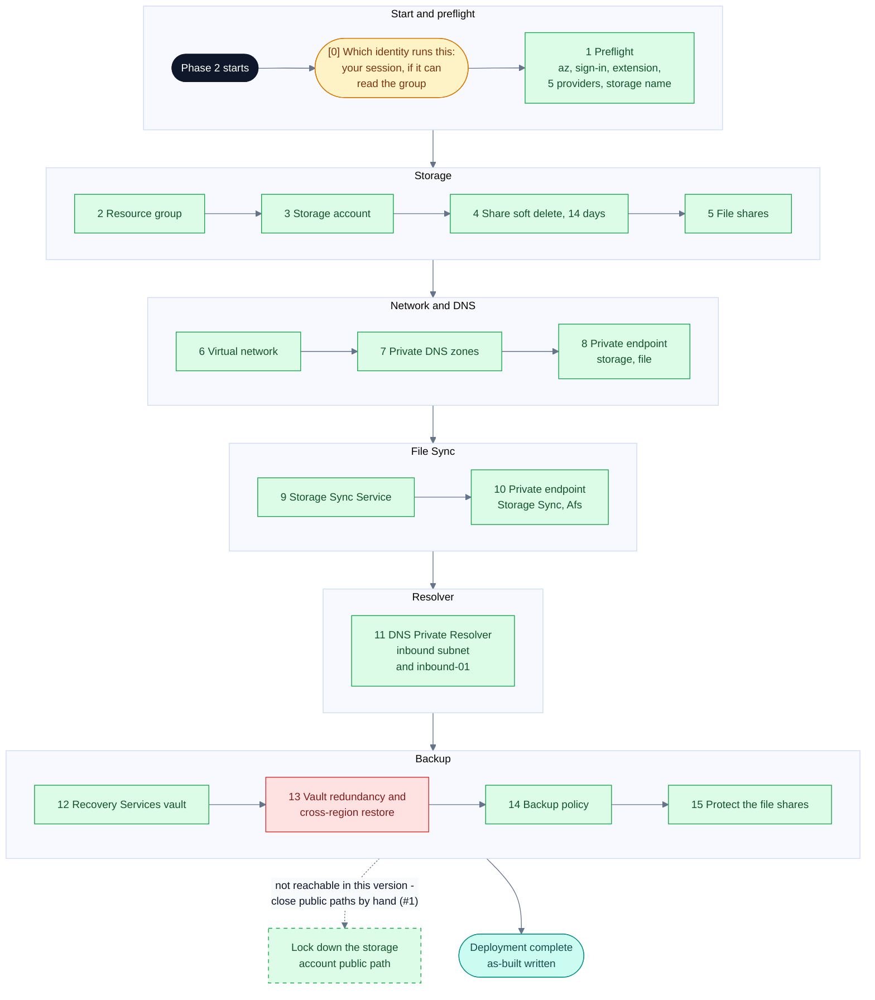

Step 13 is red in the diagram because the redundancy it sets is frozen as soon as step 15 protects the first share. This is what each step shows on screen, with the defaults for prefix `contoso` and region `eastus`:

| Shown as | Creates or sets |
| --- | --- |
| `[1/17] Preflight` | Nothing in Azure. It checks `az` and your sign-in, sets the subscription, and installs the `dns-resolver` extension if it is missing. It registers any of Microsoft.Storage, Microsoft.Network, Microsoft.StorageSync, Microsoft.RecoveryServices and Microsoft.Insights that are not registered, and waits up to 10 minutes for them. It also checks that the storage account name is free. |
| `[2/17] Resource group rg-contoso-filesync` | Nothing new in the wizard. Phase 1 created the group, so this step prints `already exists`. |
| `[3/17] Storage account stcontosofs01` | StorageV2, `Standard_ZRS`, minimum TLS 1.2, HTTPS only, blob public access off, shared-key access on, large file shares on. The public network path is left open. |
| `[4/17] Share soft delete (14 days)` | Share soft delete for 14 days. This step applies the setting on every run. |
| `[5/17] File shares` | `dept-shares` (1024 GiB) and `home-drives` (2048 GiB). |
| `[6/17] Virtual network vnet-contoso-filesync` | `10.60.0.0/16`, with the subnet `snet-privateendpoints` (`10.60.1.0/26`). |
| `[7/17] Private DNS zones` | `privatelink.file.core.windows.net` and `privatelink.afs.azure.net`, each linked to the virtual network. |
| `[8/17] Private endpoint for the storage account (sub-resource: file)` | `pe-stcontosofs01-file`, and its DNS zone group. |
| `[9/17] Storage Sync Service sss-contoso-filesync` | The Storage Sync Service, with incoming traffic set to `AllowAllTraffic`. |
| `[10/17] Private endpoint for the Storage Sync Service (sub-resource: Afs)` | `pe-sss-contoso-filesync-afs`, and its DNS zone group. |
| `[11/17] DNS Private Resolver dnspr-contoso-eastus` | The delegated subnet `snet-dnsresolver-inbound` (`10.60.2.0/28`), the resolver, and the inbound endpoint `inbound-01`. There is no outbound endpoint. |
| `[12/17] Recovery Services vault rsv-contoso-eastus` | The vault. |
| `[13/17] Vault redundancy and cross-region restore (must precede any protected item)` | `GeoRedundant` storage, with cross-region restore on. |
| `[14/17] Backup policy afs-daily-60d (daily snapshot, 60 days)` | One snapshot a day at 02:00 UTC, kept for the retention you chose. |
| `[15/17] Protect the file shares` | Protects each share with that policy. |

If you turn the resolver or backup off in [option 2](#option-2-deployment-settings), phase 2 skips those steps and renumbers the steps after them. The closing bar always reads `17/17 steps`, even though the last step header printed is `[15/17]` with the defaults, and a lower number still when you turn steps off.

When phase 2 finishes, it prints the following, in order:

- `Took <time> in total.`, and the slowest steps under `Where it went:`.
- `Deployment complete. N object(s) created this run.` and a table of what it created.
- `Generating the as-built from the live estate`, then the paths of the as-built files.
- `Verify with:`, followed by one `az` command for each object.
- The three on-premises commands.
- `Remove everything with: .\Remove-AfsEnvironment.ps1 -Context <kit>\deploy\deployment-context.json`

The wizard then shows its `Done` screen.

**Files it writes.** The kit's `.gitignore` excludes all of these files:

| File | What it holds |
| --- | --- |
| `deploy\inputs.json` | Your answers. |
| `deploy\deployment-context.json` | Schema `afs-deployment-context/1`: who created it and when, the identity (name, appId, tenant, role, scope, secret file name), and the whole resolved configuration. Options 2, 6, 7, 11, 12 and 13 read it. |
| `deploy\deployment-identity.json` | The identity's appId and tenantId, and its client secret in plain text. |
| `as-built\AS-BUILT-<prefix>-<yyyyMMdd-HHmm>.md`, `.html` and `.json` | The as-built document, read from Azure after the build. The timestamp is UTC. |
| `logs\wizard-<yyyyMMdd-HHmmss>.log`, `.jsonl` and `.transcript.txt` | The run log. Phase 1 and phase 2 write into the same files. |

**What it creates.** A default build creates the following:

- **In Entra ID:** the app registration and service principal `sp-contoso-afs-deploy`, with a client secret that expires after one year.
- **In the subscription:**
  - the resource group `rg-contoso-filesync`;
  - a `Contributor` role assignment for the identity, scoped to that group;
  - every phase 2 resource in the table above;
  - registrations for any of the five resource providers that were not already registered.
- **Placed by Azure Backup, not the kit:** a delete lock named `AzureBackupProtectionLock` on the storage account, once a share is protected.

A build does not create sync groups, server endpoints, registered servers, DNS forwarders, the AD DS join, the storage lock-down, or a network path from on-premises (VPN gateway, ExpressRoute connection or peering). [Option 11](#option-11-connect-your-on-premises-servers) creates the first five. You provide the network path and close the public path yourself.

#### When it worked

```text
  [ok]   saved C:\kits\afs\deploy\inputs.json
   OK   Contributor granted at /subscriptions/00000000-0000-0000-0000-000000000000/resourceGroups/rg-contoso-filesync
   OK   the identity can sign in and read rg-contoso-filesync (ready after N attempt(s)) - phase 2 will run unattended
Phase 1 complete.
  [ok]   phase 1 complete
WHAT-IF complete. Nothing was changed.
Deployment complete. 14 object(s) created this run.
  as-built: C:\kits\afs\as-built\AS-BUILT-contoso-20260910-1432.md
  as-built: C:\kits\afs\as-built\AS-BUILT-contoso-20260910-1432.html
```

At the end you see the title `Done` and a bar that ends with `7/7 stages`. With default settings, a first build counts 14 objects. The resource group is not in the count, because phase 1 created it.

#### Next

- Connect your servers with [option 11](#option-11-connect-your-on-premises-servers). It covers the agent and server endpoint, the DNS forwarders and the AD DS join. The forwarders send the public zones `file.core.windows.net` and `afs.azure.net` to the resolver inbound IP. Each of the three runs a dry run first.
- Before option 11's DNS step, connect your on-premises network to `vnet-<prefix>-filesync` with the VPN, ExpressRoute or peering you provide. The build created none of these. Without that path, the DNS step's [gate](SCRIPT-REFERENCE.md#onpremset-afsdnsforwardersps1) gets no private answer from the resolver, and it writes no forwarders.
- Close the storage account's public network path by hand, once the private endpoint resolves from on-premises. The build leaves it open (tracked in [#1](https://github.com/gusitde/azure-filesync-backup-assessment/issues/1)).
- Move `deploy\deployment-identity.json` into your secret store. Open the as-built with [option 13](#option-13-open-the-findings-and-as-built-reports). [AS-BUILT-TEMPLATE.md](AS-BUILT-TEMPLATE.md) lists the evidence to capture.

#### If it goes wrong

| You see | It means | Do this |
| --- | --- | --- |
| `[!]    Azure CLI (az) was not found on PATH.` | The Azure CLI is not installed, or PowerShell has not picked up PATH yet. | Run `winget install --exact --id Microsoft.AzureCLI`, reopen PowerShell, and choose 3 again. |
| `[!]    you appear to be running under Git Bash / MSYS.` | You started the wizard from Git Bash. | Start it from PowerShell. |
| `[!]    sign-in did not complete.` | The browser sign-in was abandoned or failed. | Choose 3 again. |
| `[!]    this account can sign in, but cannot read that subscription.` | The account has no Azure role on the subscription. An Entra role is not an Azure role. | Run the commands the wizard printed (list your roles, elevate if you are a Global Administrator, `az login`, grant yourself Owner), then choose 3 again. |
| `Stopped before asking anything else. Grant the access above, then start again.` | You answered `n` to **`Carry on anyway and answer the rest?`** | Grant the access, then choose 3 again. |
| `[i]    keeping the existing file.` | You answered `n` to **`Overwrite it?`** Your new answers were discarded. | Choose 3 again and answer `y`, or change single values in [option 2](#option-2-deployment-settings). |
| `That step did not complete.` with `Not valid JSON after comment stripping` or `inputs file is missing required value` | The existing `deploy\inputs.json` does not parse, or does not resolve. | If it does not parse, open `deploy\inputs.json` in an editor and fix it. Option 2 cannot open a file that does not parse, and a trailing comma or an unescaped backslash are the usual causes. If a value is missing, set it in [option 2](#option-2-deployment-settings). Then choose 3 again. |
| `What went wrong:  This tenant requires multi-factor authentication before any resource can be created.` | Your session did not complete MFA (`RequestDisallowedByAzure`). | Run `az logout`, choose 3 again, and complete MFA in the browser. |
| `Stopped before creating anything. Fix the above and run this again.` | Phase 1 could not create the resource group. Usually the account is not Owner, or MFA is missing. | Do what the `Do this:` lines say, then choose 3 again. |
| `Stopped. The resource group exists; nothing else was created.` | The account has no Entra directory role that can create applications. | Get Application Administrator or Global Administrator. Check with the `az rest ... memberOf` command it printed. In PowerShell, put the URL in single quotes first, because `$select` inside double quotes is expanded to nothing (tracked in [#3](https://github.com/gusitde/azure-filesync-backup-assessment/issues/3)). Then choose 3 again. The group is reused. |
| `Stopped. Grant the role, then run this again - it will reuse the identity.` | The identity was created, but the role assignment failed. | Make sure you are Owner on the subscription, then choose 3 again. |
| `WARN the identity is not usable yet: ...` | Entra has not replicated the new identity yet. | Nothing. The wizard carries on, and phase 2 runs as you. |
| `[!]    phase 1 did not produce a deployment context. Stopping here.` | Phase 1 ended without writing `deploy\deployment-context.json`. | Read the log named at startup, fix the cause, and choose 3 again. |
| `That step did not complete.` right after `Phase 2 - dry run first` | The dry run failed, for example with `storageAccountName '<name>' is already taken by another account`. A failed dry run ends the build. | Storage names are global. Change **Storage name suffix** in [option 2](#option-2-deployment-settings), then choose 3 again and press Enter at **`Answer the questions again?`**, because answering the questions again resets the suffix to `01`. Changing **Name prefix** also works, but it renames the resource group and the identity. The empty group and the identity that phase 1 already created, with a secret that is still valid, stay behind, and option 7 does not remove them. |
| `Phase 2 stopped (attempt N of 5).` followed by `What went wrong:` | An Azure call failed during the real build. | Do what the `Do this:` lines say, then answer `Y` to **`Retry phase 2 now?`**. The retry skips everything that already exists. |
| `These resource providers did not finish registering in 10 minutes: ...` | Registration was denied or is slow. | An account with subscription rights runs `az provider register -n <namespace>`. Then retry. |
| `What went wrong:  The CLI has no subscription selected, or cannot see the one requested.` during a create step, although the subscription is right | This can be an unregistered resource provider. The wizard shows the wrong advice for it (tracked in [#3](https://github.com/gusitde/azure-filesync-backup-assessment/issues/3)). | Look in the log's `.jsonl` for `MissingSubscriptionRegistration`. Run `az provider register -n <namespace>`, then retry. |
| `[!]    giving up after repeated failures. Fix the cause above, then choose Resume from the menu.` | Five attempts failed. | Fix the cause, then use [option 12](#option-12-resume-the-last-build). |
| `WARN  as-built not generated: ...` | The build finished, but the as-built export failed. | Generate it from [option 13](#option-13-open-the-findings-and-as-built-reports), or from `deploy\` run `.\Export-AfsAsBuilt.ps1 -Context .\deployment-context.json`. |

#### Good to know

- **Phase 1 is not dry-run.** Once you answer `Y` to **`Run phase 1 now?`**, phase 1 creates the resource group, the Entra app and service principal, the secret and the role assignment, and writes the two files. Only phase 2 gets a dry run. Earlier documentation said every changing step shows a dry run first. That is true of phase 2 only.
- **"Nothing was changed" is wrong after phase 1.** If you answer `n` to **`Build it for real now?`**, the wizard prints `[i]    nothing was changed. Run this again when you are ready.` Phase 1's changes are already in place at that point (tracked in [#3](https://github.com/gusitde/azure-filesync-backup-assessment/issues/3)).
- **Phase 2 runs as you, not as the deployment identity.** The phase 1 screen says `After this, every deployment runs without a human.` Earlier documentation said phase 2 signs in as the identity. In the wizard, your own session can read the resource group, so phase 2 uses your session. The identity signs in only when no session can read the group, for example in a pipeline. That is also why provider registration works from the wizard. The identity is scoped to the resource group, and it cannot register providers (tracked in [#1](https://github.com/gusitde/azure-filesync-backup-assessment/issues/1)).
- **Choosing a subscription changes your Azure CLI default at once.** The wizard runs `az account set` without asking. If you then decline **`Overwrite it?`**, that change stays. Phase 1 switches back to the subscription named in the file.
- **Every build issues a new secret.** Option 3 runs phase 1 every time. When the identity already exists, phase 1 issues a new one-year secret, which replaces the old one, and overwrites `deploy\deployment-identity.json`. Anything else that uses the old secret stops working. A code comment says a re-run issues no new secret (tracked in [#3](https://github.com/gusitde/azure-filesync-backup-assessment/issues/3)).
- **Build picks up settings changes; Resume does not.** Because option 3 re-runs phase 1, edits you made in [option 2](#option-2-deployment-settings) reach the deployment context. [Option 12](#option-12-resume-the-last-build) does not re-read them.
- **The four questions are not the four inputs earlier documentation listed.** The code asks for the administrator; then the subscription, region and prefix; then an optional AD join, which defaults to no; then backup retention. It never asks for the AD object type or the storage name suffix. It writes `ComputerAccount` and `01`, which you can change in [option 2](#option-2-deployment-settings).
- **Skipping AD leaves a placeholder.** If you answer no to the AD join, the AD admin is saved as `not-configured`. If you later turn the join on in option 2, and fill in the domain, NetBIOS name and OU but not the AD admin account, the kit plans the join as `not-configured` (tracked in [#3](https://github.com/gusitde/azure-filesync-backup-assessment/issues/3)). Set the AD admin account at the same time.
- **The retention check is looser than its message.** The message says `a number of days, 1 to 200.`, but any number from 0 to 999 is accepted (tracked in [#3](https://github.com/gusitde/azure-filesync-backup-assessment/issues/3)). Stay within 1 to 200.
- **Answers are saved as ASCII.** A character outside ASCII in a UPN or OU is saved as `?` (tracked in [#3](https://github.com/gusitde/azure-filesync-backup-assessment/issues/3)).
- **Some wizard text is inaccurate:**
  - The administrator question and the phase 1 failure hint both say "Owner or User Access Administrator". You need Owner. Issue [#1](https://github.com/gusitde/azure-filesync-backup-assessment/issues/1) (item 5) covers the same wording in phase 1's help; these two wizard lines are not listed in an issue yet.
  - The access check prints `access confirmed - Microsoft.Resources resource group(s) visible`. That is a provider name, not a count (tracked in [#3](https://github.com/gusitde/azure-filesync-backup-assessment/issues/3)).
  - Phase 1's counter reads `/9`, but only 7 steps print (tracked in [#3](https://github.com/gusitde/azure-filesync-backup-assessment/issues/3)).
  - Phase 2's counter reads `/17` for 15 steps (tracked in [#1](https://github.com/gusitde/azure-filesync-backup-assessment/issues/1)).
- **The lock-down step never runs.** The storage account's public network path stays open after the build. Close it by hand, once the private endpoint resolves from on-premises (tracked in [#1](https://github.com/gusitde/azure-filesync-backup-assessment/issues/1)).
- **The design screen names a sync group the build never creates.** `What this will create` shows `sync group          sg-contoso-shares`. [Option 11](#option-11-connect-your-on-premises-servers) creates one sync group per share instead, named `sg-<prefix>-<share>`. No issue tracks this yet.
- **The dry run is lighter than the real run:**
  - On a first build, the dry run prints `storage account id not resolvable yet (what-if run?), private endpoint skipped`, and the same for the Storage Sync Service. That is expected, because nothing exists yet.
  - The dry run does not register providers or install the extension. It can pass while the real run then waits for provider registration.
- **Vault redundancy is a one-way door.** Step 13 sets it before any share is protected. Once a share is protected, the vault's redundancy can no longer be changed. See [Decisions you cannot undo](#decisions-you-cannot-undo).
- **The console does not print the resolver inbound IP.** The `Done` screen tells you to point DNS at it. Read the IP from the as-built (the **Network** tab and the **Still manual** table), or run the `resolver inbound IP` command under `Verify with:`.

*Code: `start.ps1` (Invoke-BuildFlow, New-InputsFile, Ensure-SignedIn, Test-Prerequisites, Invoke-Phase2WithRetry), `deploy/Phase1-New-DeploymentIdentity.ps1`, `deploy/Deploy-AfsEnvironment.ps1`, `deploy/Export-AfsAsBuilt.ps1`, `deploy/AfsConfig.ps1` (Resolve-AfsConfig, Show-AfsConfig, Get-AzureFailureAdvice)*

### Option 4: Assess an existing environment

Use it to export an existing Azure File Sync and Azure Backup estate read-only, or to turn an export you already have into a findings report.

The menu offers two steps: **Export** and **Assess**. The wizard's own intro text mentions an optional per-server step, but no such step is on the menu. To include server-side checks, run [Get-AfsServerDiagnostics.ps1](SCRIPT-REFERENCE.md#get-afsserverdiagnosticsps1) by hand on each file server and copy its zip into the export folder before you assess.

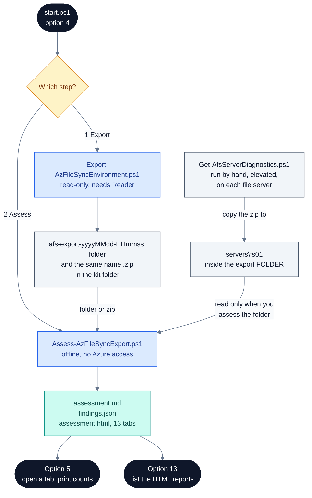

#### Before you start

- Run it on your workstation or jump box, from the kit folder, in PowerShell (not Git Bash). No elevation is needed.
- The Azure CLI must be on PATH. The wizard checks this first, on a screen titled `Checking what you have`, and stops if `az` is missing.
- **For Export:**
  - You need Reader on each subscription you export. Nothing more.
  - You sign in twice, and the wizard walks you through both:
    - the **Azure CLI**, which the wizard uses to list your subscriptions;
    - **Az PowerShell**, which the exporter uses. `az login` does not sign in Az PowerShell.
  - The `Az.Accounts` module must be installed. If it is missing, the wizard offers to install it for your user from the PowerShell Gallery.
  - The machine needs outbound HTTPS to Azure Resource Manager.
- **For Assess:** you need an export folder or zip whose root holds `manifest.json`. No Azure access is needed.
- **Optional, for server-side checks:** on each registered file server, run `Get-AfsServerDiagnostics.ps1` elevated. Copy each bundle zip into `servers\<hostname>\` inside the export **folder**, then assess the folder, not the zip.
- **If the customer runs the export themselves:**
  - They need Reader on each subscription, Windows PowerShell 5.1 and the `Az.Accounts` module. They do not need the wizard or the Azure CLI.
  - They sign in with `Connect-AzAccount -Tenant <tenant-id>`, then run `.\Export-AzFileSyncEnvironment.ps1` from the kit folder. `-SubscriptionId <id>` limits the scope. Without it, the export covers every enabled subscription in that tenant.
  - The output lands in the folder they ran it from: `afs-export-<yyyyMMdd-HHmmss>` and `afs-export-<yyyyMMdd-HHmmss>.zip`. They send you the zip.
  - For server checks, they also run `Get-AfsServerDiagnostics.ps1` elevated on each registered file server, and send you each `<hostname>-afs-server-<stamp>.zip`.
  - On your side, extract the export zip to a folder of the same name. Inside it, create `servers\<hostname>\` for each server and put that server's bundle zip there. Then choose option 4, step 2, and give the folder, not the zip.
  - The export zip holds subscription names and ids, resource ids, server names, server endpoint paths, private IPs, RBAC principal ids, and the account and tenant id that ran it. Each server bundle holds that server's name and domain, its volumes, services and installed programs. Handle both as confidential in transit and at rest.
  - Microsoft reference: [Azure built-in roles: Reader](https://learn.microsoft.com/azure/role-based-access-control/built-in-roles#reader).

#### What you will be asked

Yes/no prompts take the capitalised default when you press Enter. Menus have no default, so type a number.

1. **`Which step?`** (no default):
   - `1) Export the configuration from Azure (needs Reader)`
   - `2) Assess an export I already have (no Azure access needed)`
   - `3) Back`

If you chose **1 (Export)**, you are asked next:

1. Azure CLI sign-in (screen `Signing in`):
   - If you are signed in, it prints `[ok]   already signed in as <user>`, then asks **`Use this account?`** `[Y/n]`. Answering n runs `az logout` and starts a new sign-in.
   - If you are not signed in, it asks **`Press Enter to open the browser`**. Complete MFA in the browser.
2. **`Which subscription should be exported?`** (no default). You get one line per enabled subscription the Azure CLI can see, as `<name>   (<id>)`, plus `All of them`.
   - If the Azure CLI lists no subscriptions, the question is skipped. The exporter then exports every enabled subscription in the Az PowerShell tenant.
3. Az PowerShell sign-in (screen `Az PowerShell session`):
   - If `Az.Accounts` is missing: **`Install it now, for the current user only?`** `[Y/n]`. Answering n stops the flow with `The export was not started.`
   - If a working session exists, it prints `[ok]   Az PowerShell already signed in as <account>` and asks nothing.
   - Otherwise: **`Press Enter to sign in to Az PowerShell`**. The wizard passes the Azure CLI's tenant to `Connect-AzAccount`. It also passes the subscription, but only when you picked exactly one.
4. `[i]    the export makes only read calls - no keys, no SAS, no data.`, then **`Run the export now?`** `[Y/n]`.

If you chose **2 (Assess)**, you are asked next:

1. **`Path to the export zip or folder?`** (no default). Type a full path, without quotes.
2. **`Name to put on the report?`** `[Customer]`. This is the name printed in the report header.
3. **`Must sync and backup traffic stay on a private path?`** `[y/N]`. Answering y turns on rules NET-05 to NET-11 and raises NET-01 from Info to High.
4. **`Open the HTML report now?`** `[Y/n]`. It is asked after the run, and only if the wizard finds an `assessment.html` under the kit folder.

#### What it runs

- **Export:** from the kit folder, it runs `.\Export-AzFileSyncEnvironment.ps1 -SubscriptionId <the id or ids you picked>`. If the subscription list was empty, it runs the script with no arguments.
  - You cannot set these from the menu:
    - `-OutputPath`: always `<kit folder>\afs-export-<yyyyMMdd-HHmmss>` (local time)
    - `-JobLookbackDays` (30)
    - `-MetricsLookbackDays` (7)
    - `-SkipMetrics`
    - `-NoZip`: the export is always zipped
  - To change any of them, run [Export-AzFileSyncEnvironment.ps1](SCRIPT-REFERENCE.md#export-azfilesyncenvironmentps1) directly.
- **Assess:** from the kit folder, it runs `.\Assess-AzFileSyncExport.ps1 -ExportPath <your path> -CustomerName <name>`. It adds `-PrivateTrafficRequired` if you answered y.
  - You cannot set `-OutputPath`, `-IncludeCatalog` or `-LatestAgentMajor` (default 20) from the menu. See [Assess-AzFileSyncExport.ps1](SCRIPT-REFERENCE.md#assess-azfilesyncexportps1).
- **Server diagnostics:** not run. Nothing in the wizard calls `Get-AfsServerDiagnostics.ps1`.

Where the reports land depends on what you give the assessor:

| You give | Reports written to | Server bundles read |
| --- | --- | --- |
| The export folder | That folder | Yes, from `servers\<hostname>\` |
| The export zip | The folder that contains the zip | Only bundles inside the zip. Bundles copied into the export folder afterwards are not read |

A zip is expanded to `%TEMP%\afs-assess-<yyyyMMdd-HHmmss>` and deleted after a successful run. The reports are always `assessment.md`, `findings.json` and `assessment.html`.

#### When it worked

Export (the first column is the time):

```text
[09:02:11] Export-AzFileSyncEnvironment v1.0.0 -> C:\kits\afs\afs-export-20260910-090210
[09:02:11] Signed in as admin@contoso.com , tenant 00000000-0000-0000-0000-000000000000 , cloud AzureCloud
[09:02:12] Scope: 1 subscription(s): Contoso-Prod (00000000-0000-0000-0000-000000000000)
...
[09:04:40] Done. <N> files, 0 failed call(s). Counts: storageSyncServices=<n> syncGroups=<n> ...
[09:04:41] Zipped -> C:\kits\afs\afs-export-20260910-090210.zip  (send this file for assessment)
```

The first 12 lines of `summary.md` follow, then `... (full summary in summary.md)`. `0 failed call(s)` means every read succeeded.

Assess:

```text
Assessing export at C:\kits\afs\afs-export-20260910-090210 (exported 2026-09-10 09:04:40Z)
Findings: High=<n> Medium=<n> Low=<n> Info=<n> -> C:\kits\afs\afs-export-20260910-090210\assessment.md
Report: C:\kits\afs\afs-export-20260910-090210\assessment.html
```

The exported time is in UTC. It is taken when the export writes `manifest.json`, just before `Done.`, not when the export starts.

If you let the wizard open the report, it prints `[ok]   opened <path>`.

#### Next

- After an export, choose option 4 again, then `2) Assess an export I already have`. The wizard does not chain the two steps. Give the folder if you added server bundles; the zip otherwise.
- After an assessment, use [option 5](#option-5-see-the-assessment-results) to open the report at a tab or print the counts. [Option 13](#option-13-open-the-findings-and-as-built-reports) lists it with your other reports.
- If finding OPS-03 appears, collect the missing server bundles and assess the folder again.

#### If it goes wrong

| You see | It means | Do this |
| --- | --- | --- |
| `[!]    Azure CLI (az) was not found on PATH.` | The Azure CLI is missing or not on PATH | `winget install --exact --id Microsoft.AzureCLI`, then close and reopen PowerShell |
| `[!]    you appear to be running under Git Bash / MSYS.` | You started the wizard from Git Bash | Open PowerShell and run `.\start.ps1` again |
| `[!]    sign-in did not complete.` | The Azure CLI browser sign-in was cancelled or failed | Choose option 4 again, or run `az login` first |
| `[!]    install failed: <message>` | `Az.Accounts` could not be installed from the PowerShell Gallery | Check access to the gallery, or run `Install-Module Az.Accounts -Scope CurrentUser` yourself |
| `[!]    Connect-AzAccount failed: <message>` or `[!]    signed in, but the session still cannot list subscriptions.`, then `The export was not started.` | Az PowerShell could not sign in or cannot reach Resource Manager | Run `Connect-AzAccount -Tenant 00000000-0000-0000-0000-000000000000` yourself, then choose option 4 again |
| `Subscription <id> is not visible to <account>. Check the id, and that this account has Reader on it.` | No Reader on that subscription, or the Az PowerShell session is in a different tenant from the subscription | Grant Reader. Or run `Disconnect-AzAccount` and choose option 4 again, so the wizard signs Az PowerShell in to the Azure CLI's tenant |
| `No subscriptions in scope.` | No enabled subscription in the Az PowerShell tenant | Sign Az PowerShell in to the right tenant |
| `WARNING: <label>: HTTP 403 AuthorizationFailed: ...` during the export | Reader is missing on one resource. The export carries on | Grant Reader and export again, or accept the gap. The assessment reports it as OPS-02 |
| `The export did not complete.` or `The assessment did not complete.`, then `What went wrong:` or `The error Azure returned:` | The script stopped. The lines below say why | Follow the `Do this:` lines when there are any. Full detail is in the wizard log ([section 5](#5-logs-levels-and-environment-variables)) |
| `[!]    that path does not exist.` | A typo, quotes around the path, or a relative path | Type the full path, without quotes |
| `Not an export folder (manifest.json missing): <path>` | The path points at the wrong level, such as a parent folder or `servers\` | Point at the `afs-export-<stamp>` folder or its zip |
| `WARNING: assessment.html was not produced: <message>` | The HTML renderer failed. `assessment.md` and `findings.json` were written | Read `assessment.md`, and report the message |
| Finding OPS-03, evidence `no servers/<hostname>/ bundle in the export` | No bundle for that registered server, or you assessed the zip | Run `Get-AfsServerDiagnostics.ps1` on the server, copy the zip into the export folder, and assess the folder |

#### Good to know

- **No server-diagnostics step.** The intro screen says "optionally collect per-server detail". The menu offers only Export, Assess and Back. Server diagnostics are always a manual step (tracked in [#3](https://github.com/gusitde/azure-filesync-backup-assessment/issues/3)).
- **Two separate sign-ins.** An existing Az PowerShell session is used as it is. The wizard does not check that its tenant matches the Azure CLI's. If they differ, the export stops with `Subscription <id> is not visible to ...`. Run `Disconnect-AzAccount` and choose option 4 again, so the wizard signs Az PowerShell in to the Azure CLI's tenant.
- **`All of them` with several tenants.** It passes every enabled subscription the Azure CLI can see, which can span tenants. One subscription outside the Az PowerShell tenant stops the whole export. Picking one subscription helps only when it is in the Azure CLI's current tenant, because that is the tenant the wizard signs Az PowerShell in to. For a subscription in another tenant, run the exporter directly after `Connect-AzAccount -Tenant <tenant-id>`.
- **Sovereign clouds.** The wizard checks the Az PowerShell session against the public-cloud endpoint `https://management.azure.com`, so a session in another cloud fails that check. The exporter itself uses your session's own Resource Manager endpoint, so run it directly (tracked in [#3](https://github.com/gusitde/azure-filesync-backup-assessment/issues/3)).
- **What the export does.** It makes ARM GET calls plus one Resource Graph query, which is a POST that only reads. It never requests keys, SAS tokens or certificates.
- **What the export contains.** It holds subscription names and ids, resource ids, server names, server endpoint paths, private IPs and RBAC principal ids. `summary.md` and `manifest.json` also record your account and tenant id. Handle the folder and zip as confidential.
- **Failed reads do not stop the export.** A run that ends `Done.` still counts as complete when some calls failed. Check the `<E> failed call(s)` count and `errors.json`.
- **Where zip reports land.** Assessing a zip writes the reports beside the zip. For the wizard's own export, that is the kit folder itself, so the next zip you assess there overwrites them. Assess the folder to keep each report with its export.
- **Server bundles and the zip.** Bundles you copy into the export folder are read only when you assess the folder. Assessing the zip reads only bundles that are inside the zip itself (tracked in [#1](https://github.com/gusitde/azure-filesync-backup-assessment/issues/1)).
- **`Open the HTML report now?`** It opens the newest `assessment.html` anywhere under the kit folder, not necessarily the one just written. If your export is outside the kit folder, it opens an older report or does not ask. Open the file named on the `Report:` line instead.
- **Relative paths.** The wizard checks the path from the folder you started it in, but runs the assessor from the kit folder. Start the wizard from the kit folder, or type a full path (tracked in [#3](https://github.com/gusitde/azure-filesync-backup-assessment/issues/3)).
- **Quotes.** The wizard does not strip quotes, and Explorer's "Copy as path" adds them. Remove the quotes before you press Enter.
- **The private-path answer.** It raises exactly one finding (NET-01, from Info to High) and adds NET-05 to NET-11. Other findings keep their severity, although the prompt's own help text says it "escalates findings about anything still reachable over the public endpoint".
- **No dry run.** Neither script supports `-WhatIf`. The export waits for **`Run the export now?`**. The assessment starts as soon as you answer the private-path question. It only reads the export and writes local files.

*Code: `start.ps1` (Invoke-AssessFlow, Ensure-SignedIn, Ensure-AzPowerShellSession, Test-AzPowerShellSession), `Export-AzFileSyncEnvironment.ps1`, `Assess-AzFileSyncExport.ps1`*

### Option 5: See the assessment results

Use it to pick an assessment report and open it at any tab, print its severity counts in the terminal, open its folder, or rebuild it from its export.

#### Before you start

- Run it on the machine that holds the reports. It needs no Azure sign-in, no Azure CLI and no elevation.
- At least one `assessment.html` must exist under the kit folder, at most three folder levels down. Run [option 4](#option-4-assess-an-existing-environment) first.
- To use **Show the headline numbers here**, `findings.json` must sit beside the report.
- To rebuild, `findings.json` must also record an export path that still exists.

#### What you will be asked

1. If no report is found, the wizard prints `[i]    no assessment has been run yet.` and returns to the menu.
2. **`Which assessment?`** (no default). It is asked only when there is more than one report. The list is newest first:
   - Each entry reads `yyyy-MM-dd HH:mm  <customer>`, with the path relative to the kit folder on the next line. `(no customer name)` is shown when the report header has none.
   - The list ends with `Back`.
3. The wizard confirms your pick with `[ok]   <relative path>   <yyyy-MM-dd HH:mm>`.
   - An older report without the subject tabs adds `[i]    this report has <N> tabs - it was written before the per-subject tabs existed.`
   - It then says either `It can be rebuilt from the export it was made from: <path>` or `Its export is no longer at <path>, so it cannot be rebuilt from here.`
4. **`What would you like to see?`** (no default). This menu repeats until you choose `Back`:
   - `Open the whole report`
   - `Open at: <tab>`, one entry per tab. The tabs are read from the report file itself, so the Findings entry includes its count, for example `Open at: Findings 84`.
   - `Show the headline numbers here`
   - `Open the folder it is in`
   - `Re-generate this report from its export`. It appears only when a rebuild is possible, and gets `(adds the subject tabs)` appended for an older report.
   - `Back`
5. For a rebuild only: **`Name to put on the report?`**. The default is the customer name recorded in `findings.json`, or `[Customer]` if there is none. This is only a label; it does not change what is assessed.

#### What it runs

- **Open the whole report / Open at:** it runs `Start-Process` on the file, or on `file:///<path>/assessment.html#<tab id>` for a tab. Your default browser opens.
- **Show the headline numbers here:** it reads `findings.json` beside the report. Nothing else runs.
- **Open the folder it is in:** it opens the report's folder in Explorer.
- **Re-generate:** it runs `.\Assess-AzFileSyncExport.ps1 -ExportPath <export recorded in findings.json> -OutputPath <report folder> -CustomerName <name>`. It overwrites `assessment.md`, `findings.json` and `assessment.html` in that folder. You cannot add `-PrivateTrafficRequired` or `-IncludeCatalog` here.

#### When it worked

The report opens in your browser and the wizard prints the target, for example `[ok]   file:///C:/kits/afs/afs-export-20260910-090210/assessment.html#backup`.

**Show the headline numbers here** prints:

```text
    High       3
    Medium    12
    Low        9
    Info       6

    highest first:
      AFS-04  Registered server appears offline
```

It lists up to five High findings. A rebuild prints `[ok]   rebuilt <path>`, then `[ok]   13 tabs now`.

A current report has 13 tabs, in this order. The id is what the wizard appends after `#` to open a tab.

| # | Tab | id | What it shows |
| --- | --- | --- | --- |
| 1 | Overview | `overview` | Four severity tiles (click one to filter Findings), a By-area matrix, and a card for every High finding |
| 2 | Findings | `findings` | Every finding with its evidence, recommendation and Microsoft reference. Filter by severity and area. The tab label carries the count |
| 3 | Storage | `storage` | Storage accounts and file shares: posture at a glance, then one panel per account |
| 4 | File Sync | `filesync` | Per Storage Sync Service: sync groups, server endpoints, sync health (ages measured against the export time, not today), cloud tiering, registered servers |
| 5 | Backup | `backup` | The protection chain, coverage of every file share (protected or not), and per vault: redundancy, guards, policies, jobs, and who can delete the backups |
| 6 | Network | `network` | Private connectivity: the DNS resolution chain, private endpoints, private DNS zones, the hybrid path, and public-path evidence |
| 7 | Servers | `servers` | Registered servers and one section per server bundle, with the measurements behind the SRV findings |
| 8 | Guardrails | `adjacent` | Defender for Storage, resource locks, metric alert rules and Data Protection vaults. A missing input shows as "unknown, not clear" |
| 9 | Export | `provenance` | Chain of custody for the export: a confidence statement, the run identity, collection windows, failed calls, file hashes, and what the export cannot tell you |
| 10 | Roadmap | `roadmap` | Three lanes: Do now (High), This engagement (Medium), Backlog (Low and Info) |
| 11 | Scope | `scope` | Customer, assessment time, export path, the severity counts, and the export's `summary.md` |
| 12 | Rules | `rules` | The rule catalogue, but only for a report assessed with `-IncludeCatalog`. Otherwise it points to [RULES.md](RULES.md). The wizard never passes that switch |
| 13 | About | `about` | What the report is and is not, the severity definitions, and which traffic cannot be made private |


On the Network tab, a zero count comes with its cause. The tab says whether the object is not configured, lives outside the exported subscriptions, or was not collected because an export call failed.


#### Next

- Start at Overview, then use Findings and Roadmap to plan the work. Each finding's evidence is on the matching subject tab.
- Use [option 13](#option-13-open-the-findings-and-as-built-reports) for as-built and governance reports.
- To assess a newer export, run [option 4](#option-4-assess-an-existing-environment) again.

#### If it goes wrong

| You see | It means | Do this |
| --- | --- | --- |
| `[i]    no assessment has been run yet.` | No `assessment.html` within three folder levels of the kit folder | Run option 4, or move the report folder under the kit folder |
| `[i]    findings.json is not beside the report: <folder>` | The report was copied without its `findings.json` | Copy `findings.json` next to `assessment.html` |
| `[!]    could not read findings.json: <message>` | The file is damaged or not JSON | Assess the export again with option 4 |
| `[!]    the report was not rebuilt: <message>` | The assessor failed on the recorded export | Read the message and the wizard log |
| No `Re-generate this report from its export` entry. For an older report you also see `Its export is no longer at <path>, so it cannot be rebuilt from here.` | The export recorded in `findings.json` was moved or deleted | Run option 4, choose Assess, and give the export's new location |
| `[i]    opened at the top - the tab you wanted is <tab>.` | Windows could not open a `file://` address with a tab fragment | Click the tab in the browser |
| `[!]    could not open a browser: <message>`, then `Open this file by hand: <path>` | No default program for `.html` | Open the printed path yourself |

#### Good to know

- **Where it looks.** It searches only under the kit folder, three levels deep. A report written beside an export outside the kit folder is not listed. Unlike option 13, it does not skip `logs`, `.git`, `.azgovviz` or `.pwsh7`.
- **Older reports.** The tab list comes from each report, so an older report shows fewer entries. A report with 6 tabs was written before the subject tabs existed; rebuild it to add them. Earlier documentation described only those 6 tabs.
- **Rebuilds overwrite.** A rebuild overwrites the three report files in place. It asks for no confirmation beyond the menu choice. Copy the folder first if you need the old version.
- **Rebuilds drop the private-path rules.** A rebuild never passes `-PrivateTrafficRequired`, and `findings.json` does not record whether it was used. Rebuilding a report first made with the private-path answer y therefore drops NET-05 to NET-11 and returns NET-01 to Info. Rebuild that kind of report with option 4 instead, answering y again (tracked in [#3](https://github.com/gusitde/azure-filesync-backup-assessment/issues/3)).
- **Counts come from `findings.json`.** The headline numbers are read from `findings.json`, not the HTML. The customer name in the list is read from the report header.
- **Tab fragments.** Opening a tab relies on the report reading the `#<id>` fragment. You can use the same link yourself, for example `assessment.html#network`.

*Code: `start.ps1` (Invoke-AssessmentResultsFlow, Get-AfsAssessmentReports, Get-AfsReportTabs), `Render-AfsAssessmentHtml.ps1`, `render\AfsTab-*.ps1`, `Assess-AzFileSyncExport.ps1`*

### Option 6: Assess policy and governance across the tenant

Use it to run the Azure Governance Visualizer (AzGovViz) read-only across the tenant: policy, RBAC, management groups, locks and Defender coverage. The report lands in `governance\`, next to your other reports.

#### Before you start

- Run it on your workstation or jump box, from the kit folder, in Windows PowerShell. The script starts PowerShell 7 for AzGovViz itself.
- **PowerShell 7.0.3 or later** must be present. The script looks for it in this order:
  1. `-PwshPath`. Only when you run the script directly; the wizard never passes it.
  2. `<kit folder>\.pwsh7\pwsh.exe`, a portable copy you unzip there. When it is used, the script prints `..    using the portable PowerShell 7 in .pwsh7`.
  3. `pwsh` on PATH.
  The wizard never installs PowerShell 7. If none is found, the run stops.
- **The Azure CLI** must be installed. The wizard signs you in. It does not run the Azure CLI check that option 4 runs.
- **Reader at the management group.** The wizard always starts from the tenant root group, whose id is the tenant id. Without Reader, the script warns and carries on, and the report comes back nearly empty.
- **git** on PATH, the first time only, to clone AzGovViz into `<kit folder>\.azgovviz\`.
- **Network access** to GitHub (for the clone) and the PowerShell Gallery (for modules).
- **Optional:** `deploy\deployment-context.json` from a build. It supplies the subscription and tenant. Without it, the script uses the subscription and tenant you are signed in to.
- No elevation is needed.

#### What you will be asked

1. A screen titled `Policy and governance across the tenant` explains the run. It asks nothing.
2. Azure CLI sign-in (screen `Signing in`):
   - If you are signed in: **`Use this account?`** `[Y/n]`.
   - If you are not: **`Press Enter to open the browser`**.
3. If there is no deployment context, you see `[i]    no deployment context - assessing the subscription you are signed in to.` There is no question here.
4. **`Dry run first?`** `[Y/n]`. Yes runs the script with `-WhatIf`.
5. **`Run it now? It can take a while on a large tenant.`** `[Y/n]`. Yes runs it for real; No returns to the menu. This is asked even when the dry run failed.

#### What it runs

- **Dry run:** `.\Invoke-AfsGovernanceAssessment.ps1 -Context <kit folder>\deploy\deployment-context.json -WhatIf`. `-Context` is left out when the file does not exist.
- **Real run:** the same command, with `-Confirm:$false` instead of `-WhatIf`.
- **Six steps:**
  - `[1/6] Preflight`
  - `[2/6] AzGovViz source`
  - `[3/6] Modules inside PowerShell 7`
  - `[4/6] Run the assessment`
  - `[5/6] Collect the output`
  - `[6/6] Where it fits`
- **The AzGovViz command.** In step 4 the script prints and then runs `pwsh -NoProfile -File <kit folder>\.azgovviz\pwsh\AzGovVizParallel.ps1 -ManagementGroupId <mg> -OutputPath <kit folder>\governance -SubscriptionId4AzContext <sub> -TenantId4AzContext <tenant>`.
- **What you cannot change from the menu:**
  - the management group, which is always the tenant root
  - `-PwshPath`, `-InstallPowerShell7`, `-SourcePath`, `-SourceRepo`, `-SkipClone`, `-OutputPath`, `-SubscriptionId` and `-TenantId`

  To change any of these, run [Invoke-AfsGovernanceAssessment.ps1](SCRIPT-REFERENCE.md#invoke-afsgovernanceassessmentps1) directly.

A real run changes nothing in Azure. It does change your machine:

- It clones AzGovViz into `<kit folder>\.azgovviz\` with `git clone --depth 1`. By default the source is `https://github.com/gusitde/azuregovassessment`, on its default branch, not pinned to a version. An existing checkout is reused.
- Inside PowerShell 7, for your user only, it checks for `AzAPICall` (the version AzGovViz asks for, with 1.4.1 as the fallback) and `Az.Accounts`. For each one that is missing, it:
  - installs the NuGet provider if needed;
  - sets the `PSGallery` repository to **Trusted**;
  - installs the module.
- It writes the AzGovViz output to `<kit folder>\governance\`. Files from earlier runs stay there.
- It writes a temporary script, `%TEMP%\afs-gov-modules.ps1`, and deletes it afterwards.

A dry run still does the reads: the Azure CLI account, the PowerShell 7 lookup, and the management group check. It skips the clone, the module install and the AzGovViz run.

#### When it worked

```text
      OK    signed in as admin@contoso.com
      OK    assessing from management group 00000000-0000-0000-0000-000000000000
      OK    PowerShell 7.x.y at C:\Program Files\PowerShell\7\pwsh.exe
      OK    management group 00000000-0000-0000-0000-000000000000 is readable
...
      OK    AzGovViz <version>
...
      OK    finished in <n> seconds
      OK    <file name>.html  (<n> KB)
...
Governance assessment complete.
...
Output: C:\kits\afs\governance
```

Step 5 lists up to eight files written by this run; AzGovViz chooses the file names. A dry run ends with `WHAT-IF complete. Nothing was run.` instead.

#### Next

- Open the report from [option 13](#option-13-open-the-findings-and-as-built-reports). It is listed with the kind `governance`.
- Read it alongside `assessment.html`. The script's closing lines put it this way: the assessment asks "is this File Sync and Backup estate built well?", and AzGovViz asks "is the tenant around it governed well?".
- If you saw `WARN  cannot read management group`, get Reader granted and run it again.

#### If it goes wrong

| You see | It means | Do this |
| --- | --- | --- |
| `WARN  PowerShell 7 is not installed, and AzGovViz needs 7.0.3 or later`, then `The dry run did not complete.` or `The governance assessment did not complete.`, then `The error Azure returned:` and `The variable '$r' cannot be retrieved because it has not been set.` | No PowerShell 7 in `.pwsh7\` or on PATH. The script stops while building its own help text, so the install commands are not printed | Run `winget install --exact --id Microsoft.PowerShell` and reopen PowerShell. Or unzip the portable PowerShell 7 zip into `<kit folder>\.pwsh7\`, so that `.pwsh7\pwsh.exe` exists. The codex entry [playbook-run-the-tenant-governance-assessment](../codex/playbook-run-the-tenant-governance-assessment.md) lists the commands for the zip |
| `AzGovViz needs PowerShell 7.0.3 or later; this machine has <version>.` | PowerShell 7 is too old | Update PowerShell 7 |
| `WARN  cannot read management group <mg>` | You do not have Reader at the tenant root | Run the printed `az role assignment create --assignee <you> --role Reader --scope /providers/Microsoft.Management/managementGroups/<mg>`. For the tenant root, first elevate your account once in Entra ID (Properties > Access management for Azure resources) |
| `git is needed to fetch AzGovViz, or pass -SourcePath to an existing checkout.` | First run, and git is missing | Install git, or run the script directly with `-SourcePath` |
| `git clone failed (exit <n>): ...` | No access to GitHub | Fix the network or proxy, or clone elsewhere and pass `-SourcePath` |
| `The dry run did not complete.` with `Cannot find path '<kit folder>\.azgovviz\pwsh\AzGovVizParallel.ps1' because it does not exist.` | A dry run on a machine that has never cloned AzGovViz | Answer Y to **`Run it now?`**; the real run clones it. See Good to know |
| `AzGovViz exited with code <n>. The log is <log>.` | AzGovViz itself failed | Read the log at the printed path |
| `WARN  this run produced no output files - check the log before trusting anything in that folder.` | AzGovViz finished but wrote nothing | Read the log. Do not read older files in `governance\` as current |
| `The governance assessment did not complete.`, then `What went wrong:` or `The error Azure returned:` | The script stopped. The lines below say why | Follow them, and read the wizard log |

Microsoft reference: [Azure built-in roles: Reader](https://learn.microsoft.com/azure/role-based-access-control/built-in-roles#reader). The portable PowerShell 7 steps and the management group check are in the codex entry [playbook-run-the-tenant-governance-assessment](../codex/playbook-run-the-tenant-governance-assessment.md).

#### Good to know

- **"Read-only" means Azure.** The script's header says "IT DOES NOT MODIFY ANYTHING", which is true for Azure. On your machine it clones a repository, installs modules and can set PSGallery to Trusted.
- **PowerShell 7 is not installed for you.** The wizard says the script "sorts that out" for PowerShell 7. It does not. When PowerShell 7 is missing, the script prints one WARN line, then stops with `The variable '$r' cannot be retrieved because it has not been set.` before its install help is printed. That happens before the `-InstallPowerShell7` step too, so the switch cannot install PowerShell 7 even when you run the script directly. Install PowerShell 7 yourself, or unzip it into `.pwsh7\`.
- **The first dry run fails.** On a machine without `.azgovviz\`, the dry run skips the clone, then fails at step 3 reading the missing AzGovViz script. The real run that follows clones it and works. To avoid the error on a first run, answer n to **`Dry run first?`** (tracked in [#3](https://github.com/gusitde/azure-filesync-backup-assessment/issues/3)).
- **Missing Reader does not stop the run.** A nearly empty report means a missing role, not a broken tool.
- **Always the tenant root.** The wizard always assesses from the tenant root group. To start lower in the hierarchy, run the script directly with `-ManagementGroupId`.
- **The version is not pinned.** The AzGovViz version is printed as `OK    AzGovViz <version>` but not enforced.
- **Only the Azure CLI sign-in is checked.** The wrapper does not sign Az PowerShell in inside PowerShell 7.
- **Files accumulate in `governance\`.** Step 5 lists only the files this run wrote. It mentions older files only when this run wrote none.
- **What option 13 shows.** It lists only the top-level `governance\AzGovViz*.html`. The per-subscription pages and the `.md` and `.csv` files stay in the folder.
- **One log.** Under the wizard, the script writes into the wizard's log rather than starting its own.

*Code: `start.ps1` (Invoke-GovernanceFlow, Ensure-SignedIn), `Invoke-AfsGovernanceAssessment.ps1`*

### Option 7: Remove an environment I built

Use it to delete the Azure resource group the kit built, and everything in it, after a dry run and a typed confirmation.

#### Before you start

- Run it from the same copy of the kit that built the environment. It removes what `deploy\deployment-context.json` names, which is the last build made from this folder. Changes you made in [option 2](#option-2-deployment-settings) after that build do not change what it removes.
- Sign in to the Azure CLI first (`az login`). Option 7 does not sign you in. It uses the current `az` session and switches it to the subscription in the context.
- Use an account that can delete every resource in the group and can delete management locks. Azure Backup places a lock (`AzureBackupProtectionLock`) on the storage account, and Contributor cannot delete locks. Owner can.
- Know what is lost. Option 7 turns off backup protection for every protected share with `--delete-backup-data true`, then deletes the vault. You cannot undo this.
- Remove the on-premises side first. Option 7 touches only the resource group. Tear down in this order:

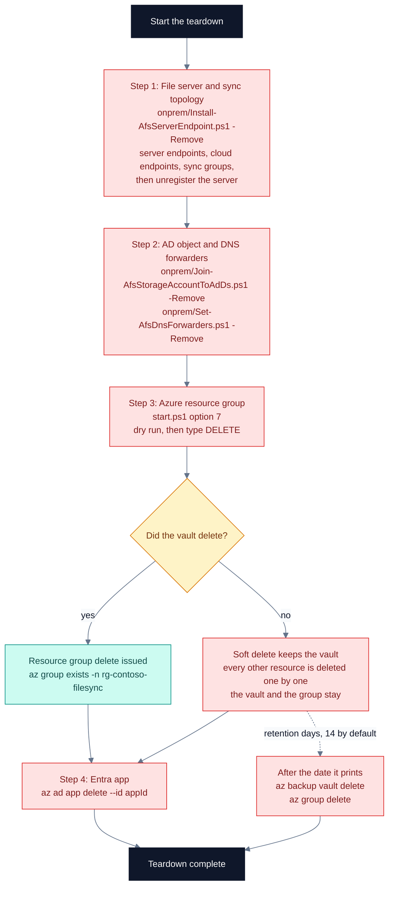

  The wizard does not offer steps 1, 2 and 4. Run them from the kit folder:

```powershell
# 1. Server endpoints, cloud endpoints, sync groups, then unregister the server.
#    Add -UninstallAgent to remove the agent as well.
.\onprem\Install-AfsServerEndpoint.ps1 -Context .\deploy\deployment-context.json -FileServer fs01.corp.contoso.com -SharePath 'dept-shares=D:\Shares\dept-shares','home-drives=D:\Shares\home-drives' -Remove

# 2a. The storage account's AD object (asks before each change)
.\onprem\Join-AfsStorageAccountToAdDs.ps1 -Context .\deploy\deployment-context.json -Remove

# 2b. The conditional forwarders (asks before each change)
.\onprem\Set-AfsDnsForwarders.ps1 -Context .\deploy\deployment-context.json -DnsServer dc01.corp.contoso.com,dc02.corp.contoso.com -Remove

# 3. The resource group: start.ps1, option 7

# 4. The deployment identity. The appId is identity.appId in deploy\deployment-context.json.
az ad app delete --id 00000000-0000-0000-0000-000000000000
```

  Do steps 1 and 2 while the resource group still exists. The file-server removal works through the Storage Sync Service. The forwarder removal reads the resolver address from Azure unless you pass `-ResolverIpAddress`. If you delete the group first, the forwarders keep sending every `file.core.windows.net` and `afs.azure.net` lookup on your network to a resolver that no longer exists. The as-built's Teardown tab ([option 13](#option-13-open-the-findings-and-as-built-reports)) lists steps 1, 2a, 3 and 4 with the real names, but it leaves out the forwarder removal (step 2b). Run that one from the block above.

  Microsoft reference: [Lock your Azure resources](https://learn.microsoft.com/azure/azure-resource-manager/management/lock-resources) (why Contributor cannot delete the backup lock) and [soft delete for Azure Backup](https://learn.microsoft.com/azure/backup/backup-azure-security-feature-cloud) (why the vault can outlive the teardown). The kit's codex covers the removals in step 1 and step 2b: [playbook-install-file-sync-agent-and-server-endpoint](../codex/playbook-install-file-sync-agent-and-server-endpoint.md) and [playbook-point-on-premises-dns-at-the-private-resolver](../codex/playbook-point-on-premises-dns-at-the-private-resolver.md).

#### What you will be asked

The wizard first prints `Checking what you have` (PowerShell version, Azure CLI) and `this deletes the resource group and everything in it.` Then:

1. **`Show a dry run first?`** `[Y/n]`. No returns you to the menu and nothing is removed. You cannot skip the dry run and still remove.
2. The dry run runs. There is no question here.
3. **`Type DELETE to confirm, anything else to cancel`** - no default. Only `DELETE` in capitals continues. Anything else, including an empty Enter or `delete`, prints `cancelled. Nothing was removed.`

#### What it runs

- `Test-Prerequisites` in its short form: it prints the PowerShell version, refuses Git Bash, and stops if `az` is missing.
- From `deploy\`, the dry run: `Remove-AfsEnvironment.ps1 -Context <kit>\deploy\deployment-context.json -WhatIf`
- After you type DELETE: `Remove-AfsEnvironment.ps1 -Context <kit>\deploy\deployment-context.json -Confirm:$false`

The script works in four steps, `[1/4]` to `[4/4]`:

| Step | What it does |
| --- | --- |
| `Inventory` | Lists every resource in the group. Refuses if any name is not one the configuration knows. |
| `Recovery Services vault` | Turns off protection for each protected share and deletes its backup data, then deletes the vault and checks that it is gone. |
| `Resource locks` | Deletes each lock by its ID, then checks it is gone. |
| `Resource group <rg>` | Runs `az group delete --yes --no-wait`. If the vault is still there, it keeps the group and deletes every other resource one by one instead. |

You cannot change these from the menu: `-Force` (delete despite unknown resources), `-InputFile`, and the context path. The real run shows no PowerShell confirmation prompts, because the wizard passes `-Confirm:$false`.

#### When it worked

```text
   OK   vault deleted
   OK   delete issued (asynchronous)

Confirm it is gone with:
  az group exists -n rg-contoso-filesync
```

The delete runs in the background. `az group exists -n rg-contoso-filesync` returns `false` once Azure finishes. The script prints no final "complete" line.

When soft delete keeps the vault, look for these lines instead (other lines between them are left out here):

```text
   WARN vault NOT deleted: soft delete keeps the removed backup data for 14 days, and a vault holding soft-deleted items cannot be deleted
   WARN everything else is removed now; delete the vault and the group after <yyyy-MM-dd> with:
        az backup vault delete -n rsv-contoso-eastus -g rg-contoso-filesync --yes
        az group delete -n rg-contoso-filesync --yes
   WARN resource group kept (the vault is still in it); removing every other resource individually
   OK   everything except the vault is gone
```

#### Next

- If soft delete kept the vault, wait until the date it printed, then run the two `az` commands it printed.
- Delete the deployment identity: `az ad app delete --id <appId>` (step 4 above). Run it as an Entra administrator (Application Administrator or Global Administrator, the same role phase 1 needed).
- Confirm the group is gone: `az group exists -n rg-contoso-filesync`.

#### If it goes wrong

| You see | It means | Do this |
| --- | --- | --- |
| `no deployment context found - nothing to remove from here.` | This copy of the kit has no `deploy\deployment-context.json`. | Run option 7 from the kit folder that built the environment, or run [deploy/Remove-AfsEnvironment.ps1](SCRIPT-REFERENCE.md#deployremove-afsenvironmentps1) with `-InputFile`. |
| `Failed: az account set --subscription <id>`, then `That step did not complete.` | There is no `az` session, or this account cannot see the subscription. | `az login` as the right account, then choose 7 again. |
| `WARN the group holds N resource(s) the parameter file does not name:` and `WARN refusing to delete the group. Re-run with -Force if this is expected.` | The group holds resources the build did not create. Nothing was deleted. | Check each `! <name>  (<type>)` line. Move or delete those resources, then choose 7 again. If they really belong to this environment, run the script yourself with `-Force` (see below). |
| `cancelled. Nothing was removed.` | You did not type `DELETE` in capitals. | Choose 7 again. |
| `lock NOT removed: <name> (<id>)` | Your account cannot delete management locks. | Remove the lock as an Owner, then choose 7 again. |
| `vault NOT deleted: soft delete keeps the removed backup data for <days> days` | Vault soft delete is keeping the deleted backup data. This is expected. | Wait until the printed date, then run the two printed commands. |
| `a full pass removed nothing - N resource(s) are held by something this script cannot see`, then `still present: <names>` | On the soft-delete path, something outside the group still holds these resources. | List them with `az resource list -g rg-contoso-filesync -o table`, remove what holds them, then choose 7 again. |
| `OK   resource group does not exist - nothing to remove` | The group is already gone. | Go on with step 4, the Entra app. |

To run the teardown yourself with `-Force`, from the kit folder:

```powershell
# Dry run first: shows what -Force would delete
.\deploy\Remove-AfsEnvironment.ps1 -Context .\deploy\deployment-context.json -Force -WhatIf
# Real run: PowerShell asks before each delete, because the script is ConfirmImpact High
.\deploy\Remove-AfsEnvironment.ps1 -Context .\deploy\deployment-context.json -Force
```

#### Good to know

- A refusal is not an error. The script prints its `WARN` lines and returns normally, so the wizard shows no failure banner and no `cancelled` line. The dry run shows the same refusal, but the wizard still asks you to type DELETE. If you type it, the real run refuses again.
- The wizard never passes `-Force`. Earlier documentation said to "pass `-Force` when that is expected". You cannot do that from option 7; run the script yourself.
- The dry run cannot predict the soft-delete path. It always shows the whole-group delete. Only the real run finds out whether the vault will delete.
- The refusal check matches names by substring against seven names: the storage account, the Storage Sync Service, the vault, the virtual network, the DNS Private Resolver and the two private DNS zones. Any resource whose name contains one of them counts as known.
- `OK   protection removed: <share>` prints even when turning off protection failed, because that call's failure is tolerated (tracked in [#3](https://github.com/gusitde/azure-filesync-backup-assessment/issues/3)).
- When soft delete keeps the vault, the resource group stays until you delete it after the printed date.
- Option 7 leaves these behind: the Entra app and its service principal, the storage account's AD object, the registered server and agent, the on-premises DNS forwarders, and `deploy\deployment-context.json` with `deploy\deployment-identity.json`. If you built into an existing virtual network in another resource group, the resolver inbound subnet the build added there also stays, because option 7 only touches its own group.
- The context file stays, but [option 12](#option-12-resume-the-last-build) cannot rebuild from it. With the group gone, no session can read it, so phase 2 falls back to the deployment identity and stops at `[0] Which identity runs this` with `The deployment identity cannot sign in yet` or `No signed-in session and no deployment secret file`. While `deploy\deployment-identity.json` is still there, the dry run gets past `[0]` anyway and shows `WHATIF would create resource group`. To build again, use [option 3](#option-3-build-a-new-azure-file-sync-environment); phase 1 re-creates the group.
- `az account set` changes the Azure CLI's default subscription for every window on this machine.

*Code: `start.ps1` (Invoke-RemoveFlow), `deploy/Remove-AfsEnvironment.ps1`, `deploy/Export-AfsAsBuilt.ps1` (Teardown section)*

### Option 8: Check requirements

Use it to find out, without changing anything, whether this machine, the subscription, your DNS servers, Active Directory and the file server are ready for the build and the on-premises steps.

#### Before you start

- Run it on the admin workstation you will use for the build and for [option 11](#option-11-connect-your-on-premises-servers). The "This machine" rows describe the machine it runs on.
- Use Windows PowerShell 5.1 (`powershell.exe`). Under PowerShell 7 the first row is a blocker.
- Run it from a domain-joined machine inside the on-premises network. The AD join and the resolver path can only be proven from there.
- The Azure CLI must be installed. Without it the check stops. Sign in first with `az login`, and with `Connect-AzAccount` for the Az PowerShell row. Option 8 signs in to neither.
- Fill in `deploy\inputs.json` with [option 2](#option-2-deployment-settings). The Azure rows past sign-in, and the whole DNS and AD areas, run only when that file resolves. The DNS servers come from `onPremises.dnsServers`, the domain and OU from `activeDirectory`, and the file server and folders from `onPremises`.
- Rights: local administrator on the file server (the wizard offers a credential). For the DNS rows, your own Windows account must be in DnsAdmins or Domain Admins, because option 8 has no DNS credential prompt. The AD rows run as your Windows account. No elevation is needed.

#### What you will be asked

1. **`Install it now?`** `[Y/n]` - only when the `dns-resolver` CLI extension is missing (after `the dns-resolver extension is missing.`). Yes installs it. No prints `continuing without it - the DNS resolver step will be skipped or fail.`
2. **`Also check the file server?`** `[Y/n]`
   - If `onPremises.fileServer` is set in `deploy\inputs.json`, that server is used and you are not asked for one.
   - If it is not set: **`Which file server should I check?`** - no default. Leave it empty to skip the server checks.
3. **`Use a different account to reach <server>?`** `[y/N]` - only when a server is known. Yes opens a credential prompt with the message `Local administrator on <server>`. The wizard then prints `Checking <server> - this opens one session and asks everything at once.`

#### What it runs

- `Test-Prerequisites -ForDeploy`: a quick list of what is installed here (PowerShell, Azure CLI, the `dns-resolver` extension, the three Az modules, RSAT AD and RSAT DNS). Only Git Bash or a missing `az` stop it.
- `Show-AfsRequirements`: the deep check from `deploy\AfsRequirements.ps1`, in five areas. Each row prints as `[ok]`, `[!]` (missing, red) or `[?]` (could not be checked, yellow), with `(degraded)` or `(advisory)` after rows that are not blockers. When a row is not ok, its fix prints on the line below.
- You cannot change these from the menu: the resolver IP, a DNS credential, an AD credential, and the folder list (it comes from `onPremises.serverPaths`).

"Blocks the run?" below is the severity the code gives the row: a `[!]` on a Yes row makes option 8 report `there are blockers`. Most such rows do stop their step, but a few are stricter than the step itself: `reachable: <server>` when only ping is blocked; `path <folder>` when the folder does not exist yet (the file-server step creates it) or is on the system volume without cloud tiering; and `RSAT DnsServer module` (without it the DNS script falls back to PowerShell remoting, which works with an account that has rights on the DNS server itself).

**This machine**

| Check | Blocks the run? | Fix it prints |
| --- | --- | --- |
| `Windows PowerShell 5.1` | Yes | `Run from Windows PowerShell 5.1 (powershell.exe), not PowerShell 7 (pwsh.exe).` |
| `module Az.Accounts`, `module Az.Storage`, `module Az.StorageSync` | Yes | `Install-Module <module> -Scope CurrentUser` |
| `RSAT ActiveDirectory module` | Yes | `Install-WindowsFeature RSAT-AD-PowerShell   (elevated, once)` |
| `RSAT DnsServer module` | Yes | `Install-WindowsFeature RSAT-DNS-Server   (elevated, once)` |
| `PowerShell 7 (governance only)` | No (degraded) | `Extract the PowerShell 7 zip to .pwsh7 beside the repo - no administrator needed.` |

**Azure**

| Check | Blocks the run? | Fix it prints |
| --- | --- | --- |
| `signed in` | Yes | `az login` |
| `subscription` - shown only when `deploy\inputs.json` does not resolve; the area stops | Yes (always `[?]`) | `Open Deployment settings and fill in the subscription id.` |
| `provider Microsoft.Storage`, `.Network`, `.StorageSync`, `.RecoveryServices`, `.Insights` | Yes | `az provider register -n <namespace> --subscription <subscription id>` |
| `role assignment rights` | Yes | `Grant Owner, User Access Administrator, or Azure File Sync Administrator on the storage account. Contributor is not enough - it cannot create the role assignment a cloud endpoint needs.` |

**DNS servers** (runs only when `deploy\inputs.json` resolves)

| Check | Blocks the run? | Fix it prints |
| --- | --- | --- |
| `DNS readiness` - shown only when no DNS server is named; the area stops | Yes (always `[?]`) | `Pass -DnsServer <dc1>,<dc2>, or set onPremises.dnsServers in deploy\inputs.json.` |
| `zones to be forwarded` | No (advisory) | none - always `[ok]`, naming the public zones `file.core.windows.net` and `afs.azure.net` |
| `how zones will be read` | No (degraded) | `Install-WindowsFeature RSAT-DNS-Server   (elevated, once)`, or `Add-WindowsCapability -Online -Name Rsat.Dns.Tools~~~~0.0.1.0` on Windows 10/11 |
| `the run can be confirmed` | No (degraded) | Run it from a console, or use the `powershell -Command` form it prints (not `-File`) |
| `every resolver is listed` | No (degraded) | `Enumerate the resolvers from the DHCP scope options and the client NIC settings, not from the DC list, and pass all of them to -DnsServer.` |
| `resolver inbound address` | Yes (always `[?]` from option 8) | `Pass -ResolverIpAddress <ip>, or read it with: az dns-resolver inbound-endpoint list -g <rg> --dns-resolver-name <resolver> -o json` |
| `az dns-resolver extension` | No (degraded) | `az extension add --name dns-resolver   - or bypass Azure entirely by passing -ResolverIpAddress <ip>.` |
| `<server>: WinRM on 5985` | Yes | `Enable-PSRemoting -Force   (on the DNS server, elevated), and open TCP 5985 from this subnet to it.` |
| `<server>: zones and forwarders` - shown when WinRM failed or the read failed | Yes (`[?]`) | `Test-WSMan -ComputerName <server>` |
| `<server>: rights to read its zones` | Yes | `Re-run with -Credential using an account in DnsAdmins or Domain Admins (the wizard offers to collect one).` |
| `<server>: session to read its zones` | Yes (`[?]`) | `Test-WSMan -ComputerName <server>   and, if this machine is not domain-joined: winrm get winrm/config/client ...` |
| `<server>: DNS Server role` | Yes | `Drop it from -DnsServer, or install the DNS role on it. ...` |
| `<server>: -ReplicationScope Forest` | Yes | `Give it its own pass: .\onprem\Set-AfsDnsForwarders.ps1 -Context <context> -DnsServer <server> -ReplicationScope None` |
| `<server>: reaches the resolver` | Yes (always `[?]` from option 8) | an `Invoke-Command -ComputerName <server> -ScriptBlock { Resolve-DnsName ... }` line to run by hand |
| `<server>: file.core.windows.net`, `<server>: afs.azure.net` | Yes | `[ok]` when no zone of that name exists yet. `[!]` when a zone of that name exists that is not a forwarder (fix: find out why, then `Remove-DnsServerZone -Name <zone> -ComputerName <server>` as a separate change). `[?]` when a forwarder already exists (fix: `Pass -ResolverIpAddress <ip> and re-run this check.`) |

**AD DS join** (runs only when `deploy\inputs.json` resolves)

| Check | Blocks the run? | Fix it prints |
| --- | --- | --- |
| `AD DS join readiness` - shown only when no domain and no OU are set; the area stops | Yes (always `[?]`) | `Pass -DomainFqdn and -OrganizationalUnit, or set activeDirectory.domainFqdn and activeDirectory.organizationalUnitDistinguishedName in deploy\inputs.json.` |
| `this machine is domain-joined` | Yes | `Run the join from a domain-joined admin station or a domain controller.` |
| `the domain being joined` | No (degraded) | `nltest /domain_trusts /all_trusts /v    (or run the join from a machine in <domain>)` |
| `AD cmdlets (RSAT)` | Yes | `Install-WindowsFeature RSAT-AD-PowerShell    (elevated, once; ...)` |
| `Az.Storage 8.1.0 or later` | Yes | `Install-Module Az.Storage -MinimumVersion 8.1.0 -Scope CurrentUser` |
| `Az PowerShell sign-in` | Yes | `Connect-AzAccount`, or `Set-AzContext -Subscription <id>` when the session is on another subscription |
| `AzFilesHybrid v0.3.2` | Yes | `Extract AzFilesHybrid.zip into <temp>\AzFilesHybrid from a machine with egress, or pass -ModuleUrl <internal mirror> to the join script.` |
| `the directory itself` - replaces the directory rows below when the AD module will not load | Yes (`[?]`) | `Install-WindowsFeature RSAT-AD-PowerShell    (elevated, once), then run this check again.` |
| `a writable DC answering ADWS` | Yes | `nltest /dsgetdc:<domain> /writable    then on that DC: Get-Service ADWS   (TCP 9389, plus 88/389/636/464 from here)` |
| `the OU and its rights` - shown when no DC was reached | Yes (`[?]`) | `nltest /dsgetdc:<domain> /writable` |
| `the organizational unit` | Yes | `New-ADOrganizationalUnit -Name '<leaf>' -Path '<parent>'    (or re-run the join with -CreateOrganizationalUnit -AdCredential)` |
| `the OU parent` | No (degraded) | `New-ADOrganizationalUnit ... - the join builds only the LEAF OU, so the parent has to exist first.` |
| `create-computer right in the OU` | Yes | `dsacls "<OU DN>" /I:T /G "<DOMAIN>\<user>:CC;computer"    (the join runs as THIS account - -AdCredential does not cover it)` |
| `no leftover object with the SPN` | No (degraded) | `.\onprem\Join-AfsStorageAccountToAdDs.ps1 -Context .\deploy\deployment-context.json -Remove -Confirm:$false ...` |
| `clock vs the domain controller` | No (advisory) | `w32tm /resync /force    (and fix the time source if w32tm /query /status reports Local CMOS Clock)` |
| `storage account identity source` | Yes | `az storage account show -n <account> -g <rg> --query azureFilesIdentityBasedAuthentication -o json ...`; when another source is on: `az storage account update -n <account> -g <rg> --enable-files-aadkerb false --enable-files-aadds false` |
| `shared key access` | No (degraded) | `az storage account update -n <account> -g <rg> --allow-shared-key-access true    (and set it back to false once the join is done)` |
| `default share permission` | No (advisory) | `az storage account update -n <account> -g <rg> --default-share-permission None` |
| `the AD account name` | No (advisory) | `Pass -SamAccountName <existing> to work with the existing join, or -Remove first.` |
| `identity object type` | No (advisory) | `Set activeDirectory.identityObjectType to ComputerAccount in deploy\inputs.json, ...` |

**File server** (runs only when you answered yes and a server is known)

| Check | Blocks the run? | Fix it prints |
| --- | --- | --- |
| `reachable: <server>` | Yes | `Check the name and the network path.` |
| `WinRM on 5985` | Yes | `Enable-PSRemoting -Force   (on the file server, elevated)` |
| `PowerShell session` - the area stops if it fails | Yes | `Supply a credential with local-administrator rights on that server (the wizard offers one).` |
| `server state` - the area stops if it fails | Yes (`[?]`) | none |
| `supported Windows Server` | Yes | none - the server must be Windows Server 2016, 2019, 2022 or 2025 |
| `.NET Framework 4.7.2+` | Yes | `Install .NET Framework 4.7.2 or later on the file server.` |
| `no half-removed agent` | Yes | `Restart the file server. An agent uninstall returns 3010 (restart required) and the filter cannot unload until it does.` |
| `Task Scheduler running` | Yes | `Start-Service Schedule   (on the file server)` |
| `Az modules on the server` | No (degraded) | `The install step installs them, falling back to copying from this machine when the Gallery is unreachable.` |
| `path <folder>` (one per folder in `onPremises.serverPaths`) | Yes | `Use a local NTFS path on a non-system volume - not a mapped drive and not a UNC path.` A folder that does not exist yet also shows `[!]` (`does not exist on that server`), although the file-server step creates it. |

Microsoft reference: [AD DS authentication for Azure Files](https://learn.microsoft.com/en-us/azure/storage/files/storage-files-identity-ad-ds-enable) for the AD DS join rows, [prevent Shared Key authorization](https://learn.microsoft.com/en-us/azure/storage/common/shared-key-authorization-prevent) for `shared key access`, [share-level permissions](https://learn.microsoft.com/en-us/azure/storage/files/storage-files-identity-assign-share-level-permissions) for `default share permission`, [hybrid DNS with Azure DNS Private Resolver](https://learn.microsoft.com/azure/dns/private-resolver-hybrid-dns) for the DNS rows, and [Azure File Sync operating system requirements](https://learn.microsoft.com/azure/storage/file-sync/file-sync-planning#operating-system-requirements) for the file server rows. `Install-WindowsFeature RSAT-DNS-Server` and `Remove-DnsServerZone` are in the kit's [codex/playbook-point-on-premises-dns-at-the-private-resolver.md](../codex/playbook-point-on-premises-dns-at-the-private-resolver.md); `w32tm` is in [codex/runbook-file-sync-broken-after-network-lockdown.md](../codex/runbook-file-sync-broken-after-network-lockdown.md).

#### When it worked

The summary prints last. From option 8, the best result you can get today is the yellow line with zero blockers:

```text
  <N> checks - <ok> ok, 0 blocker(s), <u> could not be checked, <d> degraded
  [i]    nothing is known to be broken, but <u> requirement(s) could not be checked from here.
    ? DNS servers: resolver inbound address - no resolver address was supplied, so neither the forwarder target, the answer it returns, nor any path to it could be checked
```

Read the `?` lines under it. Each one names something the check could not prove either way.

How the verdict is decided:

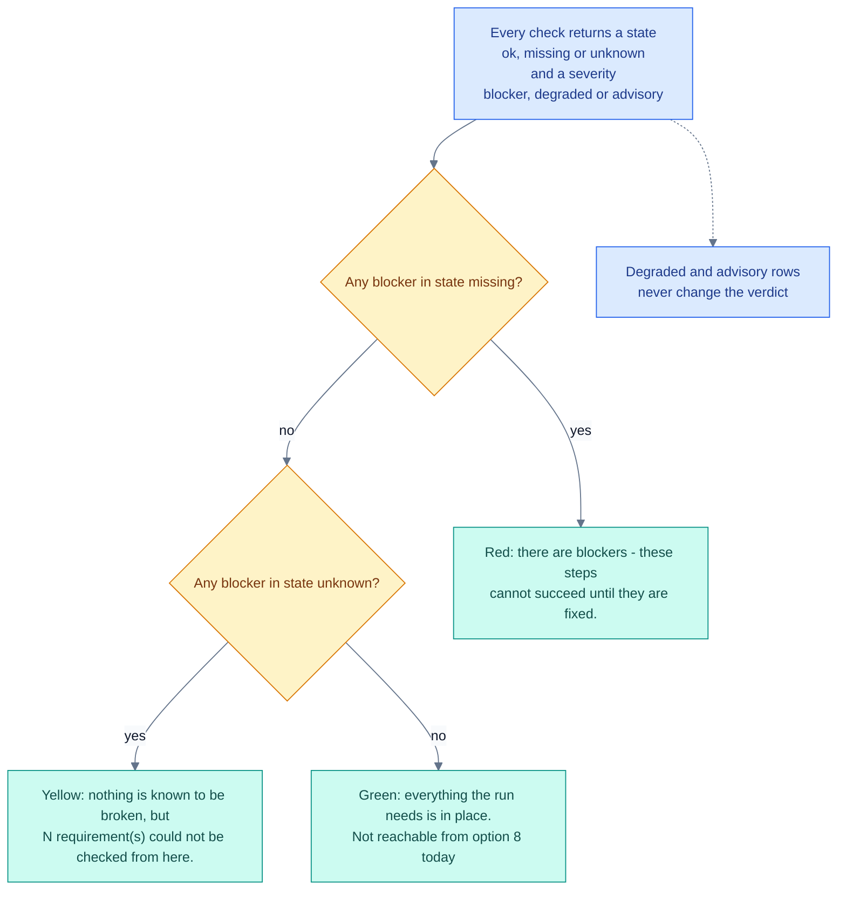

- `blocker(s)` counts blocker rows that are `[!]`. The red line lists each one as `- <Area>: <Name>`.
- `could not be checked` counts blocker rows that are `[?]`. They do not count as blockers. When there is no `[!]` blocker, each one is listed as `? <Area>: <Name> - <Detail>`, so "not checked" is never read as "fine". When the red line prints, they are not listed under it; find them as the `[?]` rows above the summary.
- `degraded` counts degraded rows that are not ok. Advisory rows count only in the total.

#### Next

- Fix each `[!]` row with the fix printed under it, then choose 8 again.
- Close the `[?]` rows you can. For the DNS rows, see "Good to know" below.
- Then build with [option 3](#option-3-build-a-new-azure-file-sync-environment), or connect your servers with [option 11](#option-11-connect-your-on-premises-servers).

#### If it goes wrong

| You see | It means | Do this |
| --- | --- | --- |
| `Azure CLI (az) was not found on PATH.` | The Azure CLI is not installed, or not on PATH. | `winget install --exact --id Microsoft.AzureCLI`, then close and reopen PowerShell. |
| `you appear to be running under Git Bash / MSYS.` | Git Bash rewrites arguments that start with `/`. | Run `start.ps1` from PowerShell. |
| `[?]` `subscription` `no resolved config was supplied, ...`, and no DNS or AD areas | `deploy\inputs.json` is missing or does not resolve. The wizard does not say which. | In [option 2](#option-2-deployment-settings), choose `Show what it all resolves to`, or `Edit the JSON file directly` then `Check that it still parses`. |
| `[!]` `Windows PowerShell 5.1` `running 7.x ...` | You started the wizard from `pwsh.exe`. | Start it from `powershell.exe`. |
| `[?]` `role assignment rights` `no role assignments were returned - Graph may be blocked for this account` | A known defect: this row cannot read the roles (see "Good to know"). | Check by hand: `az role assignment list --assignee <your UPN> --all -o table`. |
| `[!]` `reachable: <server>` `does not answer ping ...` | The server does not answer ping. Many networks block it. | If `WinRM on 5985` and `PowerShell session` are `[ok]`, you can ignore this row. |
| `[!]` `PowerShell session` `could not open a session: ...` | WinRM refused the session, or the account is not a local administrator there. | Choose 8 again and answer yes to **`Use a different account to reach <server>?`** with a local administrator. |
| `[!]` `<server>: rights to read its zones` `access denied as CONTOSO\<user> ...` | Your Windows account is not in DnsAdmins or Domain Admins. | Option 8 cannot pass a credential. Run the DNS check yourself with `-Credential` (see "Good to know"), or rely on the credential prompt in option 11. |
| `[!]` `<server>: -ReplicationScope Forest` `DomainRole 3 ...` | A member server is in the list. Forest scope fails there. | Take it out of `onPremises.dnsServers` and give it its own pass with `-ReplicationScope None` from the command line. Option 11 cannot. |
| `[!]` `no half-removed agent` `... MSI 1603 ...` | An agent uninstall is waiting for a restart. | Restart the file server. |
| `[!]` `create-computer right in the OU` `none of the N ACEs grants create-computer to ...` | Your account cannot create the storage account's computer object in that OU. | Have a directory administrator run the `dsacls` line printed under the row. |
| `[!]` `Az PowerShell sign-in` `... an Azure CLI sign-in does not cover the Az cmdlets the join uses` | Only the Azure CLI is signed in. | `Connect-AzAccount`, then choose 8 again. |

The kit's [codex/blueprint-azure-files-secure-storage-account.md](../codex/blueprint-azure-files-secure-storage-account.md) uses the same `az role assignment` commands.

#### Good to know

- Option 8 changes nothing in Azure, AD, DNS or on your servers. It can do four things on this machine and the network: install the `dns-resolver` extension if you answer yes, import the ActiveDirectory module into the session, send one HEAD request to github.com to see whether AzFilesHybrid can be downloaded, and open and close PowerShell sessions to the file server and DNS servers.
- It reads `deploy\inputs.json`. Option 11 reads `deploy\deployment-context.json`. The two can differ.
- The menu label says "this machine, Azure, and the file server". Option 8 also checks your DNS servers and AD DS when the settings name them.
- From option 8 the green `everything the run needs is in place.` line cannot appear. With settings, the DNS area always adds at least one `[?]` blocker, because option 8 never passes a resolver address. Without settings, the `subscription` row is a `[?]` blocker. The best result is the yellow `nothing is known to be broken, but N requirement(s) could not be checked from here.` line (tracked in [#3](https://github.com/gusitde/azure-filesync-backup-assessment/issues/3)).
- The `role assignment rights` row always ends as `[?]`, even when you hold one of the roles. The role list is parsed twice and the second parse always fails (tracked in [#3](https://github.com/gusitde/azure-filesync-backup-assessment/issues/3)). The code accepts Owner, User Access Administrator, Azure File Sync Administrator and Role Based Access Control Administrator. The fix text names only three.
- `reachable: <server>` is a blocker that turns `[!]` when ping is blocked, even if WinRM works. On such a network option 8 reports `there are blockers` (tracked in [#3](https://github.com/gusitde/azure-filesync-backup-assessment/issues/3)).
- A `path <folder>` on the system volume (usually `C:`) shows `[!]`. The file-server step refuses the system volume only with cloud tiering, and option 11 never turns tiering on (tracked in [#3](https://github.com/gusitde/azure-filesync-backup-assessment/issues/3)).
- The `shared key access` fix says to set shared key access back to false after the join. The file-server step, and its `-Remove`, refuse to run while shared key access is off, so leave it on while you use File Sync (tracked in [#3](https://github.com/gusitde/azure-filesync-backup-assessment/issues/3)).
- The access-denied fix for a DNS server says "the wizard offers to collect one". Only option 11 does.
- The number of checks depends on your estate: how many DNS servers and folders you name, and whether the AD module loads.
- Option 8 writes no report file. Its output goes to the console and to the wizard log and transcript (see [Logs](#5-logs-levels-and-environment-variables)).
- To close most of the DNS `[?]` rows, run the DNS check yourself with the resolver address and a DnsAdmins credential. One row stays `[?]` even then: `answer is a private address`, because this check is not given the storage account name. Run the `Resolve-DnsName` line in that row's `Fix` column by hand; it should return a private address. Get the address first:

```powershell
az dns-resolver inbound-endpoint show -g rg-contoso-filesync --dns-resolver-name dnspr-contoso-eastus -n inbound-01 --query 'ipConfigurations[0].privateIpAddress' -o tsv

# From the kit folder, in Windows PowerShell 5.1. 10.60.2.4 stands for the address above.
. .\deploy\AfsLog.ps1; . .\deploy\AfsConfig.ps1; . .\deploy\AfsRequirements.ps1
$r = Get-AfsDnsRequirements -DnsServer 'dc01.corp.contoso.com,dc02.corp.contoso.com' -ResolverIpAddress 10.60.2.4 -Credential (Get-Credential)
$r | Format-Table Name, State, Severity, Detail, Fix -Wrap
Get-AfsRequirementVerdict -Results $r
```

Microsoft reference: [Azure Files DNS for private endpoints](https://learn.microsoft.com/en-us/azure/storage/files/storage-files-networking-dns) for `Resolve-DnsName`. The kit's [codex/playbook-deploy-dns-private-resolver-and-forwarders.md](../codex/playbook-deploy-dns-private-resolver-and-forwarders.md) documents `az dns-resolver inbound-endpoint`.

*Code: `start.ps1` (Invoke-RequirementsFlow, Show-AfsRequirements, Test-Prerequisites), `deploy/AfsRequirements.ps1`*

### Option 9: Read the documentation

Lists the kit's documents with what each one is for, and opens the one you pick on GitHub, from disk, or as a preview in the console.

#### Before you start

- Run it on any machine. You need no Azure sign-in and no rights.
- To open a document on GitHub you need network access to `github.com`. If the repository is private, you also need a GitHub account with access to it.
- To open a document from disk you need an application that opens `.md` files.

#### What you will be asked

1. **`Which document?`** - type 1 to 15. There is no default. Each document shows its description on a second line. A `?` in front of a name means that file is missing from your copy.

   | # | Document | What it is for | File |
   |---|---|---|---|
   | 1 | Getting started | Dependencies, sign-in, and a walk-through of every script. Start here. | [docs/GETTING-STARTED.md](GETTING-STARTED.md) |
   | 2 | Two-phase deployment | How the four inputs, phase 1 and phase 2 fit together. | [deploy/README.md](../deploy/README.md) |
   | 3 | Assessor rules | Every rule the assessment applies, with its recommendation and source. | [docs/RULES.md](RULES.md) |
   | 4 | Architecture references | 73 verified Microsoft sources, each with a specific take-away. | [docs/ARCHITECTURE-REFERENCES.md](ARCHITECTURE-REFERENCES.md) |
   | 5 | Validation record | What has been executed, what has not, and what execution found. | [docs/VALIDATION.md](VALIDATION.md) |
   | 6 | Version control | The version scheme, the change ledger, and how to cut a release. | [docs/VERSION-CONTROL.md](VERSION-CONTROL.md) |
   | 7 | Proof of work | What was built and what verification caught. For sharing. | [docs/PROOF-OF-WORK.md](PROOF-OF-WORK.md) |
   | 8 | As-built template | Fill in after a deployment. Names the evidence and screenshots to capture. | [docs/AS-BUILT-TEMPLATE.md](AS-BUILT-TEMPLATE.md) |
   | 9 | Playbook: assessment | Scope, export, assess and recommend on an existing estate. | [docs/PLAYBOOK-azure-file-sync-assessment.md](PLAYBOOK-azure-file-sync-assessment.md) |
   | 10 | Playbook: backup | Design and set up Azure Backup for the synced shares. | [docs/PLAYBOOK-azure-backup-for-azure-files.md](PLAYBOOK-azure-backup-for-azure-files.md) |
   | 11 | Customer session guide | A two-hour working session when there is nothing to assess yet. | [advise/SESSION-GUIDE.md](../advise/SESSION-GUIDE.md) |
   | 12 | Reference design | 18 decisions, each with a default, a reason and a reversal cost. | [advise/REFERENCE-DESIGN.md](../advise/REFERENCE-DESIGN.md) |
   | 13 | Contributing | How to report a correction or a gap. No write access needed. | [CONTRIBUTING.md](../CONTRIBUTING.md) |
   | 14 | Open the whole docs folder on GitHub | Opens the `docs` folder of the repository's main branch. | - |
   | 15 | Back | Returns to the main menu. | - |

2. After you pick a document (1 to 13): **`Open <Document> how?`**, for example **`Open Getting started how?`** - type 1 to 4, no default.
   - `1) On GitHub, in the browser`
   - `2) From disk, in the default editor`
   - `3) Show the first page here` - prints the first 40 lines in the console.
   - `4) Back`

   After any of these you return to `Which document?`. Choose 15 to leave.

#### What it runs

- No scripts. Choices open a web address or a local file with `Start-Process`, or print the file with `Get-Content`.
- GitHub addresses have the form `https://github.com/gusitde/azure-filesync-backup-assessment/blob/main/<path>`. The folder link is `.../tree/main/docs`.
- The list of documents is fixed in `start.ps1`. You cannot add to it from the menu.

#### When it worked

One of these lines, depending on how you opened it:

```
  [ok]   https://github.com/gusitde/azure-filesync-backup-assessment/blob/main/docs/GETTING-STARTED.md
  [ok]   C:\kits\afs\docs\GETTING-STARTED.md
  [i]    showing the first 40 lines of docs/GETTING-STARTED.md
```

Before it opens a GitHub page, the wizard prints `[i]    if the repository is still private, GitHub will ask you to sign in.`

#### Next

- Choose `Back` to return to the main menu.
- For the step-by-step library, choose [option 10](#option-10-browse-the-blueprints-playbooks-and-runbooks).

#### If it goes wrong

| You see | It means | Do this |
| --- | --- | --- |
| `?` in front of a document name | The file is missing from your copy of the kit. | Open it on GitHub instead, or get a complete copy. |
| `[!]    not found on disk: <path>` | You chose disk or preview for a missing file. | Choose `On GitHub, in the browser`. |
| GitHub shows a sign-in page or "not found" | The repository is private and you are not signed in, or your account has no access. | Sign in with an account that has access. |
| `That step did not complete.` then `The error Azure returned:` and a Windows error, and you are back at the main menu | Windows could not open the address or the file. There is no browser, or nothing is associated with `.md` files. Azure is not involved, whatever the heading says. | Choose `Show the first page here`, or open the file from the kit folder yourself. |

#### Good to know

- The GitHub choices always open the `main` branch. That can differ from the copy on your disk.
- The preview is the first 40 lines of raw Markdown. Tables and links are not rendered.
- If opening the file or the address fails, this option does not recover the way option 1 does. The error goes to the wizard's general handler, which labels it `The error Azure returned:` and returns you to the main menu, not to the document list. (tracked in [#3](https://github.com/gusitde/azure-filesync-backup-assessment/issues/3))
- The list holds 13 files and is fixed in `start.ps1`. Some documents are not in it: this user guide (`docs/USER-GUIDE.md`), the [script reference](SCRIPT-REFERENCE.md), the [README](../README.md), `advise/BUILD-SEQUENCE.md` and `advise/DESIGN-INTERVIEW.md`. Open them from the kit folder. Choice 14 shows only the `docs` folder on GitHub, so of these it reaches the user guide and the script reference. The HTML guide is [option 1](#option-1-how-to-use-it).

*Code: `start.ps1` (Invoke-DocsFlow, Open-Target)*

### Option 10: Browse the blueprints, playbooks and runbooks

Lists every entry in the kit's `codex\` library by type, and opens the one you pick.

#### Before you start

- Run it on any machine. You need no Azure sign-in and no rights.
- The `codex\` folder must be in your copy of the kit.
- To open an entry on GitHub you need network access to `github.com`, and access to the repository if it is private.

#### What you will be asked

The screen first explains the three types:

```
  Three kinds of document, separated on purpose:
    blueprint - what the target state looks like and why, including the
                decisions that cannot be reversed
    playbook  - the ordered steps to build it, each carrying a verify as
                well as a run
    runbook   - symptom, cause, recovery, for when it breaks later
```

1. **`Which one?`** - type a number, no default. In this copy there are 28 choices: 25 entries, then `Open the codex folder on GitHub`, `Open the diagram library on GitHub` and `Back`. Each entry shows as `[<type>] <title>`, for example `[blueprint] ...`, `[playbook ] ...` or `[runbook  ] ...`. Blueprints come first, then playbooks, then runbooks, each group in file-name order. This copy lists:

   | Type | Title |
   |---|---|
   | blueprint | [Hybrid DNS for private endpoints with Azure DNS Private Resolver](../codex/blueprint-azure-dns-for-private-endpoints.md) |
   | blueprint | [Azure Backup protection for file shares behind Azure File Sync (Contoso profile)](../codex/blueprint-azure-files-backup-protection.md) |
   | blueprint | [Azure file share private endpoint over ExpressRoute (Contoso profile)](../codex/blueprint-azure-files-private-endpoint.md) |
   | blueprint | [Secure storage account baseline for Azure file shares (Contoso profile)](../codex/blueprint-azure-files-secure-storage-account.md) |
   | blueprint | [Azure File Sync over ExpressRoute - both private endpoints (Contoso profile)](../codex/blueprint-azure-file-sync-private-path.md) |
   | blueprint | [Azure Migrate over Private Link - project, cache storage account and DNS](../codex/blueprint-azure-migrate-private-link-landing.md) |
   | blueprint | [Azure VM backup for servers migrated from VMware, and the three protection surfaces](../codex/blueprint-azure-vm-backup-for-migrated-servers.md) |
   | playbook | [Add a file private endpoint to an existing storage account and resolve it from Contoso](../codex/playbook-add-file-private-endpoint-and-dns.md) |
   | playbook | [Prepare the Azure Migrate cache storage account and DNS for replication over Private Link](../codex/playbook-azure-migrate-private-link-cache-storage.md) |
   | playbook | [Deploy the hub DNS Private Resolver, the privatelink zones and the Infoblox forwarders](../codex/playbook-deploy-dns-private-resolver-and-forwarders.md) |
   | playbook | [Deploy a hardened storage account with file shares and a file private endpoint (Bicep AVM)](../codex/playbook-deploy-secure-storage-account-and-share.md) |
   | playbook | [Enable Azure Backup with snapshot and vaulted tiers for every Azure file share](../codex/playbook-enable-azure-backup-for-file-shares.md) |
   | playbook | [Move Azure File Sync onto the ExpressRoute path and disable its public endpoint](../codex/playbook-enable-file-sync-private-endpoint-and-cutover.md) |
   | playbook | [Enable AD DS Kerberos authentication and share-level RBAC on an Azure Files account](../codex/playbook-enable-identity-based-auth-ad-ds.md) |
   | playbook | [Hand the deployment kit to another engineer without sitting next to them](../codex/playbook-hand-the-kit-to-another-engineer.md) |
   | playbook | [Harden an existing Azure Files storage account without breaking File Sync or Backup](../codex/playbook-harden-existing-storage-account.md) |
   | playbook | [Install the Azure File Sync agent on a file server, register it, and sync a folder to an Azure file share](../codex/playbook-install-file-sync-agent-and-server-endpoint.md) |
   | playbook | [Point on-premises DNS at the Azure DNS Private Resolver](../codex/playbook-point-on-premises-dns-at-the-private-resolver.md) |
   | playbook | [Protect a migration wave with Azure Backup before the wave is allowed to close](../codex/playbook-protect-a-migration-wave-with-azure-backup.md) |
   | playbook | [Run the tenant policy and governance assessment alongside the File Sync one](../codex/playbook-run-the-tenant-governance-assessment.md) |
   | runbook | [Repair an Azure File Sync agent install or registration that will not complete](../codex/runbook-file-sync-agent-install-and-registration-failures.md) |
   | runbook | [Respond to Azure File Sync failing after a firewall or private endpoint change](../codex/runbook-file-sync-broken-after-network-lockdown.md) |
   | runbook | [Respond to a private endpoint that resolves publicly, NXDOMAINs or cannot be reached](../codex/runbook-private-endpoint-name-resolution-and-reachability.md) |
   | runbook | [Respond to deleted or corrupted data on an Azure file share behind File Sync](../codex/runbook-restore-file-share-and-share-soft-delete.md) |
   | runbook | [Respond to a key leak, an expired key policy, or breakage after disabling shared key](../codex/runbook-storage-key-rotation-and-shared-key-incidents.md) |

2. After you pick an entry: **`Open <Title> how?`** - the same four choices as [option 9](#option-9-read-the-documentation): `On GitHub, in the browser`, `From disk, in the default editor`, `Show the first page here` or `Back`.

   After any of these you return to `Which one?`. Choose `Back` to leave.

#### What it runs

- No scripts. The list is built each time the option opens. The wizard reads the first 12 lines of every `codex\*.md` except `README.md`. It takes the title from the `title:` line and the type from the `doc_type:` line.
- `Open the codex folder on GitHub` opens `https://github.com/gusitde/azure-filesync-backup-assessment/tree/main/codex`.
- `Open the diagram library on GitHub` opens `.../tree/main/codex/diagrams`.
- Opening an entry works exactly as in option 9 (GitHub address, local file, or a 40-line preview).

#### When it worked

Above the list, a summary line counts what it found. For this copy:

```
  25 entries: 7 blueprints, 13 playbooks, 5 runbooks, plus the diagram library.
```

After you open something, one of the option 9 lines appears, or `  [ok]   https://github.com/gusitde/azure-filesync-backup-assessment/tree/main/codex`.

#### Next

- When something breaks after a build, start with the runbooks. [Section 6](#6-when-it-goes-wrong) covers the kit's own messages.
- For the kit's other documents, choose [option 9](#option-9-read-the-documentation).

#### If it goes wrong

| You see | It means | Do this |
| --- | --- | --- |
| `[!]    no codex folder found.` | Your copy of the kit has no `codex\` folder. The wizard returns to the main menu. | Get a complete copy, or use `Open the codex folder on GitHub` from a machine that has one. |
| An entry shows as `[entry    ]`, or its title is a file name | That file has no `doc_type:` or `title:` line in its first 12 lines. | Open it anyway; the content is unaffected. Report it as described in [CONTRIBUTING.md](../CONTRIBUTING.md). |
| `[!]    not found on disk: <path>` | The file was removed after the list was built. | Leave the option and open it again to rebuild the list. |
| `That step did not complete.` then `The error Azure returned:` and a Windows error | Windows could not open the address or the file. Same cause as in option 9. | Choose `Show the first page here`, or open the file from the kit folder. |

#### Good to know

- The count and the list come from the files on disk, so a copy with more or fewer entries shows different numbers.
- The two folder links go straight to GitHub. Unlike the per-entry GitHub choice, they do not print the note that a private repository asks you to sign in.
- If opening fails, the error returns you to the main menu, as in option 9. (tracked in [#3](https://github.com/gusitde/azure-filesync-backup-assessment/issues/3))
- The codex [README](../codex/README.md) and the diagram files are not in the numbered list. Reach them through the two GitHub links or the kit folder.

*Code: `start.ps1` (Invoke-CodexFlow, Open-Target), `codex/`*

### Option 11: Connect your on-premises servers

Use it to run the three steps that change machines you own: install the File Sync agent and sync folders to the Azure shares, point on-premises DNS at the Azure resolver, and domain-join the storage account. Each step runs as a dry run first.

#### Before you start

- Build the Azure side first with [option 3](#option-3-build-a-new-azure-file-sync-environment). Option 11 needs `deploy\deployment-context.json`. The file-server step also needs `deploy\deployment-identity.json` beside it, because server registration signs in as the deployment identity.
- Run it on a domain-joined admin workstation inside the on-premises network, in Windows PowerShell 5.1 (`powershell.exe`). The AD join refuses PowerShell 7 and machines that are not domain-joined.
- For step 2, this machine needs a network path into the build's virtual network, over ExpressRoute or a VPN. The DNS step's gate asks the resolver's inbound IP for `<account>.privatelink.file.core.windows.net` from the machine running it, and writes nothing unless the answer is a private address. The kit's build creates no VPN or ExpressRoute gateway and no virtual network peering, so that path must already exist.
  - Microsoft reference: [Azure Files DNS forwarding over VPN or ExpressRoute](https://learn.microsoft.com/en-us/azure/storage/files/storage-files-networking-dns) and [hybrid DNS with Azure DNS Private Resolver](https://learn.microsoft.com/azure/dns/private-resolver-hybrid-dns).
- Sign in twice. The wizard signs in the Azure CLI for you (`az login`). Steps 1 and 3 also need Az PowerShell, and the wizard does not run `Connect-AzAccount`. Run it yourself first:

  ```powershell
  Connect-AzAccount -Tenant 00000000-0000-0000-0000-000000000000
  ```

  The scripts switch that session to the deployment's subscription themselves. The kit's [codex/playbook-enable-identity-based-auth-ad-ds.md](../codex/playbook-enable-identity-based-auth-ad-ds.md) shows the same `Connect-AzAccount` sign-in.

- Install these on this machine: Az.Accounts, Az.Storage (8.1.0 or later for the join) and Az.StorageSync; RSAT Active Directory (for the join); RSAT DNS Server (for the forwarders).
- Rights you need:
  - local administrator on the file server;
  - Owner, User Access Administrator, Azure File Sync Administrator or Role Based Access Control Administrator on the storage account, for your `az` account. Contributor is not enough to create a cloud endpoint;
  - DnsAdmins or Domain Admins on the DNS servers;
  - the right to create computer objects in the target OU, for the Windows account running the wizard.
- Run [option 8](#option-8-check-requirements) first. Option 11 runs no requirements check of its own.

#### What you will be asked

1. **`Which one?`** - `1) Install the File Sync agent and sync a folder to a share`, `2) Point on-premises DNS at the Azure resolver`, `3) Domain-join the storage account to Active Directory`, `4) Back`.
2. Sign-in, each time you pick a step:
   - If a session exists: `already signed in as <user>`, then **`Use this account?`** `[Y/n]`. No runs `az logout` and signs you in again.
   - If there is none: **`Press Enter to open the browser`**, then `az login` (no tenant is passed).

**Step 1 - Install the File Sync agent and sync a folder to a share**

3. **`Which file server?`** - a name this machine can reach over PowerShell remoting. The default is `onPremises.fileServer` from the deployment context. When there is none, it shows an example built from your AD domain, and an answer is required.
4. For each share the build created (by default `dept-shares` and `home-drives`): **`Which folder on <server> syncs to the share '<share>'?`** `[D:\Shares\<share>]`, or the saved path from the context. Use a local NTFS path, not a mapped drive or a UNC path.
5. The wizard saves your answers to `deploy\inputs.json`, prints `A dry run first, as always.`, and runs the dry run. The script opens a credential prompt with the message `Local administrator on <server>`.
6. **`Do it for real?`** `[y/N]`. Yes runs the real install. The credential prompt opens again.

**Step 2 - Point on-premises DNS at the Azure resolver**

3. **`Which DNS servers?`** - comma-separated. Name every resolver your clients use, not only the domain controllers. The default is `onPremises.dnsServers` from the context. An answer is required.
4. **`Use a different account to reach the DNS servers?`** `[y/N]`. Yes opens a credential prompt with the message `Account with DnsAdmins or Domain Admins rights`. No uses your Windows account. The same answer covers the dry run and the real run.
5. The dry run runs.
6. **`Do it for real?`** `[y/N]`

**Step 3 - Domain-join the storage account to Active Directory**

3. **`Which organizational unit should the storage account live in?`** - a distinguished name, for example `OU=AzureFiles,DC=corp,DC=contoso,DC=com`. The default is the OU in the context. An answer is required.
4. The dry run runs.
5. **`Do it for real?`** `[y/N]`

After each step the **`Which one?`** menu comes back. Choose 4 to return to the main menu.

#### What it runs

Each script runs with the working directory set to `onprem\`, first with `-WhatIf`, then, after a yes, with `-Confirm:$false`.

| Step | The wizard runs | Not offered from the menu (default) |
| --- | --- | --- |
| 1 | [onprem/Install-AfsServerEndpoint.ps1](SCRIPT-REFERENCE.md#onpreminstall-afsserverendpointps1) `-Context <context> -FileServer <server> -SharePath '<share>=<folder>', ...` | `-Credential` (prompt), `-CloudTiering` (off), `-VolumeFreeSpacePercent` (20), `-TierFilesOlderThanDays` (0), `-SkipAgentInstall`, `-Remove`, `-UninstallAgent` |
| 2 | [onprem/Set-AfsDnsForwarders.ps1](SCRIPT-REFERENCE.md#onpremset-afsdnsforwardersps1) `-Context <context> -DnsServer '<servers>'`, plus `-Credential` if you gave one | `-ResolverIpAddress` (read from Azure), `-Zone` (the two public zones), `-ReplicationScope` (Forest), `-ForwarderTimeout` (3), `-UpdateExisting`, `-Force`, `-Remove` |
| 3 | [onprem/Join-AfsStorageAccountToAdDs.ps1](SCRIPT-REFERENCE.md#onpremjoin-afsstorageaccounttoaddsps1) `-Context <context> -OrganizationalUnit '<OU DN>'` | `-SamAccountName` (derived), `-DomainAccountType` (from the context, else ComputerAccount), `-CreateOrganizationalUnit`, `-AdCredential`, `-GrantShareAccess`, `-ShareRole`, `-ModuleUrl`, `-Remove` |

Each script has a `-Remove` switch that reverses it. The wizard does not offer it. See [option 7](#option-7-remove-an-environment-i-built) for the commands and the order.

#### When it worked

Each script ends with a row of `=` and an outcome line. A dry run ends with `WHAT-IF complete. Nothing was changed.` Look for:

- Sign-in: `[ok]   already signed in as <user>` or `[ok]   signed in as <user>`
- Az PowerShell (steps 1 and 3): `OK    Azure PowerShell session: <account> on <subscription name>`
- Step 1:

```text
      OK    registered as fs01 (server id 00000000-0000-0000-0000-000000000000)
      OK    sg-contoso-dept-shares created
      OK    dept-shares cloud endpoint created
      OK    dept-shares server endpoint created for D:\Shares\dept-shares
Server endpoint setup complete.
```

- Step 2:

```text
      OK    stcontosofs01.privatelink.file.core.windows.net -> <private IP> (a private address, through the resolver)
      OK    file.core.windows.net on dc01.corp.contoso.com now forwards to <resolver IP>
Conditional forwarders in place.
```

- Step 3: `OK    joined as stcontosofs01`, then `AD DS join complete.` A second run shows `already joined, and the AD password matches a Kerberos key`.
- No `That step did not complete.` banner.

#### Next

- Prove DNS from a client that uses these DNS servers, not with `-Server`: `Clear-DnsClientCache; Resolve-DnsName stcontosofs01.file.core.windows.net` should return a private address. Remount any share that was mounted against the public address.
- Add the same forwarders by hand on resolvers the script does not change: member-server DNS, Infoblox, BIND.
- Grant share-level access. The wizard does not; run [onprem/Join-AfsStorageAccountToAdDs.ps1](SCRIPT-REFERENCE.md#onpremjoin-afsstorageaccounttoaddsps1) with `-GrantShareAccess` and the same `-OrganizationalUnit` you gave the wizard, then set the NTFS permissions as the script's closing text describes.

Microsoft reference: [share-level permissions](https://learn.microsoft.com/en-us/azure/storage/files/storage-files-identity-assign-share-level-permissions), and [Azure Files DNS for private endpoints](https://learn.microsoft.com/en-us/azure/storage/files/storage-files-networking-dns) for `Resolve-DnsName`. `Clear-DnsClientCache` is in the kit's [codex/playbook-point-on-premises-dns-at-the-private-resolver.md](../codex/playbook-point-on-premises-dns-at-the-private-resolver.md).

#### If it goes wrong

| You see | It means | Do this |
| --- | --- | --- |
| `no deployment context found - build the Azure side first (option 3).` | There is no `deploy\deployment-context.json`. | Run option 3 first. |
| `sign-in did not complete.` | The browser sign-in was abandoned or failed. | Choose 11 again. |
| `No Azure PowerShell session. Run Connect-AzAccount, then run this again.` | Only the Azure CLI is signed in. | `Connect-AzAccount -Tenant <tenant id>`, then choose 11 again. |
| `The Azure PowerShell session (<account>) cannot select subscription <id>: ...` | The Az PowerShell account cannot see the deployment's subscription. | Sign in to Az PowerShell as an account that can. |
| `<module> is not installed on this machine. Install it with: Install-Module <module> -Scope CurrentUser` | An Az module is missing here. | Install it, then choose 11 again. |
| `PowerShell remoting to <server> failed.` | WinRM is off, port 5985 is closed, or the credential is not a local administrator. | `Enable-PSRemoting -Force` on the server; test with `Test-WSMan -ComputerName <server>`. |
| `The signed-in account cannot create a cloud endpoint (needs to create a role assignment).` | Your `az` account holds none of the four roles on the storage account. This also stops the dry run. | Run the `az role assignment create ... --role 'Azure File Sync Administrator' ...` line it prints, then run step 1 again. It continues from there. |
| `Server registration runs inside the session on <server>, ... deploy/deployment-identity.json was not found next to the context ...` | The phase 1 secret file is missing. | Run option 3 again (phase 1 issues a new secret), or register the server by hand with ServerRegistration.exe. |
| `This server still has the previous Azure File Sync agent's file system filter loaded, ... Restart <server> and run this step again.` | An earlier agent uninstall is waiting for a restart. | Restart the file server, then run step 1 again. |
| `Azure File Sync needs 'Allow storage account key access' enabled on <account>. ...` | Shared key access is off on the storage account. | Run the `az storage account update ... --allow-shared-key-access true` line it prints. |
| `The resolver did not return a private address. Nothing was changed. ...` | This machine got no private answer from the resolver. Usually there is no VPN or ExpressRoute path, the private DNS zones are not linked, or there is no A record. This also stops the dry run. | Fix the cause the script lists. `-Force` is not available from the wizard. |
| `No resolver address. Pass -ResolverIpAddress, or deploy the DNS Private Resolver first.` | The resolver is not deployed, the `dns-resolver` extension is missing, or its inbound endpoint is not named `inbound-01`. | Install the extension with `az extension add --name dns-resolver`, or run the script yourself with `-ResolverIpAddress`. |
| `Cannot read DNS zones on <server>.` plus a cause | The zones could not be read: RSAT DNS missing here, access denied, a name that does not resolve, or no DNS role. | Follow the cause it names. For access denied, answer yes to the DNS credential question. |
| `<zone> already exists on <server> as a <type> zone. This script will not touch it ...` | An authoritative zone of that name exists. | Find out why it exists. Removing it is a separate, deliberate change. |
| `This machine is not domain-joined. Join-AzStorageAccount refuses to run anywhere else - even with -WhatIf. ...` | You are on a workgroup machine. | Run option 11 from a domain-joined machine. |
| `RSAT Active Directory PowerShell is required. See the instructions above.` | RSAT AD is missing. | `Install-WindowsFeature RSAT-AD-PowerShell` from an elevated PowerShell, once. |
| `The organizational unit does not exist.` | The OU is missing, or it could not be read (ADWS down, no DC, a malformed DN, a denied read). | Run option 8. It tells these cases apart. Create the OU with the `New-ADOrganizationalUnit` line printed. The wizard cannot pass `-CreateOrganizationalUnit`. |
| `Active Directory refused to create the account` | Your Windows account lacks the create-computer right in the OU. | Have a directory administrator run `dsacls "OU=AzureFiles,DC=corp,DC=contoso,DC=com" /I:T /G "CONTOSO\<user>:CC;computer"`. Do not copy the printed line (see "Good to know"). |

Microsoft reference: [troubleshoot Azure File Sync agent installation and server registration](https://learn.microsoft.com/troubleshoot/azure/azure-storage/files/file-sync/file-sync-troubleshoot-installation), [AD DS authentication for Azure Files](https://learn.microsoft.com/en-us/azure/storage/files/storage-files-identity-ad-ds-enable) and [prevent Shared Key authorization](https://learn.microsoft.com/en-us/azure/storage/common/shared-key-authorization-prevent). The kit's [codex/runbook-file-sync-agent-install-and-registration-failures.md](../codex/runbook-file-sync-agent-install-and-registration-failures.md) covers the file-server failures.

#### Good to know

- Every step runs with `-WhatIf` first. The real run needs an explicit yes, because the default is No and redirected input counts as no. If the dry run fails, the wizard prints `That step did not complete.` and never asks **`Do it for real?`**.
- The step 1 dry run is not fully read-only. It creates any missing server-endpoint folders on the file server (tracked in [#3](https://github.com/gusitde/azure-filesync-backup-assessment/issues/3)).
- Step 1 asks for the file-server credential twice: once for the dry run and once for the real run. The script skips the prompt when the environment variables `AFS_SERVER_USER` and `AFS_SERVER_PASS` are both set.
- "Leave empty to skip this share" does not work. Every share question has a default, and Enter takes it, so you cannot skip a share from the wizard (tracked in [#3](https://github.com/gusitde/azure-filesync-backup-assessment/issues/3)). To sync only some shares, run the script yourself with only those `-SharePath` entries.
- Your answers are saved to `deploy\inputs.json`, but the defaults come from `deploy\deployment-context.json`. The next time, the wizard does not offer your last answer until phase 1 writes the context again (tracked in [#3](https://github.com/gusitde/azure-filesync-backup-assessment/issues/3)).
- Server registration runs as the deployment identity inside a session on the file server. The sync groups and the cloud and server endpoints are created with your own Az PowerShell session. The cloud-endpoint role check looks only at roles assigned directly to your account, so a role you hold only through a group may not be seen.
- Step 2 changes how every client on your network resolves Azure storage names. The script first asks the resolver for `<account>.privatelink.file.core.windows.net` from this machine, and writes nothing unless the answer is a private address.
- With RSAT DNS Server installed, step 2 first runs each DNS command as your own Windows account. It uses the credential you gave only if that attempt fails.
- Step 2 applies replication scope Forest to every server in the list, and the wizard cannot change that. A member server in the list makes the run stop partway, after the servers before it were changed, with no rollback. Give member servers their own run with `-ReplicationScope None` from the command line.
- Step 2 leaves an existing forwarder that points elsewhere alone and still ends with `Conditional forwarders in place.` Look for a `WARN <zone> on <server> forwards to ..., not <resolver IP>` line. `-UpdateExisting` is not offered.
- `OK    <server> cache cleared` prints even when clearing the cache failed (tracked in [#3](https://github.com/gusitde/azure-filesync-backup-assessment/issues/3)).
- Step 3 creates the AD object as the Windows account running the wizard. `-AdCredential` would cover only the OU check and creating the OU, and the wizard passes neither it nor `-CreateOrganizationalUnit`. The dry run does not download AzFilesHybrid; the real run downloads v0.3.2 from GitHub into `%TEMP%\AzFilesHybrid`.
- When AD refuses the join, the `dsacls` line the script prints is missing the user name and the `:CC` right. It prints as `dsacls "<OU DN>" /I:T /G "CONTOSO\;computer"`. Use the form in the table above (tracked in [#3](https://github.com/gusitde/azure-filesync-backup-assessment/issues/3)).

*Code: `start.ps1` (Invoke-OnPremisesFlow, Ensure-SignedIn), `onprem/Install-AfsServerEndpoint.ps1`, `onprem/Set-AfsDnsForwarders.ps1`, `onprem/Join-AfsStorageAccountToAdDs.ps1`, `onprem/AfsOnPrem.ps1`, `deploy/AfsSettings.ps1` (Save-AfsOnPremisesAnswers)*

### Option 12: Resume the last build

Use this option to run phase 2 again from the saved deployment context, so that a build that crashed, was interrupted, or gave up after five attempts continues where it stopped.

#### Before you start

- Run it on the same machine and from the same kit folder as the build. It needs `deploy\deployment-context.json`, which phase 1 wrote.
- Decide who runs the build:
  - To run it as yourself, sign in with an account that can read the resource group and deploy into it: Contributor or higher on the group. If a resource provider still needs registering, you need rights on the subscription as well.
  - To run it as the deployment identity, keep `deploy\deployment-identity.json` next to the context file. The kit uses it when no session can read the group.
- Fix the cause of the last failure first: the `Do this:` lines, or the entry for the error in [When it goes wrong](#6-when-it-goes-wrong).
- The same prerequisite check as [option 3](#option-3-build-a-new-azure-file-sync-environment) runs first: the Azure CLI and the `dns-resolver` extension.
- Resume builds from the configuration saved when phase 1 ran. It does not read `deploy\inputs.json`. To apply settings you changed since then, use [option 3](#option-3-build-a-new-azure-file-sync-environment).

#### What you will be asked

The wizard first prints the saved context, under the title `Resume the last build`:

```text
  context   : C:\kits\afs\deploy\deployment-context.json
  target    : rg-contoso-filesync in 00000000-0000-0000-0000-000000000000
  identity  : sp-contoso-afs-deploy (00000000-0000-0000-0000-000000000000)
  created   : 2026-09-10T14:32:00Z by admin@contoso.onmicrosoft.com
```

1. Only if the `dns-resolver` extension is missing: **`Install it now?`** `[Y/n]`. This comes before the context summary.
2. Signing in:
   - If you are already signed in: **`Use this account?`** `[Y/n]`. If you answer `n`, the wizard runs `az logout` and opens the browser.
   - If you are not signed in: `Press Enter to open the browser`. The sign-in is pinned to the tenant saved in the context (`az login --tenant <tenant id>`).
3. **`Dry run first?`** `[Y/n]`.
4. **`Resume the build now?`** `[Y/n]`. If you answer `n`, you go back to the menu, and nothing has been changed.
5. Only if phase 2 fails: **`Retry phase 2 now?`** `[Y/n]`, after each of the first four failed attempts.

#### What it runs

The wizard runs these from the `deploy\` folder:

| # | What the wizard runs | What it changes |
| --- | --- | --- |
| 1 | `Deploy-AfsEnvironment.ps1 -Context <kit>\deploy\deployment-context.json -WhatIf`, only if you answered `Y` to **`Dry run first?`** | Nothing. |
| 2 | `Deploy-AfsEnvironment.ps1 -Context <kit>\deploy\deployment-context.json`, at most five times (one run plus up to four retries) | It creates whatever is still missing, with one gap: a private DNS zone that already exists is never linked again. A run that stopped between creating a zone and linking it stays unlinked (tracked in [#3](https://github.com/gusitde/azure-filesync-backup-assessment/issues/3)). Check with `az network private-dns link vnet list -g rg-contoso-filesync -z <zone> -o table`. The 15 steps are listed under [option 3](#option-3-build-a-new-azure-file-sync-environment). |
| 3 | `Export-AfsAsBuilt.ps1 -Context <kit>\deploy\deployment-context.json`, called by step 2 after a successful run | It writes a new, timestamped as-built set. Earlier ones are kept. |

Microsoft reference: [Private endpoint DNS integration](https://learn.microsoft.com/azure/private-link/private-endpoint-dns-integration) explains why the zone needs a virtual network link. The codex entry [blueprint-azure-files-private-endpoint](../codex/blueprint-azure-files-private-endpoint.md) uses the same `az network private-dns link vnet list` check.

Who the build runs as depends on the `[0] Which identity runs this` step:

- If your session can read the resource group, phase 2 prints `OK    using the current session: <upn>` and builds as you.
- If your session cannot read the group, phase 2 reads `deploy\deployment-identity.json` and prints `..    no usable session - signing in as the deployment identity <appId>`. It tests the identity up to 6 times, 10 s apart. Then it runs `az login --service-principal` and prints `OK    signed in unattended`.
- In the dry run, phase 2 never signs in as the identity. It prints `..    what-if: would sign in as the deployment identity` and carries on.

Resume does not run phase 1. It does not change `deploy\inputs.json` or the context file. The menu cannot change the context path, the attempt limit or the preflight.

#### When it worked

```text
WHAT-IF complete. Nothing was changed.
Deployment complete. 3 object(s) created this run.
  as-built: C:\kits\afs\as-built\AS-BUILT-contoso-20260910-1510.md
  as-built: C:\kits\afs\as-built\AS-BUILT-contoso-20260910-1510.html
```

The count shows only the objects this run created. If nothing was missing, you see `Deployment complete. 0 object(s) created this run.` In that case most steps print `already exists`, share soft delete prints `enabled` again, and step 13 warns `vault already protects 2 item(s) - redundancy can no longer be changed`. All of that is expected. Resume has no stage bar and no `Done` screen: the run ends with phase 2's own closing lines, and then the menu comes back.

#### Next

- Continue with [option 11](#option-11-connect-your-on-premises-servers), the same as after a first build.
- If it gave up again, fix the cause that the `Do this:` lines name, and choose 12 again.
- Open the new as-built with [option 13](#option-13-open-the-findings-and-as-built-reports).

#### If it goes wrong

| You see | It means | Do this |
| --- | --- | --- |
| `[!]    no deployment context found - there is nothing to resume. Run a build first.` | There is no `deploy\deployment-context.json` in this kit folder. Either phase 1 never finished, or the build ran from another folder or machine. | Run the wizard from the kit folder that ran the build, or use [option 3](#option-3-build-a-new-azure-file-sync-environment). |
| `Unexpected context schema '<x>'. Regenerate it with Phase1-New-DeploymentIdentity.ps1.` | The context file was not written by this version of phase 1, or it was edited. | Use [option 3](#option-3-build-a-new-azure-file-sync-environment). It re-runs phase 1 and rewrites the file. |
| `The dry run did not complete.` followed by the advice | The dry run failed. The wizard still goes on to the next question. | Read the advice. Answer `n` to **`Resume the build now?`** until you have fixed it. |
| `No signed-in session and no deployment secret file. Run az login, or re-run phase 1.` | Your session cannot read the resource group, and `deploy\deployment-identity.json` is not next to the context. This also shows when you are signed in, but to the wrong tenant or without a role on the group. | Choose 12 again and answer `n` to **`Use this account?`**. Then sign in to the tenant in the context, with an account that has Contributor on the group. Or put the secret file back. |
| `The deployment identity cannot sign in yet: ... Wait a minute and try again, or re-run phase 1.` | The secret has not replicated yet, has expired (it lasts one year), or was replaced by a later phase 1 run. | Wait a minute and retry. If the secret has expired or was replaced, sign in as yourself, or use [option 3](#option-3-build-a-new-azure-file-sync-environment) to issue a new secret. |
| `Phase 2 stopped (attempt N of 5).` followed by `What went wrong:` | An Azure call failed. | Do what the `Do this:` lines say, then answer `Y` to **`Retry phase 2 now?`**. The rows under [option 3](#option-3-build-a-new-azure-file-sync-environment) apply. |
| `[i]    stopped. Choose Resume the last build from the menu when you are ready.` | You answered `n` to **`Retry phase 2 now?`** | Choose 12 when you are ready. |
| `[!]    giving up after repeated failures. Fix the cause above, then choose Resume from the menu.` | Five attempts failed. | Fix the cause, then choose 12 again. |

#### Good to know

- **The dry run is optional, and its failure does not stop you.** Here the dry run defaults to yes, but you can skip it. If it fails, the wizard shows the advice and still asks **`Resume the build now?`**. Earlier documentation described resume as "a dry run, then the build again".
- **The tenant is not checked when you keep your session.** The context's tenant is applied only when you sign in fresh. If you keep a session in another tenant, phase 2 cannot read the resource group, and it falls back to the deployment identity.
- **The fallback replaces your Azure CLI session.** If phase 2 signs in as the deployment identity, the service principal becomes the active account in your Azure CLI profile, in place of your own account. After the run, `az account show` shows the service principal. Run `az login` to get your own session back.
- **The "no signed-in session" message can be misleading.** `No signed-in session and no deployment secret file.` also appears when you are signed in but cannot read the resource group. No issue tracks this yet.
- **Resume uses the configuration frozen at phase 1.** Changes made in [option 2](#option-2-deployment-settings) since then are ignored. Option 2 warns about this only when the resource group name has changed.
- **Resume never issues a new secret.** It does not run phase 1. When the one-year secret expires, sign in as yourself, or use [option 3](#option-3-build-a-new-azure-file-sync-environment).

*Code: `start.ps1` (Invoke-ResumeFlow, Ensure-SignedIn, Test-Prerequisites, Invoke-Phase2WithRetry), `deploy/Deploy-AfsEnvironment.ps1` (the `[0] Which identity runs this` block), `deploy/AfsLog.ps1` (Test-AfsServicePrincipal)*

### Option 13: Open the findings and as-built reports

Use it to open an assessment, as-built or governance report the kit has produced, or to generate a fresh as-built for the last build.

#### Before you start

- Run it on the machine that holds the kit folder. Opening a report needs no sign-in.
- At least one report must exist. With none, the flow stops before it offers to generate an as-built.
- To generate an as-built you need:
  - `deploy\deployment-context.json`, which a build ([option 3](#option-3-build-a-new-azure-file-sync-environment)) writes;
  - an Azure CLI sign-in that can read the build's subscription and resource group.

#### What you will be asked

1. With no reports, you see `[i]    no reports yet. Run an assessment (option 4) or a build (option 3) first.` and return to the menu.
2. **`Which report?`** (no default). This menu repeats until you choose `Back`. It lists:
   - one line per report, as `<kind>  yyyy-MM-dd HH:mm  <path relative to the kit folder>`, where the kind is `as-built`, `governance` or `assessment`
   - `Generate the as-built for the last build now`
   - `Back`
3. For Generate only:
   - Without a context, it prints `[!]    no deployment context - build first.` and shows the list again.
   - Otherwise it shows the Azure CLI sign-in (screen `Signing in`): **`Use this account?`** `[Y/n]`, or **`Press Enter to open the browser`**.

#### What it runs

The list contains exactly these files:

| Kind | File name | Where it looks | Order |
| --- | --- | --- | --- |
| `assessment` | `assessment.html` | Anywhere under the kit folder | Newest first, mixed with as-built |
| `as-built` | `AS-BUILT-*.html` | Anywhere under the kit folder | Newest first, mixed with assessment |
| `governance` | `AzGovViz*.html` | The top level of `governance\` only | Newest first, after the others |

Some files are never listed:

- anything under a folder named `logs`, `.git`, `node_modules`, `.azgovviz` or `.pwsh7`
- AzGovViz's per-subscription pages below `governance\`
- the `.md`, `.json` and `.csv` companions
- any report outside the kit folder

What each choice runs:

- **Opening a report** runs `Start-Process <file>`, which opens it in your default browser.
- **Generate** runs, from `deploy\`, `.\Export-AfsAsBuilt.ps1 -Context <kit folder>\deploy\deployment-context.json`. It pins every call to the build's subscription and only reads Azure. It writes three files, stamped in UTC:
  - `<kit folder>\as-built\AS-BUILT-<namePrefix>-<yyyyMMdd-HHmm>.md`
  - `.html` and `.json` with the same name

  You cannot change the output folder from the menu. See [deploy/Export-AfsAsBuilt.ps1](SCRIPT-REFERENCE.md#deployexport-afsasbuiltps1).

#### When it worked

Opening prints `[ok]   opened C:\kits\afs\afs-export-20260910-090210\assessment.html`, and the browser opens.

Generate prints:

```text
As-built for rg-contoso-filesync in 00000000-0000-0000-0000-000000000000
  as-built: C:\kits\afs\as-built\AS-BUILT-contoso-20260910-0915.md
  as-built: C:\kits\afs\as-built\AS-BUILT-contoso-20260910-0915.html
```

The list then appears again, with the new as-built at the top.

#### Next

- For an assessment report, [option 5](#option-5-see-the-assessment-results) opens it at a given tab and prints the counts in the terminal.
- Generate the as-built again after any change to the build, so the record matches what is live.
- For a governance report, see [option 6](#option-6-assess-policy-and-governance-across-the-tenant).

#### If it goes wrong

| You see | It means | Do this |
| --- | --- | --- |
| `[i]    no reports yet. Run an assessment (option 4) or a build (option 3) first.` | No listed report yet, so Generate is not offered either | Run option 4 or 6. To make an as-built with no report yet, run `deploy\Export-AfsAsBuilt.ps1` directly |
| `[!]    no deployment context - build first.` | `deploy\deployment-context.json` is missing | Run the build (option 3), or copy the context file from the machine that ran it |
| `The as-built was not generated.`, then `What went wrong:` or `The error Azure returned:` | The as-built script stopped | Follow the `Do this:` lines when there are any, and read the wizard log |
| `That step did not complete.` right after you pick a report | Windows could not open the file (no default program for `.html`) | Open the listed path yourself |
| A value in the as-built shows `-` | That read failed, often for lack of permission | Check that you can read the resource group, then generate again |
| A report you expect is missing | It is outside the kit folder, under an excluded folder, or not one of the three file names | Open it by hand |

#### Good to know

- **Generate needs an existing report.** It is not offered until at least one report exists, because the flow returns before it builds the menu. With a context but no report yet, run `.\Export-AfsAsBuilt.ps1 -Context .\deployment-context.json` from `deploy\`.
- **Not every report.** Earlier documentation said the list shows "every report produced so far". It shows only the three kinds in the table above.
- **The `.json` file.** Generate also writes a `.json`, which the list does not show.
- **Failed reads do not stop the as-built.** Every read tolerates failure, and an unreadable value renders as `-`. Scan the as-built for `-` before you hand it over.
- **Opening errors.** Opening a report has no error handling of its own. A failure takes you back to the main menu with `That step did not complete.`

*Code: `start.ps1` (Invoke-ReportsFlow, Get-AfsReports), `deploy/Export-AfsAsBuilt.ps1`*

### Option 14: Quit

Ends the wizard and closes the session's log.

#### Before you start

- Nothing. Any job that was running has already finished, because the menu only comes back after a job ends.

#### What you will be asked

Nothing. The wizard does not ask for confirmation.

#### What it runs

- No scripts. It writes the final lines to the session log and stops the console transcript.

#### When it worked

```
  Bye.
```

The session's `logs\wizard-<yyyyMMdd-HHmmss>.log` ends with `log ended by user` followed by `log closed`.

#### Next

- Run `.\start.ps1` again when you need it.
- To read what the session did, open its log files. [Section 5](#5-logs-levels-and-environment-variables) explains them.

#### Good to know

- A normal quit writes two closing lines to the log, `log ended by user` and then `log closed`. Both are expected.
- The wizard also ends on its own after five unusable entries at the main menu. It prints `[!]    No usable choice after several attempts. Stopping rather than looping.` The log records that message as an ERROR and ends with `log closed` only, without `log ended by user`.
- Quitting does not sign you out of the Azure CLI. The session you signed in with during a build or an assessment stays signed in on this machine.

*Code: `start.ps1` (main menu loop), `deploy/AfsLog.ps1` (Stop-AfsLog)*

## 3. Script reference and the settings file

Every script, its parameters, examples and output, and the settings file `deploy\inputs.json`, are in
[SCRIPT-REFERENCE.md](SCRIPT-REFERENCE.md). They live in their own file so that both pages stay a
reasonable size to load and render.

- Assessment and governance: [Export](SCRIPT-REFERENCE.md#export-azfilesyncenvironmentps1), [server diagnostics](SCRIPT-REFERENCE.md#get-afsserverdiagnosticsps1), [assessor](SCRIPT-REFERENCE.md#assess-azfilesyncexportps1), [report renderer](SCRIPT-REFERENCE.md#render-afsassessmenthtmlps1), [governance](SCRIPT-REFERENCE.md#invoke-afsgovernanceassessmentps1)
- Build and teardown: [phase 1](SCRIPT-REFERENCE.md#deployphase1-new-deploymentidentityps1), [phase 2](SCRIPT-REFERENCE.md#deploydeploy-afsenvironmentps1), [teardown](SCRIPT-REFERENCE.md#deployremove-afsenvironmentps1), [as-built](SCRIPT-REFERENCE.md#deployexport-afsasbuiltps1)
- On-premises: [server endpoint](SCRIPT-REFERENCE.md#onpreminstall-afsserverendpointps1), [DNS forwarders](SCRIPT-REFERENCE.md#onpremset-afsdnsforwardersps1), [AD DS join](SCRIPT-REFERENCE.md#onpremjoin-afsstorageaccounttoaddsps1)
- [The settings file](SCRIPT-REFERENCE.md#4-the-settings-file)

## 5. Logs, levels and environment variables

Every run of the wizard, and of the build, teardown, as-built, governance and on-premises scripts, leaves three files in the kit's `logs` folder. This section tells you which file to open, what `-LogLevel` really changes, how scripts share one log, which environment variables the kit reads, and how to read a failed run. The exporter, the assessor and the server diagnostics script do not use this logging (see Good to know under the first section).

### The three files each run writes

Each run writes three files under `<kit folder>\logs\`. The folder is created if it is missing, and it is always the kit's own `logs` folder, whatever your current directory is.

| File | What it holds | Open it when |
| --- | --- | --- |
| `<name>-<stamp>.log` | One ASCII line per event, for example the first line of a wizard run: `2026-09-10T14:30:00.123Z [INFO ] log started: run=wizard-20260910-143000 level=Verbose version=V 2026.09.10.002` | You want the story of the run and its `[ERROR]` lines |
| `<name>-<stamp>.jsonl` | One JSON object per event: `ts`, `run`, `level`, `msg`, plus extra fields. A failed Azure CLI call adds `exit`, `ms` and `stderr` | You need the Azure CLI's own error text, or want to filter events |
| `<name>-<stamp>.transcript.txt` | Everything the console showed, captured with `Start-Transcript -Append` | You need to see exactly what was on screen |

`<stamp>` is UTC, formatted `yyyyMMdd-HHmmss`. The wizard prints the path right after the banner: `  Logging to <kit folder>\logs\wizard-20260910-143000.log`. A script started on its own prints `  log: <path>` as its first line.

`<name>` depends on the script that started the log:

| Script | `<name>` |
| --- | --- |
| `start.ps1` | `wizard` |
| `deploy/Phase1-New-DeploymentIdentity.ps1` | `phase1` |
| `deploy/Deploy-AfsEnvironment.ps1` | `deploy` |
| `deploy/Remove-AfsEnvironment.ps1` | `remove` |
| `deploy/Export-AfsAsBuilt.ps1` | `asbuilt` |
| `Invoke-AfsGovernanceAssessment.ps1` | `governance` |
| `onprem/Install-AfsServerEndpoint.ps1` | `serverendpoint` |
| `onprem/Set-AfsDnsForwarders.ps1` | `dnsforwarders` |
| `onprem/Join-AfsStorageAccountToAdDs.ps1` | `addsjoin` |

The `.log` levels, lowest first, are `DEBUG`, `INFO`, `STEP`, `WARN` and `ERROR`. Here is what the wizard files under each:

- Each menu title is a `STEP` line.
- Each green `[ok]` line is an `INFO` line, `ok: <text>`.
- Each yellow `[i]` line is a `WARN` line.
- Each red `[!]` line from the wizard's own messages is an `ERROR` line. The option 8 requirement rows and the `The wizard stopped unexpectedly` line are screen-only; the crash itself is logged as `wizard crashed:`.
- Every answer you type is a `DEBUG` line, `answer: <question> -> <answer>`, and every menu choice is `choice: <question> -> <option>`.
- Every Azure CLI call the kit makes through its wrapper is a `DEBUG` line, `run  az ...`, followed by `ok   az ... in <ms> ms`, `probe az ... -> exit <n> (tolerated) in <ms> ms`, or, at `ERROR`, `fail az ... -> exit <n> in <ms> ms`.

The first line is `log started: run=wizard-<stamp> level=<Level> version=V 2026.09.10.002`; the version is the kit's own stamp. The `az version` and `az account show` calls that fill in this line run before the log exists, so they get no `run` or `ok` lines. Its `.jsonl` record also carries `version`, `powershell`, `azureCli`, `account`, `cwd`, `host` and `machine`. When you quit, the last two lines are `log ended by user` and `log closed`.

#### Good to know

- The `.log` and `.jsonl` are written in ASCII, so any non-ASCII character in a message appears as `?`.
- `Export-AzFileSyncEnvironment.ps1`, `Assess-AzFileSyncExport.ps1` and `Get-AfsServerDiagnostics.ps1` do not write to `logs\` at all. The exporter records failed calls in `errors.json` and `summary.md` inside the export folder. The server diagnostics script records its failures in `errors.json` inside the bundle. When the wizard runs the exporter or the assessor, their console output reaches the wizard's transcript only.
- `deploy/Export-AfsAsBuilt.ps1` does not print the `log:` line.
- The files hold account names, tenant and subscription IDs, resource names and every answer you typed. `logs/` is in `.gitignore`. Never commit a log, and read one before you send it to anybody.

*Code: `deploy/AfsLog.ps1` (Start-AfsLog, Write-AfsLog, Stop-AfsLog), `start.ps1` (Write-Title, Write-Good, Write-Bad, Write-Note, Read-Answer, Read-Choice)*

### What -LogLevel changes

`-LogLevel` exists only on `start.ps1`: `.\start.ps1 -LogLevel Quiet|Normal|Verbose|Debug`. The default is `Verbose`. It sets two things: the verbosity flag the kit adds to every Azure CLI call, and whether the kit's `DEBUG` lines are also echoed to the screen.

| Level | Flag added to `az` | Extra lines on screen | The CLI's own output, in the log |
| --- | --- | --- | --- |
| `Quiet` | `--only-show-errors` | none | not written |
| `Normal` | none | none | not written |
| `Verbose` (default) | `--verbose` | the kit's `DEBUG` lines, in grey, as `      \| run  az ...`, `      \| ok   az ... in 812 ms`, `      \| answer: ...` | written at `DEBUG` as `cli  <line>`, first 400 lines per call |
| `Debug` | `--debug` | the same, plus the `      \| cli  ...` lines | written at `DEBUG` as `cli  <line>`, first 400 lines per call |

At every level, the log files get every event the kit writes itself. That includes every Azure CLI command line with its exit code and duration. For a failed call, the `.jsonl` record also gets the CLI's error output, up to 4000 characters, at every level.

A script you run on its own always logs at `Verbose`. None of the scripts has a `-LogLevel` parameter.

```powershell
.\start.ps1                    # Verbose: commands and results echoed in grey
.\start.ps1 -LogLevel Normal   # no az verbosity flag, no grey command echo
.\start.ps1 -LogLevel Debug    # az --debug; CLI trace lines also on screen
```

#### Good to know

- `Quiet` does not quiet the wizard. The banner, titles, menus and every `[ok]`, `[i]` and `[!]` line print at every level. On screen `Quiet` and `Normal` look the same; `Quiet` only makes the Azure CLI drop its warnings before the kit captures them. docs/GETTING-STARTED.md says `Quiet` shows "warnings and errors only", and the header of `deploy/AfsLog.ps1` says the console shows WARN and ERROR only. The code does not do that. (tracked in [#3](https://github.com/gusitde/azure-filesync-backup-assessment/issues/3))
- The log does not receive "everything regardless of level", as docs/GETTING-STARTED.md and the header of `deploy/AfsLog.ps1` say. The CLI's own output is written only at `Verbose` or `Debug`, and only its first 400 lines per call. `Debug` traces are cut at 400 lines, both on screen and in the file.
- To read an error, `Verbose` usually works better than `Debug`. At `Debug`, the captured output of a failed call begins with the trace. The `The error Azure returned:` block (its first 6 lines) and the 4000-character `stderr` field then show the start of the trace, not the error. The complete text is still in the `.log`, in the handler's `ERROR` line (see [Reading a failed run](#reading-a-failed-run)).
- A command that already carries `--only-show-errors`, such as the sign-in, never gets `--verbose` or `--debug`, because the CLI refuses both together.
- The line `  Level <LogLevel> - re-run with -LogLevel Debug for full Azure CLI traces` prints at every level, `Debug` included.

*Code: `start.ps1` (param block), `deploy/AfsLog.ps1` (Get-AfsAzVerbosityArgs, Invoke-AfsAz, Write-AfsLog)*

### How the scripts share one log

The wizard always starts a new log, whether `AFS_LOG_FILE` is set or not, and records the file's path in the `AFS_LOG_FILE` environment variable. Every other script starts a log of its own only when `AFS_LOG_FILE` is not already set. So a script the wizard launches writes into the wizard's `.log` and `.jsonl`, and its `  log:` line shows the wizard's file. A script you run by hand gets its own three files, at `Verbose`.

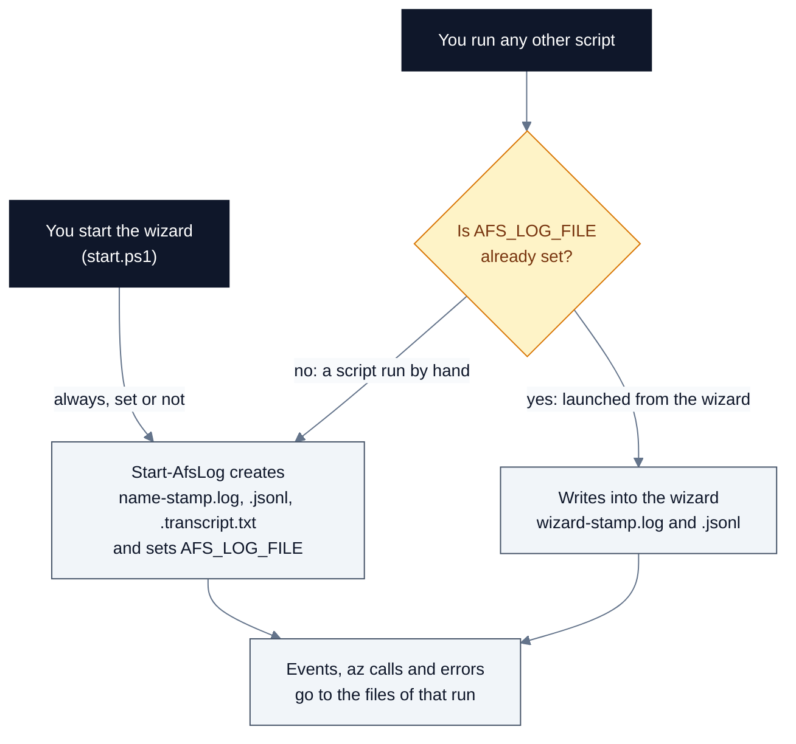

A script launched from the wizard also inherits the wizard's level, because it reads `AFS_LOG_LEVEL` and does not reset it.

#### Good to know

- **Options 6 and 11 stop the wizard's transcript.** These scripts end by calling `Stop-AfsLog`, which runs `Stop-Transcript`:
  - `Invoke-AfsGovernanceAssessment.ps1`
  - `onprem/Install-AfsServerEndpoint.ps1`
  - `onprem/Set-AfsDnsForwarders.ps1`
  - `onprem/Join-AfsStorageAccountToAdDs.ps1`

  When the wizard launches one of them, that call stops the wizard's own transcript. From then on, `.transcript.txt` records nothing more, although `.log` and `.jsonl` carry on. The install and DNS scripts do this even after a dry run. To capture the screen of a later step, quit and start the wizard again; the new run gets new files. (tracked in [#3](https://github.com/gusitde/azure-filesync-backup-assessment/issues/3))
- **The variables stay set in that PowerShell window.** Nothing clears `AFS_LOG_FILE`, `AFS_LOG_JSONL`, `AFS_LOG_LEVEL` or `AFS_LOG_RUN` when a run ends. Suppose you quit the wizard, or finish a script run by hand, and then start another script in the same window. That script writes into the previous run's files instead of starting its own, and records no transcript. The wizard itself is not affected: it always starts new files. Open a new PowerShell window, or clear the variables first (tracked in [#3](https://github.com/gusitde/azure-filesync-backup-assessment/issues/3)):

  ```powershell
  Remove-Item Env:AFS_LOG_FILE, Env:AFS_LOG_JSONL, Env:AFS_LOG_LEVEL, Env:AFS_LOG_RUN -ErrorAction SilentlyContinue
  ```

*Code: `deploy/AfsLog.ps1` (Start-AfsLog, Stop-AfsLog), the `if (-not $env:AFS_LOG_FILE)` line near the top of each script under `deploy/` and `onprem/`, and `Invoke-AfsGovernanceAssessment.ps1`*

### What is kept out of the log

Before the kit logs an Azure CLI command line, it masks secrets:

- The value after `-p`, `--password` or `--client-secret` becomes `***`.
- `--claims-challenge "..."` becomes `--claims-challenge "***"`.

The masked form is what appears in the `run`, `ok` and `fail` lines, in the red `Failed: az ...` heading on screen, and in the error message the wizard logs.

Passwords are never asked through the wizard's text prompts. The file-server, DNS and OU credentials come from `Get-Credential` (or the environment variables below), and only the user name is recorded. Every other text answer you type is logged as typed.

#### Good to know

- Masking covers only the command line the kit writes. The CLI's own output, which is logged as `cli  ...` lines at `Verbose` and `Debug`, is written as the CLI produced it. So is the error output stored for a failed call. The code comment says "never let a secret reach the log", but nothing masks that text. Treat a `Verbose` or `Debug` log from phase 1, or from a service-principal sign-in, as sensitive. Read it before you share it, or reproduce the problem at `-LogLevel Normal`. (tracked in [#3](https://github.com/gusitde/azure-filesync-backup-assessment/issues/3))
- The Azure CLI command in the claims-challenge advice comes from the CLI's own error text, and that text is stored unmasked in the `.jsonl` `stderr` field and in the handler's `ERROR` line. Copy the command from the screen, and treat the log as sensitive.
- Phase 1 writes the deployment secret to `deploy\deployment-identity.json`, not to the logs. That file is in `.gitignore`. Move it into your secret store.

*Code: `deploy/AfsLog.ps1` (Invoke-AfsAz), `onprem/AfsOnPrem.ps1` (Get-AfsCredential), `deploy/Phase1-New-DeploymentIdentity.ps1`*

### Environment variables

The kit reads and sets a small number of environment variables. `$env:` values live in the PowerShell process, so anything the kit sets is still set in that window after the run ends.

| Variable | Set by | What it does |
| --- | --- | --- |
| `AFS_LOG_FILE` | `Start-AfsLog` | Path of the `.log`. Every script checks it to decide whether to start its own log (see above). |
| `AFS_LOG_JSONL` | `Start-AfsLog` | Path of the `.jsonl`. |
| `AFS_LOG_LEVEL` | `Start-AfsLog`: your `-LogLevel` in the wizard, `Verbose` for a script run on its own | Chooses the `az` verbosity flag and whether `DEBUG` lines are echoed. |
| `AFS_LOG_RUN` | `Start-AfsLog` | Run id `<name>-<stamp>`, written as `run` in every `.jsonl` record. |
| `AFS_SUBSCRIPTION_ID` | Wizard option 3, once you pick a subscription. Also phase 1, phase 2, the teardown, the as-built and the three on-premises scripts, from their configuration | Adds `--subscription <id>` to every `az` call the kit makes. It is skipped for commands that already name `--subscription` and for the groups `login`, `logout`, `account`, `extension`, `version`, `config`, `configure`, `upgrade`, `find`, `feedback`, `interactive`, `ad`, `rest`, `cloud` and `self-test`. Each script sets it from its own configuration, so setting it yourself does not redirect a script. |
| `AFS_STEP_PAUSE` | You | Seconds to pause after each timed step, for a demo. Decimals are accepted; off when unset or not above 0. It applies to the steps of phase 2, the teardown, the governance assessment and the three on-premises scripts. It does not apply to phase 1 or the wizard's own stages. |
| `AFS_SERVER_USER`, `AFS_SERVER_PASS` | You | The local-administrator credential for the file server, used by `onprem/Install-AfsServerEndpoint.ps1` when no `-Credential` is passed and both are set. Otherwise the script prompts, and in [option 11](#option-11-connect-your-on-premises-servers) it prompts twice (dry run, then real run). |
| `AFS_AD_USER`, `AFS_AD_PASS` | You | The credential used to create the OU. `onprem/Join-AfsStorageAccountToAdDs.ps1` reads them only with `-CreateOrganizationalUnit` and no `-AdCredential`, and both must be set. The wizard never passes `-CreateOrganizationalUnit`, so they have no effect from option 11. |
| `MSYSTEM` | Git Bash | When it is set, options 3, 4, 7, 8 and 12 print `you appear to be running under Git Bash / MSYS.` and return to the menu. |
| `MSYS_NO_PATHCONV` | You, in Git Bash | The kit never reads it. Git Bash rewrites arguments that begin with `/` into Windows paths, which corrupts Azure resource IDs. The help of `deploy/Deploy-AfsEnvironment.ps1` says: if you must use Git Bash, set `MSYS_NO_PATHCONV=1` first. Run from PowerShell instead. |
| `AZ_INSTALLER` | The kit, set to `MSI` | Set in the kit's own process when it bypasses `az.cmd` (see [When it goes wrong](#wizard)). You do not need to set it. |
| `AFS_AZAPICALL_VERSION` | `Invoke-AfsGovernanceAssessment.ps1` | Passes the AzAPICall version to its PowerShell 7 helper. Internal. |

```powershell
# A demo: pause 2 seconds after each timed step
$env:AFS_STEP_PAUSE = '2'
.\start.ps1

# Answer the file-server credential once for option 11 (both must be set)
$cred = Get-Credential -Message 'Local administrator on fs01.corp.contoso.com'
$env:AFS_SERVER_USER = $cred.UserName
$env:AFS_SERVER_PASS = $cred.GetNetworkCredential().Password
.\start.ps1
# afterwards, remove the plain-text password from the window
Remove-Item Env:AFS_SERVER_USER, Env:AFS_SERVER_PASS
```

#### Good to know

- `AFS_SERVER_PASS` and `AFS_AD_PASS` hold a password in plain text in the process environment. Remove them as soon as the step is done.
- `AFS_SUBSCRIPTION_ID` also stays set after the wizard quits. The scripts overwrite it from their own configuration, so a leftover value does not retarget them.

*Code: `deploy/AfsLog.ps1` (Start-AfsLog, Invoke-AfsAz, Write-AfsStepTimer, Get-AfsAzLauncher), `onprem/AfsOnPrem.ps1` (Get-AfsCredential), `onprem/Install-AfsServerEndpoint.ps1`, `onprem/Join-AfsStorageAccountToAdDs.ps1`, `start.ps1` (Test-Prerequisites)*

### Reading a failed run

Follow these steps in order. Most failures are explained by step 1 or step 2.

1. **Read the screen.** Each failure has a red heading, for example:
   - `That step did not complete.`
   - `Phase 2 stopped (attempt 2 of 5).`
   - `The export did not complete.`
   - `Failed: az group create -n rg-contoso-filesync ...`

   If the kit recognises the error, it prints `  What went wrong:  <cause>`, the reason, and `  Do this:` with the commands. If it does not, it prints `  The error Azure returned:`, the first 6 lines of the error, and `  This one is not recognised. docs/GETTING-STARTED.md has a troubleshooting table.` After `That step did not complete.` from the main menu's handler, the wizard also prints `  Full detail is in <log path>`. The same heading from option 11, and the other headings, do not print it. The path is also on the `Logging to` line under the banner. [Section 6](#6-when-it-goes-wrong) is that troubleshooting table.
2. **Open the `.log` and search for `[ERROR]`.** You will find three kinds of line:
   - `fail az <command> -> exit <n> in <ms> ms` is the Azure CLI call that failed, with its secrets masked.
   - `<context>: <message>` comes from the handler that caught the error. The context is one of `flow failed`, `phase 2 attempt <n> failed`, `export failed`, `governance assessment failed`, `on-premises step failed`, `Connect-AzAccount failed`, `report rebuild failed` or `wizard crashed`. The message is complete: for a failed Azure CLI call, it is the command line followed by the CLI's whole output, over several lines.
   - The wizard's own red `[!]` lines, such as `sign-in did not complete.`
3. **Open the matching `.jsonl` record** for the fields the `.log` does not show:
   - A `fail az` record has `exit`, `ms` and `stderr`, which holds the first 4000 characters of the CLI's output.
   - A handler record has `where` (the script line that threw), `stack`, `exceptionType`, `category` and `fullyQualifiedErrorId`.
4. **Open the `.transcript.txt`** to see what was on screen around the failure. It is incomplete after options 6 and 11 (see [How the scripts share one log](#how-the-scripts-share-one-log)).

```powershell
# From the kit folder: the newest log, every ERROR line and the 6 lines after it
$log = Get-ChildItem .\logs\*.log | Sort-Object LastWriteTime | Select-Object -Last 1
Select-String -Path $log.FullName -Pattern '\[ERROR\]' -Context 0,6

# The same run's JSON records for those errors
$jsonl = [IO.Path]::ChangeExtension($log.FullName, '.jsonl')
Get-Content $jsonl | ForEach-Object { $_ | ConvertFrom-Json } |
    Where-Object level -eq 'ERROR' |
    Select-Object ts, msg, exit, stderr, where |
    Format-List
```

#### Good to know

- The same advice can print twice for one failure. The CLI wrapper prints it under `Failed: az ...`, and then the wizard prints it again under its own heading.
- Each phase 2 retry adds its own `phase 2 attempt <n> failed:` line, so a run with retries has several.
- A run the wizard recovered from, for example a retry that then succeeded, still has its `[ERROR]` lines. Read the last `STEP` and `ok:` lines to see where the run ended.

*Code: `deploy/AfsLog.ps1` (Write-AfsLogException, Invoke-AfsAz), `deploy/AfsConfig.ps1` (Show-AzureFailure), `start.ps1` (main loop, Invoke-Phase2WithRetry)*

## 6. When it goes wrong

Take the first red line on your screen and find it in the tables below. They are grouped by what you were doing. Each "You see" entry is text the kit prints, with the variable parts in angle brackets. When the kit's error advice recognises a failure, it prints a `What went wrong:` line; that line is quoted here as it appears. The advice table knows eleven error patterns. For anything else it prints `This one is not recognised. docs/GETTING-STARTED.md has a troubleshooting table.`, and this section is that table.

If the line is not here, work through [Reading a failed run](#reading-a-failed-run), then [Before you ask for help](#before-you-ask-for-help). Rows marked with an issue number describe a code defect; [section 7](#7-known-behaviour-and-limitations) lists them all.

### Sign-in and access

| You see | It means | Do this |
| --- | --- | --- |
| `What went wrong:  The Az PowerShell module is not signed in, or its session no longer works.` (also `No Az PowerShell session.` or `No Azure PowerShell session. Run Connect-AzAccount, then run this again.`) | Az PowerShell keeps its own sign-in, and `az login` does not cover it. The exporter, the agent install and the AD DS join all need it. [Option 4](#option-4-assess-an-existing-environment) signs you in; [option 11](#option-11-connect-your-on-premises-servers) does not. | Run `Connect-AzAccount -Tenant 00000000-0000-0000-0000-000000000000`, then run the printed `Invoke-AzRestMethod` check and expect `200`. Run the step again. |
| `What went wrong:  Your access is correct, but the sign-in token was issued before it was granted.` | Your token predates a role grant. | Run `az login`, then run the step again. Nothing needs undoing. |
| `What went wrong:  Conditional Access requires step-up authentication before this tenant will allow a write.` | The tenant wants step-up authentication (a claims challenge) for writes. | Run `az logout`, then the `az login ... --claims-challenge "..."` command printed under `Do this:`, exactly as shown. Copy it from the screen. The log holds the same text unmasked, so treat the log as sensitive. |
| `What went wrong:  This tenant requires multi-factor authentication before any resource can be created.` (the error contains `RequestDisallowedByAzure`) | Your session signed in without completing MFA. It can read, but it cannot create. | Run `az logout`, then `az login`, and complete MFA in the browser. In the wizard, answer `n` to **`Use this account?`** `[Y/n]` to get a fresh sign-in. |
| `What went wrong:  This account cannot grant roles at that scope.` | Phase 1 needs Owner on the subscription. The usual cause is an Entra Global Administrator with no Azure role. | Run the printed `az rest ... elevateAccess` command, then `az login`, then `az role assignment create --assignee <your-upn> --role Owner --scope /subscriptions/<sub-id>`. Turn the elevation off afterwards. |
| `What went wrong:  This account does not have the Azure role it needs at that scope.` (`AuthorizationFailed`) | You hold no Azure role at that scope. Directory roles do not count. | Run `az role assignment list --assignee <your-upn> --all -o table`. Phase 2 needs Contributor at least, and phase 1 needs Owner. |
| `What went wrong:  The CLI has no subscription selected, or cannot see the one requested.` | Either the subscription is wrong or not visible, or the real error is `MissingSubscriptionRegistration`, which this advice also catches (see [Build](#build)). | Read the error lines. If they say `MissingSubscriptionRegistration`, follow the Build row. Otherwise run `az account list -o table` and `az account set --subscription <id>`, and check `azure.subscriptionId` in [the settings file](SCRIPT-REFERENCE.md#4-the-settings-file). |
| `[!]    sign-in did not complete.` | The browser sign-in was abandoned or failed. | Choose the option again and finish the sign-in in the browser. |
| `[!]    this account can sign in, but cannot read that subscription.` | The account has no Azure role on the subscription you picked in option 3. | Answer `n` to **`Carry on anyway and answer the rest?`** `[y/N]`, run the three printed commands, then start option 3 again. |
| `WARN signed in as <user> but the inputs file names <admin>` | Phase 1 is running as a different account from `entraGlobalAdmin.userPrincipalName`. | Carry on if that is intended. Otherwise run `az logout` and sign in as the named administrator. |
| `Stopped. The resource group exists; nothing else was created.` | Creating the Entra application failed: the account has no directory role. | Get Application Administrator or Global Administrator. Check with the printed `az rest --method get --url "https://graph.microsoft.com/v1.0/me/memberOf?$select=displayName"`. Then run option 3 again; it reuses the group. |
| `No signed-in session and no deployment secret file. Run az login, or re-run phase 1.` | Phase 2 found neither a usable Azure CLI session nor `deployment-identity.json`. | Run `az login`, then [option 12](#option-12-resume-the-last-build). |
| `The deployment identity cannot sign in yet: <detail>. Wait a minute and try again, or re-run phase 1.` | Entra has not replicated the new identity yet, or its one-year secret has expired. | Wait a minute, then use option 12. If the secret is more than a year old, run option 3 again; phase 1 issues a new secret. |
| `..    no usable session - signing in as the deployment identity <appId>` (in option 12) | Your session cannot read the resource group, for example because you kept a session in another tenant. The wizard does not compare tenants. | This works, but it replaces your Azure CLI session with the service principal. To stay signed in as yourself, answer `n` to **`Use this account?`** `[Y/n]` and sign in to the tenant in the deployment context. |

Microsoft reference: [Azure RBAC best practices](https://learn.microsoft.com/azure/role-based-access-control/best-practices) and [the Reader role](https://learn.microsoft.com/azure/role-based-access-control/built-in-roles#reader). `Connect-AzAccount` and `az role assignment` are also used in [codex/playbook-enable-identity-based-auth-ad-ds.md](../codex/playbook-enable-identity-based-auth-ad-ds.md).

*Code: `deploy/AfsConfig.ps1` (Get-AzureFailureAdvice, Show-AzureFailure), `start.ps1` (Ensure-SignedIn, Ensure-AzPowerShellSession, New-InputsFile), `deploy/Phase1-New-DeploymentIdentity.ps1`, `deploy/Deploy-AfsEnvironment.ps1`*

### Build

| You see | It means | Do this |
| --- | --- | --- |
| `What went wrong:  That storage account name is not available.` (also `storageAccountName '<name>' is already taken by another account: <msg>`) | Storage account names are unique across all of Azure. | Change **Storage name suffix** or **Name prefix** in [option 2](#option-2-deployment-settings). Test a name with `az storage account check-name --name <candidate>`, then build again. |
| `What went wrong:  The dns-resolver CLI extension is not installed.` | The DNS Private Resolver commands are an extension, not part of the base CLI. | Run `az extension add --name dns-resolver`, then run the step again. |
| `What went wrong:  The resource group does not exist yet.` | Phase 2 ran before phase 1 created the group. | Use [option 3](#option-3-build-a-new-azure-file-sync-environment), or from `deploy\` run `.\Phase1-New-DeploymentIdentity.ps1 -InputFile .\inputs.json`. |
| `What went wrong:  The CLI has no subscription selected, or cannot see the one requested.` when the error lines say `MissingSubscriptionRegistration` | A resource provider is not registered. The advice checks `MissingSubscription` first, so it gives the wrong fix. (tracked in [#3](https://github.com/gusitde/azure-filesync-backup-assessment/issues/3)) | Run `az provider register -n <namespace from the error>` and wait until `az provider show -n <namespace> --query registrationState -o tsv` returns `Registered`. Then retry. |
| `These resource providers did not finish registering in 10 minutes: <list>. Check 'az provider show -n <namespace>' and run again.` | Phase 2 ran as the deployment identity, which is Contributor on one resource group and cannot register providers. The kit ignores the failed attempt and waits the full 10 minutes. (tracked in [#1](https://github.com/gusitde/azure-filesync-backup-assessment/issues/1)) | Ask a subscription Owner to run `az provider register -n <namespace>` for each namespace listed. Or run phase 2 from the wizard while signed in as yourself. Then retry. |
| `Phase 2 stopped (attempt <n> of 5).` | A build step failed. The advice under it names the cause. | Fix the cause, then answer `Y` to **`Retry phase 2 now?`** `[Y/n]`. The build is idempotent, so a retry continues from the failed step. |
| `[!]    giving up after repeated failures. Fix the cause above, then choose Resume from the menu.` | Five attempts failed. | Fix the cause, then use [option 12](#option-12-resume-the-last-build). |
| `[!]    phase 1 did not produce a deployment context. Stopping here.` | There is no `deploy\deployment-context.json` after phase 1. | Read the phase 1 output above it, fix the cause, and run option 3 again. |
| `[i]    nothing was changed. Run this again when you are ready.` after you answer `n` to **`Build it for real now?`** `[Y/n]` | Wrong: phase 1 has already created the resource group, the Entra application and service principal, a secret, the role assignment and two files. (tracked in [#3](https://github.com/gusitde/azure-filesync-backup-assessment/issues/3)) | Nothing is broken. Use option 12 when you are ready, or [option 7](#option-7-remove-an-environment-i-built) to remove the group. |
| `Unexpected context schema '<x>'. Regenerate it with Phase1-New-DeploymentIdentity.ps1.` | The context file is from another version or another tool. | Run option 3, which writes a new context. |
| `derived storage account name '<name>' is longer than 24 characters. Shorten azure.namePrefix.` | The prefix and suffix make a name that is too long. | Choose a shorter prefix, or set **Storage account** in option 2. |
| `Existing virtual network '<vnet>' not found in group '<rg>'.` | `overrides.existingVNet` names a network that is not there. | Correct `overrides.existingVNet` in `deploy\inputs.json` (see [section 4](SCRIPT-REFERENCE.md#4-the-settings-file)). |
| `[!]    that value does not resolve: <message>` then `Nothing was saved. Pick it again and enter something else.` | Option 2 rejected an edit before saving it. | Pick the setting again and enter a valid value. |
| `[!]    it does not parse: <message>` (or `Not valid JSON after comment stripping: ...`) | `deploy\inputs.json` is not valid JSON. | The two usual causes are a trailing comma and an unescaped backslash (write `\\`). While the file does not parse, option 2 stops at once with `That step did not complete.`, so fix `deploy\inputs.json` in an editor first. Then use option 2, **Edit the JSON file directly**, **Check that it still parses**. |
| `[!]    the settings do not resolve yet - fill in the ones shown as (not set).` | A value is missing or malformed: no `azure` section, a missing or malformed subscription id or name prefix, a derived storage account name over 24 characters, or `overrides.existingVNet` missing `name` or `subnet`. | Use option 2, **Edit the JSON file directly**, **Check that it still parses**; it prints the exact reason. |
| `[i]    the saved deployment still points at <old-rg>, not <new-rg>.` | You changed settings after phase 1. | Build with option 3, which re-runs phase 1 and picks up the change. Option 12 keeps the old context. Only the resource group name is compared. |
| `WARN  vault already protects <n> item(s) - redundancy can no longer be changed` | Vault redundancy is fixed once the first item is protected. | Expected. See [Decisions you cannot undo](#decisions-you-cannot-undo). |
| `WARN  storage account id not resolvable yet (what-if run?), private endpoint skipped` (in a dry run) | On a first dry run the storage account does not exist yet. | Nothing. The real run creates the endpoint. |
| `WARN  as-built not generated: <msg>` | The build worked; the as-built did not. | From `deploy\` run `.\Export-AfsAsBuilt.ps1 -Context .\deployment-context.json`, or use [option 13](#option-13-open-the-findings-and-as-built-reports), **Generate the as-built for the last build now**. |
| `WARN the identity is not usable yet: <detail>` (phase 1) | Entra replication delay. The wizard carries on to the dry run. | If the dry run then fails at sign-in, wait a minute and use option 12. |
| `Stopped. Grant the role, then run this again - it will reuse the identity.` | The role assignment for the new identity failed. | Read the advice above it (usually Owner is missing), then run option 3 again. |
| `Stopped before creating anything. Fix the above and run this again.` | Phase 1 could not create the resource group. | Read the advice above it (usually MFA or a missing role). |

Microsoft reference: [Azure File Sync deployment guide](https://learn.microsoft.com/azure/storage/file-sync/file-sync-deployment-guide) and [Azure DNS Private Resolver for hybrid DNS](https://learn.microsoft.com/azure/dns/private-resolver-hybrid-dns). The `az dns-resolver` commands are also in [codex/playbook-deploy-dns-private-resolver-and-forwarders.md](../codex/playbook-deploy-dns-private-resolver-and-forwarders.md).

*Code: `deploy/AfsConfig.ps1` (Get-AzureFailureAdvice, Resolve-AfsConfig), `deploy/Deploy-AfsEnvironment.ps1` (preflight), `deploy/Phase1-New-DeploymentIdentity.ps1`, `start.ps1` (Invoke-BuildFlow, Invoke-Phase2WithRetry, Invoke-SettingsFlow)*

### Assessment

| You see | It means | Do this |
| --- | --- | --- |
| `[!]    Connect-AzAccount failed: <msg>` or `[!]    signed in, but the session still cannot list subscriptions.`, then `The export was not started.` | The Az PowerShell sign-in in option 4 failed. The wizard's check always calls `https://management.azure.com`. | Run `Connect-AzAccount -Tenant <tenant-id>` and use option 4 again. In a sovereign cloud, run [Export-AzFileSyncEnvironment.ps1](SCRIPT-REFERENCE.md#export-azfilesyncenvironmentps1) directly instead. |
| `Subscription <id> is not visible to <account>. Check the id, and that this account has Reader on it.` | The id is wrong, Reader is missing, or the subscription is in a different tenant from your Az PowerShell session. **`All of them`** passes every subscription the Azure CLI lists, and those can span tenants. | Pick one subscription, grant Reader, or run `Connect-AzAccount -Tenant <tenant-id>` for the right tenant. |
| `No subscriptions in scope.` | The Az PowerShell tenant has no Enabled subscription. | Sign in to the right tenant, or pass `-SubscriptionId`. |
| `WARNING: <label>: HTTP 403 AuthorizationFailed: ...` and `Done. <n> files, <e> failed call(s).` | Reader is missing at some scope. The export carries on and records the gap in `errors.json`. | Grant Reader and export again, or accept the gap; the assessor reports it as OPS-02. |
| `[!]    that path does not exist.` | Option 4 could not find the export path you typed. | Give the full path to the `afs-export-<stamp>` folder or its `.zip`. |
| `Not an export folder (manifest.json missing): <root>` | The path points at the wrong level, such as a parent folder or `servers\`. | Point at the `afs-export-<stamp>` folder or its `.zip`. |
| Finding OPS-03 with the evidence `no servers/<hostname>/ bundle in the export` | No server bundle was found for a registered server. This also happens when you assess the `.zip`: bundles copied into the folder are ignored. (tracked in [#1](https://github.com/gusitde/azure-filesync-backup-assessment/issues/1)) | Run [Get-AfsServerDiagnostics.ps1](SCRIPT-REFERENCE.md#get-afsserverdiagnosticsps1) elevated on each server. Put each zip in `<export folder>\servers\<hostname>\` and assess the **folder**. |
| `WARNING: assessment.html was not produced: <msg>` | The HTML renderer failed. `assessment.md` and `findings.json` are complete. | Read `assessment.md`, or run the assessment again. |
| A card reading `This section could not be rendered from the export: <msg>` | One subject tab failed. The rest of the report is valid. | Use the raw data in the export for that subject. |
| `[i]    this report has <n> tabs - it was written before the per-subject tabs existed.` | The report is older than the subject tabs. | In [option 5](#option-5-see-the-assessment-results), choose **Re-generate this report from its export (adds the subject tabs)**. It is offered only while the export still exists. |
| The browser opens an older report after **`Open the HTML report now?`** `[Y/n]` | Option 4 opens the newest `assessment.html` anywhere under the kit folder, not necessarily the one just written. (tracked in [#3](https://github.com/gusitde/azure-filesync-backup-assessment/issues/3)) | Open the file on the `Report: <path>\assessment.html` line. |
| `WARN  PowerShell 7 is not installed, and AzGovViz needs 7.0.3 or later`, then `The variable '$r' cannot be retrieved because it has not been set.` (from option 6, under `The governance assessment did not complete.` and `The error Azure returned:`) | This machine has no PowerShell 7. The script then tries to print how to get one, and dies inside that help text: it expands `$r` and `$a`, which are not set, and the script runs under `Set-StrictMode -Version 2.0`. So the install commands are never printed, and the message `PowerShell 7 is required for the governance assessment.` is never reached. (tracked in [#3](https://github.com/gusitde/azure-filesync-backup-assessment/issues/3)) | Get PowerShell 7 yourself, then use option 6 again. Run `winget install --exact --id Microsoft.PowerShell`. With no winget and no local administrator, extract the PowerShell 7 zip instead, so that `pwsh.exe` sits at `<kit folder>\.pwsh7\pwsh.exe`, which the script finds on its own; the zip commands are in [codex/playbook-run-the-tenant-governance-assessment.md](../codex/playbook-run-the-tenant-governance-assessment.md). On a direct run you can also point at a copy you already have: `.\Invoke-AfsGovernanceAssessment.ps1 -PwshPath 'D:\pwsh7\pwsh.exe'`. |
| `The dry run did not complete.` with `Cannot find path '<kit folder>\.azgovviz\pwsh\AzGovVizParallel.ps1' because it does not exist.` | This is the first run on this machine. The dry run skips the clone, then reads the file anyway. (tracked in [#3](https://github.com/gusitde/azure-filesync-backup-assessment/issues/3)) | Answer `Y` to **`Run it now? It can take a while on a large tenant.`** `[Y/n]`. The real run clones first. |
| `git is needed to fetch AzGovViz, or pass -SourcePath to an existing checkout.` | `git` is not on PATH and there is no AzGovViz checkout. | Install git, or run [Invoke-AfsGovernanceAssessment.ps1](SCRIPT-REFERENCE.md#invoke-afsgovernanceassessmentps1) with `-SourcePath`. |
| `WARN  cannot read management group <mg>` | You have no Reader at the tenant root group. The run carries on and the report comes back nearly empty. | Run the printed `az role assignment create ... --role Reader --scope /providers/Microsoft.Management/managementGroups/<mg>`. The tenant root needs a one-time elevation first. |
| `AzGovViz exited with code <n>. The log is <path>.` | The governance tool itself failed. | Read that log. |
| `WARN  this run produced no output files - check the log before trusting anything in that folder.` | Nothing was written. Any files in `governance\` are older. | Do not read older files as current. Check the log, fix the cause and run again. |
| `WARNING: Not elevated: event logs, fltmc and server cmdlets may be incomplete. Re-run from an elevated PowerShell.` | The server diagnostics script is running without elevation. | Run it again from an elevated PowerShell on the file server. |
| `A parameter cannot be found that matches parameter name 'SkipAfsDiag'.` | The help documents `-SkipAfsDiag`, but the parameter does not exist. (tracked in [#3](https://github.com/gusitde/azure-filesync-backup-assessment/issues/3)) | Leave it out. AFSDiag is off by default; `-CollectAfsDiag` turns it on. |
| `agent DLL not found at C:\Program Files\Azure\StorageSyncAgent\...` in the bundle's `errors.json` | The agent is missing, or installed outside the default path, which is the only path the script checks. | Run it on a registered server with the agent in the default location. |

Microsoft reference: [the Reader role](https://learn.microsoft.com/azure/role-based-access-control/built-in-roles#reader) and [the Azure File Sync debug cmdlet](https://learn.microsoft.com/troubleshoot/azure/azure-storage/files/file-sync/file-sync-use-debug-cmdlet). The PowerShell 7 install and the management-group Reader grant are in [codex/playbook-run-the-tenant-governance-assessment.md](../codex/playbook-run-the-tenant-governance-assessment.md).

*Code: `start.ps1` (Invoke-AssessFlow, Ensure-AzPowerShellSession, Invoke-AssessmentResultsFlow, Invoke-GovernanceFlow), `Export-AzFileSyncEnvironment.ps1`, `Assess-AzFileSyncExport.ps1`, `Render-AfsAssessmentHtml.ps1`, `Invoke-AfsGovernanceAssessment.ps1`, `Get-AfsServerDiagnostics.ps1`*

### On-premises

| You see | It means | Do this |
| --- | --- | --- |
| Option 8: `[!]   Windows PowerShell 5.1` with `running 7.<x> - the AD DS join needs Windows PowerShell 5.1, which AzFilesHybrid requires` | You started the kit in `pwsh.exe`. | Use `powershell.exe`. |
| Option 8: `[?]   subscription` with `no resolved config was supplied, so nothing subscription-scoped could be checked` | `deploy\inputs.json` is missing, does not parse, or does not resolve. Option 8 hides which. (tracked in [#3](https://github.com/gusitde/azure-filesync-backup-assessment/issues/3)) | If `deploy\inputs.json` does not parse, fix it in an editor first; until it parses, option 2 stops at once with `That step did not complete.`. Then use option 2, **Edit the JSON file directly**, **Check that it still parses**, which also prints why the file does not resolve. |
| Option 8: `[?]   role assignment rights` with `no role assignments were returned - Graph may be blocked for this account` | This row always ends up unknown: the check parses the CLI's result twice and loses it. (tracked in [#3](https://github.com/gusitde/azure-filesync-backup-assessment/issues/3)) | Check by hand: `az role assignment list --assignee <your-upn> --all --query "[].roleDefinitionName" -o tsv`. You need Owner, User Access Administrator, Azure File Sync Administrator or Role Based Access Control Administrator. |
| Option 8: `[i]    nothing is known to be broken, but <n> requirement(s) could not be checked from here.` | This yellow line is the best result option 8 can reach, because the DNS resolver rows are always unknown. (tracked in [#3](https://github.com/gusitde/azure-filesync-backup-assessment/issues/3)) | Read each `?` line. The DNS script's own gate tests the resolver before it writes anything. |
| Option 8: `[!]   reachable: <server>` with `does not answer ping` | A network that blocks ping is reported as a blocker. (tracked in [#3](https://github.com/gusitde/azure-filesync-backup-assessment/issues/3)) | If `WinRM on 5985` and `PowerShell session` are `[ok]`, ignore it. |
| Option 8: `[!]   <srv>: rights to read its zones` | Your Windows account was refused, and option 8 cannot ask for another. | Use the DNS step in option 11 and answer `y` to **`Use a different account to reach the DNS servers?`** `[y/N]`. |
| Option 8: `[!]   <srv>: -ReplicationScope Forest` | That DNS server is a member server. The DNS step always uses Forest scope and would throw part-way through the list. | Leave it out of option 11, then give it its own pass: `.\onprem\Set-AfsDnsForwarders.ps1 -Context .\deploy\deployment-context.json -DnsServer <member server> -ReplicationScope None`. |
| `This server still has the previous Azure File Sync agent's file system filter loaded, waiting for a restart. Installing now fails with MSI error 1603. Restart <server> and run this step again.` (option 8: `no half-removed agent`) | An earlier agent uninstall needs a restart. | Restart the file server, then run the step again. |
| `The agent installer failed. MSI 1618 - another installation is already in progress. Wait for it to finish.` (also 1603, 1638, 1601) | msiexec returned that code. | Do what the message says. The full MSI log on the server is `C:\Windows\Temp\afs-agent\AFSInstaller.log`. |
| `The agent did not install within 20 minutes, and the installer task never reported a result.` | The install timed out. | Read the MSI log on the server, and check that the server can reach `aka.ms` over HTTPS. |
| `[!]    no deployment context found - build the Azure side first (option 3).` | There is no `deploy\deployment-context.json`. | Build with [option 3](#option-3-build-a-new-azure-file-sync-environment). |
| `The Azure PowerShell session (<account>) cannot select subscription <id>: <msg>` | The Az PowerShell account cannot see the build's subscription. | Run `Connect-AzAccount` as an account that can. |
| `PowerShell remoting to fs01.corp.contoso.com failed.` | WinRM is off, port 5985 is closed, or the credential is not a local administrator. | On the server run `Enable-PSRemoting -Force`, then test from your machine with `Test-WSMan -ComputerName fs01.corp.contoso.com`. |
| `Azure File Sync supports Windows Server 2016, 2019, 2022 and 2025. That server reports build <n>.` or `.NET Framework 4.7.2 or later is required on the file server (found release <n>). ...` | The server does not meet the agent's requirements. | Use a supported server, or install .NET Framework 4.7.2 or later. |
| `A server endpoint path must be on a local NTFS volume. <path> resolves to <root> (<fs>).` | The path is a mapped drive, a UNC path or not NTFS. | Give a local NTFS path. For cloud tiering, it must not be on the system volume. |
| `Azure File Sync needs 'Allow storage account key access' enabled on stcontosofs01. Enable it with: az storage account update -n stcontosofs01 -g rg-contoso-filesync --allow-shared-key-access true` | Shared key access is disabled. The `-Remove` path checks this too. | Run the printed command. |
| `Server registration runs inside the session on <server>, ... deploy/deployment-identity.json was not found next to the context ...` | The phase 1 secret file is missing or has been moved. | Put the file back next to the context, or run option 3 again, which issues a new secret. |
| `The signed-in account cannot create a cloud endpoint (needs to create a role assignment).` | Contributor is not enough. The check looks only at roles assigned to your user directly, so a role held through a group is not seen. (tracked in [#3](https://github.com/gusitde/azure-filesync-backup-assessment/issues/3)) | Run the printed `az role assignment create --assignee <upn> --role 'Azure File Sync Administrator' --scope <storage account id>`, then run the step again. It continues where it stopped. |
| `WARN  the Storage Sync Service only accepts traffic from virtual networks` | The sync service is locked to its private endpoint. | Give the server a private path, or run the printed `az resource update ... incomingTrafficPolicy=AllowAllTraffic`. |
| `'<share>' is not a share this deployment created. Known shares: ...` or `Cannot read '<x>' as a share mapping. Use share=path, for example dept-shares=D:\Shares\dept.` | The share mapping is wrong. | Use `share=path` with a share name from the deployment. |
| `No resolver address. Pass -ResolverIpAddress, or deploy the DNS Private Resolver first.` | The resolver is not deployed, the `dns-resolver` extension is missing, or the inbound endpoint is not named `inbound-01`. | Read the address with `az dns-resolver inbound-endpoint list -g rg-contoso-filesync --dns-resolver-name dnspr-contoso-eastus -o json`, then run the script by hand with `-ResolverIpAddress 10.60.2.4`. |
| `Cannot read DNS zones on dc01.`, followed by the reason | The RSAT DnsServer module is missing, access was denied, the name does not resolve, WinRM failed, or the server has no DNS role. | Follow the line under it. For access denied, supply a DnsAdmins or Domain Admins account. |
| `The resolver did not return a private address. Nothing was changed. Re-run with -Force only if you are building the network path in this same change window.` | The gate refused. The machine running the script has no path to the resolver, the private DNS zones are not linked to its virtual network, or there is no A record. | Test from the same machine: `Resolve-DnsName -Name stcontosofs01.privatelink.file.core.windows.net -Server 10.60.2.4 -Type A -DnsOnly -QuickTimeout`. Fix the path (VPN or ExpressRoute, and UDP and TCP 53 to the inbound subnet). See [codex/runbook-private-endpoint-name-resolution-and-reachability.md](../codex/runbook-private-endpoint-name-resolution-and-reachability.md). |
| `<zone> already exists on <server> as a <type> zone. This script will not touch it ...` | An authoritative zone with that name exists. | Resolve it with the DNS owner before you forward. |
| `WARN  <zone> on <server> forwards to <masters>, not <ip>` and `Somebody configured that deliberately. Re-run with -UpdateExisting to repoint it.` | The existing forwarder was left alone, and the run still ends `Conditional forwarders in place.` | Capture it first: `Get-DnsServerZone -Name file.core.windows.net -ComputerName dc01 \| Export-Clixml pre-change.xml`. Then run the script by hand with `-UpdateExisting`. |
| `No console is available to confirm against. See the note above.` or `Exception calling "ShouldProcess" with "2" argument(s): "Object reference not set to an instance of an object."` | The DNS or join script runs without a console. `powershell -File ... -Confirm:$false` drops the switch silently. | Run it from a console. For unattended runs from cmd.exe or a scheduled task, use the `-Command` form: `powershell -Command "& '.\onprem\Set-AfsDnsForwarders.ps1' -Context .\deploy\deployment-context.json -DnsServer dc01,dc02 -Confirm:$false"`. |
| `Refusing to create a forwarder for privatelink.file.core.windows.net - it would have no effect.` | `-Zone` was given a privatelink zone. | Leave `-Zone` out. The default forwards the public zones `file.core.windows.net` and `afs.azure.net`. |
| `This must run in Windows PowerShell 5.1. PowerShell <v> (Core) cannot load the Active Directory cmdlets AzFilesHybrid needs.` | The join was started in `pwsh.exe`. | Use `powershell.exe`. |
| `This machine is not domain-joined. Join-AzStorageAccount refuses to run anywhere else - even with -WhatIf. ...` | The join runs only on a domain member. | Run it from a domain-joined admin workstation or a domain controller. |
| `RSAT Active Directory PowerShell is required. See the instructions above.` (AzFilesHybrid's own error is `This cmdlet requires an elevated PowerShell session`) | The RSAT AD module is missing. | Once, from an elevated PowerShell: `Install-WindowsFeature RSAT-AD-PowerShell` (Windows Server) or `Add-WindowsCapability -Online -Name Rsat.ActiveDirectory.DS-LDS.Tools~~~~0.0.1.0` (Windows client). |
| `AzFilesHybrid needs Az.Storage 8.1.0 or later; this machine has <v>.` | Az.Storage is too old. | Run `Install-Module Az.Storage -MinimumVersion 8.1.0 -Scope CurrentUser`. |
| `The organizational unit does not exist.` | The OU is missing. The wizard cannot create it. | Run the printed `New-ADOrganizationalUnit -Name 'AzureFiles' -Path 'DC=corp,DC=contoso,DC=com'`, or run the join by hand with `-CreateOrganizationalUnit`. |
| `An organizational unit is required. See above.` | No OU was given. This also happens on a re-run for an account that is already joined. (tracked in [#3](https://github.com/gusitde/azure-filesync-backup-assessment/issues/3)) | Pass `-OrganizationalUnit 'OU=AzureFiles,DC=corp,DC=contoso,DC=com'`. |
| `WARN  Active Directory refused to create the account`, then a `dsacls` line ending `/G "CONTOSO\;computer"` | Your account lacks the right to create a computer object in the OU. The printed line has lost the user name and `:CC`. (tracked in [#3](https://github.com/gusitde/azure-filesync-backup-assessment/issues/3)) | Ask a directory administrator to run `dsacls "OU=AzureFiles,DC=corp,DC=contoso,DC=com" /I:T /G "CONTOSO\<user>:CC;computer"` for the account that runs the join. Also check that the SamAccountName is 15 characters or fewer. |
| `<storage account> already uses a different identity source (<x>). ...` | Only one identity source is allowed per storage account. | Disable the other source first. Option 8 prints the command. |
| `The storage account is joined under a different account name.` | An earlier join used another SamAccountName. | Run the join by hand with `-SamAccountName <existing>`, or with `-Remove` first. |
| `Storage account stcontosofs01 was not found in rg-contoso-filesync. Build it first, or check the context.` | The context names an account that does not exist. | Build first with option 3, or pass the right context. |

Microsoft reference: [Troubleshoot Azure File Sync agent installation](https://learn.microsoft.com/troubleshoot/azure/azure-storage/files/file-sync/file-sync-troubleshoot-installation), [Enable AD DS authentication for Azure Files](https://learn.microsoft.com/en-us/azure/storage/files/storage-files-identity-ad-ds-enable) and [DNS for Azure Files](https://learn.microsoft.com/en-us/azure/storage/files/storage-files-networking-dns). The same commands appear in [codex/runbook-file-sync-agent-install-and-registration-failures.md](../codex/runbook-file-sync-agent-install-and-registration-failures.md), [codex/runbook-private-endpoint-name-resolution-and-reachability.md](../codex/runbook-private-endpoint-name-resolution-and-reachability.md), [codex/playbook-point-on-premises-dns-at-the-private-resolver.md](../codex/playbook-point-on-premises-dns-at-the-private-resolver.md) and [codex/playbook-enable-identity-based-auth-ad-ds.md](../codex/playbook-enable-identity-based-auth-ad-ds.md).

*Code: `deploy/AfsRequirements.ps1` (Get-AfsAzureRequirements, Get-AfsServerRequirements, Get-AfsDnsRequirements, Get-AfsAdRequirements), `start.ps1` (Invoke-OnPremisesFlow, Show-AfsRequirements), `onprem/AfsOnPrem.ps1` (Confirm-AfsAzPowerShell, Confirm-AfsCanPrompt, Test-AfsAzureWriteScope), `onprem/Install-AfsServerEndpoint.ps1`, `onprem/Set-AfsDnsForwarders.ps1`, `onprem/Join-AfsStorageAccountToAdDs.ps1`*

### Teardown

| You see | It means | Do this |
| --- | --- | --- |
| `[!]    no deployment context found - nothing to remove from here.` | Option 7 needs `deploy\deployment-context.json`. | From `deploy\`, run `.\Remove-AfsEnvironment.ps1 -InputFile .\inputs.json -WhatIf`. |
| `Failed: az account set --subscription <id>`, then `That step did not complete.` | You are not signed in to the Azure CLI. Option 7 does not sign you in. | Run `az login`, then use option 7 again. |
| `WARN the group holds <n> resource(s) the parameter file does not name:`, the `! <name>  (<type>)` lines, then `WARN refusing to delete the group. Re-run with -Force if this is expected.` | The safety check refused. The wizard still asks for `DELETE`; the real run then refuses the same way without an error, because the wizard never passes `-Force`. (tracked in [#3](https://github.com/gusitde/azure-filesync-backup-assessment/issues/3)) | Check the listed resources. If they should go, from `deploy\` run `.\Remove-AfsEnvironment.ps1 -Context .\deployment-context.json -Force -WhatIf`, then the same without `-WhatIf`. |
| `[i]    cancelled. Nothing was removed.` | You did not type `DELETE` exactly. The check is case-sensitive. | Choose option 7 again and type `DELETE` in capitals. |
| `WARN vault NOT deleted: soft delete keeps the removed backup data for <n> days, ...` and `WARN everything else is removed now; delete the vault and the group after <yyyy-MM-dd> with:` | Vault soft delete holds the backup data, so the group is kept and everything else is deleted. | After the printed date, run the two printed commands: `az backup vault delete -n rsv-contoso-eastus -g rg-contoso-filesync --yes` and `az group delete -n rg-contoso-filesync --yes`. |
| `WARN lock NOT removed: <name> (<id>)` | The account cannot delete locks. Contributor does not include lock deletion. | Run as Owner or User Access Administrator, or delete the lock with `az lock delete --ids <id>`, then run again. |
| `WARN a full pass removed nothing - <n> resource(s) are held by something this script cannot see` or `WARN still present: <names>` | Something outside the kit holds those resources. | Find what holds them in the portal and remove it by hand. |
| `OK   protection removed: <share>`, but the vault will not delete | This line prints even when disabling protection failed. (tracked in [#3](https://github.com/gusitde/azure-filesync-backup-assessment/issues/3)) | Check with `az backup item list -v rsv-contoso-eastus -g rg-contoso-filesync -o table`. |
| `az group exists -n rg-contoso-filesync` still returns `true` after `OK   delete issued (asynchronous)` | Group deletion runs asynchronously. | Wait, then check again. |
| After teardown, `sp-contoso-afs-deploy`, the AD computer object, the agent's registration on the file server and the DNS forwarders are still there | They live outside the resource group. | Delete the app with `az ad app delete --id <appId>`. Run the `-Remove` path of each on-premises script, ideally before the teardown. |

Microsoft reference: [Lock your resources](https://learn.microsoft.com/azure/azure-resource-manager/management/lock-resources) and [Azure Backup security features, including soft delete](https://learn.microsoft.com/azure/backup/backup-azure-security-feature-cloud). `az backup item list` is also used in [codex/playbook-enable-azure-backup-for-file-shares.md](../codex/playbook-enable-azure-backup-for-file-shares.md).

*Code: `start.ps1` (Invoke-RemoveFlow), `deploy/Remove-AfsEnvironment.ps1`*

### Wizard

| You see | It means | Do this |
| --- | --- | --- |
| `[!]    you appear to be running under Git Bash / MSYS.` | Git Bash rewrites arguments that start with `/`, which corrupts Azure resource IDs. | Run the kit from PowerShell. |
| `[!]    Azure CLI (az) was not found on PATH.` | The Azure CLI is missing. | Run `winget install --exact --id Microsoft.AzureCLI`, then close and reopen PowerShell. |
| `... cannot be loaded because running scripts is disabled on this system.` | The PowerShell execution policy blocks scripts. | In that window, run `Set-ExecutionPolicy -Scope Process -ExecutionPolicy Bypass`, then `.\start.ps1`. |
| `-o was unexpected at this time` (exit 255) when you run an `az` command yourself | With the Windows MSI install, `az.cmd` breaks on any `)` in an argument, and every JMESPath function has one. The kit calls the CLI's own Python directly, so its calls are not affected. | Use a filter instead of a function in `--query`, or call Python the way the kit does: `$py = Join-Path (Split-Path (Split-Path (Get-Command az).Source)) 'python.exe'`, then `& $py -IBm azure.cli <arguments>`. |
| `That step did not complete.`, then `This one is not recognised. docs/GETTING-STARTED.md has a troubleshooting table.` | The error is not one of the eleven recognised patterns. | Look up the error lines in this section, then follow [Reading a failed run](#reading-a-failed-run). |
| `[!]    No usable choice after several attempts. Stopping rather than looping.` | Five invalid menu entries, or the input ended. The wizard stops. | Start it again and type a number from the list. Do not pipe input into the wizard. |
| `No usable answer after several attempts (is input redirected or empty?). Stopping rather than looping.` | Five invalid or empty answers to a question. | Answer in the form shown under the question. |
| `[i]    no answer (input ended) - treating that as no.` | Input is redirected, so every yes/no question counts as no. | Run the wizard in an interactive console. |
| `[!]    The wizard stopped unexpectedly: <message>` and `Details: <log path>` | An error escaped every flow. | Find the `wizard crashed:` line in the log and report it. |
| `[!]    the guide is missing from this copy of the kit: <path>` | `docs\HOW-TO-USE.html` is not in this copy. | Pull the latest kit, or read docs/GETTING-STARTED.md. |
| `[!]    could not open a browser: <message>`, then `Open this file by hand: <path>` | There is no program to open the file. | Open the printed path yourself. |
| `That step did not complete.` straight after you choose how to open a document in option 9 or 10 | There is no program for `.md` files or no browser. The error returns you to the main menu. | Choose **Show the first page here** instead, or open the file yourself. |
| `.transcript.txt` stops part-way, after option 6 or 11 | The child script stopped the wizard's transcript. (tracked in [#3](https://github.com/gusitde/azure-filesync-backup-assessment/issues/3)) | Use the `.log` and `.jsonl`, which carry on. Restart the wizard for a fresh transcript. |
| `-LogLevel Quiet` still shows everything | Quiet only adds `--only-show-errors` to Azure CLI calls. (tracked in [#3](https://github.com/gusitde/azure-filesync-backup-assessment/issues/3)) | See [What -LogLevel changes](#what--loglevel-changes). |

*Code: `start.ps1` (Test-Prerequisites, Read-Answer, Read-YesNo, Read-Choice, main loop, Invoke-HowToUseFlow, Open-Target), `deploy/AfsLog.ps1` (Get-AfsAzLauncher, Stop-AfsLog)*

### Before you ask for help

Work through this list first. Most questions are answered by the first four items, and the rest make any report you send actionable.

- [ ] Note the menu option, and the answers you gave up to the failure.
- [ ] Copy the first red line exactly as printed.
- [ ] Look it up in this section, in [section 7](#7-known-behaviour-and-limitations), and in the open issues [#1](https://github.com/gusitde/azure-filesync-backup-assessment/issues/1), [#2](https://github.com/gusitde/azure-filesync-backup-assessment/issues/2) and [#3](https://github.com/gusitde/azure-filesync-backup-assessment/issues/3).
- [ ] Run [option 8](#option-8-check-requirements). Keep the counts line and every `[!]` line.
- [ ] Find the `[ERROR]` lines and their `.jsonl` records, as in [Reading a failed run](#reading-a-failed-run).
- [ ] Note the versions from the first `.jsonl` record: `version`, `powershell` and `azureCli`.
- [ ] Reproduce once at the default level, `Verbose`. Use `Debug` only when asked: it buries the error under the trace.
- [ ] Before sharing anything, replace real account, tenant, subscription, resource, server and domain names with placeholders such as `contoso`. Never send `deploy\deployment-identity.json`, and read any `Verbose` or `Debug` log first.
- [ ] Report it as a GitHub issue, using the correction or gap form described in [CONTRIBUTING.md](../CONTRIBUTING.md).

*Code: `deploy/AfsLog.ps1` (Start-AfsLog, Write-AfsLogException), `deploy/AfsRequirements.ps1` (Get-AfsRequirementVerdict)*

## 7. Known behaviour and limitations

Every row below describes the code as it is today, and places where the code differs from what earlier documentation said or what the kit's own text says. Each row carries its tracking issue, or says why it has none:

- [#1](https://github.com/gusitde/azure-filesync-backup-assessment/issues/1): the build and assessment gaps (lock-down, provider registration, the step counter, zip input).
- [#2](https://github.com/gusitde/azure-filesync-backup-assessment/issues/2): codex diagrams.
- [#3](https://github.com/gusitde/azure-filesync-backup-assessment/issues/3): the code defects listed in it. Not every row below that cites #3 is in the issue yet (for example `-LogLevel Quiet`, the optional dry run in option 12, and the export's one POST). Check the issue before you rely on this column, and add any missing row to it.
- By design: behaviour the kit intends. Plan around it; there is nothing to fix.
- Not filed: a gap that is in no issue yet. Report it as described in [Before you ask for help](#before-you-ask-for-help).

Where the code and a document disagree, trust the code and this table.

| What you might expect | What the kit does today | Workaround | Tracked in |
| --- | --- | --- | --- |
| **Logging** | | | |
| `-LogLevel Quiet` shows only warnings and errors | Quiet only adds `--only-show-errors` to Azure CLI calls. Every line the wizard prints still appears. | None needed. Treat Quiet as Normal. | [#3](https://github.com/gusitde/azure-filesync-backup-assessment/issues/3) |
| The log file gets everything, whatever the level | The CLI's own output is written only at Verbose or Debug, first 400 lines per call. A failed call's output is stored in the `.jsonl`, capped at 4000 characters. | Stay at Verbose. The complete text is in the handler's `ERROR` line in the `.log`. | [#3](https://github.com/gusitde/azure-filesync-backup-assessment/issues/3) |
| No secret reaches the log | The kit masks the command lines it logs. The CLI's own output (Verbose and Debug) and the error output of a failed call are written unmasked. | Read a log before sharing it. Reproduce at `-LogLevel Normal` when you must share one. | [#3](https://github.com/gusitde/azure-filesync-backup-assessment/issues/3) |
| The wizard's transcript covers the whole session | The scripts behind options 6 and 11 stop it when they finish, even after a dry run. | Rely on `.log` and `.jsonl`. Restart the wizard for a new transcript. | [#3](https://github.com/gusitde/azure-filesync-backup-assessment/issues/3) |
| A script run by hand always gets its own log | Only when `AFS_LOG_FILE` is unset. The variable stays set in the window after the wizard or a script ends. | Use a new PowerShell window, or `Remove-Item Env:AFS_LOG_FILE, Env:AFS_LOG_JSONL, Env:AFS_LOG_LEVEL, Env:AFS_LOG_RUN`. | [#3](https://github.com/gusitde/azure-filesync-backup-assessment/issues/3) |
| **Build and settings** | | | |
| Every step that changes something shows a dry run first | Option 3 runs phase 1 for real after **`Run phase 1 now?`** `[Y/n]`, with no dry run. Only phase 2 is dry-run first. | To preview phase 1, from `deploy\` run `.\Phase1-New-DeploymentIdentity.ps1 -InputFile .\inputs.json -WhatIf` before option 3. | [#3](https://github.com/gusitde/azure-filesync-backup-assessment/issues/3) |
| Answering `n` to **`Build it for real now?`** leaves everything untouched, as the `nothing was changed` message says | Phase 1 has already created the resource group, the Entra application and service principal, a one-year secret, the role assignment, `deployment-context.json` and `deployment-identity.json`. | Use option 12 later, or undo with option 7 and `az ad app delete --id <appId>`. | [#3](https://github.com/gusitde/azure-filesync-backup-assessment/issues/3) |
| Phase 2 signs in as the deployment identity | Phase 2 uses any Azure CLI session that can read the resource group. In the wizard that is you. The identity is used only when no such session exists. | A `-WhatIf` run cannot prove it: after `az logout` a dry run never signs in as the identity and stops at `Not signed in. Run: az login`. To prove it, run `az logout`, then from `deploy\` run `.\Deploy-AfsEnvironment.ps1 -Context .\deployment-context.json` without `-WhatIf`. The build is idempotent. Afterwards the Azure CLI stays signed in as the service principal until you run `az login` again. | [#3](https://github.com/gusitde/azure-filesync-backup-assessment/issues/3) |
| Re-running phase 1 keeps the existing secret (as a code comment says) | Every non-federated run issues a new one-year secret and overwrites `deployment-identity.json`. The old secret stops working. | Re-run phase 1 (option 3) only when you mean to rotate, and update anything that uses the old secret. `-Federate` issues no secret. | [#3](https://github.com/gusitde/azure-filesync-backup-assessment/issues/3) |
| The admin needs "Owner or User Access Administrator", as the wizard's text says | Phase 1 creates the resource group, which User Access Administrator alone cannot do. | Use an account with Owner on the subscription. | [#3](https://github.com/gusitde/azure-filesync-backup-assessment/issues/3) |
| Retention is limited to 1 to 200 days, as the prompt says | Option 3 accepts 0 to 999, option 2 accepts any whole number, and nothing checks the range. | Enter a value from 1 to 200, and confirm it in option 2 under **Show what it all resolves to**. | [#3](https://github.com/gusitde/azure-filesync-backup-assessment/issues/3) |
| The build has 15 steps and can close the public paths | The counter shows `/17`. The lock-down step can never run: it is hard-coded off and no input turns it on. The storage account firewall stays open. | Once on-premises clients resolve the private address, run the command the step would have run: `az storage account update -n stcontosofs01 -g rg-contoso-filesync --default-action Deny --bypass AzureServices`. See [codex/playbook-enable-file-sync-private-endpoint-and-cutover.md](../codex/playbook-enable-file-sync-private-endpoint-and-cutover.md). | [#1](https://github.com/gusitde/azure-filesync-backup-assessment/issues/1) |
| The deployment identity registers missing resource providers | It is Contributor on one resource group and cannot. The preflight ignores the failed attempt, waits 10 minutes, then stops. | Before phase 2, have a subscription Owner run `az provider register -n <namespace>` for Microsoft.Storage, Microsoft.Network, Microsoft.StorageSync, Microsoft.RecoveryServices and Microsoft.Insights. | [#1](https://github.com/gusitde/azure-filesync-backup-assessment/issues/1) |
| A `MissingSubscriptionRegistration` error gets the "register the provider" advice | The advice matches `MissingSubscription` first, so it prints the "no subscription selected" fix instead. | Run `az provider register -n <namespace from the error>`. | [#3](https://github.com/gusitde/azure-filesync-backup-assessment/issues/3) |
| Option 12 always dry-runs first | **`Dry run first?`** `[Y/n]` is optional, and a failed dry run does not stop the resume. | Answer `Y`, and read the dry run before you answer **`Resume the build now?`**. | [#3](https://github.com/gusitde/azure-filesync-backup-assessment/issues/3) |
| In option 2, clearing a value hands it back to the prefix | Enter keeps the value shown and writes it explicitly, so a derived value stops following the prefix. Only an empty setting can be cleared. Booleans stay explicit once set. | Delete the key from `deploy\inputs.json` (option 2, **Edit the JSON file directly**). | [#3](https://github.com/gusitde/azure-filesync-backup-assessment/issues/3) |
| Option 2 warns when the settings drift from the last build | It compares only the resource group name. A change of region, retention, SKU or network is not reported. | After changing any setting, build with option 3, not option 12. | [#3](https://github.com/gusitde/azure-filesync-backup-assessment/issues/3) |
| Option 2 keeps the sample's comments | The first save rewrites `inputs.json` without comments, in a different key order. | Read the annotated sample (option 2, **Edit the JSON file directly**, **Open the annotated sample**). | [#3](https://github.com/gusitde/azure-filesync-backup-assessment/issues/3) |
| Answering `n` to **`Overwrite it?`** leaves things as they were | Your new answers are discarded, but the CLI's default subscription stays on the one you just picked. | Run `az account show`. Phase 1 pins the subscription from the file anyway. | [#3](https://github.com/gusitde/azure-filesync-backup-assessment/issues/3) |
| Skipping AD in option 3 leaves nothing to undo later | The AD admin is saved as `not-configured`. Turning the join on later plans it as that account. | When you turn the join on, set **AD admin account** in option 2 under **Directory** as well. | [#3](https://github.com/gusitde/azure-filesync-backup-assessment/issues/3) |
| Any characters are safe in option 3 answers | Option 3 writes `inputs.json` as ASCII, so a non-ASCII character becomes `?`. | Enter such values in option 2, which saves UTF-8. | [#3](https://github.com/gusitde/azure-filesync-backup-assessment/issues/3) |
| Phase 1 counts to 9 | With `-SkipLogin` (the wizard) 7 steps print; run by hand, 8. The strip still ends at `9/9`. | Cosmetic. | [#3](https://github.com/gusitde/azure-filesync-backup-assessment/issues/3) |
| Phase 1 run by hand writes its files to `deploy\` | `-ContextFile` and `-SecretFile` are relative to your current directory. | `cd deploy` before you run it. | [#3](https://github.com/gusitde/azure-filesync-backup-assessment/issues/3) |
| The sync group shown by `-ShowResolved` exists after the build | `sg-contoso-shares` is never created. The install step creates one group per share, such as `sg-contoso-dept-shares`. | Ignore `overrides.syncGroupName`; it has no effect. | [#3](https://github.com/gusitde/azure-filesync-backup-assessment/issues/3) |
| The build connects your network to Azure | Phase 2 creates or reuses one virtual network. It puts the private endpoints in it, and the DNS Private Resolver's inbound endpoint when the build deploys one. It creates no VPN gateway, no ExpressRoute connection and no virtual network peering. | Bring the network path yourself: a VPN or ExpressRoute connection to that virtual network, or peering to a hub that has one, with UDP and TCP 53 open to the resolver's inbound subnet. Until the resolver answers from your machine, the DNS step changes nothing unless you pass `-Force`. See [codex/blueprint-azure-file-sync-private-path.md](../codex/blueprint-azure-file-sync-private-path.md). | By design |
| **Assessment and governance** | | | |
| Option 4 can collect server diagnostics, as its text says | It offers only Export, Assess and Back. | Run [Get-AfsServerDiagnostics.ps1](SCRIPT-REFERENCE.md#get-afsserverdiagnosticsps1) elevated on each file server. | [#3](https://github.com/gusitde/azure-filesync-backup-assessment/issues/3) |
| Assessing the `.zip` includes the server bundles | The zip is expanded to a temporary folder, so bundles copied into the export folder are ignored and OPS-03 fires. | Put bundles under `servers\<hostname>\` in the export folder and assess the folder. | [#1](https://github.com/gusitde/azure-filesync-backup-assessment/issues/1) |
| Assessment reports stay out of git | Given a `.zip`, the assessor writes `assessment.md`, `findings.json` and `assessment.html` (and `rules.md` with `-IncludeCatalog`) into the folder that holds the zip. Option 4's export puts its folder and zip in the kit folder, so assessing that zip leaves the reports at the top of the kit folder. `.gitignore` covers `*.zip`, `afs-export-*/` and `assessment-latest/`, but not those files there, so git would commit them. | Assess the export folder instead (its reports land inside `afs-export-<stamp>\`, which is ignored), or run the assessor with `-OutputPath .\assessment-latest`. | Not filed |
| **`Open the HTML report now?`** opens the report just written | It opens the newest `assessment.html` anywhere under the kit folder. | Open the path on the `Report:` line. | [#3](https://github.com/gusitde/azure-filesync-backup-assessment/issues/3) |
| The export from option 4 can use the playbook's longer history | The menu cannot pass `-JobLookbackDays`, `-MetricsLookbackDays`, `-SkipMetrics`, `-NoZip` or `-OutputPath`. | Run [Export-AzFileSyncEnvironment.ps1](SCRIPT-REFERENCE.md#export-azfilesyncenvironmentps1) directly, for example with `-JobLookbackDays 60`. | [#3](https://github.com/gusitde/azure-filesync-backup-assessment/issues/3) |
| `-MetricsLookbackDays` also sets the capacity window | File capacity and snapshot metrics always cover the last day. Of the storage account metrics, only Transactions and Availability follow the setting; the Storage Sync Service metrics follow it too. | None. | [#3](https://github.com/gusitde/azure-filesync-backup-assessment/issues/3) |
| The export makes GET calls only | It also makes one POST, a read-only Azure Resource Graph query for the network topology. | None needed. Reader is still enough. | [#3](https://github.com/gusitde/azure-filesync-backup-assessment/issues/3) |
| `-PrivateTrafficRequired` escalates every public-path finding | It raises NET-01 from Info to High and adds NET-05 to NET-11. No other severity changes. | Read SEC and AFS findings on their own merits. | [#3](https://github.com/gusitde/azure-filesync-backup-assessment/issues/3) |
| `Get-AfsServerDiagnostics.ps1 -SkipAfsDiag` works, as its help says | The parameter does not exist, so passing it fails. | Leave it out. AFSDiag is off unless you pass `-CollectAfsDiag`. | [#3](https://github.com/gusitde/azure-filesync-backup-assessment/issues/3) |
| Option 6 installs PowerShell 7 for you ("The script sorts that out") | It does not. With no PowerShell 7 the script warns, then crashes while building its own install help, on `$r` and `$a` under `Set-StrictMode -Version 2.0`. That happens before the `-InstallPowerShell7` switch is read, so the switch is never reached: the wizard does not pass it, and passing it on a direct run changes nothing. | Install PowerShell 7 first with `winget install --exact --id Microsoft.PowerShell`, or put `pwsh` on PATH, or extract PowerShell 7 so that `pwsh.exe` sits at `<kit folder>\.pwsh7\pwsh.exe`. Then use option 6 again. | [#3](https://github.com/gusitde/azure-filesync-backup-assessment/issues/3) |
| The option 6 dry run works on any machine | On a machine that has never cloned AzGovViz, the dry run fails reading a file it did not fetch. | Answer `Y` to **`Run it now?`**; the real run clones first. | [#3](https://github.com/gusitde/azure-filesync-backup-assessment/issues/3) |
| The governance run refuses without Reader at the management group | It warns and carries on, and the report comes back nearly empty. | Grant Reader at the tenant root group before running. | [#3](https://github.com/gusitde/azure-filesync-backup-assessment/issues/3) |
| The governance assessment changes nothing | Nothing changes in Azure. Locally, it clones a repository into `.azgovviz\`, sets PSGallery to Trusted, and installs the NuGet provider, AzAPICall and Az.Accounts for your user in PowerShell 7. | Run it on a workstation where that is acceptable. | [#3](https://github.com/gusitde/azure-filesync-backup-assessment/issues/3) |
| Failed module installs in step 3 of the governance run are shown as errors | Every line of the helper's output is printed with an `OK` prefix, errors included. | Read the lines after `[3/6]`. An `OK` line that reads like an error is one. | [#3](https://github.com/gusitde/azure-filesync-backup-assessment/issues/3) |
| Option 13 can always generate the as-built | With no report yet, it stops before offering **Generate the as-built for the last build now**. | From `deploy\` run `.\Export-AfsAsBuilt.ps1 -Context .\deployment-context.json`. | [#3](https://github.com/gusitde/azure-filesync-backup-assessment/issues/3) |
| **On-premises** | | | |
| Option 8 can end with `everything the run needs is in place.` | It cannot. The DNS area always leaves an unknown blocker, so the best result is the yellow `nothing is known to be broken, but ...` line. | Read each `?` line. The DNS script's gate tests the resolver path itself. | [#3](https://github.com/gusitde/azure-filesync-backup-assessment/issues/3) |
| Option 8 checks your role-assignment rights | The row always ends up unknown, because it parses the CLI result twice. | `az role assignment list --assignee <your-upn> --all --query "[].roleDefinitionName" -o tsv` | [#3](https://github.com/gusitde/azure-filesync-backup-assessment/issues/3) |
| A server that blocks ping is not a blocker | `reachable: <server>` is counted as a blocker when ping fails. | Ignore it when the WinRM and session rows are `[ok]`. | [#3](https://github.com/gusitde/azure-filesync-backup-assessment/issues/3) |
| Option 8 reports an invalid `inputs.json` | It skips the subscription, DNS and AD areas without saying why. | Fix a file that does not parse in an editor first (option 2 cannot open it), then use option 2, **Edit the JSON file directly**, **Check that it still parses**. | [#3](https://github.com/gusitde/azure-filesync-backup-assessment/issues/3) |
| Option 8 offers a DNS credential, as its fix text says | Only option 11 offers one. Option 8 reads zones as your Windows account. | Treat an access-denied DNS row as a prompt to use option 11's credential question. | [#3](https://github.com/gusitde/azure-filesync-backup-assessment/issues/3) |
| Option 8 is read-only | If the `dns-resolver` extension is missing, it asks **`Install it now?`** `[Y/n]` and installs it on yes. | Answer `n` to keep the check read-only. | [#3](https://github.com/gusitde/azure-filesync-backup-assessment/issues/3) |
| Option 11 offers the answers you gave last time | It saves answers to `deploy\inputs.json` but reads its defaults from `deploy\deployment-context.json`, which only phase 1 writes. | Type the answer again, or run the script by hand. | [#3](https://github.com/gusitde/azure-filesync-backup-assessment/issues/3) |
| Pressing Enter at **`Which folder on <server> syncs to the share '<share>'?`** skips that share, as its text says | Enter takes the default, `D:\Shares\<share>` or the saved path. No share can be skipped. | To sync only some shares, run [Install-AfsServerEndpoint.ps1](SCRIPT-REFERENCE.md#onpreminstall-afsserverendpointps1) by hand with only those in `-SharePath`. | [#3](https://github.com/gusitde/azure-filesync-backup-assessment/issues/3) |
| Option 11 signs you in to everything it needs | It signs in only the Azure CLI. The install and join scripts also need an Az PowerShell session. | Run `Connect-AzAccount -Tenant <tenant-id>` before option 11. | [#3](https://github.com/gusitde/azure-filesync-backup-assessment/issues/3) |
| The install dry run changes nothing | It can create missing server-endpoint folders on the file server, because that step runs remotely outside the dry-run check. | Create the folders yourself first, or accept empty folders. | [#3](https://github.com/gusitde/azure-filesync-backup-assessment/issues/3) |
| Option 11 asks for the file-server credential once | It asks twice: once for the dry run, once for the real run. | Set `AFS_SERVER_USER` and `AFS_SERVER_PASS` (see [Environment variables](#environment-variables)). | [#3](https://github.com/gusitde/azure-filesync-backup-assessment/issues/3) |
| A cloud-endpoint role held through a group is accepted | The pre-check reads only roles assigned to your user directly. | Assign Azure File Sync Administrator on the storage account to your user. | [#3](https://github.com/gusitde/azure-filesync-backup-assessment/issues/3) |
| The install `-Remove` removes only the mapped shares | It removes every server endpoint of that server in every sync group of the service. Only the cloud endpoints and sync groups are limited to the mapping. | Before you run it, list the server's endpoints with `Get-AzStorageSyncServerEndpoint`. | [#3](https://github.com/gusitde/azure-filesync-backup-assessment/issues/3) |
| The install `-Remove` restores IE Enhanced Security | The install only prints the previous value (`IE Enhanced Security was <x> before this run`), and nothing restores it. | Set it back on the server by hand from the printed value. | [#3](https://github.com/gusitde/azure-filesync-backup-assessment/issues/3) |
| The DNS `-Remove` puts resolution back exactly as it was | It deletes every forwarder zone of that name, whatever it pointed at. Masters replaced by `-UpdateExisting` are never saved. | Before changing anything, run `Get-DnsServerZone -Name <zone> -ComputerName <server> \| Export-Clixml pre-change.xml`, and recreate from that if needed. | [#3](https://github.com/gusitde/azure-filesync-backup-assessment/issues/3) |
| `OK    <server> cache cleared` means the cache was cleared | The line prints even when `Clear-DnsServerCache` failed. | If in doubt, run `Clear-DnsServerCache -ComputerName dc01 -Force` yourself. | [#3](https://github.com/gusitde/azure-filesync-backup-assessment/issues/3) |
| The DNS gate proves both zones from every DNS server | It asks for one name, `<storage account>.privatelink.file.core.windows.net`, from the machine running the script, and accepts only RFC1918 addresses. | After the change, test both zones from a client that uses those DNS servers. | [#3](https://github.com/gusitde/azure-filesync-backup-assessment/issues/3) |
| `Conditional forwarders in place.` means every forwarder points at the resolver | It also prints when an existing forwarder to somewhere else was left alone. | Read the `WARN` lines above it. | [#3](https://github.com/gusitde/azure-filesync-backup-assessment/issues/3) |
| Option 11 can change member-server DNS | The wizard always uses `-ReplicationScope Forest`, which throws part-way on a member server. | Run a separate pass by hand with `-ReplicationScope None`. | [#3](https://github.com/gusitde/azure-filesync-backup-assessment/issues/3) |
| Option 11 can reverse each step, as earlier documentation said | It never passes `-Remove`. | Run the script by hand with `-Remove`. | [#3](https://github.com/gusitde/azure-filesync-backup-assessment/issues/3) |
| The `dsacls` line printed on an AD refusal is ready to run | It prints `/G "CONTOSO\;computer"`, without the user name or `:CC`. | `dsacls "OU=AzureFiles,DC=corp,DC=contoso,DC=com" /I:T /G "CONTOSO\<user>:CC;computer"` | [#3](https://github.com/gusitde/azure-filesync-backup-assessment/issues/3) |
| A re-run of the join just reports "already joined" | The OU step still runs, so a run with no OU throws `An organizational unit is required.` | Always pass `-OrganizationalUnit`. | [#3](https://github.com/gusitde/azure-filesync-backup-assessment/issues/3) |
| The on-premises examples in docs/GETTING-STARTED.md work from the kit folder | They pass `-Context ..\deploy\deployment-context.json`, which points outside the kit. | From the kit folder, use `-Context .\deploy\deployment-context.json`. | [#3](https://github.com/gusitde/azure-filesync-backup-assessment/issues/3) |
| **Teardown** | | | |
| Option 7 can pass `-Force`, as earlier documentation said | It never does, and a refusal ends without an error. | From `deploy\` run `.\Remove-AfsEnvironment.ps1 -Context .\deployment-context.json -Force`. | [#3](https://github.com/gusitde/azure-filesync-backup-assessment/issues/3) |
| Option 7 signs you in | It does not. The first Azure CLI call fails when you are not signed in. | Run `az login` first. | [#3](https://github.com/gusitde/azure-filesync-backup-assessment/issues/3) |
| `OK   protection removed: <share>` means protection was removed | The line prints even when the disable call failed. | Check with `az backup item list -v rsv-contoso-eastus -g rg-contoso-filesync -o table`. | [#3](https://github.com/gusitde/azure-filesync-backup-assessment/issues/3) |
| The unknown-resource check matches names exactly | A resource counts as known when its name *contains* one of seven configured names. | Read the inventory in the dry run before you type `DELETE`. | [#3](https://github.com/gusitde/azure-filesync-backup-assessment/issues/3) |
| Teardown always deletes the resource group, as deploy/README.md says | When vault soft delete keeps the vault, the group is kept and everything else is deleted one resource at a time. | After the printed date, run the two printed commands. | [#3](https://github.com/gusitde/azure-filesync-backup-assessment/issues/3) |
| **Tests** | | | |
| The test suite runs offline | `tests\run-tests.ps1` runs the DNS and AD requirement checks against `no-such-host-afs-test.invalid` and `no-such-domain-afs-test.invalid`, so it asks your DNS servers to resolve those names. When `%TEMP%\AzFilesHybrid\AzFilesHybrid.psd1` does not exist, the AD check also sends an HTTPS HEAD request to `github.com` for the AzFilesHybrid v0.3.2 zip. Without internet access that request fails, the check reports a proven blocker, and the test `Get-AfsAdRequirements claims no proven remote blocker against an unreachable target` fails. | Run the tests with internet access, or extract AzFilesHybrid into `%TEMP%\AzFilesHybrid` first; the request is then skipped. | Not filed |
| **Documentation** | | | |
| The codex diagrams show where to put the forwarder | Some draw a forwarder on a privatelink zone. The scripts forward the public zones `file.core.windows.net` and `afs.azure.net`. | Follow the scripts and [Why on-premises DNS forwards the public zone](#why-on-premises-dns-forwards-the-public-zone). | [#2](https://github.com/gusitde/azure-filesync-backup-assessment/issues/2) |

Microsoft reference for the commands in this table: [Azure File Sync networking overview](https://learn.microsoft.com/azure/storage/file-sync/file-sync-networking-overview), [DNS for Azure Files](https://learn.microsoft.com/en-us/azure/storage/files/storage-files-networking-dns) and [Azure RBAC best practices](https://learn.microsoft.com/azure/role-based-access-control/best-practices). The codex uses the same commands in [codex/playbook-install-file-sync-agent-and-server-endpoint.md](../codex/playbook-install-file-sync-agent-and-server-endpoint.md) (`Get-AzStorageSyncServerEndpoint`), [codex/playbook-point-on-premises-dns-at-the-private-resolver.md](../codex/playbook-point-on-premises-dns-at-the-private-resolver.md) (`Get-DnsServerZone`, `Clear-DnsServerCache`) and [codex/playbook-enable-azure-backup-for-file-shares.md](../codex/playbook-enable-azure-backup-for-file-shares.md) (`az backup item list`).

If you find behaviour that is not in this table, report it as described in [Before you ask for help](#before-you-ask-for-help).

## 8. How it works

This section explains the design the kit builds and the reasons behind it: what sits where, why your DNS forwards the public zone, what gets backed up, and which choices you cannot take back. Read it before a design review, or when the kit does something you did not expect.

### The target architecture

You get one resource group in Azure that your network reaches over your own ExpressRoute or VPN through two private endpoints, with names resolved through a DNS Private Resolver and the file shares protected by Azure Backup. Your file server keeps a cache. The Azure file share holds the authoritative copy.

The build does not create the ExpressRoute or VPN connection, a virtual network gateway, or any VNet peering. The link from your network to `vnet-contoso-filesync`, labelled ExpressRoute or VPN in the diagram, is yours to provide.

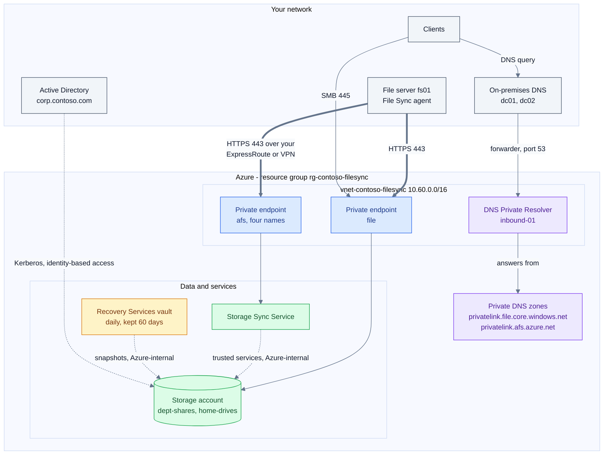

Key, by component: grey = your own network; blue = the Azure network and its two private endpoints; purple = DNS, the resolver and the two private zones; green = storage and File Sync; amber = backup. Everything in the Azure box is created by the kit. Thick arrows = File Sync agent traffic; dotted arrows = Azure-internal or identity links that never cross your ExpressRoute or VPN.

The names below are the defaults for `azure.namePrefix` `contoso`, `azure.location` `eastus` and `azure.uniqueSuffix` `01`. See [section 4](SCRIPT-REFERENCE.md#4-the-settings-file) to change them.

| Piece | Default name or address | What it is for | Made by |
| --- | --- | --- | --- |
| File server with the File Sync agent | your server, for example `fs01.corp.contoso.com`. Windows Server 2016, 2019, 2022 or 2025 | Keeps a local cache of each share and syncs it | [Option 11](#option-11-connect-your-on-premises-servers) |
| On-premises DNS | `dc01`, `dc02`. Forwarders for `file.core.windows.net` and `afs.azure.net`, 3-second timeout, forest-wide replication | Answers your clients and sends the two public zones to the resolver | Option 11 |
| Active Directory | `corp.contoso.com`, object in `OU=AzureFiles,DC=corp,DC=contoso,DC=com` | Holds the storage account's computer object, so users reach shares with Kerberos | Option 11 |
| Deployment identity | `sp-contoso-afs-deploy`. Contributor on the resource group only. Lives in Entra ID, outside the group | Runs phase 2 unattended and registers the file server | Phase 1 |
| Resource group | `rg-contoso-filesync` | Holds everything below | Phase 1 |
| Virtual network | `vnet-contoso-filesync`, `10.60.0.0/16` | Hosts the endpoints and the resolver | Phase 2 |
| Private endpoint subnet | `snet-privateendpoints`, `10.60.1.0/26` | Addresses for both private endpoints | Phase 2 |
| Storage private endpoint | `pe-stcontosofs01-file`, sub-resource `file`, one address (for example `10.60.1.4`) | The private address of the storage account | Phase 2 |
| Storage Sync private endpoint | `pe-sss-contoso-filesync-afs`, sub-resource `Afs` | Four private names: `<sss>management`, `<sss>syncp`, `<sss>syncs` and `<sss>monitoring` `.<region>.afs.azure.net` | Phase 2 |
| DNS Private Resolver | `dnspr-contoso-eastus`, inbound endpoint `inbound-01` with a dynamic address from `snet-dnsresolver-inbound` `10.60.2.0/28`. No outbound endpoint | The one address your DNS forwards to | Phase 2 |
| Private DNS zones | `privatelink.file.core.windows.net`, `privatelink.afs.azure.net`, each linked to the VNet as `link-vnet-contoso-filesync` | Hold the A records of both endpoints | Phase 2 |
| Storage account and shares | `stcontosofs01` (StorageV2, `Standard_ZRS`). Shares `dept-shares` 1024 GiB and `home-drives` 2048 GiB. Share soft delete 14 days | The authoritative copy of the data | Phase 2 |
| Storage Sync Service | `sss-contoso-filesync`. Sync groups `sg-contoso-dept-shares` and `sg-contoso-home-drives` | Coordinates sync between the server and the shares | Phase 2 (service), Option 11 (sync groups) |
| Recovery Services vault | `rsv-contoso-eastus`, `GeoRedundant` with cross-region restore. Policy `afs-daily-60d`: one snapshot a day at 02:00 UTC, kept 60 days | Protects both shares | Phase 2 |

**Which traffic can be private.** Three flows cross from your network to Azure, and each can run over ExpressRoute or VPN. Two flows never leave Azure. Management stays on the public endpoints.

| Flow | Path | Private? |
| --- | --- | --- |
| File Sync agent to the Storage Sync Service (sync control, metadata) | HTTPS 443 to the `afs` private endpoint | Can be private |
| File Sync agent to the storage account (file data, recalls) | HTTPS 443 to the `file` private endpoint | Can be private |
| Clients that mount a share directly | SMB 445 to the `file` private endpoint | Can be private |
| Your DNS servers to the resolver | UDP and TCP 53 to the inbound endpoint | Needs the same route |
| Storage Sync Service to the storage account (change enumeration, cloud endpoint work) | Trusted services, inside Microsoft's network | Azure-internal. It cannot be moved onto ExpressRoute, and it does not need to be |
| Azure Backup snapshots and restores | Inside Azure | Azure-internal. No private endpoint applies to Azure Files backup |
| Portal, CLI and PowerShell; sign-in; agent download and Microsoft Update | Public Azure endpoints | Stays public |

Read more: [codex/blueprint-azure-file-sync-private-path.md](../codex/blueprint-azure-file-sync-private-path.md) and decisions D-06 to D-10 in [advise/REFERENCE-DESIGN.md](../advise/REFERENCE-DESIGN.md).

#### Good to know

- The build creates both private endpoints but leaves the public paths open. The storage account keeps public network access and an open firewall, and the Storage Sync Service accepts all traffic (`incomingTrafficPolicy` `AllowAllTraffic`). Traffic takes the private path only once your DNS resolves the private addresses and a route exists. Close the public paths by hand after you have proved the private path. The lock-down step is not reachable from the inputs file (tracked in [#1](https://github.com/gusitde/azure-filesync-backup-assessment/issues/1)).
- Shared-key access stays on. Azure Backup needs it, and `onprem/Install-AfsServerEndpoint.ps1` refuses to run without it.
- The resolver's inbound address is dynamic. Read it after the build with `az dns-resolver inbound-endpoint show -g rg-contoso-filesync --dns-resolver-name dnspr-contoso-eastus -n inbound-01 --query 'ipConfigurations[0].privateIpAddress' -o tsv`. The codex DNS blueprint's gate rule expects a static address, and a kit-built estate fails that rule (tracked in [#3](https://github.com/gusitde/azure-filesync-backup-assessment/issues/3)). Microsoft reference: [DNS Private Resolver for hybrid DNS](https://learn.microsoft.com/azure/dns/private-resolver-hybrid-dns); the command is also documented in [codex/playbook-deploy-dns-private-resolver-and-forwarders.md](../codex/playbook-deploy-dns-private-resolver-and-forwarders.md).
- The build creates no outbound endpoint, so Azure VMs cannot resolve on-premises names through this resolver. Add an outbound endpoint and a forwarding ruleset if you need that direction. See [codex/blueprint-azure-dns-for-private-endpoints.md](../codex/blueprint-azure-dns-for-private-endpoints.md).
- The build creates no sync group. Option 11 creates one per share, named `sg-<prefix>-<share>`. The `sync group` line that the resolved configuration prints (`sg-contoso-shares`) is never created, and `overrides.syncGroupName` has no effect (tracked in [#3](https://github.com/gusitde/azure-filesync-backup-assessment/issues/3)).

*Code: `deploy/AfsConfig.ps1` (Resolve-AfsConfig), `deploy/Deploy-AfsEnvironment.ps1` (New-PrivateZone, New-Endpoint), `onprem/Install-AfsServerEndpoint.ps1`, `onprem/Set-AfsDnsForwarders.ps1`, `onprem/Join-AfsStorageAccountToAdDs.ps1`*

### Why on-premises DNS forwards the public zone

Your DNS servers get conditional forwarders for the **public** zones, `file.core.windows.net` and `afs.azure.net`, pointed at the resolver's inbound address. They do not get forwarders for the `privatelink` zones. A `privatelink` forwarder looks right, passes a "does the zone exist" check, and is never consulted. This sequence shows why.

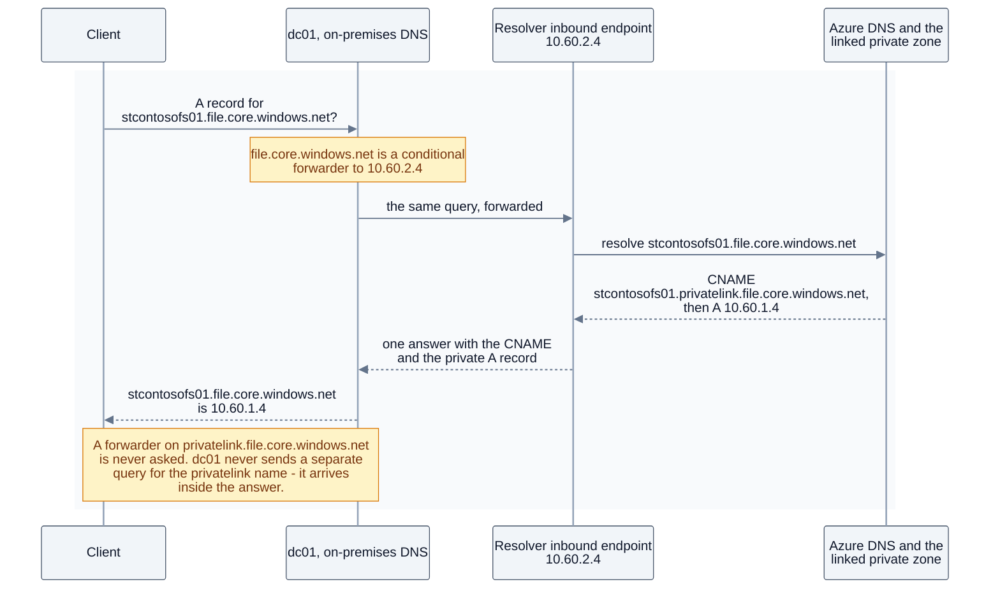

The address `10.60.2.4` is an example. The build gets a dynamic address from `10.60.2.0/28`.

**The client never asks for the privatelink name.** It asks for `stcontosofs01.file.core.windows.net`. Azure answers with a CNAME to `stcontosofs01.privatelink.file.core.windows.net`, then the address. A recursive resolver returns that whole chain in one answer. Without a forwarder on the public zone, dc01 sends the query to its usual upstream and gets the whole chain back with the **public** address. It never issues a separate query for the privatelink name, so a forwarder on that name never fires.

The exception is a resolver that does its own iterative resolution from root hints. It restarts resolution for the CNAME target and does consult its forwarders. Most on-premises resolvers forward to an upstream server instead, so do not rely on it.

The Storage Sync Service works the same way under `afs.azure.net`. Its private endpoint publishes four names, and the role token is part of the first label: `<sss>management.<region>.afs.azure.net`, `<sss>syncp.<region>.afs.azure.net`, `<sss>syncs.<region>.afs.azure.net` and `<sss>monitoring.<region>.afs.azure.net`.

**Understand the blast radius before you write the forwarder.**

- Once `file.core.windows.net` is forwarded, every on-premises query for **every** storage account under that suffix goes to the resolver, not only queries for yours.
- If the resolver cannot be reached, clients get SERVFAIL. `onprem/Set-AfsDnsForwarders.ps1` sets a 3-second forwarder timeout (`-ForwarderTimeout 3`) so the server's own fallback to recursion is still reachable. Never turn recursion off on these zones.
- A wrong answer is worse than no answer. A resolver that replies REFUSED, or NXDOMAIN because the private zone is not linked to its VNet, has that reply passed straight back to the client with no fallback. That is why the script refuses to write until the resolver returns a private address for `stcontosofs01.privatelink.file.core.windows.net`.
- `-ReplicationScope Forest` reaches domain controllers that run the DNS Server role, and nothing else. Name every resolver your clients use.

**Prefer the narrow zones.** Forwarding the whole `core.windows.net` also works, and Microsoft's Azure Files guidance shows it. But it captures blob, queue, table, dfs and web as well, and it breaks access to storage accounts in **other tenants** that use private endpoints, which may then return NXDOMAIN. The script forwards the two service zones by default. It accepts other zones through `-Zone` and refuses any `privatelink.*` zone.

Prove the resolver by hand before you write anything, then prove the result from a client:

```powershell
# from the machine that will run Set-AfsDnsForwarders.ps1: the resolver must return a PRIVATE address
Resolve-DnsName -Name stcontosofs01.privatelink.file.core.windows.net -Server 10.60.2.4 -Type A -DnsOnly -QuickTimeout

# afterwards, from a client that uses dc01/dc02 - not from the DNS server, and not with -Server
Clear-DnsClientCache
Resolve-DnsName stcontosofs01.file.core.windows.net          # a CNAME to the privatelink name, then 10.60.1.4
Test-NetConnection stcontosofs01.file.core.windows.net -CommonTCPPort SMB   # TcpTestSucceeded : True
```

Microsoft reference: [Azure Files DNS for private endpoints](https://learn.microsoft.com/en-us/azure/storage/files/storage-files-networking-dns) for `Resolve-DnsName` and `Test-NetConnection`. `Clear-DnsClientCache` and `Clear-DnsServerCache` are documented in the kit's [codex/playbook-point-on-premises-dns-at-the-private-resolver.md](../codex/playbook-point-on-premises-dns-at-the-private-resolver.md).

Read more: [codex/blueprint-azure-dns-for-private-endpoints.md](../codex/blueprint-azure-dns-for-private-endpoints.md), [codex/playbook-point-on-premises-dns-at-the-private-resolver.md](../codex/playbook-point-on-premises-dns-at-the-private-resolver.md) and D-10 in [advise/REFERENCE-DESIGN.md](../advise/REFERENCE-DESIGN.md).

#### Good to know

- The script's safety check probes one name, the Files name, directly against the resolver from the machine running the script. It does not probe from each DNS server, does not probe an `afs.azure.net` name, and accepts only RFC1918 addresses. Test the four Storage Sync names from a client yourself.
- The script changes only Windows DNS servers. For Infoblox or BIND it prints the steps. On Infoblox, leave **Use Forwarders Only** unticked for these two zones. If the resolver fails, the fallback returns the public address, which is how things behaved before the change.
- Clear the DNS server cache after you add a forwarder and again after you remove one. The script does it for you (`Clear-DnsServerCache -Force`).
- Some codex diagrams still draw a forwarder on the `privatelink` zone. The text, the script and this guide are correct (tracked in [#2](https://github.com/gusitde/azure-filesync-backup-assessment/issues/2)).

*Code: `onprem/Set-AfsDnsForwarders.ps1`, `onprem/AfsDnsForwardersRemove.ps1`, `deploy/AfsConfig.ps1` (zoneFile, zoneAfs)*

### Three things to protect, and one never to back up

People often treat backup as one thing. It is four decisions. The kit protects two of them, you protect the third, and the fourth must never be backed up.

| What | Protect it with | Who sets it up | Traffic |
| --- | --- | --- | --- |
| The data in each Azure file share | Azure Backup for Azure Files, policy `afs-daily-60d` | The build, steps 12 to 15 | Azure-internal |
| The share itself, against deletion | Share soft delete, 14 days | The build, step 4 | None |
| A server migrated to an Azure VM | Azure Backup for Azure VMs, Enhanced policy | You. The kit does not build VM backup | Azure-internal |
| The File Sync server endpoint | **Nothing.** It is a cache | Nobody, by design | None |

**The file shares.** The build creates vault `rsv-contoso-eastus`, sets `GeoRedundant` storage and cross-region restore, and creates policy `afs-daily-60d`. That policy takes one snapshot a day at 02:00 UTC and keeps it 60 days. The build then protects `dept-shares` and `home-drives`. The first protected item registers the storage account with the vault, and that freezes the vault's redundancy. That is why the build sets redundancy first. Azure Backup also places a lock on the storage account and leases the snapshots, so a protected share cannot be deleted with one click. Change the retention with `overrides.backupDailyRetentionDays`. The policy name follows it, for example `afs-daily-90d`.

**The share itself.** Share soft delete keeps a deleted share, and its snapshots, for 14 days. The build turns it on before any data exists. It is the only protection against someone deleting the share together with its snapshots. To recover, list the share with `az storage share-rm list --storage-account stcontosofs01 -g rg-contoso-filesync --include-deleted`, then undelete it in the portal or with `az storage share-rm restore`. Microsoft reference: [Prevent accidental deletion of Azure file shares](https://learn.microsoft.com/azure/storage/files/storage-files-prevent-file-share-deletion); both commands are also in [codex/runbook-restore-file-share-and-share-soft-delete.md](../codex/runbook-restore-file-share-and-share-soft-delete.md).

**Migrated VMs.** Protect a migrated server with Azure VM backup under the **Enhanced** policy. Azure Migrate lands VMs as Trusted Launch by default where the guest supports it, Trusted Launch needs Enhanced, and a VM on Enhanced cannot move back to Standard. Make "protected, and first backup succeeded" an exit gate for every migration wave. Read [codex/blueprint-azure-vm-backup-for-migrated-servers.md](../codex/blueprint-azure-vm-backup-for-migrated-servers.md) and [codex/playbook-protect-a-migration-wave-with-azure-backup.md](../codex/playbook-protect-a-migration-wave-with-azure-backup.md).

**Never the File Sync cache.** A server endpoint's tiered files are reparse points. A file-level backup agent that walks the volume reads them, and reading a tiered file recalls it. The result is a recall of the whole dataset: the volume fills, cloud tiering fights the agent, egress is billed, and the server drops into low-disk-space mode. Back up the share, not the cache. If you back up a file server VM that has File Sync attached, exclude the server endpoint volume, or rebuild the server from the playbook instead of restoring it (D-14 in [advise/REFERENCE-DESIGN.md](../advise/REFERENCE-DESIGN.md)).

**Restores and tiers.** Item-level restore (single files or folders, up to 99 items per job) works only from a **snapshot**-tier recovery point. The vault-standard tier restores whole shares, to another location only, and the target needs at least 20 % more free space than the data. The kit's policy is snapshot-only, so every recovery point it makes supports item-level restore. After a restore, Azure Backup tells the Storage Sync Service which paths changed, so servers receive the restored versions without waiting for the 24-hour enumeration.

**Prove a restore before you call it protected.** A backup is not protection until a file has come back to the server. [How to tell it works](#how-to-tell-it-works) is the operator checklist for every layer. This loop is the restore test that checklist asks for. Run it once per estate:

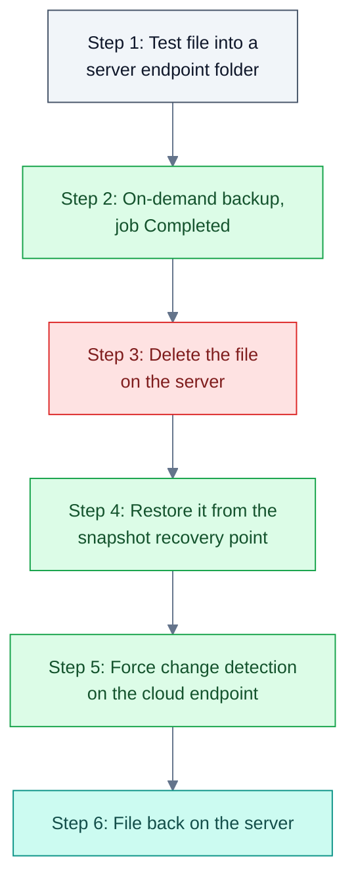

1. On the file server, put a file such as `afs-restore-proof.txt` into `D:\Shares\dept-shares`. Confirm it appears in the `dept-shares` Azure file share.
2. Take an on-demand backup and wait until the job shows `Completed`:

   ```powershell
   $v = Get-AzRecoveryServicesVault -Name rsv-contoso-eastus -ResourceGroupName rg-contoso-filesync
   $c = Get-AzRecoveryServicesBackupContainer -ContainerType AzureStorage -FriendlyName stcontosofs01 -VaultId $v.ID
   $i = Get-AzRecoveryServicesBackupItem -Container $c -WorkloadType AzureFiles -FriendlyName dept-shares -VaultId $v.ID
   Backup-AzRecoveryServicesBackupItem -Item $i -VaultId $v.ID
   Get-AzRecoveryServicesBackupJob -VaultId $v.ID -From (Get-Date).AddHours(-2).ToUniversalTime() | Format-Table Operation, Status, WorkloadName
   ```

3. Delete the file on the server, and let the delete sync up to the share.
4. Restore the file from the newest recovery point. This example restores to a folder named `restore-test`. Leave out the three `-Target*` parameters to restore to the original place:

   ```powershell
   $rp = Get-AzRecoveryServicesBackupRecoveryPoint -Item $i -VaultId $v.ID | Select-Object -First 1
   Restore-AzRecoveryServicesBackupItem -RecoveryPoint $rp -VaultId $v.ID -VaultLocation $v.Location `
       -SourceFilePath 'afs-restore-proof.txt' -SourceFileType File -ResolveConflict Overwrite `
       -TargetStorageAccountName stcontosofs01 -TargetFileShareName dept-shares -TargetFolder 'restore-test'
   ```

5. Force change detection, so the file does not wait for the 24-hour enumeration. In the kit, the cloud endpoint has the same name as the share:

   ```powershell
   Invoke-AzStorageSyncChangeDetection -ResourceGroupName rg-contoso-filesync -StorageSyncServiceName sss-contoso-filesync `
       -SyncGroupName sg-contoso-dept-shares -CloudEndpointName dept-shares -DirectoryPath 'restore-test' -Recursive
   ```

6. On the file server, confirm that `D:\Shares\dept-shares\restore-test\afs-restore-proof.txt` exists. This is the step that proves the whole loop.

Microsoft reference: [Back up Azure file shares](https://learn.microsoft.com/azure/backup/backup-azure-files) and [Invoke-AzStorageSyncChangeDetection](https://learn.microsoft.com/powershell/module/az.storagesync/invoke-azstoragesyncchangedetection). The backup, job and restore cmdlets above are documented step by step in [codex/playbook-enable-azure-backup-for-file-shares.md](../codex/playbook-enable-azure-backup-for-file-shares.md).

Read more: [codex/blueprint-azure-files-backup-protection.md](../codex/blueprint-azure-files-backup-protection.md), [codex/runbook-restore-file-share-and-share-soft-delete.md](../codex/runbook-restore-file-share-and-share-soft-delete.md) and [PLAYBOOK-azure-backup-for-azure-files.md](PLAYBOOK-azure-backup-for-azure-files.md).

#### Good to know

- The kit's policy is snapshot-only, and the assessor's BKP-04 rule flags snapshot-only policies. Assess a kit-built estate and you will see BKP-04. Add a policy with a vault-standard tier if you need an offsite, immutable copy, as the backup blueprint recommends.
- The build does not turn on vault immutability, multi-user authorization or alerts for failed jobs. Soft delete keeps Azure's default. The backup blueprint and rules BKP-06 to BKP-11 describe the hardened posture.
- Scoped change detection handles at most 10,000 items. Leave out `-DirectoryPath` and `-Recursive` to detect changes across the whole share.
- Items with names longer than 2 KB, or with trailing dots, cannot be restored from snapshots.
- For ransomware on a server endpoint, stop the `FileSyncSvc` service on that server or take it off the network. Do not delete the server endpoint to contain it. Removing a server endpoint is destructive for tiered files. Follow class 3 of the restore runbook.

*Code: `deploy/Deploy-AfsEnvironment.ps1` (backup steps 12 to 15, share soft delete step 4), `deploy/AfsConfig.ps1` (backup defaults), `Assess-AzFileSyncExport.ps1` (BKP rules)*

### Decisions you cannot undo

A few choices lock in when you make them. Make them on purpose, before the first build or the first migration wave, and record who made each one. [advise/SESSION-GUIDE.md](../advise/SESSION-GUIDE.md) closes decisions D-01 to D-18 in one working session. It names an owner for the four that cannot be reversed (D-03, D-07, D-13, D-16) and for each decision changed from its default. Rows here that are not D-decisions, such as the name prefix and the server endpoint path, need an owner you assign yourself.

| Decision | Why it is one-way | Where it is set | Read more |
| --- | --- | --- | --- |
| Vault storage redundancy and cross-region restore | Both freeze once the vault protects its first item. Changing them later means a new vault. | `overrides.backupStorageRedundancy` (default `GeoRedundant`) and `overrides.enableCrossRegionRestore` (default `true`). Build step 13 sets them before step 15 protects anything. On a vault that already protects items, it prints `vault already protects N item(s) - redundancy can no longer be changed` | D-16 in [REFERENCE-DESIGN](../advise/REFERENCE-DESIGN.md); [blueprint-azure-files-backup-protection](../codex/blueprint-azure-files-backup-protection.md) |
| Vault soft delete set to always-on | Always-on cannot be switched off. A vault that holds soft-deleted backup data cannot be deleted until the retention runs out (14 days by default). | Not set by the kit. The portal (vault Properties, Security settings) or a tenant policy sets it | [Option 7](#option-7-remove-an-environment-i-built); [playbook-enable-azure-backup-for-file-shares](../codex/playbook-enable-azure-backup-for-file-shares.md) |
| Storage account redundancy | Chosen when the account is created. Zone-redundant cannot go back to locally redundant, and any later change is a data migration. | `overrides.storageSku` (default `Standard_ZRS`) | D-07 in [REFERENCE-DESIGN](../advise/REFERENCE-DESIGN.md) |
| Enhanced VM backup policy | A VM protected with Enhanced cannot move back to Standard. Trusted Launch VMs need Enhanced, and Azure Migrate lands Trusted Launch by default. | Your VM backup policy, outside the kit | D-03 and D-13 in [REFERENCE-DESIGN](../advise/REFERENCE-DESIGN.md); [blueprint-azure-vm-backup-for-migrated-servers](../codex/blueprint-azure-vm-backup-for-migrated-servers.md) |
| Azure Migrate region and cache storage account | The target region and the cache storage account lock once replication starts. A project's connectivity method cannot change later, and a network interface cannot move between VNets, so choose the target resource group, network and subnet at replication time. | The Azure Migrate project and its replication settings, outside the kit | D-02 in [REFERENCE-DESIGN](../advise/REFERENCE-DESIGN.md); [blueprint-azure-migrate-private-link-landing](../codex/blueprint-azure-migrate-private-link-landing.md) |
| Name prefix and storage account name | Azure has no rename for a storage account or a resource group. Every resource name derives from the prefix, so a new prefix means a new estate. | `azure.namePrefix` (2 to 8 lowercase letters or digits), `azure.uniqueSuffix` (default `01`), `overrides.storageAccountName`, `overrides.resourceGroup` | [Section 4](SCRIPT-REFERENCE.md#4-the-settings-file) |
| Server endpoint path | A server endpoint's path cannot be edited. Moving it means removing the endpoint, which is destructive for tiered files. A new endpoint on the same path fails with `0x80c80077` until orphaned tiered-file cleanup finishes (event 6662 started, 6661 complete). | `-SharePath` on `onprem/Install-AfsServerEndpoint.ps1`, or the folder prompt in [Option 11](#option-11-connect-your-on-premises-servers). `onPremises.serverPaths.<share>` in the settings file is only a remembered default, and reaches the scripts only after phase 1 rewrites the context | [runbook-restore-file-share-and-share-soft-delete](../codex/runbook-restore-file-share-and-share-soft-delete.md) |
| Forwarding a public DNS zone | You can remove it, but not restore what was there before. `-Remove` deletes every forwarder with that zone name, whatever it points at. Masters replaced with `-UpdateExisting` are not recorded. While the forwarder is in place, the resolver is a dependency of every name under the zone. | `onprem/Set-AfsDnsForwarders.ps1` (`-Zone`, `-UpdateExisting`, `-Remove`), or Option 11 | [Why on-premises DNS forwards the public zone](#why-on-premises-dns-forwards-the-public-zone); D-10 in [REFERENCE-DESIGN](../advise/REFERENCE-DESIGN.md) |

The reference design also marks two migration decisions that sit outside the kit. The file-server disposition (D-04) is expensive to reverse. Copy fidelity (D-12) cannot be fixed once the source server is decommissioned.

#### Good to know

- The as-built document labels storage redundancy and vault redundancy "(one-way)" in its Storage and Backup tabs, so a reviewer can see both values on one page.
- The reference design's summary table names four one-way decisions (D-03, D-07, D-13, D-16). Its headings also mark D-04 and D-14 as one-way. Read the headings for the complete picture.
- `onprem/Set-AfsDnsForwarders.ps1` says its reverse path puts resolution back exactly as it was. It cannot put back a forwarder that existed before, because it never records the previous masters (tracked in [#3](https://github.com/gusitde/azure-filesync-backup-assessment/issues/3)).

*Code: `deploy/AfsConfig.ps1` (Resolve-AfsConfig), `deploy/AfsSettings.ps1`, `deploy/Deploy-AfsEnvironment.ps1` (vault redundancy step), `onprem/AfsDnsForwardersRemove.ps1`*

## 9. Maintaining the kit

This section is for anyone who changes the kit. It covers how to prove the kit still works, how to record a change, how to export the codex, how to report a problem, and what must never reach the repository.

### Run the tests

`tests/run-tests.ps1` runs 195 checks against a synthetic estate, without signing in to Azure. They cover the assessor, the reports, the requirements check and the wiring of the wizard. Section 4c is not fully offline: it resolves `.invalid` names through your DNS and, unless `%TEMP%\AzFilesHybrid` is already extracted, sends an HTTPS HEAD request to github.com. On a machine with no internet access that check fails.

#### Before you start

- Windows PowerShell 5.1 or later.
- Python 3 on `PATH` as `python`, to generate the fixture.
- HTTPS access to github.com, unless `%TEMP%\AzFilesHybrid` is already extracted.
- Run from the root of the repository.

```powershell
python fixtures\make-fixture.py     # regenerate the synthetic export first - see Good to know
.\tests\run-tests.ps1
$LASTEXITCODE                        # after ALL GREEN: 0; after "n check(s) FAILED": n
                                     # if the script stopped on an error, this still holds the previous command's code (often 0)
```

#### What it checks

The sections print in the order below, which is not numeric.

| Printed section | What it proves | Checks |
| --- | --- | --- |
| `1. rule catalog` | `-ListRules` lists at least 80 rules, and every id is unique | 2 |
| `2. default assessment on the fixture` | 65 rules fire and 29 stay silent. NET-01 is Info. BKP-01 fires three times, including the File Sync share. DATA-03 is High at 96 %. AFS-05 splits High and Medium. OPS-03 fires twice. `assessment.md` has a High section | 101 |
| `3. assessment with -PrivateTrafficRequired` | NET-05, 06, 09, 10 and 11 fire. NET-07 and 08 stay silent. NET-01 becomes High | 8 |
| `4. zip input` | A zipped export gives the same High and Medium counts as the folder | 1 |
| `5. how-to guide` | `docs/HOW-TO-USE.html` ships and the wizard offers it. It has 10 tabs, each with a section. No external asset is loaded. Four diagrams, balanced, with unique marker ids | 11 |
| `5b. splatting` | No splatted variable in `start.ps1` is an array of switch names, and nothing splats `$args` | 2 |
| `4b. customer name is not baked in` | A named customer's report carries that name and no example name. No `{customer}` token survives. The rule catalog carries no customer name | 5 |
| `4c. requirements` | A probe that throws or returns nothing is `unknown`. Local checks describe themselves. A missing blocker stops the run, and an unknown one is counted. The DNS and AD checks neither throw nor claim a proven blocker when given no target, or a `.invalid` one | 34 |
| `5a. subject tabs` | The seven subject tabs render in order and none throws. Diagrams are balanced and no CSS variable is undefined. Each tab shows fixture names. A near-empty export still renders every tab | 18 |
| `5c. assessment results` | The wizard reads the report's tabs back one by one and finds `findings`. Its subject list equals the renderer's | 9 |
| `5d. menu wiring` | The main menu has one switch branch per option, numbered 0 to n-1 | 3 |
| `6. wizard` | `start.ps1` parses clean | 1 |

#### When it worked

Every check prints `  PASS  <what>` or `  FAIL  <what>`. The run ends with:

```
ALL GREEN (195 checks)
```

#### If it goes wrong

| You see | It means | Do this |
| --- | --- | --- |
| `fixture missing - run: python fixtures/make-fixture.py` | `fixtures\sample-export\manifest.json` does not exist | Run `python fixtures\make-fixture.py`, then the tests |
| `9 check(s) FAILED`, with `FAIL  fires SRV-02` to `SRV-11` and `FAIL  OPS-03 for the two servers without a bundle (FS02, FS03)` | The fixture's server bundle is missing. A fresh clone does not have it | Run `python fixtures\make-fixture.py`, then the tests again |
| `FAIL  fires <id>` or `FAIL  silent <id>` | A rule no longer behaves as expected against the fixture | Fix the rule. If the change was intended, change the fixture and the `$expected` / `$notExpected` lists in section 2 together |
| `FAIL  the wizard knows exactly the subject tabs the renderer produces` | A report tab was added to `Render-AfsAssessmentHtml.ps1` but not to `$SUBJECT_TABS` in `start.ps1`, or the reverse | Make the two lists match |
| `FAIL  every menu option has a switch branch (...)` | A menu option was added or removed without its branch | Fix the main-menu `switch` in `start.ps1` |
| `FAIL  start.ps1 parses clean - line <n>: <message>` | A syntax error | Fix the line named |

#### Good to know

- A fresh clone fails 9 checks until you run `make-fixture.py`. The `.gitignore` pattern `*-afs-server-*/` also matches the fixture's server bundle, `fixtures/sample-export/servers/FS01/FS01-afs-server-20260903-070000/`, so the bundle is never committed (tracked in [#3](https://github.com/gusitde/azure-filesync-backup-assessment/issues/3)). Generate the fixture first, as [CONTRIBUTING.md](../CONTRIBUTING.md) says.
- Output goes to `%TEMP%\afs-tests-<yyyyMMdd-HHmmss>` and is deleted at the end. The fixture folder is not written to.
- Each of section 4c's two remote-area probes may take up to 3 minutes against its unreachable target. A full run on a workstation takes about half a minute.
- The suite does not check the ASCII rule or render any Mermaid. See [Contribute a change, or report one](#contribute-a-change-or-report-one).

*Code: `tests/run-tests.ps1`, `fixtures/make-fixture.py`*

### The synthetic fixture

`fixtures/make-fixture.py` writes `fixtures/sample-export`: a synthetic `Export-AzFileSyncEnvironment.ps1` output for a fictional subscription, `Contoso-Prod`, in `westus2`. Every deliberate defect in it maps to an assessment rule. Section 2 of the tests asserts which rules fire and which stay silent. The script deletes the folder and rewrites it on every run.

| Part | What it contains | Deliberate problems |
| --- | --- | --- |
| Storage Sync Service `sss-contoso-files` | 3 sync groups, 3 cloud endpoints, 4 server endpoints | An endpoint in error with 12 files that persistently fail to sync, tiering errors and low-disk mode. A 5 % free-space policy. Two nested endpoints on `C:`. A cloud endpoint with no completed enumeration. Accepts all traffic |
| Registered servers | FS01 (Windows Server 2022), FS02 (build 6.3.9600), FS03 (cluster node) | FS01's agent is close to expiry. FS02's agent has expired and its heartbeat is stale |
| Storage accounts | `stcontosofiles01` (weak) and `stcontosobackup02` (hardened) | Weak account: LRS, TLS 1.0, public blob access, firewall open, no share soft delete, keys from 2024, `home-drives` at 96 % of quota. A soft-deleted share with 6 days left |
| Backup | Vault `rsv-contoso-westus2`, a snapshot-only daily policy kept 7 days, three protected items, a Data Protection vault | Locally redundant, no cross-region restore, soft delete not always-on, no immutability, no multi-user authorization, no alerts. 3 of 5 shares unprotected, one with protection stopped, one failed backup job |
| Network | One VNet | No private endpoints and no private DNS zones |
| Server bundle | A diagnostic bundle for FS01 | A file-level backup agent installed on a File Sync server, 8 % free space on `D:`, self-service restore off on `D:`, a certificate warning in the diagnostics |

To add or change a rule, add a defect to the fixture that triggers it. Then add the rule id to `$expected`, or to `$notExpected`, in section 2 of `tests/run-tests.ps1`. Re-run `make-fixture.py` whenever the export layout changes.

#### Good to know

- The fixture is entirely synthetic. Never commit a real export, or anything derived from one. Exports contain customer resource names and identifiers.
- The committed copy of the fixture lacks the FS01 server bundle. See [Run the tests](#run-the-tests).
- The tests look for `stcontosofiles01`, `sss-contoso-files`, `rsv-contoso-westus2` and `FS01` in the report tabs. Rename them in the fixture and you must change the tests too.

*Code: `fixtures/make-fixture.py`, `tests/run-tests.ps1` (section 2)*

### Import the codex

`codex/import-to-luca.mjs` exports the 25 codex entries to another codex checkout and validates them with that checkout's validator. Every mode needs a target checkout that contains `scripts\codex\validate-manifest.mjs`. The dry run needs it too, because it borrows that validator.

```powershell
# validate the entries in place - copies nothing
node codex\import-to-luca.mjs --luca-root E:\src\codex-target --dry-run

# copy the entries and the root diagrams into the target, merge ref-dispositions.json, validate
node codex\import-to-luca.mjs --luca-root E:\src\codex-target

# the same, then the seed SQL. Stdout also carries the 'copied', 'merged' and validator lines,
# so remove them from codex-seed.sql before you apply it. The script never connects to a database
node codex\import-to-luca.mjs --luca-root E:\src\codex-target --seed > codex-seed.sql
```

| Mode | Copies | Validates | Console |
| --- | --- | --- | --- |
| `--dry-run` | Nothing | The entries, in place | `dry run: validating 25 entries in place with <target>`, then the validator's output |
| Plain run | The 25 entries and 7 root diagrams into the target's codex folder. It also merges `codex/ref-dispositions.json` into `<target>\scripts\codex\ref-dispositions.json`, adding missing keys only | The copied entries. It stops at the first error | `copied 32 files into <folder>`, `merged 23 disposition(s) into scripts\codex\ref-dispositions.json`, `done - entries copied and validated; run with --seed to emit the seed SQL` |
| `--seed` | As the plain run | As the plain run | The `copied` and `merged` lines and the validator's output, then the seed SQL from the target's `scripts\codex\seed-codex.mjs`, all on stdout |

#### When it worked

The validator reports no errors and the exit code is 0. The last recorded dry run passed all 25 entries with 0 errors.

#### If it goes wrong

| You see | It means | Do this |
| --- | --- | --- |
| A `usage:` line, exit code 2 | The path has no `scripts\codex\validate-manifest.mjs` | Point `--luca-root` at the root of the target checkout |
| `validation failed - fix the entries before seeding` | An entry does not conform. The validator's message above names it | Fix the entry, then run `--dry-run` until it is clean |

#### Good to know

- Only the 7 diagrams at the root of `codex/diagrams/` are copied. The 90 diagrams in the eight principle folders are not, because the script does not read sub-folders (tracked in [#3](https://github.com/gusitde/azure-filesync-backup-assessment/issues/3)).
- The plain run writes into the target checkout. [codex/README.md](../codex/README.md) calls it a "dry run for the DB", which means only that no database is touched. Use `--dry-run` if you want nothing to change.
- `--dry-run` wins over `--seed`: the dry run exits before the seed step.
- Re-running is safe. It overwrites the copied files and adds only disposition keys that are missing.
- [codex/README.md](../codex/README.md) says there are 23 entries, but there are 25. Its index leaves out `playbook-hand-the-kit-to-another-engineer` and `runbook-file-sync-agent-install-and-registration-failures`.

*Code: `codex/import-to-luca.mjs`, `codex/ref-dispositions.json`*

### Stamp a version

Every change to the kit gets a version stamp and a ledger row, the way a commit gets a message. The stamp format is `V YYYY.MM.DD.NNN`: the date, then the number of the change on that day. It starts at `001` and resets each day. The stamp lives in one place, `$script:AfsProductVersion` in `deploy\AfsLog.ps1`, and `Get-AfsProductInfo` reads it from there.

1. Bump the stamp in `deploy\AfsLog.ps1`. On the same day, increment `NNN`. On a new day, use the new date and `001`. For example, the current stamp is `V 2026.09.10.002`, so the next change on the same day becomes:

   ```powershell
   $script:AfsProductVersion = 'V 2026.09.10.003'
   ```

2. Add a row at the **top** of the Change Log in [VERSION-CONTROL.md](VERSION-CONTROL.md): `Version | Date | Type | Component | Description | Author`. Type is `feat`, `fix`, `docs`, `test` or `chore`. The Description says what changed and why, for a reader who was not there.
3. Validate before you ship:
   - Parse-check every file you touched.
   - Run `tests\run-tests.ps1` until it is green.
   - Run the proof that fits the change: a `-WhatIf` dry run for deploy, teardown or on-premises changes; a fixture assessment for assessor rules; `codex\import-to-luca.mjs --dry-run` for codex changes.

```powershell
# parse-check one file; an empty $err means it parses clean
$err = $null
[void][System.Management.Automation.Language.Parser]::ParseFile((Resolve-Path .\deploy\Deploy-AfsEnvironment.ps1), [ref]$null, [ref]$err)
$err
```

The stamp shows in two places. It appears in the wizard banner, after the product name, and in the first entry of every run log: `log started: run=<run id> level=<level> version=<stamp>`.

**Releases.** A release is a zip handed to someone outside the repository. [VERSION-CONTROL.md](VERSION-CONTROL.md) lists six steps before you cut one:

1. The Change Log is current and the stamp is bumped.
2. The tests are green.
3. `import-to-luca.mjs --dry-run` reports 0 errors.
4. A build and a teardown have each been dry-run since the last change to either.
5. Generated folders are left out.
6. The release is recorded in its Releases table, which is empty so far.

#### Good to know

- [VERSION-CONTROL.md](VERSION-CONTROL.md) says the as-built documents carry the stamp. They do not. Only the banner and the run logs do (tracked in [#3](https://github.com/gusitde/azure-filesync-backup-assessment/issues/3)).
- Change Log rows from before `V 2026.09.04.001` carry `-` in the Version column. They are the git history from before the stamp existed.

*Code: `deploy/AfsLog.ps1` (`$script:AfsProductVersion`, Get-AfsProductInfo), `start.ps1` (banner)*

### Contribute a change, or report one

You do not need write access. Report problems through the two issue forms, or fork the repository and open a pull request.

| Form | Use it when | Required fields |
| --- | --- | --- |
| [Correction](https://github.com/gusitde/azure-filesync-backup-assessment/issues/new?template=correction.yml) | A command, parameter, limit, zone name or stated constraint does not match how Azure behaves | Which document; What it currently says; What is wrong with it. Optional: Evidence (a Microsoft Learn link), What it should say |
| [Gap](https://github.com/gusitde/azure-filesync-backup-assessment/issues/new?template=gap.yml) | A scenario, failure or decision the library does not cover | What kind of gap (blueprint, playbook, runbook, decision guidance, or not sure); The situation. Optional: Where you looked, Anything unusual about your environment |

Issue titles start with `[correction] ` or `[gap] ` and get a matching label. Blank issues are allowed. Questions of the form "how would this work in our case" go to the repository's GitHub Discussions, or to a blank issue if Discussions are off.

**Pull requests follow three house rules:**

1. **ASCII only.** No em dashes, smart quotes or arrow glyphs. The files are read by tooling that assumes ASCII.
2. **Every command must be verifiable.** When you add a command, say where its behaviour is documented.
3. **Diagrams must render.** Mermaid edge labels use the pipe form, `A -->|label| B`. Quote any label that contains a colon or parentheses. Check each diagram before you submit it:

   ```powershell
   curl.exe -sS -o out.svg -w "%{http_code}" -X POST -H "Content-Type: text/plain" --data-binary "@codex/diagrams/<principle>/<file>.mmd" https://kroki.io/mermaid/svg
   ```

Put each addition where it belongs:

| Kind | Answers | Goes in |
| --- | --- | --- |
| Blueprint | What is the target state, and which decisions are hard to reverse? | `codex/blueprint-*.md` |
| Playbook | How do I build it, step by step? Every step needs a `run` and a `verify` | `codex/playbook-*.md` |
| Runbook | It has already broken. What do I do? | `codex/runbook-*.md` |
| Diagram | A view a paragraph cannot carry | `codex/diagrams/<principle>/` |
| Reference | An authoritative source with something specific to take from it | `docs/ARCHITECTURE-REFERENCES.md` |

#### Good to know

- [CONTRIBUTING.md](../CONTRIBUTING.md) says the three rules are enforced. Nothing checks them automatically today. There is no CI workflow, and the test suite has no ASCII or render check. Check your own changes before you open a pull request:

  ```powershell
  # lists every line that holds a non-ASCII character
  Select-String -Path .\docs\*.md, .\codex\*.md, .\advise\*.md -Pattern '[^\x00-\x7F]' | Select-Object Path, LineNumber
  ```

- `.gitattributes` checks `*.ps1` out with CRLF line endings and every other text file with LF (git stores all of them with LF), and marks `*.png` and `*.zip` as binary. Keep your editor from changing them.

*Code: `CONTRIBUTING.md`, `.github/ISSUE_TEMPLATE/correction.yml`, `.github/ISSUE_TEMPLATE/gap.yml`, `.github/ISSUE_TEMPLATE/config.yml`, `.gitattributes`*

### What is never committed

The kit writes real names, identifiers and one secret into your working folder. `.gitignore` keeps them out of the repository:

| Pattern | What it holds |
| --- | --- |
| `afs-export-*/`, `*.zip` | Exports from `Export-AzFileSyncEnvironment.ps1`, with real resource names and IDs. `*.zip` matches any zip, anywhere |
| `*-afs-server-*/` | Server diagnostic bundles from `Get-AfsServerDiagnostics.ps1` |
| `deploy/deployment-identity.json` | **The phase 1 client secret**: `appId`, `tenantId` and `password`. Only this path is ignored: phase 1 run by hand writes `deployment-identity.json` and `deployment-context.json` into your current directory, so from the kit root both land outside `.gitignore`. Always `cd deploy` first, and check that neither file shows in `git status --short` anywhere in the tree |
| `deploy/inputs.json` | Your answers: account names, domain and OU. The annotated `deploy/inputs.sample.jsonc` is committed |
| `deploy/parameters.json`, `deploy/parameters.*.jsonc` | Older parameter files |
| `logs/`, `deploy/deployment-context.json` | Run logs and telemetry. The context file names your subscription, tenant and deployment identity |
| `assessment-latest/`, `as-built/` | Reports that carry real resource names |
| `.pwsh7/`, `.azgovviz/`, `governance/` | The portable PowerShell 7 and AzGovViz used by the governance assessment, and its output |
| `fixtures/**/assessment.md`, `assessment.html`, `findings.json` | Reports from assessing the fixture in place, so the fixture stays clean |

**Handle the secret file on purpose.** Phase 1 prints `that file holds a secret. It is gitignored. Move it into your secret store.` Two things still read it from beside `deploy/deployment-context.json`: phase 2, when no signed-in session can read the resource group, and server registration in [Option 11](#option-11-connect-your-on-premises-servers). Keep it there until both are done, then move it into your secret store. Each re-run of phase 1 without `-Federate` issues a new secret and overwrites the file.

Check before you commit:

```powershell
git status --short                                     # nothing from the table above should appear
git check-ignore -v deploy\deployment-identity.json    # prints the .gitignore line that covers it
```

#### Good to know

- `.gitignore` protects the repository, not a zip. A zip of your working folder includes every ignored file on disk, the secret among them. Build a release from a clean clone, or with `git archive`. The release checklist in [VERSION-CONTROL.md](VERSION-CONTROL.md) does not mention `deploy\deployment-identity.json` or the export folders, so leave them out yourself.
- The `*-afs-server-*/` pattern also catches the fixture's own server bundle. See [Run the tests](#run-the-tests).
- `.gitignore` re-includes `deploy/parameters.sample.jsonc`, which does not exist. The committed sample is `deploy/inputs.sample.jsonc`.

*Code: `.gitignore`, `deploy/Phase1-New-DeploymentIdentity.ps1` (writes the secret file), `onprem/AfsOnPrem.ps1` (Get-AfsDeploymentSecret)*
